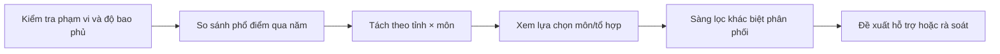
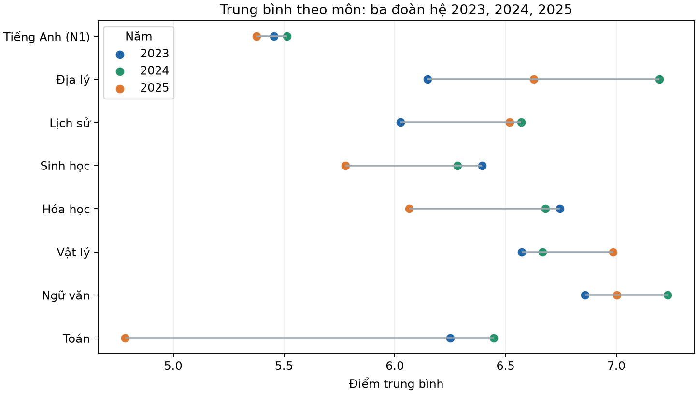
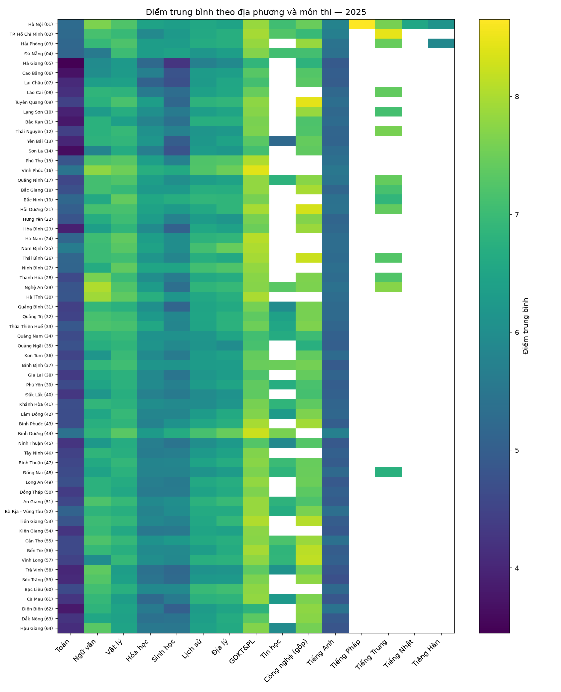
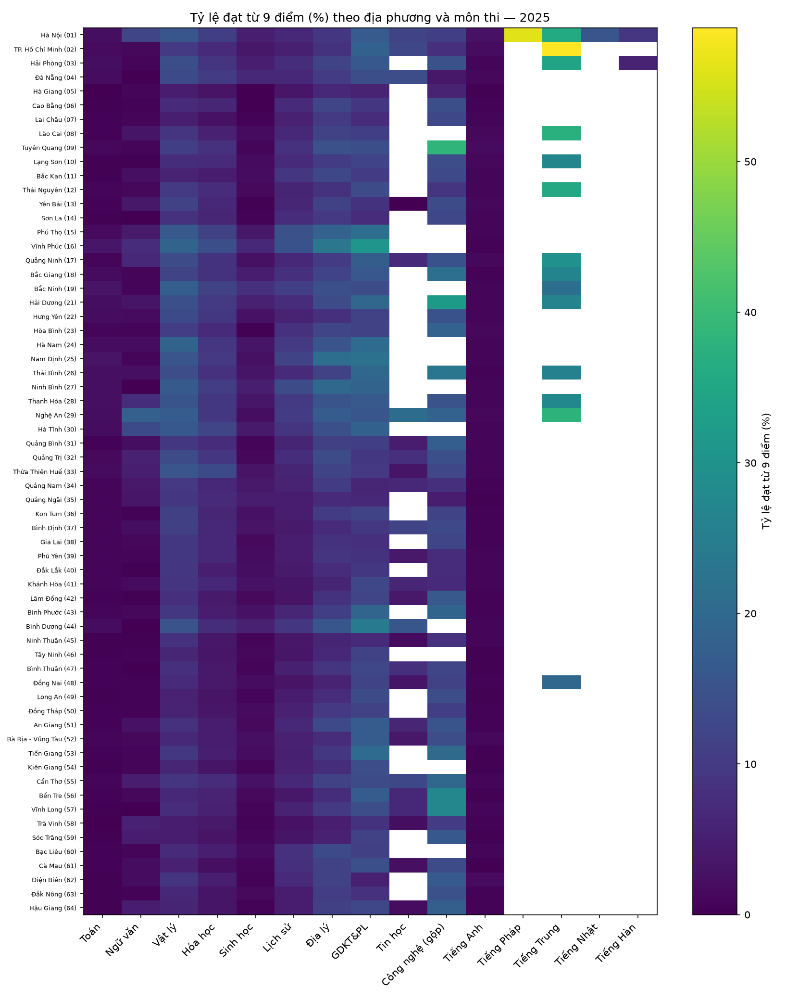
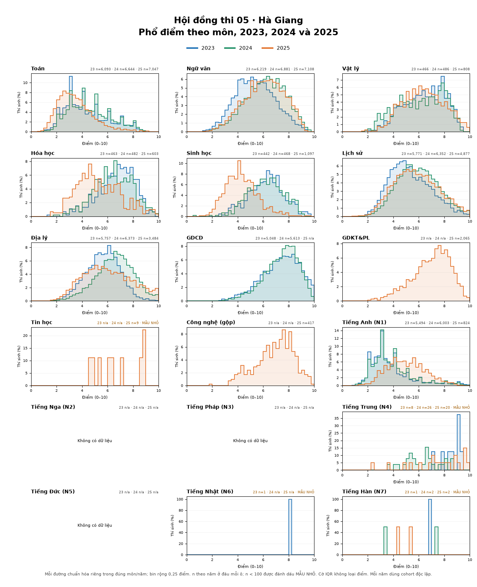
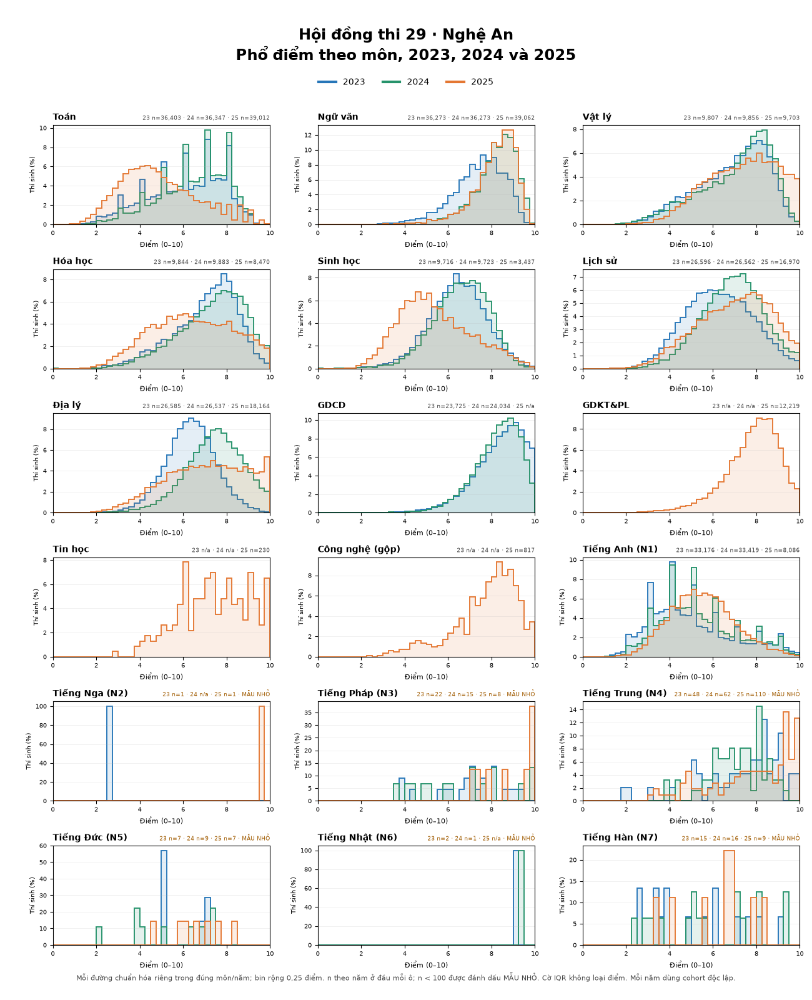
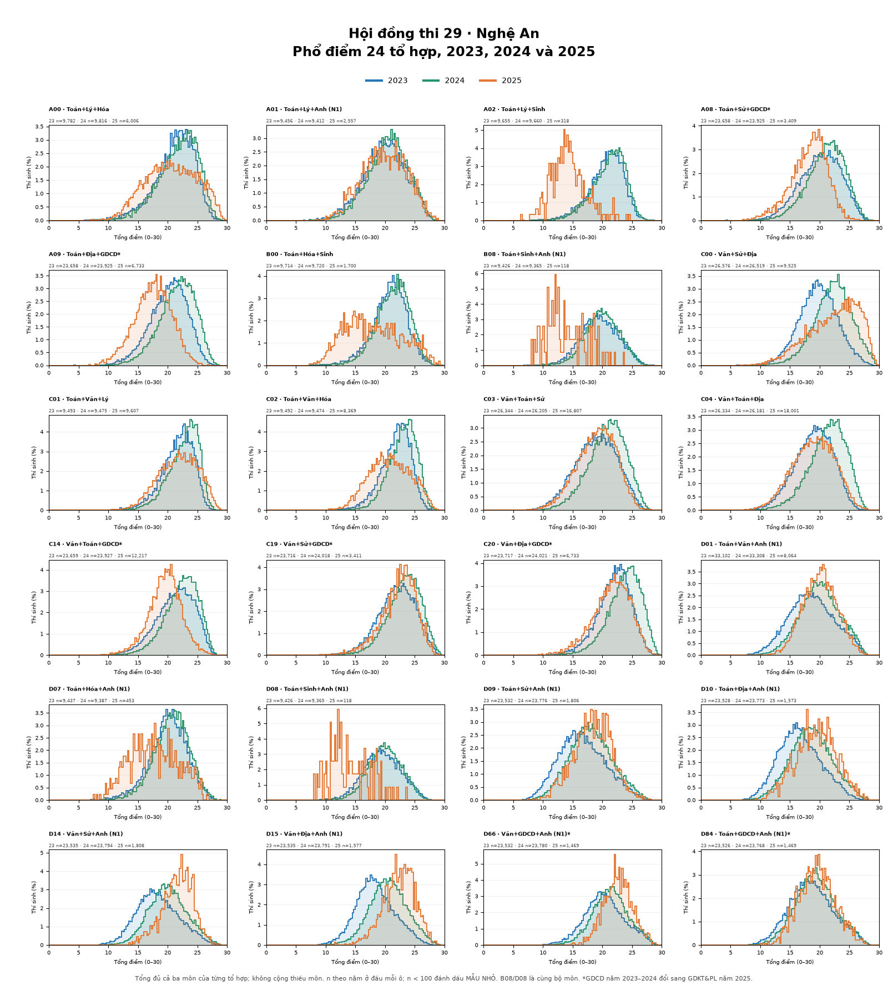
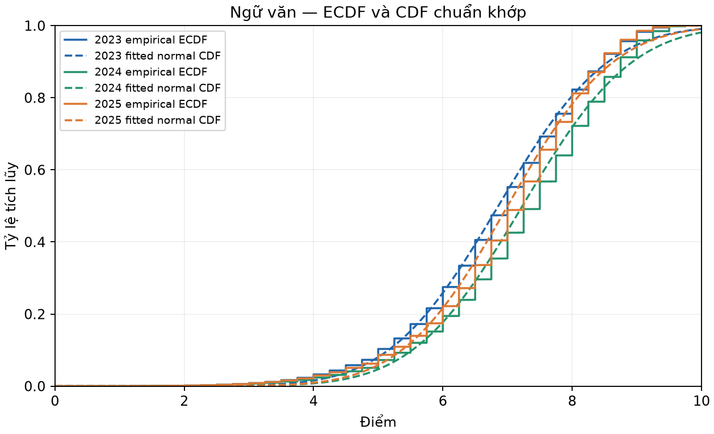
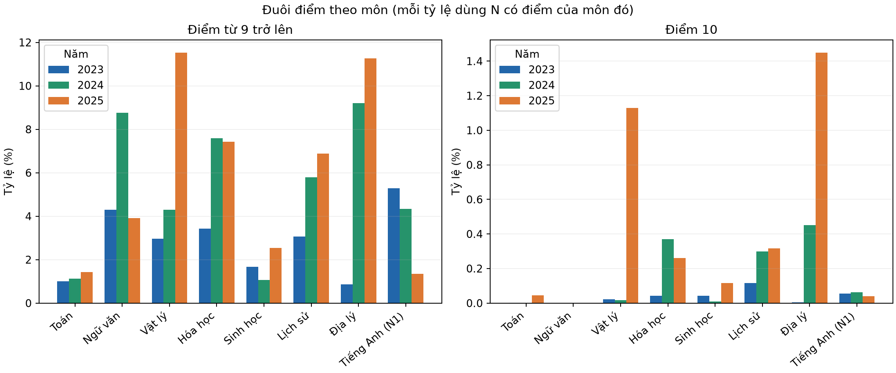
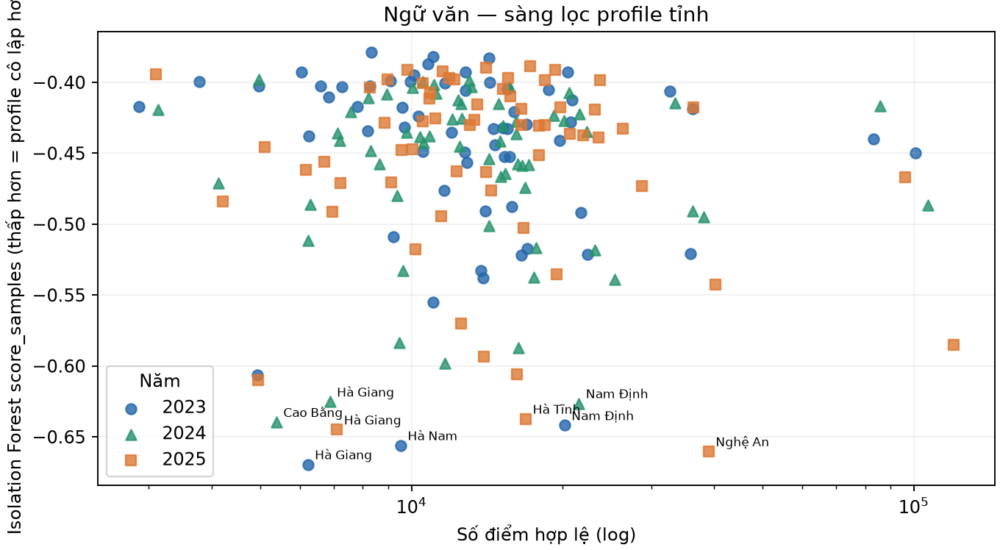

# Báo cáo phân tích điểm thi THPT theo tỉnh, 2023–2025

> **Bản trình bày dành cho giảng viên**  
> Trọng tâm: câu hỏi nghiên cứu, cách phân tích, kết quả có ý nghĩa, hành động ứng dụng và giới hạn. Báo cáo dùng lại biểu đồ đã có trong dự án.

## 1. Tóm tắt

Nhóm phân tích phổ điểm thi tốt nghiệp THPT theo **63 địa phương/mã hội đồng thi**, môn và tổ hợp trong các năm 2023, 2024, 2025. Phân tích tập trung vào ba mục tiêu:

1. Theo dõi chênh lệch kết quả để gợi ý nơi cần ưu tiên hỗ trợ học tập.
2. Mô tả thay đổi lựa chọn môn/tổ hợp để hỗ trợ lập kế hoạch nguồn lực.
3. Sàng lọc phân phối khác biệt để xác định nơi cần rà soát thêm.

Kết quả nổi bật là **Hà Giang – môn Toán** có trung bình thấp nhất trong so sánh giữa các tỉnh cả ba năm; tỷ lệ dưới 5 điểm cũng cao trong nhóm có điểm Toán. Đây là tín hiệu để ưu tiên đánh giá nhu cầu học tập ở cấp trường/tỉnh, không đủ để xác định nguyên nhân hay kết luận về năng lực của địa phương. Phân tích bất thường chỉ tạo tín hiệu rà soát, không chứng minh gian lận. Dữ liệu hiện tại chưa phù hợp để dự báo học sinh cần hỗ trợ trước kỳ thi.

## 2. Dữ liệu và cách làm

| Năm | Số hồ sơ | Có ít nhất một điểm | Ghi chú |
| --- | ---: | ---: | --- |
| 2023 | 1.022.060 | 1.017.584 | Điểm thiếu được giữ là thiếu |
| 2024 | 1.061.605 | 1.061.604 | Nguồn công khai bên thứ ba ngày 17/07/2024, chưa gồm phúc khảo |
| 2025 | 1.131.136 | 1.130.984 | Có thay đổi cấu trúc đề và lựa chọn môn |

Địa phương là mã hội đồng thi lịch sử, không khẳng định nơi cư trú hoặc trường học. Mỗi môn có mẫu số riêng; tổ hợp chỉ tính thí sinh có đủ điểm thành phần. Nhóm so sánh phân vị, trung bình, tỷ lệ dưới/vượt ngưỡng, phân phối và cỡ mẫu. Với tín hiệu đuôi, báo cáo kết hợp nhiều tiêu chí và hiệu chỉnh kiểm định nhiều lần.

### Mạch phân tích

## 3. Kết quả 1 — Kết quả môn học biến động qua các năm

| Môn | Trung bình 2023 | 2024 | 2025 |
| --- | ---: | ---: | ---: |
| Toán | 6,251 | 6,447 | 4,783 |
| Ngữ văn | 6,858 | 7,231 | 7,002 |
| Vật lý | 6,574 | 6,667 | 6,985 |
| Hóa học | 6,745 | 6,681 | 6,065 |
| Lịch sử | 6,026 | 6,570 | 6,519 |
| Địa lý | 6,148 | 7,194 | 6,628 |
| Tiếng Anh | 5,454 | 5,513 | 5,375 |

Toán giảm rõ ở năm 2025, trong khi một số môn khác biến động theo hướng khác. Đây là khác biệt về **kết quả quan sát của ba kỳ thi**; không thể diễn giải thành thay đổi năng lực của cùng học sinh do khác đoàn hệ, đề thi, chương trình và lựa chọn môn.

## 4. Kết quả 2 — Chênh lệch giữa các tỉnh và ví dụ nơi cần ưu tiên hỗ trợ

Các heatmap giúp xác định vùng cần đọc sâu hơn. Bản đồ trung bình chỉ là bước sàng lọc; kết luận hỗ trợ cần xem thêm trung vị, P10, tỷ lệ dưới ngưỡng và cỡ mẫu trong bảng chi tiết.

### Ví dụ: Hà Giang — Toán

| Năm | n có điểm Toán | Trung bình | Trung vị | Tỷ lệ dưới 5 |
| --- | ---: | ---: | ---: | ---: |
| 2023 | 6.093 | 4,315 | 4,000 | 67,91% |
| 2024 | 6.644 | 4,585 | 4,400 | 61,18% |
| 2025 | 7.047 | 3,449 | 3,250 | 86,52% |

Trong bảng so sánh chung, Hà Giang có trung bình Toán thấp nhất trong 63 tỉnh cả ba năm. Quy mô và độ bao phủ môn Toán lớn, nên đây là ví dụ phù hợp để đề xuất **ưu tiên đánh giá chẩn đoán và hỗ trợ Toán ở cấp trường/tỉnh**. Bước hành động có thể là khảo sát lỗ hổng kiến thức tại trường, rồi điều chỉnh phụ đạo và tài liệu theo kết quả khảo sát; theo dõi P10, trung vị và tỷ lệ dưới 5 ở kỳ sau.

Tỷ lệ dưới 5 năm 2025 cao hơn các năm trước, nhưng đề và chương trình đã thay đổi. Không xem đây là bằng chứng rằng năng lực học sinh giảm; không thể xác định trường hoặc học sinh cụ thể chỉ từ chỉ số cấp tỉnh.

## 5. Kết quả 3 — Lựa chọn môn và tổ hợp thay đổi

Báo cáo nền thống kê số thí sinh, tỷ lệ tham gia và 24 tổ hợp có thể lập từ ba môn thành phần. Ví dụ ở Nghệ An, số thí sinh có điểm Sinh học là 9.716/36.669 hồ sơ có điểm năm 2023, 9.723/36.729 năm 2024 và 3.437/39.182 năm 2025 — tỷ lệ giảm từ khoảng 26,5% xuống 8,8%.

**Ý nghĩa ứng dụng:** trường/Sở có thể dùng thay đổi số đăng ký để dự kiến lớp ôn, giáo viên và tài liệu môn lựa chọn. Riêng ví dụ Nghệ An, cần đối chiếu với đăng ký môn theo trường trước khi điều chỉnh nguồn lực; năm 2025 thay đổi cấu trúc lựa chọn, nên tỷ lệ dự thi giảm không tự giải thích lý do lựa chọn.

Các tổ hợp chứa GDCD (2023–2024) và GDKT&PL (2025) có khác biệt về nội dung, không nên gộp máy móc thành một chuỗi cùng loại.

## 6. Kết quả 4 — Sàng lọc khác biệt, không quy kết gian lận

ECDF và biểu đồ đuôi giúp xem khác biệt nằm ở phần nào của phân phối. Đường chuẩn chỉ là tham chiếu hình dạng; điểm thi rời rạc và bị chặn nên không mặc định phân phối phải là chuông chuẩn.

Ví dụ Ngữ văn Nghệ An: tỷ lệ đạt từ 9 là **5,62% (2023), 19,69% (2024), 17,99% (2025)**. Sau đối chiếu mô tả theo dải điểm Toán, chênh so với kỳ vọng lần lượt là **+1,67; +11,38; +14,62 điểm phần trăm**. Đây là tín hiệu để xem thêm dữ liệu độc lập, như phân phối theo trường/điểm thi, đáp án/mã đề, quy trình chấm và phúc khảo.

Các cờ thống kê và Isolation Forest chỉ giúp ưu tiên rà soát. Phân phối điểm tổng hợp không thể chứng minh gian lận hoặc xác định cá nhân/tỉnh có sai phạm.

## 7. Hàm ý cho giảng dạy và giới hạn

- **Ưu tiên hỗ trợ học tập:** Hà Giang – Toán là ví dụ nổi bật để đề xuất đánh giá chẩn đoán cấp trường/tỉnh. Số liệu hiện có chưa xác định học sinh nào cần hỗ trợ hay nguyên nhân cụ thể.
- **Lập kế hoạch nguồn lực:** theo dõi số người và tỷ lệ chọn môn/tổ hợp, rồi đối chiếu với đăng ký tại trường trước khi phân bổ giáo viên.
- **Liêm chính thi cử:** chỉ dùng tín hiệu thống kê để chọn trường hợp rà soát; cần hồ sơ thi độc lập mới xác minh được.
- **Dự báo cá nhân:** chưa thực hiện vì thiếu đặc trưng có trước kỳ thi. Dùng điểm môn khác cùng kỳ sẽ gây rò rỉ thông tin, không phải cảnh báo sớm.

Ba năm là ba đoàn hệ và 2025 có thay đổi đề/chương trình. Nguồn 2024 là snapshot bên thứ ba chưa gồm phúc khảo; số điểm Toán trong CSV thấp hơn 30 so với phổ điểm công bố. Ngoài ra, tệp `data/raw/diem_thi_thpt_2024.csv` không có trong cây tệp của nhánh nền hiện tại, nên người đọc cần bổ sung đúng tệp nguồn và quy trình sinh báo cáo để tái lập độc lập toàn bộ kết quả.

## 8. Kết luận

Dữ liệu phù hợp nhất để **mô tả chênh lệch theo tỉnh–môn, theo dõi lựa chọn môn và tạo danh sách tín hiệu cần rà soát**. Ví dụ Hà Giang–Toán gợi ý ưu tiên đánh giá nhu cầu hỗ trợ học tập; ví dụ Nghệ An–Sinh học gợi ý kiểm tra đăng ký để lập kế hoạch môn; ví dụ Nghệ An–Ngữ văn là tín hiệu rà soát dữ liệu độc lập. Không ví dụ nào tự nó chứng minh nguyên nhân, dự báo học sinh cá nhân hay xác nhận gian lận.

## Tài liệu chi tiết

- [Báo cáo phổ điểm đầy đủ, bảng theo 63 tỉnh và nguồn dữ liệu](bao_cao_thpt_2023_2024_2025.md)
- [Báo cáo ứng dụng theo từng bước và biểu đồ](ung_dung_phan_tich_tinh_2023_2025.md)
- [Nguồn 2024 được nêu trong báo cáo](https://github.com/anhdung98/diem_thi_2024)
