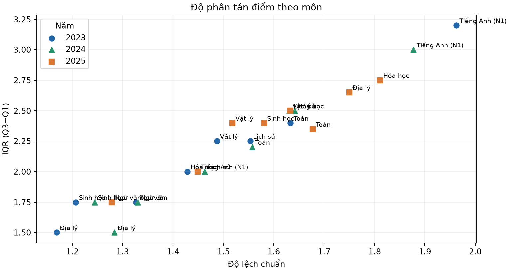

# Báo cáo đánh giá phổ điểm thi THPT 2023–2025 theo địa phương, môn và tổ hợp

> **Bản dành cho giảng viên.** Phân tích toàn bộ 63 mã địa phương/hội đồng thi trong dự án, không chọn một tỉnh để đại diện. Trình tự đọc: bức tranh quốc gia → so sánh địa phương → xác định nhóm cần tìm hiểu hỗ trợ → đọc xu hướng môn/tổ hợp → nêu giới hạn suy luận.

## Tóm tắt kết quả

- Theo quy ước sàng lọc nhất quán trên hai năm cùng cơ chế thi (2023–2024), có **37 cặp tỉnh–môn ở 23 tỉnh** cần ưu tiên tìm hiểu hỗ trợ: Toán, Ngữ văn, Lịch sử, Địa lý và Tiếng Anh. Danh sách và số liệu đủ 3 năm ở Mục 3.
- Điểm trung bình cao không đảm bảo phần điểm thấp nhỏ: Thanh Hóa năm 2025 có TB Địa lý 6,668 nhưng **21,37%** bài dưới 5; Lịch sử TB 6,600 nhưng **20,01%** dưới 5.
- Tỷ lệ dự thi môn thay đổi mạnh năm 2025: Sinh học từ khoảng 32% xuống 6,2%; Tiếng Anh từ khoảng 85% xuống 31,1%; Lịch sử/Địa lý từ khoảng 66% xuống khoảng 42%. Đây là thay đổi cơ cấu dự thi; **không đủ bằng chứng để kết luận học sinh né môn khó**.
- TB Toán năm 2025 giảm 1,664 điểm so với 2024 và tỷ lệ dưới 5 tăng từ 17,49% lên 56,39%. Tuy nhiên nhiều môn đổi theo hướng khác; dữ liệu không chuẩn hóa độ khó đề nên không tách được ảnh hưởng của đề và năng lực.
- So sánh mô tả Tây Bắc với Đồng bằng sông Hồng cho thấy khoảng cách TB Toán khoảng 1,27–1,35 điểm cả ba năm, không thể hiện bước nới rộng rõ năm 2025. Đây là khoảng cách kết quả thi giữa nhóm tỉnh, **không phải ước lượng nhân quả về chương trình mới hay thước đo toàn diện chất lượng giáo dục vùng**.
- Phổ điểm tổng hợp chỉ giúp sàng lọc nơi/môn cần xem thêm; chưa đủ để kết luận gian lận hoặc dự báo học sinh cụ thể trước kỳ thi.

## 1. Dữ liệu và cách đọc

| Năm | Hồ sơ | Có ít nhất một điểm | Đặc điểm |
|---|---:|---:|---|
| 2023 | 1.022.060 | 1.017.584 | Cơ chế thi cũ; có một số hồ sơ thiếu điểm |
| 2024 | 1.061.605 | 1.061.604 | Cơ chế cơ bản như 2023; snapshot công khai chưa gồm phúc khảo |
| 2025 | 1.131.136 | 1.130.984 | Thay đổi chương trình, cách thi và môn lựa chọn; có thí sinh thi chuyển tiếp theo chương trình cũ |

Địa phương là mã hội đồng thi lịch sử trong dữ liệu, không xác nhận nơi ở hay trường học. Mỗi môn có mẫu số riêng; tổ hợp chỉ tính người có đủ ba điểm và có thể chồng lấp nhau. Điểm 0 được giữ, điểm thiếu không đổi thành 0. Tỷ lệ chọn môn lấy n có điểm chia tổng hồ sơ có điểm trong năm; tỷ lệ có thể lệch nhẹ do thiếu dữ liệu và làm tròn.

### Các thống kê đang dùng

- **Trung bình (TB):** tổng điểm chia số bài. Tóm tắt mức điểm chung nhưng có thể che khuất đuôi thấp/cao.
- **Trung vị:** điểm nằm giữa khi xếp thứ tự.
- **P10/P90:** phân vị thứ 10/90. P10 = 3 nghĩa là khoảng 10% bài đạt không quá 3.
- **Q1/Q3:** phân vị 25/75. **IQR = Q3 − Q1** là độ rộng của 50% bài ở giữa. IQR lớn nghĩa là phần giữa phân tán rộng; IQR nhỏ là phần giữa tập trung hơn. IQR không nói điểm cao hay thấp tự nó.
- **Tỷ lệ dưới 5:** chỉ báo mô tả phần điểm thấp, không phải định nghĩa chính thức về “học sinh yếu”, chuẩn đạt hay điều kiện nhận hỗ trợ.
- **n và tỷ lệ tham gia:** cho biết mẫu số và độ bao phủ; không biến dữ liệu tổng hợp thành dữ liệu cấp trường/học sinh.

## 2. Đọc biểu đồ: quốc gia → địa phương → phần phân phối

| Môn | TB 2023 | TB 2024 | TB 2025 | Δ 2024→2025 |
|---|---:|---:|---:|---:|
| Toán | 6,251 | 6,447 | 4,783 | −1,664 |
| Ngữ văn | 6,858 | 7,231 | 7,002 | −0,229 |
| Vật lý | 6,574 | 6,667 | 6,985 | +0,318 |
| Hóa học | 6,745 | 6,681 | 6,065 | −0,616 |
| Sinh học | 6,395 | 6,284 | 5,778 | −0,506 |
| Lịch sử | 6,026 | 6,570 | 6,519 | −0,051 |
| Địa lý | 6,148 | 7,194 | 6,628 | −0,566 |
| Tiếng Anh | 5,454 | 5,513 | 5,375 | −0,138 |

Toán giảm mạnh nhất trong bảng, nhưng Vật lý tăng và Lịch sử gần như giữ nguyên. Điều này cho thấy kết quả đổi theo môn, không chứng minh “mọi học sinh yếu đi”. Ba năm là ba nhóm thí sinh độc lập.

Bản đồ nhiệt bao phủ tất cả địa phương/môn chung. Màu TB cho biết mức điểm chung; tỷ lệ ≥9 mô tả đuôi trên. Để thấy phần thấp, đọc cùng P10 và tỷ lệ dưới 5 ở bảng chi tiết.

### 2023

### 2024

### 2025

## 3. Tỉnh–môn cần ưu tiên tìm hiểu hỗ trợ

### Quy ước sàng lọc

Một cặp **tỉnh–môn** được đánh dấu nếu thỏa cả bốn điều kiện trong **cả 2023 và 2024**:

1. Có ít nhất **100** bài và tỷ lệ tham gia môn trong hồ sơ tỉnh ít nhất **70%**.
2. TB tỉnh thấp hơn TB toàn quốc cùng môn/năm ít nhất **0,5 điểm**.
3. Tỷ lệ dưới 5 của tỉnh cao hơn toàn quốc cùng môn/năm ít nhất **10 điểm phần trăm**.
4. Tín hiệu lặp lại trong cả hai năm có cơ chế thi gần nhau.

Các ngưỡng là **quy ước ưu tiên phân tích**, không phải chuẩn chính sách hay ngưỡng năng lực. Tỷ lệ toàn quốc được ước tính bằng cách gia quyền n các tỷ lệ tỉnh đã làm tròn trong báo cáo nền. Quy tắc giúp thu hẹp nơi cần khảo sát, không xếp hạng tỉnh hay quyết định hỗ trợ tự động. Môn có độ bao phủ thấp bị loại khỏi quy tắc chính để giảm ảnh hưởng của tự chọn; điều đó không có nghĩa các môn ấy không cần hỗ trợ.

### Danh sách đầy đủ: 37 cặp tỉnh–môn thuộc 23 địa phương

Mỗi ô ghi **TB / tỷ lệ dưới 5% (n; tỷ lệ tham gia môn tại tỉnh)**. Cột 2023–2024 xác định danh sách; cột 2025 cho biết ảnh chụp năm mới, không theo dõi cùng học sinh. Với môn tự chọn, thành phần người dự thi đổi đáng kể.

| Địa phương | Môn | 2023: TB / <5% (n; tham gia) | 2024: TB / <5% (n; tham gia) | 2025: TB / <5% (n; tham gia) |
|---|---|---|---|---|
| Hà Giang | Toán | 4.315 / 67.91% (n=6,093; 97.3%) | 4.585 / 61.18% (n=6,644; 96.0%) | 3.449 / 86.52% (n=7,047; 99.0%) |
| Hà Giang | Ngữ văn | 5.270 / 41.87% (n=6,219; 99.3%) | 6.053 / 22.69% (n=6,881; 99.4%) | 5.961 / 24.52% (n=7,108; 99.9%) |
| Hà Giang | Lịch sử | 5.204 / 46.91% (n=5,771; 92.2%) | 5.797 / 29.91% (n=6,352; 91.8%) | 5.722 / 34.65% (n=4,877; 68.5%) |
| Hà Giang | Địa lý | 5.537 / 29.77% (n=5,757; 91.9%) | 6.439 / 14.59% (n=6,373; 92.1%) | 5.918 / 32.75% (n=3,484; 49.0%) |
| Hà Giang | Tiếng Anh | 3.825 / 80.96% (n=5,494; 87.7%) | 3.905 / 79.96% (n=6,003; 86.7%) | 4.915 / 51.33% (n=824; 11.6%) |
| Cao Bằng | Toán | 4.893 / 53.39% (n=4,686; 93.6%) | 5.102 / 48.23% (n=5,115; 92.9%) | 3.707 / 80.81% (n=4,826; 96.8%) |
| Cao Bằng | Ngữ văn | 5.785 / 30.17% (n=4,935; 98.5%) | 5.899 / 25.36% (n=5,383; 97.8%) | 5.993 / 23.71% (n=4,947; 99.2%) |
| Cao Bằng | Tiếng Anh | 4.259 / 72.01% (n=4,194; 83.7%) | 4.365 / 70.40% (n=4,456; 80.9%) | 5.011 / 46.97% (n=758; 15.2%) |
| Lai Châu | Toán | 5.578 / 33.26% (n=3,680; 96.3%) | 5.599 / 33.50% (n=3,979; 95.0%) | 4.066 / 76.54% (n=4,178; 98.9%) |
| Lai Châu | Tiếng Anh | 4.366 / 72.76% (n=3,451; 90.3%) | 4.246 / 76.12% (n=3,752; 89.6%) | 4.991 / 51.79% (n=448; 10.6%) |
| Lào Cai | Tiếng Anh | 4.822 / 61.58% (n=6,413; 81.9%) | 4.750 / 63.03% (n=6,863; 82.1%) | 5.218 / 42.46% (n=1,538; 17.1%) |
| Lạng Sơn | Toán | 5.206 / 45.51% (n=9,047; 97.0%) | 5.518 / 36.89% (n=9,222; 97.4%) | 3.939 / 77.61% (n=9,517; 99.2%) |
| Lạng Sơn | Tiếng Anh | 4.450 / 68.47% (n=7,212; 77.3%) | 4.580 / 66.93% (n=7,251; 76.6%) | 5.206 / 41.77% (n=1,288; 13.4%) |
| Bắc Kạn | Toán | 5.239 / 44.63% (n=2,720; 94.2%) | 5.330 / 41.59% (n=2,977; 93.8%) | 3.777 / 81.79% (n=3,065; 98.6%) |
| Bắc Kạn | Tiếng Anh | 4.353 / 71.48% (n=2,391; 82.8%) | 4.252 / 71.69% (n=2,508; 79.0%) | 5.269 / 41.67% (n=372; 12.0%) |
| Thái Nguyên | Tiếng Anh | 4.937 / 57.05% (n=12,613; 78.3%) | 4.957 / 56.14% (n=13,062; 78.2%) | 5.156 / 44.36% (n=3,979; 21.4%) |
| Yên Bái | Toán | 5.304 / 42.68% (n=8,003; 97.4%) | 5.617 / 34.53% (n=8,483; 97.7%) | 4.005 / 75.77% (n=9,048; 99.3%) |
| Sơn La | Toán | 4.938 / 52.67% (n=11,178; 95.5%) | 5.241 / 43.02% (n=11,829; 94.0%) | 3.629 / 84.69% (n=12,380; 98.3%) |
| Sơn La | Tiếng Anh | 4.137 / 77.66% (n=10,090; 86.2%) | 4.380 / 72.39% (n=10,441; 83.0%) | 5.283 / 40.13% (n=1,069; 8.5%) |
| Hòa Bình | Toán | 5.140 / 47.29% (n=9,469; 98.1%) | 5.434 / 40.07% (n=9,565; 97.4%) | 3.911 / 77.37% (n=10,488; 99.4%) |
| Hòa Bình | Tiếng Anh | 4.379 / 71.24% (n=8,199; 84.9%) | 4.439 / 69.77% (n=8,366; 85.2%) | 5.217 / 42.87% (n=1,367; 13.0%) |
| Quảng Trị | Tiếng Anh | 4.778 / 60.52% (n=7,741; 92.3%) | 4.728 / 60.89% (n=7,681; 91.9%) | 5.243 / 42.78% (n=2,188; 24.6%) |
| Kon Tum | Tiếng Anh | 4.749 / 61.86% (n=4,685; 93.4%) | 4.853 / 60.41% (n=4,529; 89.9%) | 5.260 / 39.92% (n=982; 19.2%) |
| Gia Lai | Tiếng Anh | 4.772 / 60.63% (n=13,807; 93.3%) | 4.937 / 56.53% (n=14,195; 93.4%) | 5.123 / 44.54% (n=3,215; 20.6%) |
| Đắk Lắk | Toán | 5.611 / 36.80% (n=20,698; 98.8%) | 5.801 / 32.45% (n=20,578; 98.6%) | 4.295 / 67.16% (n=21,928; 99.6%) |
| Đắk Lắk | Tiếng Anh | 4.655 / 63.20% (n=18,963; 90.5%) | 4.650 / 63.31% (n=18,867; 90.4%) | 5.057 / 46.93% (n=5,114; 23.2%) |
| Ninh Thuận | Tiếng Anh | 4.930 / 55.86% (n=5,550; 91.3%) | 4.929 / 55.70% (n=5,734; 91.2%) | 4.899 / 50.00% (n=1,612; 26.1%) |
| Trà Vinh | Toán | 5.477 / 37.50% (n=8,960; 97.8%) | 5.772 / 28.59% (n=9,494; 98.0%) | 4.031 / 75.92% (n=10,030; 99.7%) |
| Trà Vinh | Tiếng Anh | 4.384 / 68.81% (n=8,462; 92.4%) | 4.692 / 61.10% (n=8,875; 91.6%) | 4.842 / 54.84% (n=1,530; 15.2%) |
| Sóc Trăng | Toán | 5.647 / 32.84% (n=9,782; 97.7%) | 5.832 / 28.36% (n=10,450; 98.2%) | 4.072 / 75.36% (n=11,094; 99.3%) |
| Sóc Trăng | Tiếng Anh | 4.742 / 59.72% (n=9,065; 90.5%) | 4.651 / 62.06% (n=9,744; 91.6%) | 4.723 / 58.60% (n=2,092; 18.7%) |
| Cà Mau | Tiếng Anh | 4.835 / 56.87% (n=9,451; 97.0%) | 4.818 / 57.25% (n=9,713; 95.7%) | 4.854 / 52.56% (n=2,186; 20.1%) |
| Điện Biên | Toán | 5.112 / 47.40% (n=6,200; 93.2%) | 5.279 / 43.65% (n=6,697; 92.8%) | 3.813 / 81.40% (n=6,843; 97.9%) |
| Điện Biên | Tiếng Anh | 4.096 / 79.58% (n=5,871; 88.3%) | 4.129 / 78.66% (n=6,100; 84.5%) | 5.428 / 37.91% (n=554; 7.9%) |
| Đắk Nông | Toán | 5.666 / 33.91% (n=7,231; 98.2%) | 5.839 / 29.59% (n=7,502; 97.7%) | 4.229 / 70.56% (n=8,255; 99.6%) |
| Đắk Nông | Tiếng Anh | 4.359 / 69.40% (n=6,781; 92.1%) | 4.343 / 70.67% (n=7,031; 91.5%) | 4.914 / 50.68% (n=1,393; 16.8%) |
| Hậu Giang | Tiếng Anh | 4.401 / 68.19% (n=6,332; 91.6%) | 4.548 / 64.66% (n=6,672; 91.9%) | 4.818 / 54.82% (n=1,100; 15.2%) |

Năm 2025, 14 trong 37 cặp vẫn thỏa cùng điều kiện số học ở môn có độ phủ cao (12 Toán, 2 Ngữ văn). Nhiều cặp môn tự chọn không đạt ngưỡng tham gia 70% do cơ cấu thi đã đổi; không nên diễn giải là khó khăn đã được giải quyết.

**Hành động sau sàng lọc:** trao đổi với trường/Sở; kiểm tra độ phủ giáo viên, học liệu, sĩ số và cơ hội học tập; tổ chức đánh giá chẩn đoán tại trường; rồi chọn hỗ trợ theo nhu cầu được xác nhận. Bảng tỉnh không chỉ ra trường hay chủ đề kiến thức cụ thể.

## 4. TB cao có đồng nghĩa ít điểm thấp?

**Không.** TB là số tổng hợp; nhóm đạt cao và nhóm điểm thấp có thể cùng tồn tại.

| Ví dụ | TB | Dưới 5 | Quy mô xấp xỉ dưới 5 |
|---|---:|---:|---:|
| Thanh Hóa – Địa lý, 2025 (n=20.106) | 6,668 | 21,37% | khoảng 4.298 bài |
| Thanh Hóa – Lịch sử, 2025 (n=20.871) | 6,600 | 20,01% | khoảng 4.177 bài |
| TP. Hồ Chí Minh – Tiếng Anh, 2023 (n=71.074) | 6,756 | 18,50% | khoảng 13.149 bài |

Đây là số bài dưới ngưỡng, không phải danh sách cá nhân và không định nghĩa người học “yếu”. Đọc TB cùng trung vị, P10, IQR, tỷ lệ dưới ngưỡng, n và cơ cấu chọn môn.

## 5. Tỷ lệ dự thi môn và tổ hợp thay đổi thế nào?

### Tỷ lệ có điểm theo môn

| Môn | 2023: n (% hồ sơ có điểm) | 2024 | 2025 | Δ 2024→2025 |
|---|---:|---:|---:|---:|
| Toán | 1.003.373 (98,60%) | 1.045.613 (98,49%) | 1.126.172 (99,57%) | +1,08 đpt |
| Ngữ văn | 1.008.239 (99,08%) | 1.050.101 (98,92%) | 1.126.726 (99,62%) | +0,70 đpt |
| Vật lý | 327.189 (32,15%) | 345.615 (32,56%) | 347.599 (30,73%) | −1,83 đpt |
| Hóa học | 328.118 (32,24%) | 346.518 (32,64%) | 240.135 (21,23%) | −11,41 đpt |
| Sinh học | 324.625 (31,90%) | 342.378 (32,25%) | 69.895 (6,18%) | −26,07 đpt |
| Lịch sử | 683.447 (67,16%) | 706.214 (66,52%) | 481.293 (42,56%) | −23,96 đpt |
| Địa lý | 682.134 (67,03%) | 704.682 (66,38%) | 476.472 (42,13%) | −24,25 đpt |
| Tiếng Anh | 876.102 (86,10%) | 906.538 (85,39%) | 351.848 (31,11%) | −54,28 đpt |

**2023→2024:** tỷ lệ khá ổn định; các môn KHTN tăng nhẹ 0,35–0,40 điểm phần trăm, Sử/Địa/Anh giảm 0,6–0,7 điểm phần trăm.  
**2024→2025:** Toán/Văn vẫn gần phổ cập; Vật lý gần giữ số bài; Hóa, Sinh, Sử, Địa và Anh giảm tỷ lệ dự thi. Năm 2025 thí sinh thường chọn hai môn trong nhóm đã học; trước đó các môn thành phần được gắn với cấu trúc bài tổ hợp cũ. Vì vậy đây là thay đổi cơ cấu ghi nhận được, không phải đo thuần sở thích hay “né môn”.

### Số người có đủ ba điểm tổ hợp

Các tỷ lệ tính trên toàn bộ hồ sơ có điểm. Một thí sinh có thể nằm trong nhiều tổ hợp; đây **không phải** số người khai tổ hợp xét tuyển đại học.

| Tổ hợp | 2023: n (% hồ sơ) | 2024 | 2025 |
|---|---:|---:|---:|
| A00 | 325,902 (32.0%) | 343,800 (32.4%) | 162,200 (14.3%) |
| A01 | 314,412 (30.9%) | 328,850 (31.0%) | 146,960 (13.0%) |
| A02 | 322,538 (31.7%) | 339,801 (32.0%) | 4,795 (0.4%) |
| A08 | 564,507 (55.5%) | 581,304 (54.8%) | 68,313 (6.0%) |
| A09 | 564,517 (55.5%) | 581,310 (54.8%) | 109,404 (9.7%) |
| B00 | 324,554 (31.9%) | 342,291 (32.2%) | 44,964 (4.0%) |
| B08 | 313,063 (30.8%) | 326,939 (30.8%) | 4,227 (0.4%) |
| C00 | 681,723 (67.0%) | 704,008 (66.3%) | 297,377 (26.3%) |
| C01 | 320,523 (31.5%) | 337,425 (31.8%) | 345,014 (30.5%) |
| C02 | 320,465 (31.5%) | 337,293 (31.8%) | 237,064 (21.0%) |
| C03 | 669,692 (65.8%) | 691,003 (65.1%) | 476,660 (42.1%) |
| C04 | 668,369 (65.7%) | 689,443 (64.9%) | 472,025 (41.7%) |
| C14 | 564,516 (55.5%) | 581,379 (54.8%) | 246,298 (21.8%) |
| C19 | 565,211 (55.5%) | 583,125 (54.9%) | 68,351 (6.0%) |
| C20 | 565,249 (55.5%) | 583,208 (54.9%) | 109,423 (9.7%) |
| D01 | 873,126 (85.8%) | 902,723 (85.0%) | 350,654 (31.0%) |
| D07 | 313,538 (30.8%) | 327,525 (30.9%) | 24,478 (2.2%) |
| D08 | 313,063 (30.8%) | 326,939 (30.8%) | 4,227 (0.4%) |
| D09 | 557,198 (54.8%) | 571,425 (53.8%) | 69,904 (6.2%) |
| D10 | 557,086 (54.7%) | 571,310 (53.8%) | 53,567 (4.7%) |
| D14 | 557,405 (54.8%) | 571,762 (53.9%) | 69,989 (6.2%) |
| D15 | 557,312 (54.8%) | 571,611 (53.8%) | 53,592 (4.7%) |
| D66 | 556,185 (54.7%) | 570,177 (53.7%) | 47,905 (4.2%) |
| D84 | 556,034 (54.6%) | 569,967 (53.7%) | 47,902 (4.2%) |

Các ví dụ thay đổi: D01 từ 85,8% xuống 31,0%; C00 từ 67,0% xuống 26,3%; B00 từ 31,9% xuống 4,0%; A00 từ 32,0% xuống 14,3%. Số liệu đủ điểm thành phần không chứng minh học sinh đăng ký nguyện vọng bằng mã đó. Xem [atlas biểu đồ môn và tổ hợp của 63 địa phương](assets/thpt_2023_2024_2025/tinh/).

### Môn nào “có thể coi là khó”?

Không thể xếp độ khó cố hữu chỉ từ điểm tổng. Có thể mô tả môn có **chỉ báo kết quả thấp trong kỳ/năm cụ thể**:

- 2025: Toán TB 4,783 và 56,39% dưới 5.
- 2023–2024: Tiếng Anh TB khoảng 5,45–5,51, khoảng 42,7–44,8% dưới 5, trong khi tỷ lệ có điểm vẫn 85–86%.
- 2025: Hóa 29,53% và Sinh 32,44% dưới 5; nhưng Sinh chỉ có điểm ở 6,18% hồ sơ nên cơ cấu tự chọn rất mạnh.

Các con số không cho biết lý do chọn môn hay cảm nhận độ khó. Để kết luận học sinh né vì khó cần khảo sát lý do lựa chọn và dữ liệu đăng ký theo từng em.

## 6. Đề khó hơn hay học sinh yếu đi?

**Chưa thể tách hai nguyên nhân bằng dữ liệu này.** Toán năm 2025 giảm 1,664 điểm so với 2024 và tỷ lệ dưới 5 tăng từ 17,49% lên 56,39%. Cùng lúc, đề/chương trình/cách tính điểm và cơ cấu chọn môn thay đổi. Vật lý tăng 0,318 điểm, Lịch sử gần như giữ nguyên; vì vậy nhận định “mọi học sinh yếu đi” không được kết quả ủng hộ.

Muốn so độ khó cần câu hỏi neo chung, chuẩn hóa đo lường/IRT hoặc dữ liệu từng câu. Muốn kết luận năng lực giảm cần dữ liệu dọc và kiểm soát khác biệt đoàn hệ. Kết luận có thể bảo vệ hiện tại là **điểm Toán quan sát năm 2025 thấp rõ trong kỳ thi mới; nguyên nhân chưa được nhận dạng**.

## 7. Chênh lệch vùng miền có tăng vì chương trình mới?

So sánh có trọng số theo n giữa Tây Bắc (6 mã: Lai Châu, Điện Biên, Sơn La, Hòa Bình, Lào Cai, Yên Bái) và Đồng bằng sông Hồng (11 mã lịch sử). Chọn Toán/Văn vì độ phủ gần phổ cập:

| Môn | Năm | Tây Bắc | Đồng bằng sông Hồng | Chênh lệch ĐBSH − Tây Bắc |
|---|---:|---:|---:|---:|
| Toán | 2023 | 5,262 | 6,611 | 1,349 |
| Toán | 2024 | 5,503 | 6,775 | 1,272 |
| Toán | 2025 | 3,903 | 5,191 | 1,288 |
| Ngữ văn | 2023 | 6,511 | 7,239 | 0,728 |
| Ngữ văn | 2024 | 6,746 | 7,726 | 0,980 |
| Ngữ văn | 2025 | 6,453 | 7,234 | 0,781 |

Chênh Toán ở hai nhóm dao động 1,27–1,35 điểm, không có bước tăng rõ năm 2025; chênh Văn cao nhất năm 2024 rồi giảm. Dẫn chứng cho thấy khoảng cách kết quả vẫn đáng quan tâm, nhưng không cho thấy nới rộng đồng loạt trong năm chuyển đổi.

Không thể quy chênh lệch cho chương trình mới: chỉ có một năm sau thay đổi, năm 2025 có thí sinh thi chuyển tiếp chương trình cũ nhưng dữ liệu không có cờ chương trình. Điểm thi cũng không đo toàn diện chất lượng giáo dục vùng; môn tự chọn khó so do độ phủ và thành phần thí sinh thay đổi.

## 8. Phân phối khác biệt nào cần rà soát?

Báo cáo nền sàng lọc toàn bộ tỉnh × môn/tổ hợp bằng ngoại lệ IQR/±3SD, tỷ lệ đuôi và profile đa biến. Số người có ít nhất một môn bị cờ là 43.642 (4,29%) năm 2023; 49.786 (4,69%) năm 2024; 38.640 (3,42%) năm 2025. Cờ đuôi môn: 55/70/50 nhóm; cờ đuôi tổ hợp: 34/70/27 nhóm.

Ví dụ Ngữ văn Nghệ An có tỷ lệ ≥9 là 5,62% (2023), 19,69% (2024), 17,99% (2025). Sau đối chiếu mô tả theo dải điểm Toán, mức chênh so kỳ vọng trong báo cáo là +1,67; +11,38; +14,62 điểm phần trăm. Đây là tín hiệu đặt câu hỏi, vẫn có thể chịu ảnh hưởng của khác biệt thí sinh, đề và bối cảnh chấm.

**Cờ thống kê không phải kết luận gian lận.** Muốn rà tiếp cần kiểm tra nguồn/cỡ mẫu, phân phối theo trường/điểm thi, mã đề, đáp án, dữ liệu chấm và phúc khảo. Không dùng phổ điểm tổng hợp để buộc tội địa phương hay thí sinh.

## 9. Có đủ dữ liệu để dự báo học sinh cần hỗ trợ trước kỳ thi?

**Chưa đủ.** Dữ liệu chủ yếu là điểm sau kỳ thi và tổng hợp cấp tỉnh/môn; thiếu biến học tập có trước kỳ thi để nhận diện từng em. Dùng điểm môn khác của chính kỳ thi làm đầu vào sẽ rò rỉ thông tin xảy ra sau khi kỳ thi kết thúc. Muốn dự báo sớm cần điểm kiểm tra định kỳ và thông tin học tập có trước kỳ thi; kiểm định theo năm và kiểm tra sai lệch giữa nhóm. Dự báo nên dẫn đến hỗ trợ, không gắn nhãn cố định.

## 10. Hành động đề xuất

1. Dùng danh sách 37 cặp tỉnh–môn để **bắt đầu khảo sát**, rồi xác nhận ở trường bằng chẩn đoán kiến thức và điều kiện học tập.
2. Lập kế hoạch giáo viên/học liệu theo số đăng ký thật ở từng trường, nhất là môn tự chọn; tỷ lệ tỉnh chỉ là tín hiệu tổng quan.
3. Theo dõi n, tỷ lệ tham gia, P10/trung vị/P90, IQR, tỷ lệ dưới 5 và ≥9; mỗi biểu đồ ghi năm, mẫu số, thay đổi quy chế.
4. Rà soát profile bằng hồ sơ độc lập; không suy luận gian lận từ bất thường thống kê.
5. Chỉ xây mô hình dự báo cá nhân khi có dữ liệu trước kỳ thi phù hợp và kiểm định theo thời gian.

## Nguồn, biểu đồ và giới hạn tái lập

- [Báo cáo nền đủ 63 địa phương, môn và tổ hợp](bao_cao_thpt_2023_2024_2025.md)
- [Báo cáo từng bước đọc biểu đồ](ung_dung_phan_tich_tinh_2023_2025.md)
- [Atlas biểu đồ địa phương](assets/thpt_2023_2024_2025/tinh/)
- [Cục Quản lý chất lượng: điểm mới kỳ thi 2025](https://vqa.moet.gov.vn/vi/news/tin-tuc-su-kien/nhung-diem-moi-trong-ky-thi-tot-nghiep-thpt-tu-nam-2025-144.html)
- [Cục Quản lý chất lượng: hướng dẫn tổ chức kỳ thi 2025](https://vqa.moet.gov.vn/vi/news/tin-tuc-su-kien/hoi-nghi-tap-huan-quy-che-va-nghiep-vu-to-chuc-ky-thi-tot-nghiep-thpt-nam-2025-183.html)

Số liệu/biểu đồ tổng hợp lấy từ báo cáo nền trên nhánh dự án. CSV snapshot 2024 không có trong cây tệp nhánh để tái chạy độc lập; báo cáo nền ghi nguồn là dữ liệu công khai bên thứ ba ngày 17/07/2024, chưa gồm phúc khảo, và có chênh độ bao phủ Toán 30 bài so với phổ điểm công bố. Để tái lập đầy đủ cần lưu snapshot CSV cùng mã sinh phân tích và phiên bản dữ liệu.
