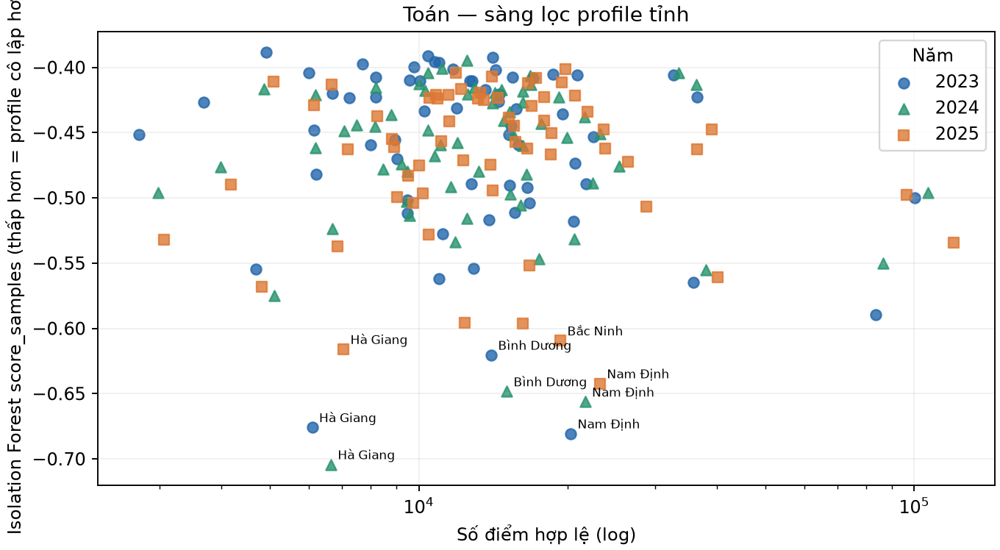

# Báo cáo phân tích điểm thi THPT theo tỉnh, 2023–2025

> **Bản báo cáo dành cho giảng viên**  
> Trình bày kết quả trên toàn bộ dữ liệu ba năm và 63 địa phương/mã hội đồng thi; sử dụng biểu đồ có sẵn, không suy rộng từ một tỉnh minh họa.

## 1. Mục tiêu và phạm vi

Báo cáo đánh giá phổ điểm theo **năm × địa phương × môn/tổ hợp** để trả lời bốn câu hỏi:

1. Mức chênh lệch điểm và phần phân phối thấp tập trung ở đâu để ưu tiên tìm hiểu nhu cầu hỗ trợ học tập?
2. Tỷ lệ dự thi môn/tổ hợp thay đổi thế nào để hỗ trợ lập kế hoạch dạy học và nguồn lực?
3. Tỉnh–môn nào có phân phối khác biệt cần rà soát thêm?
4. Dữ liệu có đủ để dự báo học sinh cần hỗ trợ trước kỳ thi không?

Đơn vị địa phương là mã hội đồng thi lịch sử trong nguồn dữ liệu, không xác định nơi cư trú hay trường học. Mỗi môn có mẫu số riêng theo số thí sinh có điểm; tổ hợp chỉ tính thí sinh đủ điểm các môn thành phần. Điểm 0 được giữ, điểm thiếu không điền thành 0.

## 2. Nguồn và cách phân tích

| Năm | Hồ sơ | Có ít nhất một điểm | Ghi chú |
| --- | ---: | ---: | --- |
| 2023 | 1.022.060 | 1.017.584 | Có hồ sơ thiếu điểm |
| 2024 | 1.061.605 | 1.061.604 | Snapshot công khai 17/07/2024, chưa gồm phúc khảo |
| 2025 | 1.131.136 | 1.130.984 | Có thay đổi cấu trúc đề và lựa chọn môn |

Quy trình: kiểm tra độ bao phủ → so sánh phân phối toàn quốc → phân rã theo tỉnh × môn → xem cơ cấu dự thi và tổ hợp → sàng lọc khác biệt → diễn giải hành động và giới hạn. Chỉ số gồm trung bình, trung vị, P10/P90, IQR, tỷ lệ dưới/vượt ngưỡng, số dự thi và các chỉ báo khác biệt phân phối.

## 3. Kết quả toàn quốc theo môn

| Môn | Trung bình 2023 | 2024 | 2025 |
| --- | ---: | ---: | ---: |
| Toán | 6,251 | 6,447 | 4,783 |
| Ngữ văn | 6,858 | 7,231 | 7,002 |
| Vật lý | 6,574 | 6,667 | 6,985 |
| Hóa học | 6,745 | 6,681 | 6,065 |
| Sinh học | 6,395 | 6,284 | 5,778 |
| Lịch sử | 6,026 | 6,570 | 6,519 |
| Địa lý | 6,148 | 7,194 | 6,628 |
| Tiếng Anh | 5,454 | 5,513 | 5,375 |

Các trung bình cho thấy mức và hướng biến động khác nhau theo môn. Đây là so sánh kết quả của ba đoàn hệ và ba kỳ thi; khác đề, chương trình, lựa chọn môn và độ bao phủ khiến không thể diễn giải thành thay đổi năng lực của cùng học sinh.

## 4. Chênh lệch giữa tỉnh và môn: toàn bộ 63 địa phương

Sáu heatmap dưới đây bao phủ **tất cả 63 địa phương và các môn được so sánh**. Bản đồ trung bình và tỷ lệ đạt từ 9 điểm mô tả hai phần khác nhau của phân phối; khi quyết định hỗ trợ cần đọc cùng cỡ mẫu, trung vị, P10 và tỷ lệ dưới ngưỡng trong bảng tỉnh.

### Năm 2023

### Năm 2024

### Năm 2025

Bảng dưới đây tổng hợp **mức trung bình cao nhất/thấp nhất trong các tỉnh cho từng môn và từng năm**. Nó cho thấy toàn bộ 24 so sánh môn–năm, không phải danh sách kết luận chất lượng địa phương.

| Năm | Môn | Trung bình cao nhất | Trung bình thấp nhất | Khoảng cách |
| --- | --- | --- | --- | ---: |
| 2023 | Toán | Nam Định 7,128 | Hà Giang 4,315 | 2,813 |
| 2023 | Ngữ văn | Hà Nam 7,828 | Hà Giang 5,270 | 2,558 |
| 2023 | Vật lý | Vĩnh Phúc 7,345 | Trà Vinh 5,870 | 1,475 |
| 2023 | Hóa học | Nam Định 7,254 | Cà Mau 6,238 | 1,016 |
| 2023 | Sinh học | Vĩnh Long 7,064 | Hưng Yên 5,963 | 1,101 |
| 2023 | Lịch sử | Vĩnh Phúc 6,974 | Hà Giang 5,204 | 1,770 |
| 2023 | Địa lý | Vĩnh Phúc 6,899 | Hà Giang 5,537 | 1,362 |
| 2023 | Tiếng Anh | TP. Hồ Chí Minh 6,756 | Hà Giang 3,825 | 2,931 |
| 2024 | Toán | Nam Định 7,262 | Hà Giang 4,585 | 2,677 |
| 2024 | Ngữ văn | Ninh Bình 8,169 | Cao Bằng 5,899 | 2,269 |
| 2024 | Vật lý | Vĩnh Phúc 7,490 | Cà Mau 5,989 | 1,500 |
| 2024 | Hóa học | Tuyên Quang 7,516 | Cà Mau 6,032 | 1,484 |
| 2024 | Sinh học | Tuyên Quang 7,320 | Đà Nẵng 5,657 | 1,663 |
| 2024 | Lịch sử | Vĩnh Phúc 7,440 | Hà Giang 5,797 | 1,643 |
| 2024 | Địa lý | Vĩnh Phúc 8,074 | Hà Giang 6,439 | 1,635 |
| 2024 | Tiếng Anh | TP. Hồ Chí Minh 6,731 | Hà Giang 3,905 | 2,826 |
| 2025 | Toán | Nam Định 5,642 | Hà Giang 3,449 | 2,193 |
| 2025 | Ngữ văn | Nghệ An 8,035 | Đà Nẵng 5,597 | 2,438 |
| 2025 | Vật lý | Vĩnh Phúc 7,505 | Hà Giang 6,253 | 1,252 |
| 2025 | Hóa học | Hà Tĩnh 6,737 | Lai Châu 5,091 | 1,646 |
| 2025 | Sinh học | Bắc Ninh 6,701 | Hà Giang 4,254 | 2,447 |
| 2025 | Lịch sử | Vĩnh Phúc 7,244 | Hà Giang 5,722 | 1,522 |
| 2025 | Địa lý | Vĩnh Phúc 7,491 | Hà Giang 5,918 | 1,573 |
| 2025 | Tiếng Anh | Hà Nội 5,780 | Sóc Trăng 4,723 | 1,057 |

### Hàm ý hỗ trợ học tập trên toàn bộ tỉnh

Không dùng một thứ hạng hay trung bình để quyết định nơi hỗ trợ. Với mỗi tỉnh–môn, xem đồng thời P10, trung vị, P90, IQR, tỷ lệ dưới ngưỡng và n; sau đó đối chiếu nhiều năm. Heatmap cho biết vị trí cần xem sâu, còn bảng chi tiết cung cấp chỉ số đủ để sàng lọc. Dữ liệu tổng hợp hiện không có mã trường, nên quyết định phải được xác nhận bằng chẩn đoán tại trường; không thể xác định từng học sinh cần hỗ trợ chỉ từ bản đồ tỉnh.

## 5. Tham gia môn và tổ hợp trên toàn bộ địa bàn

Bộ phân tích tính số dự thi/tỷ lệ tham gia môn và **24 mã tổ hợp** theo tỉnh và năm. Các tổ hợp cần đủ ba điểm thành phần; quy mô nhóm thay đổi theo tỉnh. Báo cáo đầy đủ có bảng tỉnh × năm × môn/tổ hợp, còn thư mục biểu đồ chứa hai hình cho từng mã địa phương: phổ điểm môn và phổ điểm tổ hợp.

- [Mở toàn bộ atlas 63 địa phương — biểu đồ môn và tổ hợp](assets/thpt_2023_2024_2025/tinh/)
- [Mở báo cáo đầy đủ để xem bảng tổ hợp toàn quốc và theo tỉnh](bao_cao_thpt_2023_2024_2025.md)

Cần dùng số lượng và tỷ lệ dự thi cùng nhau khi lập kế hoạch giáo viên, lớp ôn và tài liệu. Thay đổi năm 2025 có thể phản ánh thay đổi cấu trúc kỳ thi và quyết định chọn môn, không tự nó phản ánh học sinh giỏi/yếu hơn. GDCD năm 2023–2024 và GDKT&PL năm 2025 được giữ riêng, không gộp như một môn đồng nhất.

## 6. Sàng lọc phân phối khác biệt trên toàn bộ tỉnh–môn

| Năm | Người có ít nhất một điểm môn bị cờ IQR/±3SD | Tỷ lệ người có điểm | Cờ đuôi môn | Cờ đuôi tổ hợp |
| --- | ---: | ---: | ---: | ---: |
| 2023 | 43.642 | 4,29% | 55 | 34 |
| 2024 | 49.786 | 4,69% | 70 | 70 |
| 2025 | 38.640 | 3,42% | 50 | 27 |

Cờ đuôi là số nhóm tỉnh × môn/tổ hợp đáp ứng quy tắc sàng lọc trong báo cáo; không phải số tỉnh hay số thí sinh bị xác định sai phạm. Các profile sau thể hiện chấm điểm khác biệt theo tỉnh cho từng môn; mỗi hình bao phủ các địa phương có dữ liệu của môn đó.

[Danh mục profile đủ tám môn](assets/thpt_2023_2024_2025/phan_phoi/)

Đường chuẩn trong ECDF/Q-Q chỉ tham chiếu hình dạng. Điểm rời rạc, bị chặn và thay đổi theo kỳ thi; bất thường thống kê là danh sách để kiểm tra thêm, không chứng minh gian lận. Xác minh cần dữ liệu câu hỏi/mã đề, phòng thi, quy trình chấm và phúc khảo.

## 7. Kết luận, hành động và giới hạn

1. **Hỗ trợ học tập:** dùng ma trận tỉnh × môn cho cả ba năm để xác định nhóm cần tìm hiểu; xác nhận tại trường bằng đánh giá kiến thức trước khi thiết kế phụ đạo. Số liệu hiện có cho thấy nơi/môn cần xem xét, chưa xác định cá nhân hoặc nguyên nhân.
2. **Kế hoạch môn học:** theo dõi toàn bộ số dự thi và tỷ lệ tham gia của 24 tổ hợp ở từng địa phương; đối chiếu với đăng ký thực tế tại trường trước khi phân bổ nguồn lực.
3. **Liêm chính thi cử:** dùng cờ đuôi/profile phân phối để sắp thứ tự rà soát trên toàn bộ tập tỉnh–môn. Không gắn nhãn gian lận từ điểm tổng hợp.
4. **Dự báo cá nhân:** chưa phù hợp vì thiếu biến học tập có trước kỳ thi. Dùng điểm môn khác cùng kỳ sẽ làm lộ kết quả sau khi xảy ra; cần thêm dữ liệu đầu kỳ và kiểm định theo thời gian nếu muốn xây cảnh báo sớm.

Ba năm là ba đoàn hệ độc lập; năm 2025 có thay đổi cấu trúc đề và lựa chọn môn. Nguồn 2024 là snapshot bên thứ ba chưa gồm phúc khảo và tệp CSV nguồn 2024 không có trong cây tệp nhánh nền hiện tại. Vì vậy, báo cáo trình bày kết quả đã ghi trong báo cáo nền; tái lập độc lập cần bổ sung đúng snapshot dữ liệu và mã sinh đầu ra.

## Báo cáo và dữ liệu chi tiết

- [Báo cáo nền đầy đủ: thống kê chi tiết 63 địa phương, từng môn và tổ hợp](bao_cao_thpt_2023_2024_2025.md)
- [Báo cáo từng bước ứng dụng và diễn giải](ung_dung_phan_tich_tinh_2023_2025.md)
- [Nguồn CSV 2024 được báo cáo sử dụng](https://github.com/anhdung98/diem_thi_2024)
