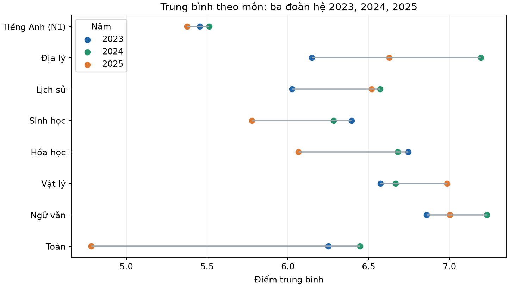
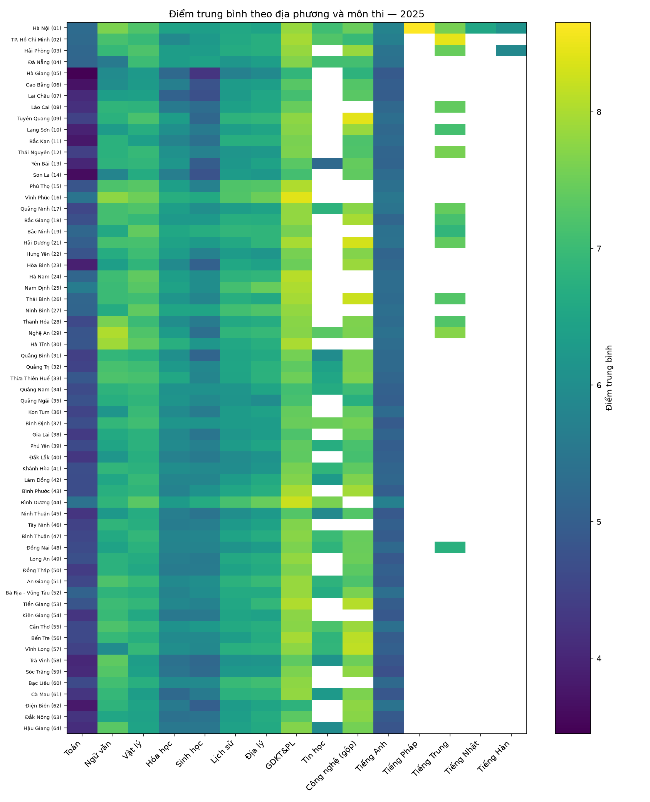

# Phần 1 — Tổng quan và đặt bài toán

## 1.1. Bối cảnh và lý do chọn đề tài

Kỳ thi tốt nghiệp THPT tạo ra lượng lớn kết quả đánh giá trên phạm vi toàn quốc. Khi điểm được xem riêng lẻ hoặc chỉ xếp hạng theo trung bình, ta dễ bỏ qua ba thông tin có ý nghĩa thực tiễn: phần phân phối điểm thấp, khác biệt giữa môn học và độ bao phủ thí sinh dự thi từng môn. So sánh ba năm còn cần thận trọng vì đề thi, chương trình và quy định chọn môn đã thay đổi.

Dự án chọn **phân tích phổ điểm thi THPT 2023–2025 theo năm × địa phương × môn/tổ hợp** vì:

1. **Có dữ liệu quy mô lớn và cấu trúc phù hợp** để mô tả kết quả theo mã hội đồng thi, môn và năm; phạm vi dự án bao quát 63 địa phương lịch sử trong bộ dữ liệu.
2. **Có câu hỏi ứng dụng cụ thể:** nơi/môn nào có phần điểm thấp kéo dài để ưu tiên tìm hiểu nhu cầu học tập; môn và tổ hợp nào thay đổi độ phủ để hỗ trợ lập kế hoạch giáo viên, lớp ôn và học liệu.
3. **Có thể kiểm tra tín hiệu phân phối khác biệt** nhằm đề xuất nơi cần rà soát thêm, trong khi vẫn tránh quy kết gian lận từ thống kê tổng hợp.
4. **Phù hợp với vòng đời khoa học dữ liệu:** dữ liệu cần được kiểm tra nguồn, chuẩn hóa, phân tích, trực quan hóa và diễn giải cùng giới hạn trước khi hỗ trợ quyết định.

Đề tài không nhằm kết luận tỉnh nào “dạy tốt/kém” hay thí sinh nào gian lận. Kết quả thi là đầu mối để đặt câu hỏi tiếp theo và ưu tiên thu thập bằng chứng phù hợp.

## 1.2. Phát biểu bài toán

**Đầu vào:** kết quả điểm thi các năm 2023, 2024 và 2025; mã địa phương/hội đồng thi lịch sử; điểm từng môn; hồ sơ đủ điểm thành phần để tính các tổ hợp. Mỗi môn/tổ hợp có mẫu số riêng. Dữ liệu tổng hợp hiện có không nhận diện trường, nơi cư trú, lý do chọn môn hay chương trình học của từng thí sinh.

**Bài toán:** mô tả và so sánh mức điểm, hình dạng phân phối và tỷ lệ tham gia theo từng năm × địa phương × môn/tổ hợp; từ đó xác định các nhóm cần tìm hiểu về hỗ trợ học tập, các thay đổi cần tính đến khi lập kế hoạch dạy học và các profile khác biệt cần rà soát độc lập.

### Câu hỏi phân tích

1. **Chênh lệch và phần điểm thấp:** tỉnh–môn nào có phân vị thấp hoặc tỷ lệ dưới ngưỡng cao lặp lại, với cỡ mẫu đủ lớn, để ưu tiên trao đổi về nhu cầu hỗ trợ?
2. **Lựa chọn môn và tổ hợp:** số lượng/tỷ lệ có điểm thay đổi ra sao qua 2023–2025; tổ hợp nào xuất hiện nhiều hay ít hơn trong hồ sơ điểm; thay đổi nào cần xác minh bằng dữ liệu đăng ký ở trường?
3. **Khác biệt phân phối:** tỉnh–môn/tổ hợp nào có profile hoặc đuôi phân phối khác biệt so với nhóm cùng môn/năm và nên được xem xét thêm?
4. **Khả năng dự báo:** dữ liệu hiện có có các biến được ghi nhận trước kỳ thi để dự báo cá nhân cần hỗ trợ hay không?

Các câu hỏi bổ sung trong diễn giải là: trung bình có che khuất phần điểm thấp không; điểm giảm có đủ để nói đề khó hơn hay học sinh yếu đi không; và khoảng cách kết quả giữa một số vùng thay đổi thế nào qua năm chuyển đổi chương trình.

## 1.3. Mục tiêu, phạm vi và sản phẩm

### Mục tiêu tổng quát

Xây dựng đánh giá có thể kiểm tra lại về phổ điểm THPT giai đoạn 2023–2025 theo địa phương, môn và tổ hợp; trình bày kết quả trực quan, nêu bất định và chuyển tín hiệu thống kê thành câu hỏi/hành động thực tiễn có giới hạn rõ ràng.

### Mục tiêu cụ thể

- Kiểm tra độ bao phủ, dữ liệu thiếu, cách mã hóa điểm và khả năng so sánh nguồn theo năm.
- Tính theo năm × địa phương × môn các chỉ số phân phối: cỡ mẫu, trung bình, trung vị, P10/P90, Q1/Q3, IQR, độ lệch chuẩn, tỷ lệ dưới/vượt ngưỡng.
- Theo dõi số lượng/tỷ lệ có điểm từng môn và 24 tổ hợp được dự án xây dựng từ các môn thành phần; luôn phân biệt số người có đủ điểm với đăng ký xét tuyển.
- Dùng quy ước sàng lọc nhất quán để ưu tiên địa phương–môn cần tìm hiểu; trình bày đủ danh sách và mẫu số, không biến ngưỡng phân tích thành tiêu chuẩn chính sách.
- Mô tả tỉnh–môn có profile khác biệt để đề xuất kiểm tra dữ liệu/hồ sơ độc lập.
- Trả lời rõ dữ liệu có đáp ứng yêu cầu dự báo trước kỳ thi hay không.
- Tạo báo cáo và biểu đồ giúp giảng viên, nhóm dự án đọc được kết quả cùng giới hạn suy luận.

### Phạm vi

| Chiều phân tích | Phạm vi sử dụng |
|---|---|
| Thời gian | Kỳ thi 2023, 2024, 2025; ba năm là ba đoàn hệ, không phải theo dõi cùng học sinh |
| Địa phương | 63 mã hội đồng thi/tỉnh lịch sử có trong bộ dữ liệu; không tự quy đổi theo địa giới sau sáp nhập |
| Môn | Các môn chung để so sánh qua năm và môn lựa chọn/môn mới khi có điểm; môn đổi nội dung hoặc cơ chế được đánh dấu riêng |
| Tổ hợp | 24 mã tổ hợp được dự án tính từ ba điểm thành phần; tổ hợp có thể chồng lấp |
| Đơn vị phân tích | Nhóm tổng hợp năm × địa phương × môn/tổ hợp; n và mẫu số phải đi kèm từng chỉ số |
| Hành động được hỗ trợ | Ưu tiên khảo sát nhu cầu, lập kế hoạch nguồn lực, chọn profile cần kiểm tra thêm; không tự động gắn nhãn cá nhân/địa phương |

**Ngoài phạm vi:** xác định nguyên nhân nhân quả của chênh lệch điểm; đánh giá toàn diện chất lượng trường/tỉnh; xác minh gian lận; dự báo cá nhân nếu không có đặc trưng được đo trước kỳ thi. Không suy diễn nơi cư trú từ mã hội đồng thi.

## 1.4. Vòng đời khoa học dữ liệu áp dụng

Dự án dùng các bước tương ứng với **CRISP-DM**, triển khai lặp lại khi kiểm tra chất lượng hoặc phát hiện hạn chế ở bước sau.

| Bước | Áp dụng trong dự án | Đầu ra cần có |
|---|---|---|
| 1. Hiểu bài toán và người dùng | Chốt câu hỏi về chênh lệch, phần điểm thấp, cơ cấu môn/tổ hợp, rà soát profile và dự báo; xác định giảng viên/nhóm dự án là người đọc | Câu hỏi nghiên cứu, phạm vi, định nghĩa chỉ số và quy tắc diễn giải |
| 2. Hiểu dữ liệu | Kiểm kê nguồn 2023–2025, cấu trúc mã hội đồng thi, điểm/môn, số hồ sơ và độ phủ theo năm | Hồ sơ dữ liệu, đối chiếu nguồn, thống kê thiếu và cảnh báo khả năng so sánh |
| 3. Chuẩn bị dữ liệu | Chuẩn hóa tên/mã môn và địa phương theo từng năm; giữ điểm 0; giữ thiếu là thiếu; tạo nhóm tỉnh × năm × môn và tổ hợp đủ ba điểm; kiểm tra n | Bảng phân tích có mẫu số rõ, nhật ký xử lý và quy tắc tái lập |
| 4. Phân tích/mô hình | Thống kê mô tả và trực quan hóa phân phối; so sánh theo năm; sàng lọc ngoại lệ/đuôi; tính tỷ lệ môn/tổ hợp; chỉ dùng mô hình đa biến như công cụ xếp hạng profile cần xem xét | Bảng chỉ số, bản đồ nhiệt, biểu đồ phân phối và danh sách tín hiệu có định nghĩa |
| 5. Đánh giá | Kiểm tra tính hợp lý, độ nhạy theo cỡ mẫu/ngưỡng, đối chiếu định nghĩa năm thi; xem kết luận có vượt quá dữ liệu không | Kết quả được kiểm chứng, giới hạn và các giải thích thay thế |
| 6. Truyền đạt/đưa vào sử dụng | Trình bày bằng báo cáo, heatmap và atlas biểu đồ; đề xuất nơi cần trao đổi/đối chiếu hồ sơ; nhận phản hồi để cập nhật phân tích | Báo cáo giảng viên, biểu đồ, danh sách rà soát và hướng thu thập dữ liệu tiếp theo |

Không có triển khai mô hình dự báo trong sản phẩm hiện tại. “Đưa vào sử dụng” ở đây là cung cấp báo cáo hỗ trợ thảo luận và kiểm tra tiếp, không phải hệ thống tự động ra quyết định.

## 1.5. Dạng bài toán khoa học dữ liệu

| Thành phần | Vai trò trong đề tài | Có/không |
|---|---|---|
| **Phân tích mô tả (descriptive analytics)** | Dạng bài toán chính: tóm tắt điểm, phân vị, phần đuôi, cỡ mẫu và tỷ lệ dự thi theo năm × địa phương × môn/tổ hợp | Có |
| **Phân tích khám phá (EDA)** | Dùng heatmap, histogram, ECDF, Q–Q và biểu đồ phân phối để tìm cấu trúc, chênh lệch và điểm cần hỏi thêm | Có |
| **Sàng lọc bất thường (anomaly screening)** | Xếp hạng profile tỉnh–môn/tổ hợp khác biệt bằng quy tắc thống kê/thuật toán; chỉ để chọn trường hợp rà soát | Có, là nhánh phụ |
| **Suy luận thống kê** | So sánh có điều kiện và trình bày bất định khi thích hợp; phải xét nhiều phép so sánh và thay đổi cơ chế thi | Hỗ trợ diễn giải |
| **Phân loại có giám sát** | Cần nhãn đã xác minh như “cần hỗ trợ” hoặc “gian lận” ở cấp cá nhân; hiện không có nhãn phù hợp | Chưa thực hiện |
| **Hồi quy/dự báo** | Cần biến đầu vào có trước kỳ thi và mục tiêu dự báo được định nghĩa; dữ liệu hiện chủ yếu là điểm sau kỳ thi/tổng hợp | Chưa đủ dữ liệu |
| **Suy luận nhân quả** | Cần thiết kế/nhóm so sánh, biến giải thích và giả định nhận dạng; ba snapshot điểm không xác lập tác động của đề/chương trình | Không thuộc kết luận hiện tại |

**Cách gọi chính xác:** đây là một dự án phân tích mô tả–khám phá, có bước sàng lọc khác biệt và so sánh thống kê. Không gọi toàn bộ đề tài là bài toán phân loại hoặc hồi quy. Đặc biệt, bất thường phân phối không phải nhãn gian lận; trung bình thấp không phải nhãn học sinh yếu.

### Tiêu chí để kết quả có ích

- Mỗi so sánh ghi rõ năm, môn, địa phương, n và mẫu số của tỷ lệ.
- Chỉ lập danh sách ưu tiên theo quy tắc đã nêu trước; ghi rõ ngưỡng là quy ước sàng lọc.
- Biểu đồ cho phép đọc cả mức trung tâm lẫn phần phân phối thấp/cao.
- Mọi đề xuất hỗ trợ đều yêu cầu bước xác minh ở trường; mọi profile bất thường cần bằng chứng độc lập.
- Không tuyên bố “đề khó hơn”, “học sinh yếu đi”, “chương trình gây ra chênh lệch” hay “có gian lận” nếu thiết kế và dữ liệu không nhận dạng được kết luận đó.

## 1.6. Bối cảnh so sánh và giới hạn từ đầu vào

2023–2024 có cấu trúc thi cơ bản gần nhau hơn; năm 2025 chuyển sang chương trình/định dạng thi và quy tắc lựa chọn môn mới. Vì thế, điểm vẫn cùng thang nhưng không mặc nhiên tương đương về độ khó, nội dung hay nhóm thí sinh. Điểm thiếu không đồng nghĩa không dự thi; số môn/tổ hợp có điểm không đồng nghĩa với môn đăng ký xét tuyển. Hồ sơ 2025 còn có thí sinh chuyển tiếp theo chương trình cũ nhưng bộ dữ liệu không có biến đánh dấu chương trình.

Minh họa dưới đây là biểu đồ có sẵn của dự án; các hình và bảng chi tiết dùng để đặt câu hỏi, không tự xác định nguyên nhân:

Xem tiếp: [Báo cáo đánh giá kết quả theo tỉnh, môn và tổ hợp](bao_cao_giang_vien_thpt_2023_2025.md) · [Báo cáo phổ điểm chi tiết](bao_cao_thpt_2023_2024_2025.md).

**Khả năng tái lập:** báo cáo nền ghi nguồn 2024 là snapshot công khai bên thứ ba chưa gồm phúc khảo; CSV nguồn 2024 hiện không có trong cây tệp của nhánh. Vì vậy, kết quả hiện tại dựa trên báo cáo/đầu ra có trong dự án; muốn chạy lại toàn bộ cần bổ sung đúng snapshot dữ liệu và mã sinh phân tích.
