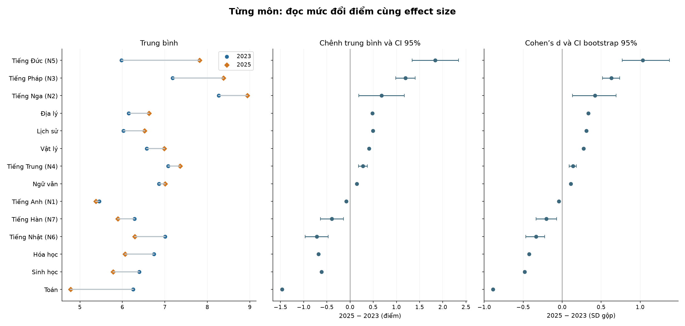
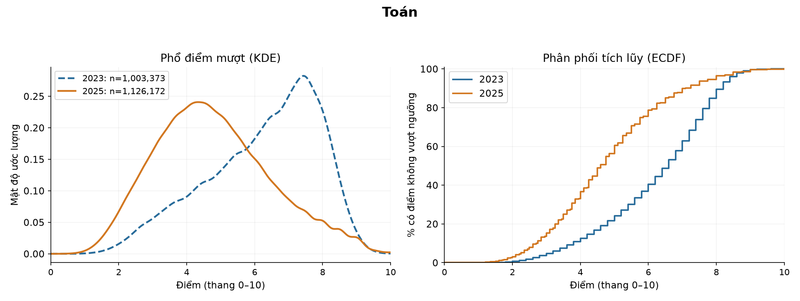

# Phần 2 — Kiểm định thống kê (tóm tắt)

So sánh **2023 → 2025**, ưu tiên từng môn rồi đến tổ hợp. Bản này giữ kết quả chính; [bản đầy đủ](phan_2_kiem_dinh_thong_ke_2023_2025.md) có mọi phép thử, khoảng tin cậy và hình chi tiết. **Δ luôn là 2025 trừ 2023**; số âm là giảm.

## 2.1. Điểm từng môn khác nhau đến mức nào?

| Môn | Số có điểm 2023 → 2025 | Trung bình 2023 → 2025 | Δ điểm | Cohen’s d |
| --- | --- | --- | --- | --- |
| Toán | 1.003.373 → 1.126.172 | 6,251 → 4,783 | -1,467 | -0,886 |
| Ngữ văn | 1.008.239 → 1.126.726 | 6,858 → 7,002 | 0,144 | 0,111 |
| Tiếng Anh (N1) | 876.102 → 351.848 | 5,454 → 5,375 | -0,079 | -0,043 |
| Vật lý | 327.189 → 347.599 | 6,574 → 6,985 | 0,411 | 0,274 |
| Hóa học | 328.118 → 240.135 | 6,745 → 6,065 | -0,680 | -0,425 |
| Sinh học | 324.625 → 69.895 | 6,395 → 5,778 | -0,617 | -0,481 |
| Lịch sử | 683.447 → 481.293 | 6,026 → 6,519 | 0,494 | 0,311 |
| Địa lý | 682.134 → 476.472 | 6,148 → 6,628 | 0,480 | 0,334 |

**Diễn giải bảng:** n chỉ đếm người có điểm hợp lệ của từng môn, giữ điểm 0 và không điền thiếu. Trung bình và Δ dùng thang 10. Cohen’s d lấy chênh trung bình chia SD gộp: dấu chỉ hướng, độ lớn tuyệt đối giúp đánh giá mức khác biệt. Các mốc 0,2/0,5/0,8 chỉ là quy ước tham khảo.

**Nhận xét:** Toán giảm rõ nhất trong 8 môn chung: khoảng **1,47 điểm**, d=**−0,886**. Hóa và Sinh giảm lần lượt khoảng **0,68** và **0,62 điểm**. Lý, Sử, Địa và Văn tăng. Tiếng Anh chỉ giảm **0,079 điểm**, d=**−0,043**: khác biệt có thể có ý nghĩa thống kê nhờ mẫu lớn nhưng mức chênh thực tế nhỏ.

**Diễn giải hình:** Trái là trung bình hai năm; giữa là Δ và CI 95% theo điểm; phải là d và CI bootstrap. Đọc đồng thời chênh điểm gốc và d. CI hẹp ở mẫu lớn không làm một chênh lệch nhỏ trở thành lớn. Các ngôn ngữ ít người có CI rộng hơn.

**Ngoại ngữ khác cũng được tính riêng, không gộp vào Tiếng Anh:**

| Ngoại ngữ | Số có điểm 2023 → 2025 | Δ điểm | d |
| --- | --- | --- | --- |
| Tiếng Nga (N2) | 87 → 60 | 0,677 | 0,422 |
| Tiếng Pháp (N3) | 716 → 408 | 1,194 | 0,630 |
| Tiếng Trung (N4) | 2.940 → 4.225 | 0,278 | 0,137 |
| Tiếng Đức (N5) | 86 → 150 | 1,838 | 1,035 |
| Tiếng Nhật (N6) | 659 → 491 | -0,718 | -0,335 |
| Tiếng Hàn (N7) | 407 → 541 | -0,390 | -0,203 |

**Diễn giải bảng:** N2–N7 là các nhóm ngôn ngữ khác nhau. Tiếng Đức có d lớn nhất nhưng chỉ có **86 → 150 người**; Tiếng Nga có **87 → 60 người**. Vì mẫu nhỏ và thành phần dự thi riêng, không dùng thứ hạng này để kết luận cho mọi thí sinh hoặc xếp độ khó giữa các ngôn ngữ.

**Môn chỉ có một năm:** GDCD năm 2023 có **565.452** điểm, trung bình **8,286**; năm 2025 có GDKT&PL **246.401** điểm, trung bình **7,691**, Tin học **7.602** điểm, trung bình **6,783**, Công nghệ **24.338** điểm, trung bình **7,535**. Giữ các kết quả mô tả này nhưng không tạo phép thử liên năm bằng cách thay điểm thiếu bằng 0; GDCD và GDKT&PL khác nội dung.

## 2.2. Kiểm định cho biết điều gì?

| Phương pháp | Câu hỏi trả lời | Kết quả cần nhớ |
| --- | --- | --- |
| Welch t-test | Trung bình hai năm có khác nhau? | 8 môn chung đều có p sau Holm < 0,001. |
| Mann–Whitney U | Thứ hạng/phân phối điểm có khác nhau? | Đối chiếu bổ sung; không mặc định là kiểm định trung vị. |
| Kolmogorov–Smirnov (KS) | Toàn bộ phân phối có thay đổi? | Toán có D=0,414; q hoán vị sau BH khoảng 0,000636. |
| Levene/Brown–Forsythe | Độ phân tán có khác nhau? | Đọc cùng SD và tỷ số phương sai, không chỉ p nhỏ. |
| Cohen’s d và CI | Khác biệt lớn đến mức nào? | Toán d=−0,886; Anh d=−0,043 dù đều có ý nghĩa thống kê. |

**Diễn giải bảng:** p nhỏ cho biết dữ liệu khó phù hợp với giả thuyết không khác biệt theo mô hình, không cho biết khác biệt lớn hay có nguyên nhân từ đâu. Welch được hiệu chỉnh Holm trên **14 nhóm môn so được**; MWU/KS/Brown–Forsythe dùng BH chung trên **42 phép thử**. Holm kiểm soát nguy cơ có ít nhất một kết luận dương tính giả trong nhóm; BH kiểm soát tỷ lệ phát hiện sai kỳ vọng theo các giả định tương ứng. p lớn cũng không chứng minh hai nhóm tương đương.

**Ví dụ Toán:** Δ=**−1,467 điểm**, CI 95% **[−1,472; −1,463]**; d=**−0,886**, CI bootstrap **[−0,889; −0,883]**. KS D=**0,414** là khoảng cách lớn nhất giữa hai đường tích lũy, khoảng **41,4 điểm phần trăm** tại mốc **5,75 điểm**; không phải 41,4% học sinh giảm điểm. KS dùng **1.999 lần hoán vị**, xử lý điểm trùng; p nhỏ nhất phân giải được là 0,0005.

**Diễn giải hình:** Đường xanh nét đứt ở phổ KDE là 2023, cam là 2025. Năm 2025 tập trung nhiều hơn ở vùng điểm thấp; tỷ lệ dưới 5 tăng từ 21,64% lên 56,39%. KDE làm mượt điểm thực tế, không ép thành phân phối chuẩn; trục dọc là mật độ, diện tích bằng 1. Hình phải là ECDF, cho biết % có điểm không vượt ngưỡng.

**Về phương sai:** SD là độ trải rộng quanh trung bình; IQR là độ rộng 50% điểm ở giữa. Với Toán, SD **1,63 → 1,68**, tỷ số phương sai **1,054**, dù Brown–Forsythe có q rất nhỏ. Vì vậy, mức thay đổi độ phân tán vẫn cần đọc bằng số, không chỉ dựa vào kết quả “có ý nghĩa”.

## 2.3. Tổng điểm các khối có khác nhau không?

Tổng ba môn dùng thang **30**, chỉ tính người đủ cả ba điểm. Bảng giữ đủ **24 mã** bằng **23 dòng kết quả** vì B08/D08 cùng bộ Toán–Sinh–Anh.

| Khối | Trung bình 2023 → 2025 | Δ tổng điểm | d |
| --- | --- | --- | --- |
| A00 | 20,774 → 19,369 | -1,405 | -0,395 |
| A01 | 20,274 → 18,869 | -1,406 | -0,410 |
| A02 | 20,426 → 15,320 | -5,107 | -1,870 |
| A08* | 20,291 → 17,287 | -3,003 | — |
| A09* | 20,383 → 17,390 | -2,993 | — |
| B00 | 20,605 → 18,289 | -2,315 | -0,762 |
| B08/D08 | 20,066 → 15,657 | -4,409 | -1,465 |
| C00 | 18,975 → 19,721 | 0,746 | 0,203 |
| C01 | 21,011 → 20,088 | -0,923 | -0,312 |
| C02 | 21,173 → 19,115 | -2,059 | -0,691 |
| C03 | 18,479 → 17,281 | -1,198 | -0,330 |
| C04 | 18,610 → 17,289 | -1,321 | -0,379 |
| C14* | 21,174 → 18,463 | -2,711 | — |
| C19* | 21,442 → 20,251 | -1,191 | — |
| C20* | 21,533 → 20,314 | -1,218 | — |
| D01 | 18,889 → 18,582 | -0,307 | -0,086 |
| D07 | 20,422 → 17,508 | -2,914 | -0,936 |
| D09 | 16,999 → 17,857 | 0,858 | 0,223 |
| D10 | 17,094 → 18,189 | 1,095 | 0,306 |
| D14 | 18,155 → 20,449 | 2,294 | 0,634 |
| D15 | 18,249 → 20,631 | 2,382 | 0,715 |
| D66* | 20,308 → 21,110 | 0,802 | — |
| D84* | 19,152 → 18,556 | -0,596 | — |

**Diễn giải bảng:** d chỉ báo cho **16 bộ môn không đổi thành phần**. Bảy khối có dấu * đổi GDCD sang GDKT&PL nên chỉ mô tả tổng riêng từng năm, không gán d/p liên năm như cùng nội dung. B08/D08 tính một lần, không nhân đôi số phép thử. Mỗi khối có tập người đủ điểm riêng; số mẫu xem ở bản đầy đủ.

**Nhận xét:** A02 giảm mạnh nhất trong nhóm so được (**−5,107 điểm; d=−1,870**); B08/D08 cũng giảm rõ (**−4,409; d=−1,465**). A00 và A01 đều giảm khoảng 1,4 điểm nhưng d chỉ khoảng −0,4. D15 và D14 tăng khoảng **2,38** và **2,29 điểm**; C00 tăng **0,746 điểm**, d=0,203. D01 giảm nhẹ (**−0,307; d=−0,086**). Cùng một p nhỏ có thể đi cùng độ lớn rất khác nhau.

## 2.4. Có thể kết luận gì?

Kiểm định bổ sung bằng chứng cho biểu đồ: **điểm quan sát thay đổi về trung bình, thứ hạng, hình dạng và độ phân tán**, nhưng cần đọc cùng Δ, d, CI và số mẫu. Hai năm có chương trình, đề và cơ cấu chọn môn khác nhau; chưa tách được nguyên nhân riêng. SD/IQR của tổng điểm cũng chưa đo trực tiếp độ phân biệt từng câu hỏi.

**Nguồn:** toàn bộ số liệu được rút từ [báo cáo phần 2 đầy đủ](phan_2_kiem_dinh_thong_ke_2023_2025.md), cùng hai tệp điểm của dự án. Các hình dùng lại thư mục hiện có; không tạo thêm dữ liệu hoặc file Python.
