# Phần 2 — Kiểm định thống kê điểm thi THPT 2023 và 2025

**2023 — CT2006** so với **2025 — CT2018**. Giữ điểm 0, không điền thiếu. Báo cáo bao phủ mọi môn có điểm, tách N1–N7; không ghép GDCD với GDKT&PL thành một môn bất biến.

## Kết quả chính — đọc phần này trước

Trong 18 nhóm môn thuộc hợp hai năm, 14 nhóm có dữ liệu cả hai năm và 4 nhóm chỉ có một năm. Các khác biệt |d| lớn nhất trong tập so được là: Tiếng Đức (N5): Δ=1,838 điểm, d=1,035; Toán: Δ=-1,467 điểm, d=-0,886; Tiếng Pháp (N3): Δ=1,194 điểm, d=0,630. Đây là chênh điểm quan sát, không phải tác động nhân quả.

## 2.1. Phạm vi: mỗi con số dùng mẫu nào?

| Năm | Nhóm môn/ngôn ngữ | Tổng lượt điểm trong các nhóm |
| --- | --- | --- |
| 2.023 | 15 | 5.803.574 |
| 2.025 | 17 | 4.504.356 |

**Diễn giải bảng:** Lượt điểm không phải số người duy nhất: một người có thể có nhiều môn. Ngoại ngữ đã tách theo mã, N1 và cột Tiếng Anh dẫn xuất chỉ tính một lần. Năm 2023 có GDCD; năm 2025 có GDKT&PL, Tin học, Công nghệ. Môn chỉ một năm vẫn hiện trong báo cáo nhưng không bị gán điểm năm còn thiếu.

## 2.2. Trung bình và mức khác biệt của mọi môn

| Môn | n 2023 | n 2025 | TB 2023 | TB 2025 | Δ điểm | d |
| --- | --- | --- | --- | --- | --- | --- |
| Sinh học | 324.625 | 69.895 | 6,395 | 5,778 | -0,617 | -0,481 |
| Hóa học | 328.118 | 240.135 | 6,745 | 6,065 | -0,680 | -0,425 |
| GDCD | 565.452 | 0 | 8,286 | — | — | — |
| GDKT&PL | 0 | 246.401 | — | 7,691 | — | — |
| Tiếng Anh (N1) | 876.102 | 351.848 | 5,454 | 5,375 | -0,079 | -0,043 |
| Tiếng Nga (N2) | 87 | 60 | 8,264 | 8,942 | 0,677 | 0,422 |
| Tiếng Pháp (N3) | 716 | 408 | 7,183 | 8,377 | 1,194 | 0,630 |
| Tiếng Trung (N4) | 2.940 | 4.225 | 7,079 | 7,356 | 0,278 | 0,137 |
| Tiếng Đức (N5) | 86 | 150 | 5,979 | 7,817 | 1,838 | 1,035 |
| Tiếng Nhật (N6) | 659 | 491 | 7,008 | 6,290 | -0,718 | -0,335 |
| Tiếng Hàn (N7) | 407 | 541 | 6,286 | 5,896 | -0,390 | -0,203 |
| Địa lý | 682.134 | 476.472 | 6,148 | 6,628 | 0,480 | 0,334 |
| Lịch sử | 683.447 | 481.293 | 6,026 | 6,519 | 0,494 | 0,311 |
| Tin học | 0 | 7.602 | — | 6,783 | — | — |
| Ngữ văn | 1.008.239 | 1.126.726 | 6,858 | 7,002 | 0,144 | 0,111 |
| Toán | 1.003.373 | 1.126.172 | 6,251 | 4,783 | -1,467 | -0,886 |
| Vật lý | 327.189 | 347.599 | 6,574 | 6,985 | 0,411 | 0,274 |
| Công nghệ | 0 | 24.338 | — | 7,535 | — | — |

**Diễn giải bảng:** Δ là 2025 trừ 2023, âm là giảm. n=0 chỉ biểu thị không có điểm trong nguồn năm đó, không phải mean=0. d đo chênh tương đối bằng SD gộp, không là phần trăm. Phải đọc cả điểm gốc và d vì cùng p nhỏ có thể đi kèm mức khác biệt rất khác.

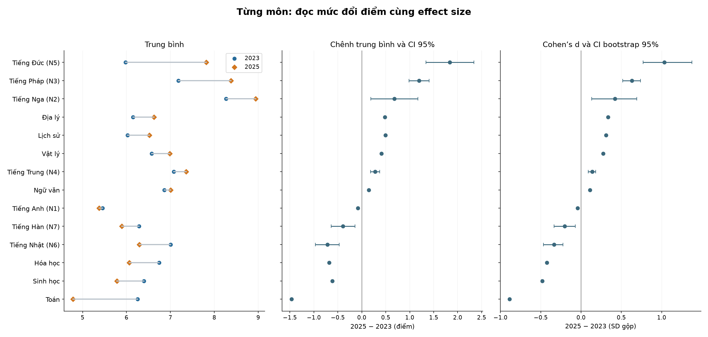

**Diễn giải hình:** Mỗi hàng là một môn có đủ hai năm. Trái là mean, giữa là Δ/CI theo điểm, phải là d/CI bootstrap theo SD. Thanh CI hẹp ở mẫu lớn không làm một mức đổi nhỏ trở thành ảnh hưởng lớn; các ngôn ngữ ít người có CI rộng hơn.

## 2.3. Cách tính và đọc trước khi đi vào từng môn

**Welch t-test** hỏi trung bình hai nhóm có khác không, không giả định phương sai bằng nhau. H0: hai trung bình bằng nhau; H1 hai phía: khác nhau. **p-value** đo độ bất tương thích với mô hình H0, không là xác suất H0 đúng, không đo độ lớn thay đổi. P rất nhỏ ở mẫu lớn phải đi kèm Δ và d.

**Cohen’s d** = (mean2025−mean2023)/SD gộp. Dấu chỉ hướng; |d| 0,2/0,5/0,8 là mốc tham khảo, không ranh giới phổ quát. **Hedges’ g** hiệu chỉnh mẫu nhỏ; ở mẫu lớn g gần d. CI d bootstrap 999 lần theo tần số điểm, CI percentile; CI mean từ Welch. CI không là khoảng chứa 95% học sinh.

**Mann–Whitney U** đối chiếu thứ hạng/phân phối, không mặc định kiểm định mean hay median. **A**=P(X2025>X2023)+0,5P(bằng điểm); **rank-biserial**=2A−1. Điểm trùng đã được hiệu chỉnh khi tính p MWU.

**Phổ điểm mượt KDE:** dùng toàn bộ điểm, histogram mịn được làm mượt bằng kernel Gaussian, bandwidth 0,20 điểm và phản xạ ở biên 0/10; diện tích chuẩn hóa bằng 1. Cách này ước lượng hình dạng thực, không ép điểm theo phân phối chuẩn. Thống kê/kiểm định vẫn tính trên điểm gốc, không trên đường đã làm mượt.

**KS D** là khoảng cách lớn nhất giữa hai ECDF. P tiêu chuẩn giả thiết liên tục chỉ để tham khảo; p chính dùng hoán vị nhãn theo tần số điểm giữ đúng n hai năm (1.999 lần, seed cố định). **Brown–Forsythe** là Levene quanh median; đọc cùng SD/IQR/tỷ số phương sai, không đồng nhất với chất lượng phân hóa của đề. Levene quanh mean được giữ ở CSV như đối chiếu bổ sung.

**Đa kiểm định:** Holm cho family Welch; BH chung cho MWU/KS/Brown–Forsythe. Môn một năm không thêm phép thử. Dữ liệu gần toàn bộ thí sinh quan sát mỗi năm nên Δ mô tả trực tiếp tập đó; p/CI chỉ có nghĩa dưới mô hình suy luận/độc lập rộng hơn. Có thể có người thi lại, số báo danh không nhận diện người liên năm.

## 2.4. Bảng, hình và diễn giải từng môn

### 2.4.1. Sinh học

| Năm | Số có điểm | Trung bình | Trung vị | SD | IQR | <5 (%) | ≥8 (%) | ≥9 (%) |
| --- | --- | --- | --- | --- | --- | --- | --- | --- |
| 2.023 | 324.625 | 6,39 | 6,50 | 1,21 | 1,75 | 10,40 | 10,57 | 1,68 |
| 2.025 | 69.895 | 5,78 | 5,75 | 1,58 | 2,40 | 32,44 | 10,83 | 2,54 |

**Diễn giải bảng:** n là số có điểm hợp lệ của riêng mục này, không phải mọi dòng trong năm. SD đo độ trải rộng; IQR là độ rộng vùng 50% ở giữa. Các tỷ lệ chia cho n của đúng hàng; nhóm ≥90% thang điểm đã nằm trong nhóm ≥80%, không cộng hai tỷ lệ.

**Nhận xét bằng số:** Trung bình 6,39 → 5,78, giảm 0,62 điểm; trung vị 6,50 → 5,75. Cohen’s d=-0,481 (trong khoảng 0,2–0,5 về |d| theo quy ước tham khảo). Tỷ số phương sai 2025/2023=1,716. Không dùng nhãn độ lớn như kết luận hai năm tương đương.

| Câu hỏi/phép thử | Thống kê | p gốc | p Holm / q BH |
| --- | --- | --- | --- |
| Welch: trung bình | t=-97,211, df=88.235,9 | ≈0 (dưới độ phân giải số) | ≈0 (dưới độ phân giải số) |
| MWU: thứ hạng | U=8.512.326.163,5 | ≈0 (dưới độ phân giải số) | ≈0 (dưới độ phân giải số) |
| KS: toàn phân phối | D=0,243; tại điểm 5,45 | 5.00e-04 | 6.36e-04 |
| Brown–Forsythe: độ phân tán | W=11.207,490 | ≈0 (dưới độ phân giải số) | ≈0 (dưới độ phân giải số) |

**Diễn giải bảng:** Welch dùng Holm trong family 14 phép thử trung bình; ba phép thăm dò dùng BH chung trong family 42 p hữu hạn. KS dùng hoán vị 1,999 lần, p nhỏ nhất phân giải được là 0,0005. Giá trị “≈0” ở các phép tiệm cận là giới hạn tính số, không phải xác suất bằng 0.

**Khoảng tin cậy và độ lớn:** Chênh trung bình có CI 95% [-0,629; -0,604] **điểm**. d có CI bootstrap 95% [-0,492; -0,472] **SD gộp**; Hedges’ g=-0,481. A=0,375 là xác suất thắng cộng nửa xác suất hòa, không phải chỉ P(2025>2023).

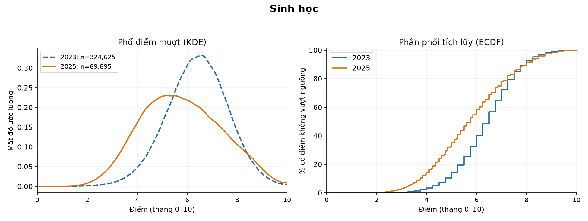

**Diễn giải hình:** Xanh nét đứt là 2023, cam nét liền là 2025; KDE mượt là mật độ, diện tích trên thang điểm bằng 1, không phải số người tuyệt đối. Ở ECDF, chiều cao là % điểm không vượt ngưỡng. Khoảng cách lớn nhất hai ECDF là D=0,243, gần mốc 5,45; đây là 24,3 điểm phần trăm ở mốc đó, không phải tỷ lệ người tiến bộ.

**Ý nghĩa và giới hạn:** Kết quả có bằng chứng chênh trung bình theo mô hình ở mức 0,05 sau Holm. Điều này cần đọc cùng mức đổi -0,617 điểm, |d| và hình dạng; p lớn không chứng minh tương đương. So sánh là giữa hai tập điểm quan sát, không tách được độ khó, chương trình, cách chấm và thành phần thí sinh.

### 2.4.2. Hóa học

| Năm | Số có điểm | Trung bình | Trung vị | SD | IQR | <5 (%) | ≥8 (%) | ≥9 (%) |
| --- | --- | --- | --- | --- | --- | --- | --- | --- |
| 2.023 | 328.118 | 6,74 | 7,00 | 1,43 | 2,00 | 11,70 | 22,67 | 3,42 |
| 2.025 | 240.135 | 6,06 | 6,00 | 1,81 | 2,75 | 29,53 | 19,29 | 7,43 |

**Diễn giải bảng:** n là số có điểm hợp lệ của riêng mục này, không phải mọi dòng trong năm. SD đo độ trải rộng; IQR là độ rộng vùng 50% ở giữa. Các tỷ lệ chia cho n của đúng hàng; nhóm ≥90% thang điểm đã nằm trong nhóm ≥80%, không cộng hai tỷ lệ.

**Nhận xét bằng số:** Trung bình 6,74 → 6,06, giảm 0,68 điểm; trung vị 7,00 → 6,00. Cohen’s d=-0,425 (trong khoảng 0,2–0,5 về |d| theo quy ước tham khảo). Tỷ số phương sai 2025/2023=1,607. Không dùng nhãn độ lớn như kết luận hai năm tương đương.

| Câu hỏi/phép thử | Thống kê | p gốc | p Holm / q BH |
| --- | --- | --- | --- |
| Welch: trung bình | t=-152,480, df=441.623,8 | ≈0 (dưới độ phân giải số) | ≈0 (dưới độ phân giải số) |
| MWU: thứ hạng | U=29.966.777.226,5 | ≈0 (dưới độ phân giải số) | ≈0 (dưới độ phân giải số) |
| KS: toàn phân phối | D=0,239; tại điểm 6,20 | 5.00e-04 | 6.36e-04 |
| Brown–Forsythe: độ phân tán | W=22.014,715 | ≈0 (dưới độ phân giải số) | ≈0 (dưới độ phân giải số) |

**Diễn giải bảng:** Welch dùng Holm trong family 14 phép thử trung bình; ba phép thăm dò dùng BH chung trong family 42 p hữu hạn. KS dùng hoán vị 1,999 lần, p nhỏ nhất phân giải được là 0,0005. Giá trị “≈0” ở các phép tiệm cận là giới hạn tính số, không phải xác suất bằng 0.

**Khoảng tin cậy và độ lớn:** Chênh trung bình có CI 95% [-0,689; -0,671] **điểm**. d có CI bootstrap 95% [-0,430; -0,419] **SD gộp**; Hedges’ g=-0,425. A=0,380 là xác suất thắng cộng nửa xác suất hòa, không phải chỉ P(2025>2023).

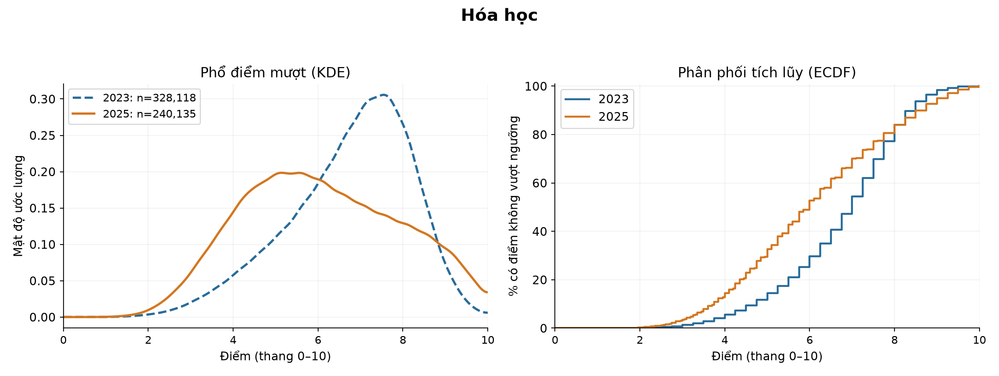

**Diễn giải hình:** Xanh nét đứt là 2023, cam nét liền là 2025; KDE mượt là mật độ, diện tích trên thang điểm bằng 1, không phải số người tuyệt đối. Ở ECDF, chiều cao là % điểm không vượt ngưỡng. Khoảng cách lớn nhất hai ECDF là D=0,239, gần mốc 6,20; đây là 23,9 điểm phần trăm ở mốc đó, không phải tỷ lệ người tiến bộ.

**Ý nghĩa và giới hạn:** Kết quả có bằng chứng chênh trung bình theo mô hình ở mức 0,05 sau Holm. Điều này cần đọc cùng mức đổi -0,680 điểm, |d| và hình dạng; p lớn không chứng minh tương đương. So sánh là giữa hai tập điểm quan sát, không tách được độ khó, chương trình, cách chấm và thành phần thí sinh.

### 2.4.3. GDCD

| Năm | Số có điểm | Trung bình | Trung vị | SD | IQR | <5 (%) | ≥8 (%) | ≥9 (%) |
| --- | --- | --- | --- | --- | --- | --- | --- | --- |
| 2.023 | 565.452 | 8,29 | 8,50 | 1,14 | 1,50 | 0,97 | 68,95 | 35,45 |

**Diễn giải bảng:** n là số có điểm hợp lệ của riêng mục này, không phải mọi dòng trong năm. SD đo độ trải rộng; IQR là độ rộng vùng 50% ở giữa. Các tỷ lệ chia cho n của đúng hàng; nhóm ≥90% thang điểm đã nằm trong nhóm ≥80%, không cộng hai tỷ lệ.

**Phạm vi so sánh:** Không có điểm ở một năm; không tạo mẫu bằng 0. Có thống kê và hình cho năm hiện có; ô thiếu không được thay bằng 0 và không tạo p-value/CI liên năm giả.

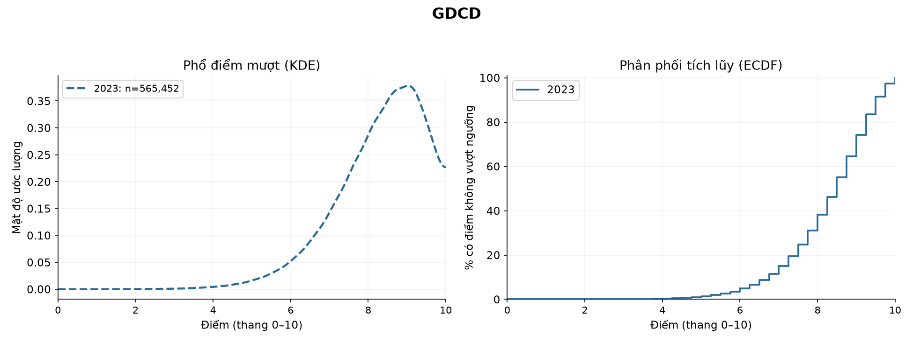

**Diễn giải hình:** Chỉ vẽ các năm có điểm thực. KDE là mật độ mượt từ điểm quan sát; ECDF mô tả phần tích lũy. Không có đường của một năm không có nghĩa điểm của năm đó bằng 0.

**Ý nghĩa và giới hạn:** Kết quả mô tả đúng mẫu có điểm. Mục này không được đưa vào family kiểm định liên năm chính; khác môn/chương trình không được diễn giải như cùng một thang năng lực.

### 2.4.4. GDKT&PL

| Năm | Số có điểm | Trung bình | Trung vị | SD | IQR | <5 (%) | ≥8 (%) | ≥9 (%) |
| --- | --- | --- | --- | --- | --- | --- | --- | --- |
| 2.025 | 246.401 | 7,69 | 7,75 | 1,18 | 1,50 | 2,57 | 49,12 | 14,30 |

**Diễn giải bảng:** n là số có điểm hợp lệ của riêng mục này, không phải mọi dòng trong năm. SD đo độ trải rộng; IQR là độ rộng vùng 50% ở giữa. Các tỷ lệ chia cho n của đúng hàng; nhóm ≥90% thang điểm đã nằm trong nhóm ≥80%, không cộng hai tỷ lệ.

**Phạm vi so sánh:** Không có điểm ở một năm; không tạo mẫu bằng 0. Có thống kê và hình cho năm hiện có; ô thiếu không được thay bằng 0 và không tạo p-value/CI liên năm giả.

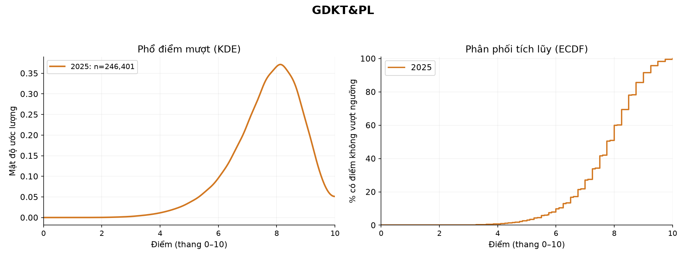

**Diễn giải hình:** Chỉ vẽ các năm có điểm thực. KDE là mật độ mượt từ điểm quan sát; ECDF mô tả phần tích lũy. Không có đường của một năm không có nghĩa điểm của năm đó bằng 0.

**Ý nghĩa và giới hạn:** Kết quả mô tả đúng mẫu có điểm. Mục này không được đưa vào family kiểm định liên năm chính; khác môn/chương trình không được diễn giải như cùng một thang năng lực.

### 2.4.5. Tiếng Anh (N1)

| Năm | Số có điểm | Trung bình | Trung vị | SD | IQR | <5 (%) | ≥8 (%) | ≥9 (%) |
| --- | --- | --- | --- | --- | --- | --- | --- | --- |
| 2.023 | 876.102 | 5,45 | 5,20 | 1,96 | 3,20 | 44,83 | 15,04 | 5,29 |
| 2.025 | 351.848 | 5,38 | 5,25 | 1,45 | 2,00 | 38,22 | 5,39 | 1,35 |

**Diễn giải bảng:** n là số có điểm hợp lệ của riêng mục này, không phải mọi dòng trong năm. SD đo độ trải rộng; IQR là độ rộng vùng 50% ở giữa. Các tỷ lệ chia cho n của đúng hàng; nhóm ≥90% thang điểm đã nằm trong nhóm ≥80%, không cộng hai tỷ lệ.

**Nhận xét bằng số:** Trung bình 5,45 → 5,38, giảm 0,08 điểm; trung vị 5,20 → 5,25. Cohen’s d=-0,043 (dưới mốc 0,2 về |d| theo quy ước tham khảo). Tỷ số phương sai 2025/2023=0,545. Không dùng nhãn độ lớn như kết luận hai năm tương đương.

| Câu hỏi/phép thử | Thống kê | p gốc | p Holm / q BH |
| --- | --- | --- | --- |
| Welch: trung bình | t=-24,443, df=871.175,3 | 6.70e-132 | 4.69e-131 |
| MWU: thứ hạng | U=155.544.315.014,0 | 1.46e-15 | 3.40e-15 |
| KS: toàn phân phối | D=0,130; tại điểm 4,20 | 5.00e-04 | 6.36e-04 |
| Brown–Forsythe: độ phân tán | W=51.838,522 | ≈0 (dưới độ phân giải số) | ≈0 (dưới độ phân giải số) |

**Diễn giải bảng:** Welch dùng Holm trong family 14 phép thử trung bình; ba phép thăm dò dùng BH chung trong family 42 p hữu hạn. KS dùng hoán vị 1,999 lần, p nhỏ nhất phân giải được là 0,0005. Giá trị “≈0” ở các phép tiệm cận là giới hạn tính số, không phải xác suất bằng 0.

**Khoảng tin cậy và độ lớn:** Chênh trung bình có CI 95% [-0,085; -0,072] **điểm**. d có CI bootstrap 95% [-0,047; -0,040] **SD gộp**; Hedges’ g=-0,043. A=0,505 là xác suất thắng cộng nửa xác suất hòa, không phải chỉ P(2025>2023).

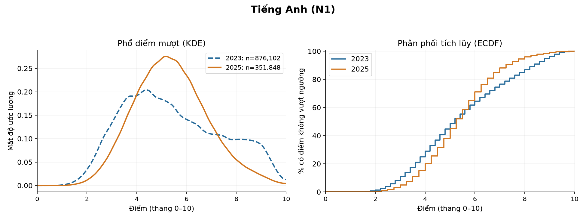

**Diễn giải hình:** Xanh nét đứt là 2023, cam nét liền là 2025; KDE mượt là mật độ, diện tích trên thang điểm bằng 1, không phải số người tuyệt đối. Ở ECDF, chiều cao là % điểm không vượt ngưỡng. Khoảng cách lớn nhất hai ECDF là D=0,130, gần mốc 4,20; đây là 13,0 điểm phần trăm ở mốc đó, không phải tỷ lệ người tiến bộ.

**Ý nghĩa và giới hạn:** Kết quả có bằng chứng chênh trung bình theo mô hình ở mức 0,05 sau Holm. Điều này cần đọc cùng mức đổi -0,079 điểm, |d| và hình dạng; p lớn không chứng minh tương đương. So sánh là giữa hai tập điểm quan sát, không tách được độ khó, chương trình, cách chấm và thành phần thí sinh.

### 2.4.6. Tiếng Nga (N2)

| Năm | Số có điểm | Trung bình | Trung vị | SD | IQR | <5 (%) | ≥8 (%) | ≥9 (%) |
| --- | --- | --- | --- | --- | --- | --- | --- | --- |
| 2.023 | 87 | 8,26 | 9,00 | 1,85 | 2,00 | 9,20 | 70,11 | 55,17 |
| 2.025 | 60 | 8,94 | 9,25 | 1,16 | 1,00 | 0,00 | 86,67 | 65,00 |

**Diễn giải bảng:** n là số có điểm hợp lệ của riêng mục này, không phải mọi dòng trong năm. SD đo độ trải rộng; IQR là độ rộng vùng 50% ở giữa. Các tỷ lệ chia cho n của đúng hàng; nhóm ≥90% thang điểm đã nằm trong nhóm ≥80%, không cộng hai tỷ lệ.

**Nhận xét bằng số:** Trung bình 8,26 → 8,94, tăng 0,68 điểm; trung vị 9,00 → 9,25. Cohen’s d=0,422 (trong khoảng 0,2–0,5 về |d| theo quy ước tham khảo). Tỷ số phương sai 2025/2023=0,390. Không dùng nhãn độ lớn như kết luận hai năm tương đương.

| Câu hỏi/phép thử | Thống kê | p gốc | p Holm / q BH |
| --- | --- | --- | --- |
| Welch: trung bình | t=2,727, df=143,8 | 0,0072 | 0,0072 |
| MWU: thứ hạng | U=3.158,0 | 0,0305 | 0,0329 |
| KS: toàn phân phối | D=0,219; tại điểm 9,40 | 0,0290 | 0,0321 |
| Brown–Forsythe: độ phân tán | W=4,304 | 0,0398 | 0,0418 |

**Diễn giải bảng:** Welch dùng Holm trong family 14 phép thử trung bình; ba phép thăm dò dùng BH chung trong family 42 p hữu hạn. KS dùng hoán vị 1,999 lần, p nhỏ nhất phân giải được là 0,0005. Giá trị “≈0” ở các phép tiệm cận là giới hạn tính số, không phải xác suất bằng 0.

**Khoảng tin cậy và độ lớn:** Chênh trung bình có CI 95% [0,186; 1,168] **điểm**. d có CI bootstrap 95% [0,133; 0,691] **SD gộp**; Hedges’ g=0,420. A=0,605 là xác suất thắng cộng nửa xác suất hòa, không phải chỉ P(2025>2023).

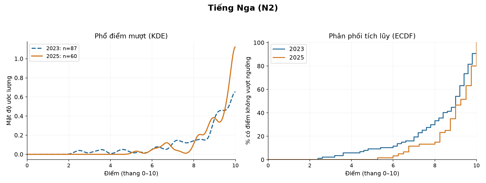

**Diễn giải hình:** Xanh nét đứt là 2023, cam nét liền là 2025; KDE mượt là mật độ, diện tích trên thang điểm bằng 1, không phải số người tuyệt đối. Ở ECDF, chiều cao là % điểm không vượt ngưỡng. Khoảng cách lớn nhất hai ECDF là D=0,219, gần mốc 9,40; đây là 21,9 điểm phần trăm ở mốc đó, không phải tỷ lệ người tiến bộ.

**Ý nghĩa và giới hạn:** Kết quả có bằng chứng chênh trung bình theo mô hình ở mức 0,05 sau Holm. Điều này cần đọc cùng mức đổi 0,677 điểm, |d| và hình dạng; p lớn không chứng minh tương đương. So sánh là giữa hai tập điểm quan sát, không tách được độ khó, chương trình, cách chấm và thành phần thí sinh.

### 2.4.7. Tiếng Pháp (N3)

| Năm | Số có điểm | Trung bình | Trung vị | SD | IQR | <5 (%) | ≥8 (%) | ≥9 (%) |
| --- | --- | --- | --- | --- | --- | --- | --- | --- |
| 2.023 | 716 | 7,18 | 7,60 | 2,10 | 3,60 | 19,13 | 45,25 | 29,75 |
| 2.025 | 408 | 8,38 | 8,75 | 1,47 | 1,75 | 2,94 | 70,83 | 47,55 |

**Diễn giải bảng:** n là số có điểm hợp lệ của riêng mục này, không phải mọi dòng trong năm. SD đo độ trải rộng; IQR là độ rộng vùng 50% ở giữa. Các tỷ lệ chia cho n của đúng hàng; nhóm ≥90% thang điểm đã nằm trong nhóm ≥80%, không cộng hai tỷ lệ.

**Nhận xét bằng số:** Trung bình 7,18 → 8,38, tăng 1,19 điểm; trung vị 7,60 → 8,75. Cohen’s d=0,630 (trong khoảng 0,5–0,8 về |d| theo quy ước tham khảo). Tỷ số phương sai 2025/2023=0,489. Không dùng nhãn độ lớn như kết luận hai năm tương đương.

| Câu hỏi/phép thử | Thống kê | p gốc | p Holm / q BH |
| --- | --- | --- | --- |
| Welch: trung bình | t=11,162, df=1.076,4 | 1.88e-27 | 1.13e-26 |
| MWU: thứ hạng | U=194.523,0 | 1.97e-20 | 4.87e-20 |
| KS: toàn phân phối | D=0,281; tại điểm 7,20 | 5.00e-04 | 6.36e-04 |
| Brown–Forsythe: độ phân tán | W=93,018 | 3.35e-21 | 8.80e-21 |

**Diễn giải bảng:** Welch dùng Holm trong family 14 phép thử trung bình; ba phép thăm dò dùng BH chung trong family 42 p hữu hạn. KS dùng hoán vị 1,999 lần, p nhỏ nhất phân giải được là 0,0005. Giá trị “≈0” ở các phép tiệm cận là giới hạn tính số, không phải xác suất bằng 0.

**Khoảng tin cậy và độ lớn:** Chênh trung bình có CI 95% [0,984; 1,404] **điểm**. d có CI bootstrap 95% [0,516; 0,739] **SD gộp**; Hedges’ g=0,630. A=0,666 là xác suất thắng cộng nửa xác suất hòa, không phải chỉ P(2025>2023).

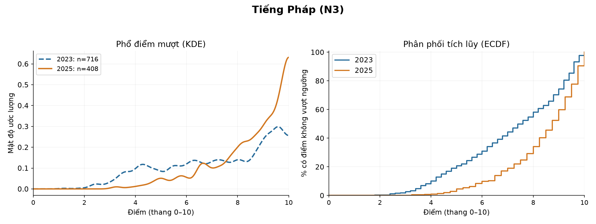

**Diễn giải hình:** Xanh nét đứt là 2023, cam nét liền là 2025; KDE mượt là mật độ, diện tích trên thang điểm bằng 1, không phải số người tuyệt đối. Ở ECDF, chiều cao là % điểm không vượt ngưỡng. Khoảng cách lớn nhất hai ECDF là D=0,281, gần mốc 7,20; đây là 28,1 điểm phần trăm ở mốc đó, không phải tỷ lệ người tiến bộ.

**Ý nghĩa và giới hạn:** Kết quả có bằng chứng chênh trung bình theo mô hình ở mức 0,05 sau Holm. Điều này cần đọc cùng mức đổi 1,194 điểm, |d| và hình dạng; p lớn không chứng minh tương đương. So sánh là giữa hai tập điểm quan sát, không tách được độ khó, chương trình, cách chấm và thành phần thí sinh.

### 2.4.8. Tiếng Trung (N4)

| Năm | Số có điểm | Trung bình | Trung vị | SD | IQR | <5 (%) | ≥8 (%) | ≥9 (%) |
| --- | --- | --- | --- | --- | --- | --- | --- | --- |
| 2.023 | 2.940 | 7,08 | 7,60 | 2,00 | 3,00 | 16,53 | 43,06 | 20,07 |
| 2.025 | 4.225 | 7,36 | 7,75 | 2,03 | 3,50 | 14,63 | 48,24 | 30,79 |

**Diễn giải bảng:** n là số có điểm hợp lệ của riêng mục này, không phải mọi dòng trong năm. SD đo độ trải rộng; IQR là độ rộng vùng 50% ở giữa. Các tỷ lệ chia cho n của đúng hàng; nhóm ≥90% thang điểm đã nằm trong nhóm ≥80%, không cộng hai tỷ lệ.

**Nhận xét bằng số:** Trung bình 7,08 → 7,36, tăng 0,28 điểm; trung vị 7,60 → 7,75. Cohen’s d=0,137 (dưới mốc 0,2 về |d| theo quy ước tham khảo). Tỷ số phương sai 2025/2023=1,031. Không dùng nhãn độ lớn như kết luận hai năm tương đương.

| Câu hỏi/phép thử | Thống kê | p gốc | p Holm / q BH |
| --- | --- | --- | --- |
| Welch: trung bình | t=5,739, df=6.383,2 | 9.96e-09 | 3.98e-08 |
| MWU: thứ hạng | U=6.798.016,0 | 9.04e-12 | 2.00e-11 |
| KS: toàn phân phối | D=0,146; tại điểm 9,20 | 5.00e-04 | 6.36e-04 |
| Brown–Forsythe: độ phân tán | W=5,716 | 0,0168 | 0,0191 |

**Diễn giải bảng:** Welch dùng Holm trong family 14 phép thử trung bình; ba phép thăm dò dùng BH chung trong family 42 p hữu hạn. KS dùng hoán vị 1,999 lần, p nhỏ nhất phân giải được là 0,0005. Giá trị “≈0” ở các phép tiệm cận là giới hạn tính số, không phải xác suất bằng 0.

**Khoảng tin cậy và độ lớn:** Chênh trung bình có CI 95% [0,183; 0,373] **điểm**. d có CI bootstrap 95% [0,090; 0,183] **SD gộp**; Hedges’ g=0,137. A=0,547 là xác suất thắng cộng nửa xác suất hòa, không phải chỉ P(2025>2023).

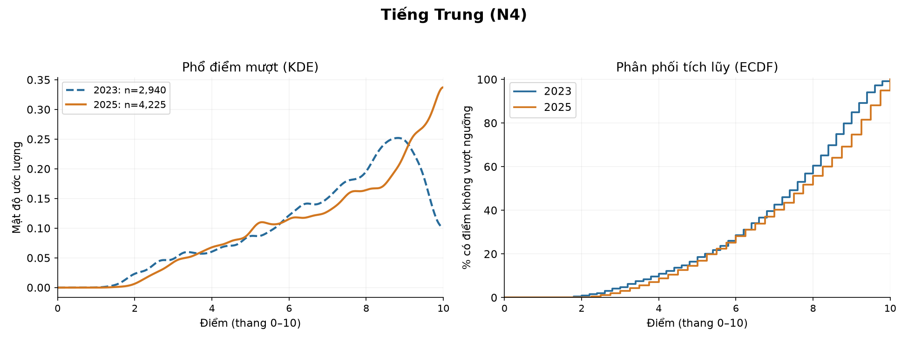

**Diễn giải hình:** Xanh nét đứt là 2023, cam nét liền là 2025; KDE mượt là mật độ, diện tích trên thang điểm bằng 1, không phải số người tuyệt đối. Ở ECDF, chiều cao là % điểm không vượt ngưỡng. Khoảng cách lớn nhất hai ECDF là D=0,146, gần mốc 9,20; đây là 14,6 điểm phần trăm ở mốc đó, không phải tỷ lệ người tiến bộ.

**Ý nghĩa và giới hạn:** Kết quả có bằng chứng chênh trung bình theo mô hình ở mức 0,05 sau Holm. Điều này cần đọc cùng mức đổi 0,278 điểm, |d| và hình dạng; p lớn không chứng minh tương đương. So sánh là giữa hai tập điểm quan sát, không tách được độ khó, chương trình, cách chấm và thành phần thí sinh.

### 2.4.9. Tiếng Đức (N5)

| Năm | Số có điểm | Trung bình | Trung vị | SD | IQR | <5 (%) | ≥8 (%) | ≥9 (%) |
| --- | --- | --- | --- | --- | --- | --- | --- | --- |
| 2.023 | 86 | 5,98 | 6,00 | 1,99 | 3,20 | 34,88 | 20,93 | 6,98 |
| 2.025 | 150 | 7,82 | 8,25 | 1,64 | 2,25 | 8,00 | 60,00 | 34,00 |

**Diễn giải bảng:** n là số có điểm hợp lệ của riêng mục này, không phải mọi dòng trong năm. SD đo độ trải rộng; IQR là độ rộng vùng 50% ở giữa. Các tỷ lệ chia cho n của đúng hàng; nhóm ≥90% thang điểm đã nằm trong nhóm ≥80%, không cộng hai tỷ lệ.

**Nhận xét bằng số:** Trung bình 5,98 → 7,82, tăng 1,84 điểm; trung vị 6,00 → 8,25. Cohen’s d=1,035 (từ 0,8 trở lên về |d| theo quy ước tham khảo). Tỷ số phương sai 2025/2023=0,681. Không dùng nhãn độ lớn như kết luận hai năm tương đương.

| Câu hỏi/phép thử | Thống kê | p gốc | p Holm / q BH |
| --- | --- | --- | --- |
| Welch: trung bình | t=7,265, df=151,2 | 1.85e-11 | 9.25e-11 |
| MWU: thứ hạng | U=9.827,5 | 2.15e-11 | 4.51e-11 |
| KS: toàn phân phối | D=0,428; tại điểm 7,20 | 5.00e-04 | 6.36e-04 |
| Brown–Forsythe: độ phân tán | W=9,445 | 0,0024 | 0,0028 |

**Diễn giải bảng:** Welch dùng Holm trong family 14 phép thử trung bình; ba phép thăm dò dùng BH chung trong family 42 p hữu hạn. KS dùng hoán vị 1,999 lần, p nhỏ nhất phân giải được là 0,0005. Giá trị “≈0” ở các phép tiệm cận là giới hạn tính số, không phải xác suất bằng 0.

**Khoảng tin cậy và độ lớn:** Chênh trung bình có CI 95% [1,338; 2,337] **điểm**. d có CI bootstrap 95% [0,770; 1,377] **SD gộp**; Hedges’ g=1,032. A=0,762 là xác suất thắng cộng nửa xác suất hòa, không phải chỉ P(2025>2023).

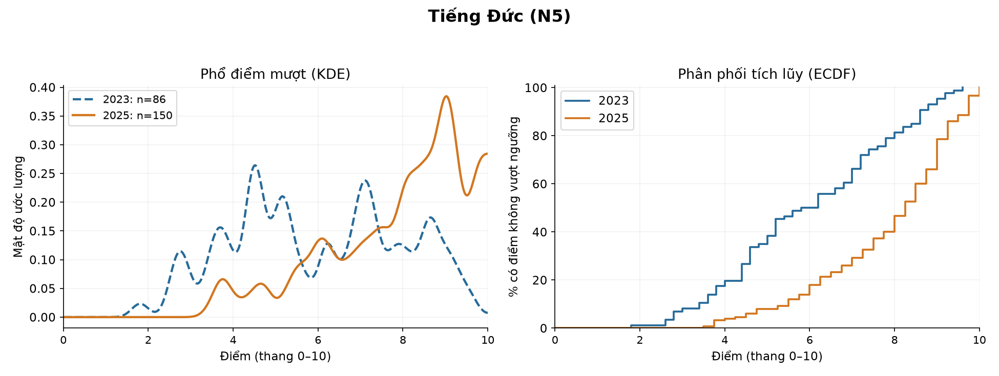

**Diễn giải hình:** Xanh nét đứt là 2023, cam nét liền là 2025; KDE mượt là mật độ, diện tích trên thang điểm bằng 1, không phải số người tuyệt đối. Ở ECDF, chiều cao là % điểm không vượt ngưỡng. Khoảng cách lớn nhất hai ECDF là D=0,428, gần mốc 7,20; đây là 42,8 điểm phần trăm ở mốc đó, không phải tỷ lệ người tiến bộ.

**Ý nghĩa và giới hạn:** Kết quả có bằng chứng chênh trung bình theo mô hình ở mức 0,05 sau Holm. Điều này cần đọc cùng mức đổi 1,838 điểm, |d| và hình dạng; p lớn không chứng minh tương đương. So sánh là giữa hai tập điểm quan sát, không tách được độ khó, chương trình, cách chấm và thành phần thí sinh.

### 2.4.10. Tiếng Nhật (N6)

| Năm | Số có điểm | Trung bình | Trung vị | SD | IQR | <5 (%) | ≥8 (%) | ≥9 (%) |
| --- | --- | --- | --- | --- | --- | --- | --- | --- |
| 2.023 | 659 | 7,01 | 7,40 | 2,19 | 3,80 | 21,70 | 43,70 | 25,19 |
| 2.025 | 491 | 6,29 | 6,50 | 2,09 | 3,50 | 29,12 | 26,27 | 14,26 |

**Diễn giải bảng:** n là số có điểm hợp lệ của riêng mục này, không phải mọi dòng trong năm. SD đo độ trải rộng; IQR là độ rộng vùng 50% ở giữa. Các tỷ lệ chia cho n của đúng hàng; nhóm ≥90% thang điểm đã nằm trong nhóm ≥80%, không cộng hai tỷ lệ.

**Nhận xét bằng số:** Trung bình 7,01 → 6,29, giảm 0,72 điểm; trung vị 7,40 → 6,50. Cohen’s d=-0,335 (trong khoảng 0,2–0,5 về |d| theo quy ước tham khảo). Tỷ số phương sai 2025/2023=0,911. Không dùng nhãn độ lớn như kết luận hai năm tương đương.

| Câu hỏi/phép thử | Thống kê | p gốc | p Holm / q BH |
| --- | --- | --- | --- |
| Welch: trung bình | t=-5,653, df=1.080,9 | 2.02e-08 | 6.05e-08 |
| MWU: thứ hạng | U=129.092,0 | 4.37e-09 | 8.73e-09 |
| KS: toàn phân phối | D=0,212; tại điểm 7,75 | 5.00e-04 | 6.36e-04 |
| Brown–Forsythe: độ phân tán | W=1,532 | 0,2161 | 0,2214 |

**Diễn giải bảng:** Welch dùng Holm trong family 14 phép thử trung bình; ba phép thăm dò dùng BH chung trong family 42 p hữu hạn. KS dùng hoán vị 1,999 lần, p nhỏ nhất phân giải được là 0,0005. Giá trị “≈0” ở các phép tiệm cận là giới hạn tính số, không phải xác suất bằng 0.

**Khoảng tin cậy và độ lớn:** Chênh trung bình có CI 95% [-0,967; -0,469] **điểm**. d có CI bootstrap 95% [-0,466; -0,223] **SD gộp**; Hedges’ g=-0,335. A=0,399 là xác suất thắng cộng nửa xác suất hòa, không phải chỉ P(2025>2023).

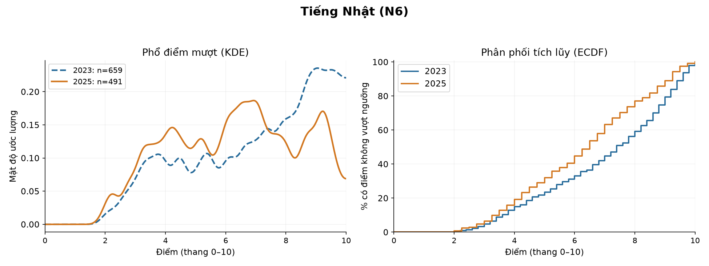

**Diễn giải hình:** Xanh nét đứt là 2023, cam nét liền là 2025; KDE mượt là mật độ, diện tích trên thang điểm bằng 1, không phải số người tuyệt đối. Ở ECDF, chiều cao là % điểm không vượt ngưỡng. Khoảng cách lớn nhất hai ECDF là D=0,212, gần mốc 7,75; đây là 21,2 điểm phần trăm ở mốc đó, không phải tỷ lệ người tiến bộ.

**Ý nghĩa và giới hạn:** Kết quả có bằng chứng chênh trung bình theo mô hình ở mức 0,05 sau Holm. Điều này cần đọc cùng mức đổi -0,718 điểm, |d| và hình dạng; p lớn không chứng minh tương đương. So sánh là giữa hai tập điểm quan sát, không tách được độ khó, chương trình, cách chấm và thành phần thí sinh.

### 2.4.11. Tiếng Hàn (N7)

| Năm | Số có điểm | Trung bình | Trung vị | SD | IQR | <5 (%) | ≥8 (%) | ≥9 (%) |
| --- | --- | --- | --- | --- | --- | --- | --- | --- |
| 2.023 | 407 | 6,29 | 6,40 | 1,92 | 3,00 | 25,80 | 23,34 | 10,57 |
| 2.025 | 541 | 5,90 | 5,75 | 1,92 | 3,00 | 34,01 | 17,38 | 7,95 |

**Diễn giải bảng:** n là số có điểm hợp lệ của riêng mục này, không phải mọi dòng trong năm. SD đo độ trải rộng; IQR là độ rộng vùng 50% ở giữa. Các tỷ lệ chia cho n của đúng hàng; nhóm ≥90% thang điểm đã nằm trong nhóm ≥80%, không cộng hai tỷ lệ.

**Nhận xét bằng số:** Trung bình 6,29 → 5,90, giảm 0,39 điểm; trung vị 6,40 → 5,75. Cohen’s d=-0,203 (trong khoảng 0,2–0,5 về |d| theo quy ước tham khảo). Tỷ số phương sai 2025/2023=1,005. Không dùng nhãn độ lớn như kết luận hai năm tương đương.

| Câu hỏi/phép thử | Thống kê | p gốc | p Holm / q BH |
| --- | --- | --- | --- |
| Welch: trung bình | t=-3,100, df=875,7 | 0,0020 | 0,0040 |
| MWU: thứ hạng | U=97.103,0 | 0,0018 | 0,0022 |
| KS: toàn phân phối | D=0,122; tại điểm 5,75 | 0,0010 | 0,0012 |
| Brown–Forsythe: độ phân tán | W=0,000 | 0,9971 | 0,9971 |

**Diễn giải bảng:** Welch dùng Holm trong family 14 phép thử trung bình; ba phép thăm dò dùng BH chung trong family 42 p hữu hạn. KS dùng hoán vị 1,999 lần, p nhỏ nhất phân giải được là 0,0005. Giá trị “≈0” ở các phép tiệm cận là giới hạn tính số, không phải xác suất bằng 0.

**Khoảng tin cậy và độ lớn:** Chênh trung bình có CI 95% [-0,638; -0,143] **điểm**. d có CI bootstrap 95% [-0,334; -0,070] **SD gộp**; Hedges’ g=-0,203. A=0,441 là xác suất thắng cộng nửa xác suất hòa, không phải chỉ P(2025>2023).

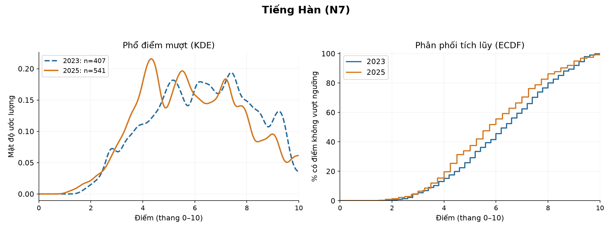

**Diễn giải hình:** Xanh nét đứt là 2023, cam nét liền là 2025; KDE mượt là mật độ, diện tích trên thang điểm bằng 1, không phải số người tuyệt đối. Ở ECDF, chiều cao là % điểm không vượt ngưỡng. Khoảng cách lớn nhất hai ECDF là D=0,122, gần mốc 5,75; đây là 12,2 điểm phần trăm ở mốc đó, không phải tỷ lệ người tiến bộ.

**Ý nghĩa và giới hạn:** Kết quả có bằng chứng chênh trung bình theo mô hình ở mức 0,05 sau Holm. Điều này cần đọc cùng mức đổi -0,390 điểm, |d| và hình dạng; p lớn không chứng minh tương đương. So sánh là giữa hai tập điểm quan sát, không tách được độ khó, chương trình, cách chấm và thành phần thí sinh.

### 2.4.12. Địa lý

| Năm | Số có điểm | Trung bình | Trung vị | SD | IQR | <5 (%) | ≥8 (%) | ≥9 (%) |
| --- | --- | --- | --- | --- | --- | --- | --- | --- |
| 2.023 | 682.134 | 6,15 | 6,25 | 1,17 | 1,50 | 13,35 | 6,64 | 0,87 |
| 2.025 | 476.472 | 6,63 | 6,75 | 1,75 | 2,65 | 18,69 | 26,68 | 11,26 |

**Diễn giải bảng:** n là số có điểm hợp lệ của riêng mục này, không phải mọi dòng trong năm. SD đo độ trải rộng; IQR là độ rộng vùng 50% ở giữa. Các tỷ lệ chia cho n của đúng hàng; nhóm ≥90% thang điểm đã nằm trong nhóm ≥80%, không cộng hai tỷ lệ.

**Nhận xét bằng số:** Trung bình 6,15 → 6,63, tăng 0,48 điểm; trung vị 6,25 → 6,75. Cohen’s d=0,334 (trong khoảng 0,2–0,5 về |d| theo quy ước tham khảo). Tỷ số phương sai 2025/2023=2,242. Không dùng nhãn độ lớn như kết luận hai năm tương đương.

| Câu hỏi/phép thử | Thống kê | p gốc | p Holm / q BH |
| --- | --- | --- | --- |
| Welch: trung bình | t=165,448, df=767.625,1 | ≈0 (dưới độ phân giải số) | ≈0 (dưới độ phân giải số) |
| MWU: thứ hạng | U=191.752.582.073,5 | ≈0 (dưới độ phân giải số) | ≈0 (dưới độ phân giải số) |
| KS: toàn phân phối | D=0,226; tại điểm 7,25 | 5.00e-04 | 6.36e-04 |
| Brown–Forsythe: độ phân tán | W=112.574,321 | ≈0 (dưới độ phân giải số) | ≈0 (dưới độ phân giải số) |

**Diễn giải bảng:** Welch dùng Holm trong family 14 phép thử trung bình; ba phép thăm dò dùng BH chung trong family 42 p hữu hạn. KS dùng hoán vị 1,999 lần, p nhỏ nhất phân giải được là 0,0005. Giá trị “≈0” ở các phép tiệm cận là giới hạn tính số, không phải xác suất bằng 0.

**Khoảng tin cậy và độ lớn:** Chênh trung bình có CI 95% [0,475; 0,486] **điểm**. d có CI bootstrap 95% [0,331; 0,338] **SD gộp**; Hedges’ g=0,334. A=0,590 là xác suất thắng cộng nửa xác suất hòa, không phải chỉ P(2025>2023).

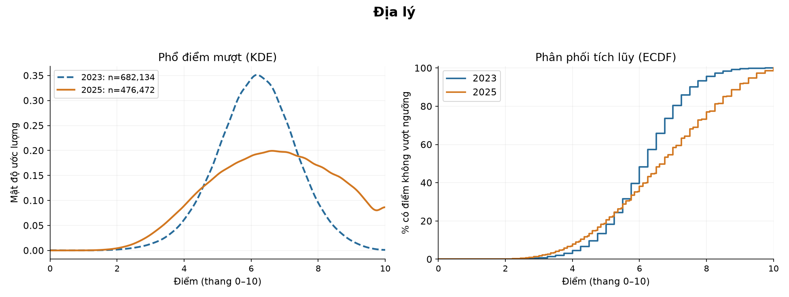

**Diễn giải hình:** Xanh nét đứt là 2023, cam nét liền là 2025; KDE mượt là mật độ, diện tích trên thang điểm bằng 1, không phải số người tuyệt đối. Ở ECDF, chiều cao là % điểm không vượt ngưỡng. Khoảng cách lớn nhất hai ECDF là D=0,226, gần mốc 7,25; đây là 22,6 điểm phần trăm ở mốc đó, không phải tỷ lệ người tiến bộ.

**Ý nghĩa và giới hạn:** Kết quả có bằng chứng chênh trung bình theo mô hình ở mức 0,05 sau Holm. Điều này cần đọc cùng mức đổi 0,480 điểm, |d| và hình dạng; p lớn không chứng minh tương đương. So sánh là giữa hai tập điểm quan sát, không tách được độ khó, chương trình, cách chấm và thành phần thí sinh.

### 2.4.13. Lịch sử

| Năm | Số có điểm | Trung bình | Trung vị | SD | IQR | <5 (%) | ≥8 (%) | ≥9 (%) |
| --- | --- | --- | --- | --- | --- | --- | --- | --- |
| 2.023 | 683.447 | 6,03 | 6,00 | 1,55 | 2,25 | 24,91 | 13,07 | 3,06 |
| 2.025 | 481.293 | 6,52 | 6,60 | 1,63 | 2,50 | 18,63 | 23,03 | 6,88 |

**Diễn giải bảng:** n là số có điểm hợp lệ của riêng mục này, không phải mọi dòng trong năm. SD đo độ trải rộng; IQR là độ rộng vùng 50% ở giữa. Các tỷ lệ chia cho n của đúng hàng; nhóm ≥90% thang điểm đã nằm trong nhóm ≥80%, không cộng hai tỷ lệ.

**Nhận xét bằng số:** Trung bình 6,03 → 6,52, tăng 0,49 điểm; trung vị 6,00 → 6,60. Cohen’s d=0,311 (trong khoảng 0,2–0,5 về |d| theo quy ước tham khảo). Tỷ số phương sai 2025/2023=1,106. Không dùng nhãn độ lớn như kết luận hai năm tương đương.

| Câu hỏi/phép thử | Thống kê | p gốc | p Holm / q BH |
| --- | --- | --- | --- |
| Welch: trung bình | t=163,919, df=1.003.086,4 | ≈0 (dưới độ phân giải số) | ≈0 (dưới độ phân giải số) |
| MWU: thứ hạng | U=193.784.815.670,5 | ≈0 (dưới độ phân giải số) | ≈0 (dưới độ phân giải số) |
| KS: toàn phân phối | D=0,141; tại điểm 6,50 | 5.00e-04 | 6.36e-04 |
| Brown–Forsythe: độ phân tán | W=2.173,638 | ≈0 (dưới độ phân giải số) | ≈0 (dưới độ phân giải số) |

**Diễn giải bảng:** Welch dùng Holm trong family 14 phép thử trung bình; ba phép thăm dò dùng BH chung trong family 42 p hữu hạn. KS dùng hoán vị 1,999 lần, p nhỏ nhất phân giải được là 0,0005. Giá trị “≈0” ở các phép tiệm cận là giới hạn tính số, không phải xác suất bằng 0.

**Khoảng tin cậy và độ lớn:** Chênh trung bình có CI 95% [0,488; 0,500] **điểm**. d có CI bootstrap 95% [0,308; 0,315] **SD gộp**; Hedges’ g=0,311. A=0,589 là xác suất thắng cộng nửa xác suất hòa, không phải chỉ P(2025>2023).

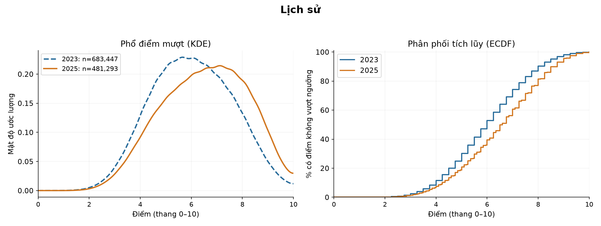

**Diễn giải hình:** Xanh nét đứt là 2023, cam nét liền là 2025; KDE mượt là mật độ, diện tích trên thang điểm bằng 1, không phải số người tuyệt đối. Ở ECDF, chiều cao là % điểm không vượt ngưỡng. Khoảng cách lớn nhất hai ECDF là D=0,141, gần mốc 6,50; đây là 14,1 điểm phần trăm ở mốc đó, không phải tỷ lệ người tiến bộ.

**Ý nghĩa và giới hạn:** Kết quả có bằng chứng chênh trung bình theo mô hình ở mức 0,05 sau Holm. Điều này cần đọc cùng mức đổi 0,494 điểm, |d| và hình dạng; p lớn không chứng minh tương đương. So sánh là giữa hai tập điểm quan sát, không tách được độ khó, chương trình, cách chấm và thành phần thí sinh.

### 2.4.14. Tin học

| Năm | Số có điểm | Trung bình | Trung vị | SD | IQR | <5 (%) | ≥8 (%) | ≥9 (%) |
| --- | --- | --- | --- | --- | --- | --- | --- | --- |
| 2.025 | 7.602 | 6,78 | 6,75 | 1,48 | 2,10 | 11,22 | 24,80 | 8,47 |

**Diễn giải bảng:** n là số có điểm hợp lệ của riêng mục này, không phải mọi dòng trong năm. SD đo độ trải rộng; IQR là độ rộng vùng 50% ở giữa. Các tỷ lệ chia cho n của đúng hàng; nhóm ≥90% thang điểm đã nằm trong nhóm ≥80%, không cộng hai tỷ lệ.

**Phạm vi so sánh:** Không có điểm ở một năm; không tạo mẫu bằng 0. Có thống kê và hình cho năm hiện có; ô thiếu không được thay bằng 0 và không tạo p-value/CI liên năm giả.

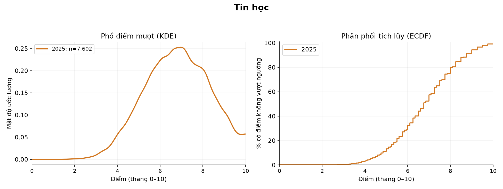

**Diễn giải hình:** Chỉ vẽ các năm có điểm thực. KDE là mật độ mượt từ điểm quan sát; ECDF mô tả phần tích lũy. Không có đường của một năm không có nghĩa điểm của năm đó bằng 0.

**Ý nghĩa và giới hạn:** Kết quả mô tả đúng mẫu có điểm. Mục này không được đưa vào family kiểm định liên năm chính; khác môn/chương trình không được diễn giải như cùng một thang năng lực.

### 2.4.15. Ngữ văn

| Năm | Số có điểm | Trung bình | Trung vị | SD | IQR | <5 (%) | ≥8 (%) | ≥9 (%) |
| --- | --- | --- | --- | --- | --- | --- | --- | --- |
| 2.023 | 1.008.239 | 6,86 | 7,00 | 1,33 | 1,75 | 7,31 | 24,42 | 4,30 |
| 2.025 | 1.126.726 | 7,00 | 7,25 | 1,28 | 1,75 | 6,24 | 26,69 | 3,91 |

**Diễn giải bảng:** n là số có điểm hợp lệ của riêng mục này, không phải mọi dòng trong năm. SD đo độ trải rộng; IQR là độ rộng vùng 50% ở giữa. Các tỷ lệ chia cho n của đúng hàng; nhóm ≥90% thang điểm đã nằm trong nhóm ≥80%, không cộng hai tỷ lệ.

**Nhận xét bằng số:** Trung bình 6,86 → 7,00, tăng 0,14 điểm; trung vị 7,00 → 7,25. Cohen’s d=0,111 (dưới mốc 0,2 về |d| theo quy ước tham khảo). Tỷ số phương sai 2025/2023=0,929. Không dùng nhãn độ lớn như kết luận hai năm tương đương.

| Câu hỏi/phép thử | Thống kê | p gốc | p Holm / q BH |
| --- | --- | --- | --- |
| Welch: trung bình | t=80,498, df=2.089.349,0 | ≈0 (dưới độ phân giải số) | ≈0 (dưới độ phân giải số) |
| MWU: thứ hạng | U=607.954.346.839,0 | ≈0 (dưới độ phân giải số) | ≈0 (dưới độ phân giải số) |
| KS: toàn phân phối | D=0,070; tại điểm 6,91 | 5.00e-04 | 6.36e-04 |
| Brown–Forsythe: độ phân tán | W=2.873,677 | ≈0 (dưới độ phân giải số) | ≈0 (dưới độ phân giải số) |

**Diễn giải bảng:** Welch dùng Holm trong family 14 phép thử trung bình; ba phép thăm dò dùng BH chung trong family 42 p hữu hạn. KS dùng hoán vị 1,999 lần, p nhỏ nhất phân giải được là 0,0005. Giá trị “≈0” ở các phép tiệm cận là giới hạn tính số, không phải xác suất bằng 0.

**Khoảng tin cậy và độ lớn:** Chênh trung bình có CI 95% [0,140; 0,147] **điểm**. d có CI bootstrap 95% [0,108; 0,113] **SD gộp**; Hedges’ g=0,111. A=0,535 là xác suất thắng cộng nửa xác suất hòa, không phải chỉ P(2025>2023).

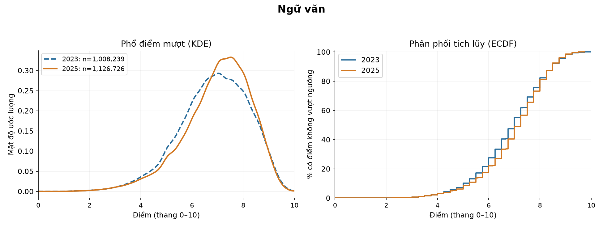

**Diễn giải hình:** Xanh nét đứt là 2023, cam nét liền là 2025; KDE mượt là mật độ, diện tích trên thang điểm bằng 1, không phải số người tuyệt đối. Ở ECDF, chiều cao là % điểm không vượt ngưỡng. Khoảng cách lớn nhất hai ECDF là D=0,070, gần mốc 6,91; đây là 7,0 điểm phần trăm ở mốc đó, không phải tỷ lệ người tiến bộ.

**Ý nghĩa và giới hạn:** Kết quả có bằng chứng chênh trung bình theo mô hình ở mức 0,05 sau Holm. Điều này cần đọc cùng mức đổi 0,144 điểm, |d| và hình dạng; p lớn không chứng minh tương đương. So sánh là giữa hai tập điểm quan sát, không tách được độ khó, chương trình, cách chấm và thành phần thí sinh.

### 2.4.16. Toán

| Năm | Số có điểm | Trung bình | Trung vị | SD | IQR | <5 (%) | ≥8 (%) | ≥9 (%) |
| --- | --- | --- | --- | --- | --- | --- | --- | --- |
| 2.023 | 1.003.373 | 6,25 | 6,60 | 1,63 | 2,40 | 21,64 | 15,16 | 1,00 |
| 2.025 | 1.126.172 | 4,78 | 4,60 | 1,68 | 2,35 | 56,39 | 5,45 | 1,43 |

**Diễn giải bảng:** n là số có điểm hợp lệ của riêng mục này, không phải mọi dòng trong năm. SD đo độ trải rộng; IQR là độ rộng vùng 50% ở giữa. Các tỷ lệ chia cho n của đúng hàng; nhóm ≥90% thang điểm đã nằm trong nhóm ≥80%, không cộng hai tỷ lệ.

**Nhận xét bằng số:** Trung bình 6,25 → 4,78, giảm 1,47 điểm; trung vị 6,60 → 4,60. Cohen’s d=-0,886 (từ 0,8 trở lên về |d| theo quy ước tham khảo). Tỷ số phương sai 2025/2023=1,054. Không dùng nhãn độ lớn như kết luận hai năm tương đương.

| Câu hỏi/phép thử | Thống kê | p gốc | p Holm / q BH |
| --- | --- | --- | --- |
| Welch: trung bình | t=-646,218, df=2.112.800,0 | ≈0 (dưới độ phân giải số) | ≈0 (dưới độ phân giải số) |
| MWU: thứ hạng | U=295.469.370.372,0 | ≈0 (dưới độ phân giải số) | ≈0 (dưới độ phân giải số) |
| KS: toàn phân phối | D=0,414; tại điểm 5,75 | 5.00e-04 | 6.36e-04 |
| Brown–Forsythe: độ phân tán | W=200,931 | 1.31e-45 | 3.68e-45 |

**Diễn giải bảng:** Welch dùng Holm trong family 14 phép thử trung bình; ba phép thăm dò dùng BH chung trong family 42 p hữu hạn. KS dùng hoán vị 1,999 lần, p nhỏ nhất phân giải được là 0,0005. Giá trị “≈0” ở các phép tiệm cận là giới hạn tính số, không phải xác suất bằng 0.

**Khoảng tin cậy và độ lớn:** Chênh trung bình có CI 95% [-1,472; -1,463] **điểm**. d có CI bootstrap 95% [-0,889; -0,883] **SD gộp**; Hedges’ g=-0,886. A=0,261 là xác suất thắng cộng nửa xác suất hòa, không phải chỉ P(2025>2023).

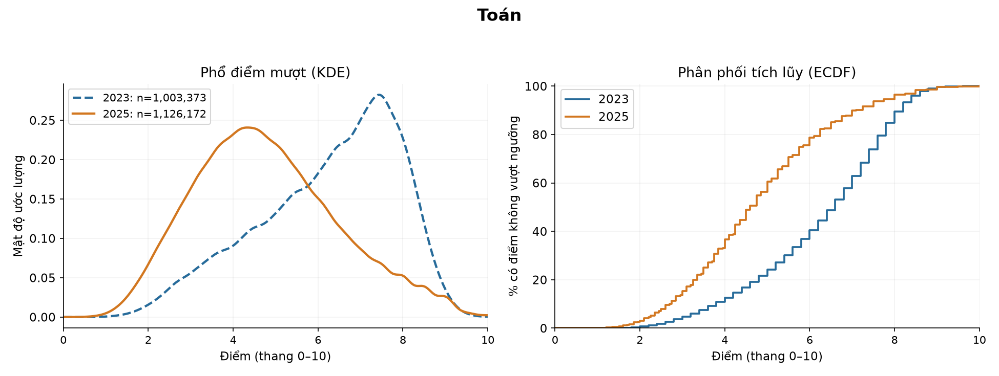

**Diễn giải hình:** Xanh nét đứt là 2023, cam nét liền là 2025; KDE mượt là mật độ, diện tích trên thang điểm bằng 1, không phải số người tuyệt đối. Ở ECDF, chiều cao là % điểm không vượt ngưỡng. Khoảng cách lớn nhất hai ECDF là D=0,414, gần mốc 5,75; đây là 41,4 điểm phần trăm ở mốc đó, không phải tỷ lệ người tiến bộ.

**Ý nghĩa và giới hạn:** Kết quả có bằng chứng chênh trung bình theo mô hình ở mức 0,05 sau Holm. Điều này cần đọc cùng mức đổi -1,467 điểm, |d| và hình dạng; p lớn không chứng minh tương đương. So sánh là giữa hai tập điểm quan sát, không tách được độ khó, chương trình, cách chấm và thành phần thí sinh.

### 2.4.17. Vật lý

| Năm | Số có điểm | Trung bình | Trung vị | SD | IQR | <5 (%) | ≥8 (%) | ≥9 (%) |
| --- | --- | --- | --- | --- | --- | --- | --- | --- |
| 2.023 | 327.189 | 6,57 | 6,75 | 1,49 | 2,25 | 14,79 | 21,32 | 2,97 |
| 2.025 | 347.599 | 6,99 | 7,00 | 1,52 | 2,40 | 9,79 | 30,79 | 11,53 |

**Diễn giải bảng:** n là số có điểm hợp lệ của riêng mục này, không phải mọi dòng trong năm. SD đo độ trải rộng; IQR là độ rộng vùng 50% ở giữa. Các tỷ lệ chia cho n của đúng hàng; nhóm ≥90% thang điểm đã nằm trong nhóm ≥80%, không cộng hai tỷ lệ.

**Nhận xét bằng số:** Trung bình 6,57 → 6,99, tăng 0,41 điểm; trung vị 6,75 → 7,00. Cohen’s d=0,274 (trong khoảng 0,2–0,5 về |d| theo quy ước tham khảo). Tỷ số phương sai 2025/2023=1,041. Không dùng nhãn độ lớn như kết luận hai năm tương đương.

| Câu hỏi/phép thử | Thống kê | p gốc | p Holm / q BH |
| --- | --- | --- | --- |
| Welch: trung bình | t=112,406, df=673.696,1 | ≈0 (dưới độ phân giải số) | ≈0 (dưới độ phân giải số) |
| MWU: thứ hạng | U=64.870.946.315,5 | ≈0 (dưới độ phân giải số) | ≈0 (dưới độ phân giải số) |
| KS: toàn phân phối | D=0,106; tại điểm 8,25 | 5.00e-04 | 6.36e-04 |
| Brown–Forsythe: độ phân tán | W=342,476 | 1.93e-76 | 5.78e-76 |

**Diễn giải bảng:** Welch dùng Holm trong family 14 phép thử trung bình; ba phép thăm dò dùng BH chung trong family 42 p hữu hạn. KS dùng hoán vị 1,999 lần, p nhỏ nhất phân giải được là 0,0005. Giá trị “≈0” ở các phép tiệm cận là giới hạn tính số, không phải xác suất bằng 0.

**Khoảng tin cậy và độ lớn:** Chênh trung bình có CI 95% [0,404; 0,418] **điểm**. d có CI bootstrap 95% [0,269; 0,279] **SD gộp**; Hedges’ g=0,274. A=0,570 là xác suất thắng cộng nửa xác suất hòa, không phải chỉ P(2025>2023).

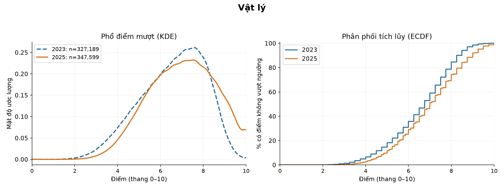

**Diễn giải hình:** Xanh nét đứt là 2023, cam nét liền là 2025; KDE mượt là mật độ, diện tích trên thang điểm bằng 1, không phải số người tuyệt đối. Ở ECDF, chiều cao là % điểm không vượt ngưỡng. Khoảng cách lớn nhất hai ECDF là D=0,106, gần mốc 8,25; đây là 10,6 điểm phần trăm ở mốc đó, không phải tỷ lệ người tiến bộ.

**Ý nghĩa và giới hạn:** Kết quả có bằng chứng chênh trung bình theo mô hình ở mức 0,05 sau Holm. Điều này cần đọc cùng mức đổi 0,411 điểm, |d| và hình dạng; p lớn không chứng minh tương đương. So sánh là giữa hai tập điểm quan sát, không tách được độ khó, chương trình, cách chấm và thành phần thí sinh.

### 2.4.18. Công nghệ

| Năm | Số có điểm | Trung bình | Trung vị | SD | IQR | <5 (%) | ≥8 (%) | ≥9 (%) |
| --- | --- | --- | --- | --- | --- | --- | --- | --- |
| 2.025 | 24.338 | 7,53 | 7,75 | 1,33 | 1,75 | 5,15 | 45,26 | 14,55 |

**Diễn giải bảng:** n là số có điểm hợp lệ của riêng mục này, không phải mọi dòng trong năm. SD đo độ trải rộng; IQR là độ rộng vùng 50% ở giữa. Các tỷ lệ chia cho n của đúng hàng; nhóm ≥90% thang điểm đã nằm trong nhóm ≥80%, không cộng hai tỷ lệ.

**Phạm vi so sánh:** Không có điểm ở một năm; không tạo mẫu bằng 0. Có thống kê và hình cho năm hiện có; ô thiếu không được thay bằng 0 và không tạo p-value/CI liên năm giả.

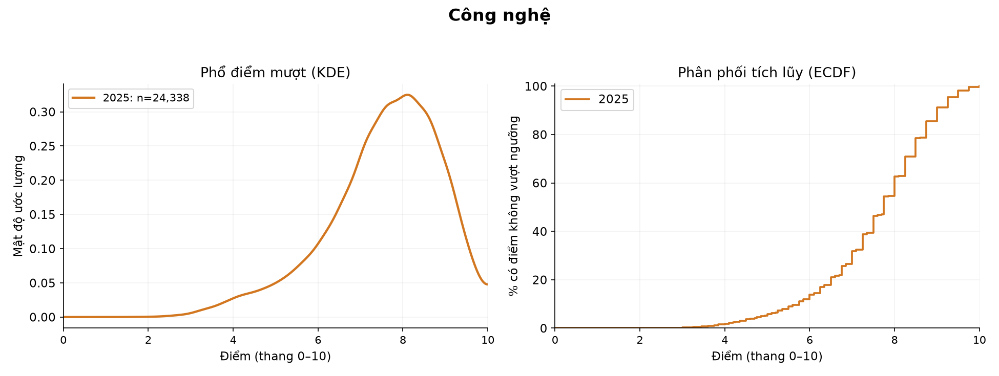

**Diễn giải hình:** Chỉ vẽ các năm có điểm thực. KDE là mật độ mượt từ điểm quan sát; ECDF mô tả phần tích lũy. Không có đường của một năm không có nghĩa điểm của năm đó bằng 0.

**Ý nghĩa và giới hạn:** Kết quả mô tả đúng mẫu có điểm. Mục này không được đưa vào family kiểm định liên năm chính; khác môn/chương trình không được diễn giải như cùng một thang năng lực.

## 2.5. Phạm vi của giai đoạn hiện tại

Phần từng môn đã được tính; kiểm định tổng điểm các tổ hợp được triển khai sau khi phần từng môn và tương quan nghiệm thu, theo thứ tự đã chốt. Không dùng bảng trống như kết quả tổ hợp đã có.

## Nguồn, khả năng tái lập và giới hạn

[Bảng phép thử đầy đủ](../outputs/statistics/subject_tests.csv) · [Thống kê mọi môn](../outputs/statistics/subject_descriptives.csv) · [Hồ sơ chạy và hash nguồn](../outputs/statistics/run_metadata.json).

Mọi so sánh dùng nguồn điểm của riêng môn, không ép các môn về một tập thí sinh chung. Không suy rằng tăng/giảm do riêng chương trình hoặc đề thi. Muốn đánh giá độ phân biệt câu hỏi cần dữ liệu theo câu, không thay bằng p hoặc SD tổng điểm.

Tài liệu phương pháp: [Welch/CI](https://docs.scipy.org/doc/scipy/reference/generated/scipy.stats.ttest_ind.html), [MWU và ties](https://docs.scipy.org/doc/scipy/reference/generated/scipy.stats.mannwhitneyu.html), [KS](https://docs.scipy.org/doc/scipy/reference/generated/scipy.stats.ks_2samp.html), [Levene](https://docs.scipy.org/doc/scipy/reference/generated/scipy.stats.levene.html), [nguyên tắc p-value của ASA](https://www.amstat.org/asa/files/pdfs/P-ValueStatement.pdf).
