# Phần 2 — Kiểm định thống kê điểm thi THPT 2023 và 2025

**2023 — CT2006** so với **2025 — CT2018**. Giữ điểm 0, không điền thiếu. Báo cáo bao phủ mọi môn có điểm, tách N1–N7; không ghép GDCD với GDKT&PL thành một môn bất biến.

## Kết quả chính — đọc phần này trước

Trong 18 nhóm môn thuộc hợp hai năm, 14 nhóm có dữ liệu cả hai năm và 4 nhóm chỉ có một năm. Các khác biệt |d| lớn nhất trong tập so được là: Tiếng Đức (N5): Δ=1,838 điểm, d=1,035, n2023/n2025=86/150; Toán: Δ=-1,467 điểm, d=-0,886, n2023/n2025=1,003,373/1,126,172; Tiếng Pháp (N3): Δ=1,194 điểm, d=0,630, n2023/n2025=716/408. Riêng Tiếng Đức (N5) chỉ có 86/150 người, cần đọc CI và giới hạn mẫu nhỏ; thứ hạng này không đại diện cho mọi thí sinh. Đây là chênh điểm quan sát, không phải tác động nhân quả.

## 2.1. Phạm vi: mỗi con số dùng mẫu nào?

| Năm | Nhóm môn/ngôn ngữ | Tổng lượt điểm trong các nhóm |
| --- | --- | --- |
| 2023 | 15 | 5.803.574 |
| 2025 | 17 | 4.504.356 |

**Diễn giải bảng:** Lượt điểm không phải số người duy nhất: một người có thể có nhiều môn. Ngoại ngữ đã tách theo mã, N1 và cột Tiếng Anh dẫn xuất chỉ tính một lần. Năm 2023 có GDCD; năm 2025 có GDKT&PL, Tin học, Công nghệ. Môn chỉ một năm vẫn hiện trong báo cáo nhưng không bị gán điểm năm còn thiếu.

## 2.2. Trung bình và mức khác biệt của mọi môn

| Môn | n 2023 | n 2025 | TB 2023 | TB 2025 | Δ điểm | d |
| --- | --- | --- | --- | --- | --- | --- |
| Sinh học | 324.625 | 69.895 | 6,395 | 5,778 | -0,617 | -0,481 |
| Hóa học | 328.118 | 240.135 | 6,745 | 6,065 | -0,680 | -0,425 |
| GDCD | 565.452 | 0 | 8,286 | — | — | — |
| GDKT&PL | 0 | 246.401 | — | 7,691 | — | — |
| Tiếng Anh (N1) | 876.102 | 351.848 | 5,454 | 5,375 | -0,079 | -0,043 |
| Tiếng Nga (N2) | 87 | 60 | 8,264 | 8,942 | 0,677 | 0,422 |
| Tiếng Pháp (N3) | 716 | 408 | 7,183 | 8,377 | 1,194 | 0,630 |
| Tiếng Trung (N4) | 2.940 | 4.225 | 7,079 | 7,356 | 0,278 | 0,137 |
| Tiếng Đức (N5) | 86 | 150 | 5,979 | 7,817 | 1,838 | 1,035 |
| Tiếng Nhật (N6) | 659 | 491 | 7,008 | 6,290 | -0,718 | -0,335 |
| Tiếng Hàn (N7) | 407 | 541 | 6,286 | 5,896 | -0,390 | -0,203 |
| Địa lý | 682.134 | 476.472 | 6,148 | 6,628 | 0,480 | 0,334 |
| Lịch sử | 683.447 | 481.293 | 6,026 | 6,519 | 0,494 | 0,311 |
| Tin học | 0 | 7.602 | — | 6,783 | — | — |
| Ngữ văn | 1.008.239 | 1.126.726 | 6,858 | 7,002 | 0,144 | 0,111 |
| Toán | 1.003.373 | 1.126.172 | 6,251 | 4,783 | -1,467 | -0,886 |
| Vật lý | 327.189 | 347.599 | 6,574 | 6,985 | 0,411 | 0,274 |
| Công nghệ | 0 | 24.338 | — | 7,535 | — | — |

**Diễn giải bảng:** Δ là 2025 trừ 2023, âm là giảm. n=0 chỉ biểu thị không có điểm trong nguồn năm đó, không phải mean=0. d đo chênh tương đối bằng SD gộp, không là phần trăm. Phải đọc cả điểm gốc và d vì cùng p nhỏ có thể đi kèm mức khác biệt rất khác.

**Diễn giải hình:** Mỗi hàng là một môn có đủ hai năm. Trái là mean, giữa là Δ/CI theo điểm, phải là d/CI bootstrap theo SD. Thanh CI hẹp ở mẫu lớn không làm một mức đổi nhỏ trở thành ảnh hưởng lớn; các ngôn ngữ ít người có CI rộng hơn.

## 2.3. Cách tính và đọc trước khi đi vào từng môn

**Welch t-test** hỏi trung bình hai nhóm có khác không, không giả định phương sai bằng nhau. H0: hai trung bình bằng nhau; H1 hai phía: khác nhau. **p-value** đo độ bất tương thích với mô hình H0, không là xác suất H0 đúng, không đo độ lớn thay đổi. P rất nhỏ ở mẫu lớn phải đi kèm Δ và d.

**Cohen’s d** = (mean2025−mean2023)/SD gộp. Dấu chỉ hướng; |d| 0,2/0,5/0,8 là mốc tham khảo, không ranh giới phổ quát. **Hedges’ g** hiệu chỉnh mẫu nhỏ; ở mẫu lớn g gần d. CI d bootstrap 999 lần theo tần số điểm, CI percentile; CI mean từ Welch. CI không là khoảng chứa 95% học sinh.

**Mann–Whitney U** đối chiếu thứ hạng/phân phối, không mặc định kiểm định mean hay median. **A**=P(X2025>X2023)+0,5P(bằng điểm); **rank-biserial**=2A−1. Điểm trùng đã được hiệu chỉnh khi tính p MWU.

**Phổ điểm mượt KDE:** dùng toàn bộ điểm, histogram mịn được làm mượt bằng kernel Gaussian, bandwidth 0,20 điểm và phản xạ ở biên 0/10; diện tích chuẩn hóa bằng 1. Cách này ước lượng hình dạng thực, không ép điểm theo phân phối chuẩn. Thống kê/kiểm định vẫn tính trên điểm gốc, không trên đường đã làm mượt.

**KS D** là khoảng cách lớn nhất giữa hai ECDF. P tiêu chuẩn giả thiết liên tục chỉ để tham khảo; p chính dùng hoán vị nhãn theo tần số điểm giữ đúng n hai năm (1.999 lần, seed cố định). **Brown–Forsythe** là Levene quanh median; đọc cùng SD/IQR/tỷ số phương sai, không đồng nhất với chất lượng phân hóa của đề. Levene quanh mean được đối chiếu ở phụ lục bổ sung.

**Đa kiểm định:** Holm cho family Welch; BH chung cho MWU/KS/Brown–Forsythe. Môn một năm không thêm phép thử. Dữ liệu gần toàn bộ thí sinh quan sát mỗi năm nên Δ mô tả trực tiếp tập đó; p/CI chỉ có nghĩa dưới mô hình suy luận/độc lập rộng hơn. Có thể có người thi lại, số báo danh không nhận diện người liên năm.

## 2.4. Bảng, hình và diễn giải từng môn

### 2.4.1. Sinh học

| Năm | Số có điểm | Trung bình | Trung vị | SD | IQR | <5 (%) | ≥8 (%) | ≥9 (%) |
| --- | --- | --- | --- | --- | --- | --- | --- | --- |
| 2023 | 324.625 | 6,39 | 6,50 | 1,21 | 1,75 | 10,40 | 10,57 | 1,68 |
| 2025 | 69.895 | 5,78 | 5,75 | 1,58 | 2,40 | 32,44 | 10,83 | 2,54 |

**Diễn giải bảng:** n là số có điểm hợp lệ của riêng mục này, không phải mọi dòng trong năm. SD đo độ trải rộng; IQR là độ rộng vùng 50% ở giữa. Các tỷ lệ chia cho n của đúng hàng; nhóm ≥90% thang điểm đã nằm trong nhóm ≥80%, không cộng hai tỷ lệ.

**Nhận xét bằng số:** Trung bình 6,39 → 5,78, giảm 0,62 điểm; trung vị 6,50 → 5,75. Cohen’s d=-0,481 (trong khoảng 0,2–0,5 về |d| theo quy ước tham khảo). Tỷ số phương sai 2025/2023=1,716. Không dùng nhãn độ lớn như kết luận hai năm tương đương.

| Câu hỏi/phép thử | Thống kê | p gốc | p Holm / q BH |
| --- | --- | --- | --- |
| Welch: trung bình | t=-97,211, df=88.235,9 | ≈0 (dưới độ phân giải số) | ≈0 (dưới độ phân giải số) |
| MWU: thứ hạng | U=8.512.326.163,5 | ≈0 (dưới độ phân giải số) | ≈0 (dưới độ phân giải số) |
| KS: toàn phân phối | D=0,243; tại điểm 5,45 | 5.00e-04 | 6.36e-04 |
| Brown–Forsythe: độ phân tán | W=11.207,490 | ≈0 (dưới độ phân giải số) | ≈0 (dưới độ phân giải số) |

**Diễn giải bảng:** Welch dùng Holm trong family 14 phép thử trung bình; ba phép thăm dò dùng BH chung trong family 42 p hữu hạn. KS dùng hoán vị 1,999 lần, p nhỏ nhất phân giải được là 0,0005. Giá trị “≈0” ở các phép tiệm cận là giới hạn tính số, không phải xác suất bằng 0.

**Khoảng tin cậy và độ lớn:** Chênh trung bình có CI 95% [-0,629; -0,604] **điểm**. d có CI bootstrap 95% [-0,492; -0,472] **SD gộp**; Hedges’ g=-0,481. A=0,375 là xác suất thắng cộng nửa xác suất hòa, không phải chỉ P(2025>2023).

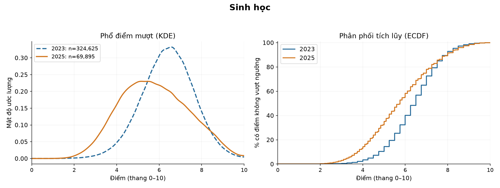

**Diễn giải hình:** Xanh nét đứt là 2023, cam nét liền là 2025; KDE mượt là mật độ, diện tích trên thang điểm bằng 1, không phải số người tuyệt đối. Ở ECDF, chiều cao là % điểm không vượt ngưỡng. Khoảng cách lớn nhất hai ECDF là D=0,243, gần mốc 5,45; đây là 24,3 điểm phần trăm ở mốc đó, không phải tỷ lệ người tiến bộ.

**Ý nghĩa và giới hạn:** Kết quả có bằng chứng chênh trung bình theo mô hình ở mức 0,05 sau Holm. Điều này cần đọc cùng mức đổi -0,617 điểm, |d| và hình dạng; p lớn không chứng minh tương đương. So sánh là giữa hai tập điểm quan sát, không tách được độ khó, chương trình, cách chấm và thành phần thí sinh.

### 2.4.2. Hóa học

| Năm | Số có điểm | Trung bình | Trung vị | SD | IQR | <5 (%) | ≥8 (%) | ≥9 (%) |
| --- | --- | --- | --- | --- | --- | --- | --- | --- |
| 2023 | 328.118 | 6,74 | 7,00 | 1,43 | 2,00 | 11,70 | 22,67 | 3,42 |
| 2025 | 240.135 | 6,06 | 6,00 | 1,81 | 2,75 | 29,53 | 19,29 | 7,43 |

**Diễn giải bảng:** n là số có điểm hợp lệ của riêng mục này, không phải mọi dòng trong năm. SD đo độ trải rộng; IQR là độ rộng vùng 50% ở giữa. Các tỷ lệ chia cho n của đúng hàng; nhóm ≥90% thang điểm đã nằm trong nhóm ≥80%, không cộng hai tỷ lệ.

**Nhận xét bằng số:** Trung bình 6,74 → 6,06, giảm 0,68 điểm; trung vị 7,00 → 6,00. Cohen’s d=-0,425 (trong khoảng 0,2–0,5 về |d| theo quy ước tham khảo). Tỷ số phương sai 2025/2023=1,607. Không dùng nhãn độ lớn như kết luận hai năm tương đương.

| Câu hỏi/phép thử | Thống kê | p gốc | p Holm / q BH |
| --- | --- | --- | --- |
| Welch: trung bình | t=-152,480, df=441.623,8 | ≈0 (dưới độ phân giải số) | ≈0 (dưới độ phân giải số) |
| MWU: thứ hạng | U=29.966.777.226,5 | ≈0 (dưới độ phân giải số) | ≈0 (dưới độ phân giải số) |
| KS: toàn phân phối | D=0,239; tại điểm 6,20 | 5.00e-04 | 6.36e-04 |
| Brown–Forsythe: độ phân tán | W=22.014,715 | ≈0 (dưới độ phân giải số) | ≈0 (dưới độ phân giải số) |

**Diễn giải bảng:** Welch dùng Holm trong family 14 phép thử trung bình; ba phép thăm dò dùng BH chung trong family 42 p hữu hạn. KS dùng hoán vị 1,999 lần, p nhỏ nhất phân giải được là 0,0005. Giá trị “≈0” ở các phép tiệm cận là giới hạn tính số, không phải xác suất bằng 0.

**Khoảng tin cậy và độ lớn:** Chênh trung bình có CI 95% [-0,689; -0,671] **điểm**. d có CI bootstrap 95% [-0,430; -0,419] **SD gộp**; Hedges’ g=-0,425. A=0,380 là xác suất thắng cộng nửa xác suất hòa, không phải chỉ P(2025>2023).

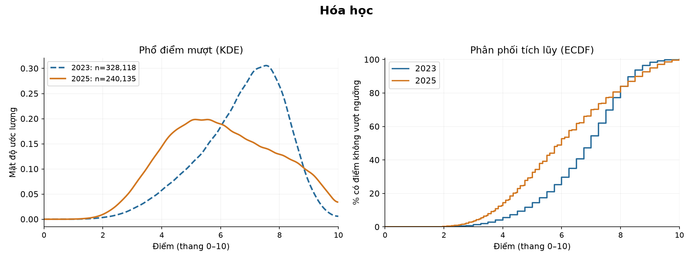

**Diễn giải hình:** Xanh nét đứt là 2023, cam nét liền là 2025; KDE mượt là mật độ, diện tích trên thang điểm bằng 1, không phải số người tuyệt đối. Ở ECDF, chiều cao là % điểm không vượt ngưỡng. Khoảng cách lớn nhất hai ECDF là D=0,239, gần mốc 6,20; đây là 23,9 điểm phần trăm ở mốc đó, không phải tỷ lệ người tiến bộ.

**Ý nghĩa và giới hạn:** Kết quả có bằng chứng chênh trung bình theo mô hình ở mức 0,05 sau Holm. Điều này cần đọc cùng mức đổi -0,680 điểm, |d| và hình dạng; p lớn không chứng minh tương đương. So sánh là giữa hai tập điểm quan sát, không tách được độ khó, chương trình, cách chấm và thành phần thí sinh.

### 2.4.3. GDCD

| Năm | Số có điểm | Trung bình | Trung vị | SD | IQR | <5 (%) | ≥8 (%) | ≥9 (%) |
| --- | --- | --- | --- | --- | --- | --- | --- | --- |
| 2023 | 565.452 | 8,29 | 8,50 | 1,14 | 1,50 | 0,97 | 68,95 | 35,45 |

**Diễn giải bảng:** n là số có điểm hợp lệ của riêng mục này, không phải mọi dòng trong năm. SD đo độ trải rộng; IQR là độ rộng vùng 50% ở giữa. Các tỷ lệ chia cho n của đúng hàng; nhóm ≥90% thang điểm đã nằm trong nhóm ≥80%, không cộng hai tỷ lệ.

**Phạm vi so sánh:** Không có điểm ở một năm; không tạo mẫu bằng 0. Có thống kê và hình cho năm hiện có; ô thiếu không được thay bằng 0 và không tạo p-value/CI liên năm giả.

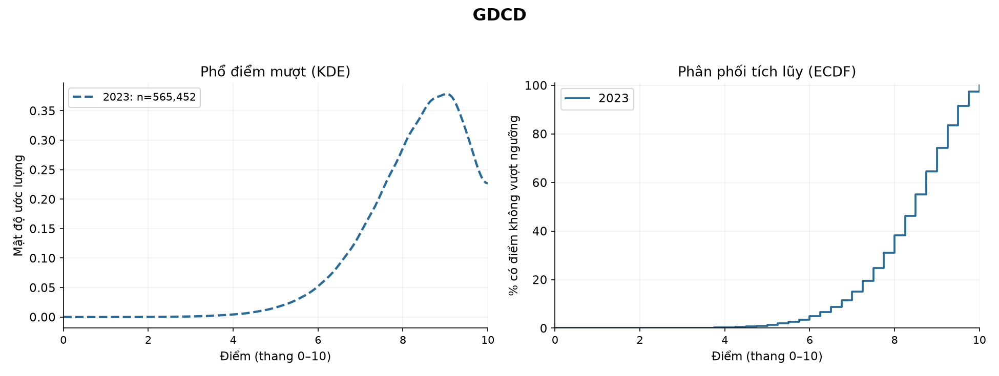

**Diễn giải hình:** Chỉ vẽ các năm có điểm thực. KDE là mật độ mượt từ điểm quan sát; ECDF mô tả phần tích lũy. Không có đường của một năm không có nghĩa điểm của năm đó bằng 0.

**Ý nghĩa và giới hạn:** Kết quả mô tả đúng mẫu có điểm. Mục này không được đưa vào family kiểm định liên năm chính; khác môn/chương trình không được diễn giải như cùng một thang năng lực.

### 2.4.4. GDKT&PL

| Năm | Số có điểm | Trung bình | Trung vị | SD | IQR | <5 (%) | ≥8 (%) | ≥9 (%) |
| --- | --- | --- | --- | --- | --- | --- | --- | --- |
| 2025 | 246.401 | 7,69 | 7,75 | 1,18 | 1,50 | 2,57 | 49,12 | 14,30 |

**Diễn giải bảng:** n là số có điểm hợp lệ của riêng mục này, không phải mọi dòng trong năm. SD đo độ trải rộng; IQR là độ rộng vùng 50% ở giữa. Các tỷ lệ chia cho n của đúng hàng; nhóm ≥90% thang điểm đã nằm trong nhóm ≥80%, không cộng hai tỷ lệ.

**Phạm vi so sánh:** Không có điểm ở một năm; không tạo mẫu bằng 0. Có thống kê và hình cho năm hiện có; ô thiếu không được thay bằng 0 và không tạo p-value/CI liên năm giả.

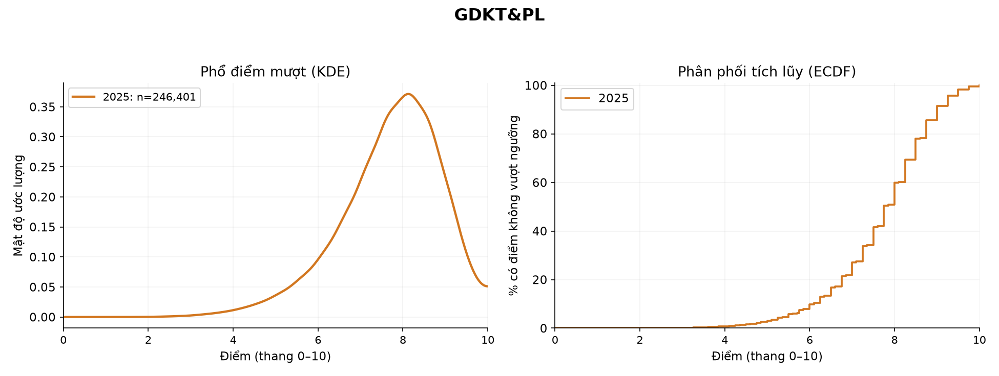

**Diễn giải hình:** Chỉ vẽ các năm có điểm thực. KDE là mật độ mượt từ điểm quan sát; ECDF mô tả phần tích lũy. Không có đường của một năm không có nghĩa điểm của năm đó bằng 0.

**Ý nghĩa và giới hạn:** Kết quả mô tả đúng mẫu có điểm. Mục này không được đưa vào family kiểm định liên năm chính; khác môn/chương trình không được diễn giải như cùng một thang năng lực.

### 2.4.5. Tiếng Anh (N1)

| Năm | Số có điểm | Trung bình | Trung vị | SD | IQR | <5 (%) | ≥8 (%) | ≥9 (%) |
| --- | --- | --- | --- | --- | --- | --- | --- | --- |
| 2023 | 876.102 | 5,45 | 5,20 | 1,96 | 3,20 | 44,83 | 15,04 | 5,29 |
| 2025 | 351.848 | 5,38 | 5,25 | 1,45 | 2,00 | 38,22 | 5,39 | 1,35 |

**Diễn giải bảng:** n là số có điểm hợp lệ của riêng mục này, không phải mọi dòng trong năm. SD đo độ trải rộng; IQR là độ rộng vùng 50% ở giữa. Các tỷ lệ chia cho n của đúng hàng; nhóm ≥90% thang điểm đã nằm trong nhóm ≥80%, không cộng hai tỷ lệ.

**Nhận xét bằng số:** Trung bình 5,45 → 5,38, giảm 0,08 điểm; trung vị 5,20 → 5,25. Cohen’s d=-0,043 (dưới mốc 0,2 về |d| theo quy ước tham khảo). Tỷ số phương sai 2025/2023=0,545. Không dùng nhãn độ lớn như kết luận hai năm tương đương.

| Câu hỏi/phép thử | Thống kê | p gốc | p Holm / q BH |
| --- | --- | --- | --- |
| Welch: trung bình | t=-24,443, df=871.175,3 | 6.70e-132 | 4.69e-131 |
| MWU: thứ hạng | U=155.544.315.014,0 | 1.46e-15 | 3.40e-15 |
| KS: toàn phân phối | D=0,130; tại điểm 4,20 | 5.00e-04 | 6.36e-04 |
| Brown–Forsythe: độ phân tán | W=51.838,522 | ≈0 (dưới độ phân giải số) | ≈0 (dưới độ phân giải số) |

**Diễn giải bảng:** Welch dùng Holm trong family 14 phép thử trung bình; ba phép thăm dò dùng BH chung trong family 42 p hữu hạn. KS dùng hoán vị 1,999 lần, p nhỏ nhất phân giải được là 0,0005. Giá trị “≈0” ở các phép tiệm cận là giới hạn tính số, không phải xác suất bằng 0.

**Khoảng tin cậy và độ lớn:** Chênh trung bình có CI 95% [-0,085; -0,072] **điểm**. d có CI bootstrap 95% [-0,047; -0,040] **SD gộp**; Hedges’ g=-0,043. A=0,505 là xác suất thắng cộng nửa xác suất hòa, không phải chỉ P(2025>2023).

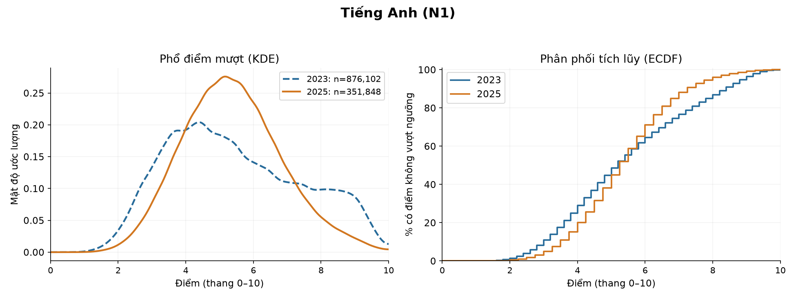

**Diễn giải hình:** Xanh nét đứt là 2023, cam nét liền là 2025; KDE mượt là mật độ, diện tích trên thang điểm bằng 1, không phải số người tuyệt đối. Ở ECDF, chiều cao là % điểm không vượt ngưỡng. Khoảng cách lớn nhất hai ECDF là D=0,130, gần mốc 4,20; đây là 13,0 điểm phần trăm ở mốc đó, không phải tỷ lệ người tiến bộ.

**Ý nghĩa và giới hạn:** Kết quả có bằng chứng chênh trung bình theo mô hình ở mức 0,05 sau Holm. Điều này cần đọc cùng mức đổi -0,079 điểm, |d| và hình dạng; p lớn không chứng minh tương đương. So sánh là giữa hai tập điểm quan sát, không tách được độ khó, chương trình, cách chấm và thành phần thí sinh.

### 2.4.6. Tiếng Nga (N2)

| Năm | Số có điểm | Trung bình | Trung vị | SD | IQR | <5 (%) | ≥8 (%) | ≥9 (%) |
| --- | --- | --- | --- | --- | --- | --- | --- | --- |
| 2023 | 87 | 8,26 | 9,00 | 1,85 | 2,00 | 9,20 | 70,11 | 55,17 |
| 2025 | 60 | 8,94 | 9,25 | 1,16 | 1,00 | 0,00 | 86,67 | 65,00 |

**Diễn giải bảng:** n là số có điểm hợp lệ của riêng mục này, không phải mọi dòng trong năm. SD đo độ trải rộng; IQR là độ rộng vùng 50% ở giữa. Các tỷ lệ chia cho n của đúng hàng; nhóm ≥90% thang điểm đã nằm trong nhóm ≥80%, không cộng hai tỷ lệ.

**Nhận xét bằng số:** Trung bình 8,26 → 8,94, tăng 0,68 điểm; trung vị 9,00 → 9,25. Cohen’s d=0,422 (trong khoảng 0,2–0,5 về |d| theo quy ước tham khảo). Tỷ số phương sai 2025/2023=0,390. Không dùng nhãn độ lớn như kết luận hai năm tương đương.

| Câu hỏi/phép thử | Thống kê | p gốc | p Holm / q BH |
| --- | --- | --- | --- |
| Welch: trung bình | t=2,727, df=143,8 | 0,0072 | 0,0072 |
| MWU: thứ hạng | U=3.158,0 | 0,0305 | 0,0329 |
| KS: toàn phân phối | D=0,219; tại điểm 9,40 | 0,0290 | 0,0321 |
| Brown–Forsythe: độ phân tán | W=4,304 | 0,0398 | 0,0418 |

**Diễn giải bảng:** Welch dùng Holm trong family 14 phép thử trung bình; ba phép thăm dò dùng BH chung trong family 42 p hữu hạn. KS dùng hoán vị 1,999 lần, p nhỏ nhất phân giải được là 0,0005. Giá trị “≈0” ở các phép tiệm cận là giới hạn tính số, không phải xác suất bằng 0.

**Khoảng tin cậy và độ lớn:** Chênh trung bình có CI 95% [0,186; 1,168] **điểm**. d có CI bootstrap 95% [0,133; 0,691] **SD gộp**; Hedges’ g=0,420. A=0,605 là xác suất thắng cộng nửa xác suất hòa, không phải chỉ P(2025>2023).

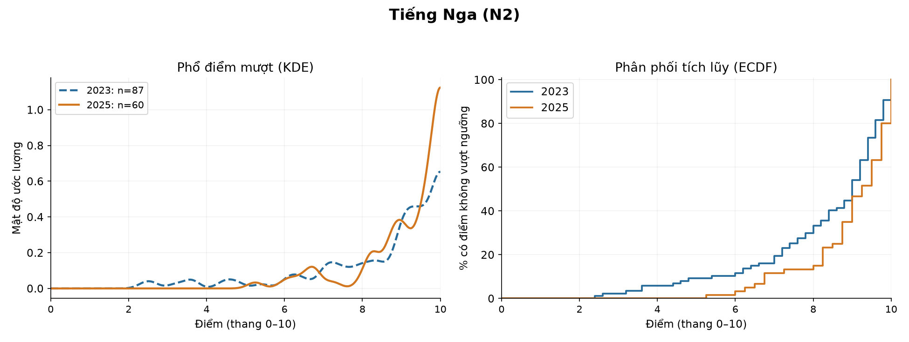

**Diễn giải hình:** Xanh nét đứt là 2023, cam nét liền là 2025; KDE mượt là mật độ, diện tích trên thang điểm bằng 1, không phải số người tuyệt đối. Ở ECDF, chiều cao là % điểm không vượt ngưỡng. Khoảng cách lớn nhất hai ECDF là D=0,219, gần mốc 9,40; đây là 21,9 điểm phần trăm ở mốc đó, không phải tỷ lệ người tiến bộ.

**Ý nghĩa và giới hạn:** Kết quả có bằng chứng chênh trung bình theo mô hình ở mức 0,05 sau Holm. Điều này cần đọc cùng mức đổi 0,677 điểm, |d| và hình dạng; p lớn không chứng minh tương đương. So sánh là giữa hai tập điểm quan sát, không tách được độ khó, chương trình, cách chấm và thành phần thí sinh.

### 2.4.7. Tiếng Pháp (N3)

| Năm | Số có điểm | Trung bình | Trung vị | SD | IQR | <5 (%) | ≥8 (%) | ≥9 (%) |
| --- | --- | --- | --- | --- | --- | --- | --- | --- |
| 2023 | 716 | 7,18 | 7,60 | 2,10 | 3,60 | 19,13 | 45,25 | 29,75 |
| 2025 | 408 | 8,38 | 8,75 | 1,47 | 1,75 | 2,94 | 70,83 | 47,55 |

**Diễn giải bảng:** n là số có điểm hợp lệ của riêng mục này, không phải mọi dòng trong năm. SD đo độ trải rộng; IQR là độ rộng vùng 50% ở giữa. Các tỷ lệ chia cho n của đúng hàng; nhóm ≥90% thang điểm đã nằm trong nhóm ≥80%, không cộng hai tỷ lệ.

**Nhận xét bằng số:** Trung bình 7,18 → 8,38, tăng 1,19 điểm; trung vị 7,60 → 8,75. Cohen’s d=0,630 (trong khoảng 0,5–0,8 về |d| theo quy ước tham khảo). Tỷ số phương sai 2025/2023=0,489. Không dùng nhãn độ lớn như kết luận hai năm tương đương.

| Câu hỏi/phép thử | Thống kê | p gốc | p Holm / q BH |
| --- | --- | --- | --- |
| Welch: trung bình | t=11,162, df=1.076,4 | 1.88e-27 | 1.13e-26 |
| MWU: thứ hạng | U=194.523,0 | 1.97e-20 | 4.87e-20 |
| KS: toàn phân phối | D=0,281; tại điểm 7,20 | 5.00e-04 | 6.36e-04 |
| Brown–Forsythe: độ phân tán | W=93,018 | 3.35e-21 | 8.80e-21 |

**Diễn giải bảng:** Welch dùng Holm trong family 14 phép thử trung bình; ba phép thăm dò dùng BH chung trong family 42 p hữu hạn. KS dùng hoán vị 1,999 lần, p nhỏ nhất phân giải được là 0,0005. Giá trị “≈0” ở các phép tiệm cận là giới hạn tính số, không phải xác suất bằng 0.

**Khoảng tin cậy và độ lớn:** Chênh trung bình có CI 95% [0,984; 1,404] **điểm**. d có CI bootstrap 95% [0,516; 0,739] **SD gộp**; Hedges’ g=0,630. A=0,666 là xác suất thắng cộng nửa xác suất hòa, không phải chỉ P(2025>2023).

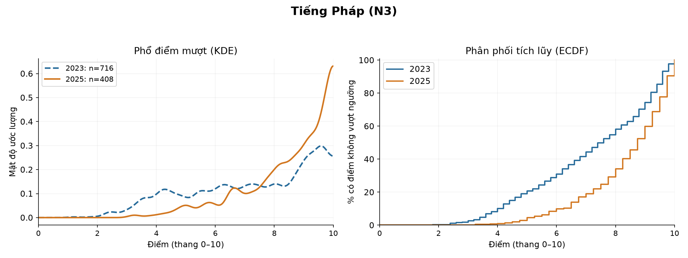

**Diễn giải hình:** Xanh nét đứt là 2023, cam nét liền là 2025; KDE mượt là mật độ, diện tích trên thang điểm bằng 1, không phải số người tuyệt đối. Ở ECDF, chiều cao là % điểm không vượt ngưỡng. Khoảng cách lớn nhất hai ECDF là D=0,281, gần mốc 7,20; đây là 28,1 điểm phần trăm ở mốc đó, không phải tỷ lệ người tiến bộ.

**Ý nghĩa và giới hạn:** Kết quả có bằng chứng chênh trung bình theo mô hình ở mức 0,05 sau Holm. Điều này cần đọc cùng mức đổi 1,194 điểm, |d| và hình dạng; p lớn không chứng minh tương đương. So sánh là giữa hai tập điểm quan sát, không tách được độ khó, chương trình, cách chấm và thành phần thí sinh.

### 2.4.8. Tiếng Trung (N4)

| Năm | Số có điểm | Trung bình | Trung vị | SD | IQR | <5 (%) | ≥8 (%) | ≥9 (%) |
| --- | --- | --- | --- | --- | --- | --- | --- | --- |
| 2023 | 2.940 | 7,08 | 7,60 | 2,00 | 3,00 | 16,53 | 43,06 | 20,07 |
| 2025 | 4.225 | 7,36 | 7,75 | 2,03 | 3,50 | 14,63 | 48,24 | 30,79 |

**Diễn giải bảng:** n là số có điểm hợp lệ của riêng mục này, không phải mọi dòng trong năm. SD đo độ trải rộng; IQR là độ rộng vùng 50% ở giữa. Các tỷ lệ chia cho n của đúng hàng; nhóm ≥90% thang điểm đã nằm trong nhóm ≥80%, không cộng hai tỷ lệ.

**Nhận xét bằng số:** Trung bình 7,08 → 7,36, tăng 0,28 điểm; trung vị 7,60 → 7,75. Cohen’s d=0,137 (dưới mốc 0,2 về |d| theo quy ước tham khảo). Tỷ số phương sai 2025/2023=1,031. Không dùng nhãn độ lớn như kết luận hai năm tương đương.

| Câu hỏi/phép thử | Thống kê | p gốc | p Holm / q BH |
| --- | --- | --- | --- |
| Welch: trung bình | t=5,739, df=6.383,2 | 9.96e-09 | 3.98e-08 |
| MWU: thứ hạng | U=6.798.016,0 | 9.04e-12 | 2.00e-11 |
| KS: toàn phân phối | D=0,146; tại điểm 9,20 | 5.00e-04 | 6.36e-04 |
| Brown–Forsythe: độ phân tán | W=5,716 | 0,0168 | 0,0191 |

**Diễn giải bảng:** Welch dùng Holm trong family 14 phép thử trung bình; ba phép thăm dò dùng BH chung trong family 42 p hữu hạn. KS dùng hoán vị 1,999 lần, p nhỏ nhất phân giải được là 0,0005. Giá trị “≈0” ở các phép tiệm cận là giới hạn tính số, không phải xác suất bằng 0.

**Khoảng tin cậy và độ lớn:** Chênh trung bình có CI 95% [0,183; 0,373] **điểm**. d có CI bootstrap 95% [0,090; 0,183] **SD gộp**; Hedges’ g=0,137. A=0,547 là xác suất thắng cộng nửa xác suất hòa, không phải chỉ P(2025>2023).

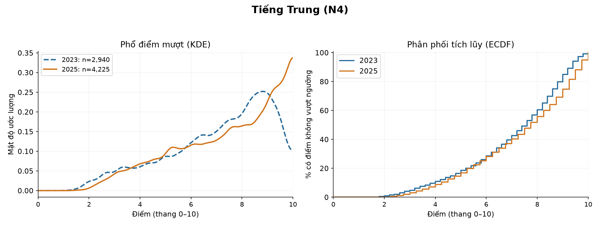

**Diễn giải hình:** Xanh nét đứt là 2023, cam nét liền là 2025; KDE mượt là mật độ, diện tích trên thang điểm bằng 1, không phải số người tuyệt đối. Ở ECDF, chiều cao là % điểm không vượt ngưỡng. Khoảng cách lớn nhất hai ECDF là D=0,146, gần mốc 9,20; đây là 14,6 điểm phần trăm ở mốc đó, không phải tỷ lệ người tiến bộ.

**Ý nghĩa và giới hạn:** Kết quả có bằng chứng chênh trung bình theo mô hình ở mức 0,05 sau Holm. Điều này cần đọc cùng mức đổi 0,278 điểm, |d| và hình dạng; p lớn không chứng minh tương đương. So sánh là giữa hai tập điểm quan sát, không tách được độ khó, chương trình, cách chấm và thành phần thí sinh.

### 2.4.9. Tiếng Đức (N5)

| Năm | Số có điểm | Trung bình | Trung vị | SD | IQR | <5 (%) | ≥8 (%) | ≥9 (%) |
| --- | --- | --- | --- | --- | --- | --- | --- | --- |
| 2023 | 86 | 5,98 | 6,00 | 1,99 | 3,20 | 34,88 | 20,93 | 6,98 |
| 2025 | 150 | 7,82 | 8,25 | 1,64 | 2,25 | 8,00 | 60,00 | 34,00 |

**Diễn giải bảng:** n là số có điểm hợp lệ của riêng mục này, không phải mọi dòng trong năm. SD đo độ trải rộng; IQR là độ rộng vùng 50% ở giữa. Các tỷ lệ chia cho n của đúng hàng; nhóm ≥90% thang điểm đã nằm trong nhóm ≥80%, không cộng hai tỷ lệ.

**Nhận xét bằng số:** Trung bình 5,98 → 7,82, tăng 1,84 điểm; trung vị 6,00 → 8,25. Cohen’s d=1,035 (từ 0,8 trở lên về |d| theo quy ước tham khảo). Tỷ số phương sai 2025/2023=0,681. Không dùng nhãn độ lớn như kết luận hai năm tương đương.

| Câu hỏi/phép thử | Thống kê | p gốc | p Holm / q BH |
| --- | --- | --- | --- |
| Welch: trung bình | t=7,265, df=151,2 | 1.85e-11 | 9.25e-11 |
| MWU: thứ hạng | U=9.827,5 | 2.15e-11 | 4.51e-11 |
| KS: toàn phân phối | D=0,428; tại điểm 7,20 | 5.00e-04 | 6.36e-04 |
| Brown–Forsythe: độ phân tán | W=9,445 | 0,0024 | 0,0028 |

**Diễn giải bảng:** Welch dùng Holm trong family 14 phép thử trung bình; ba phép thăm dò dùng BH chung trong family 42 p hữu hạn. KS dùng hoán vị 1,999 lần, p nhỏ nhất phân giải được là 0,0005. Giá trị “≈0” ở các phép tiệm cận là giới hạn tính số, không phải xác suất bằng 0.

**Khoảng tin cậy và độ lớn:** Chênh trung bình có CI 95% [1,338; 2,337] **điểm**. d có CI bootstrap 95% [0,770; 1,377] **SD gộp**; Hedges’ g=1,032. A=0,762 là xác suất thắng cộng nửa xác suất hòa, không phải chỉ P(2025>2023).

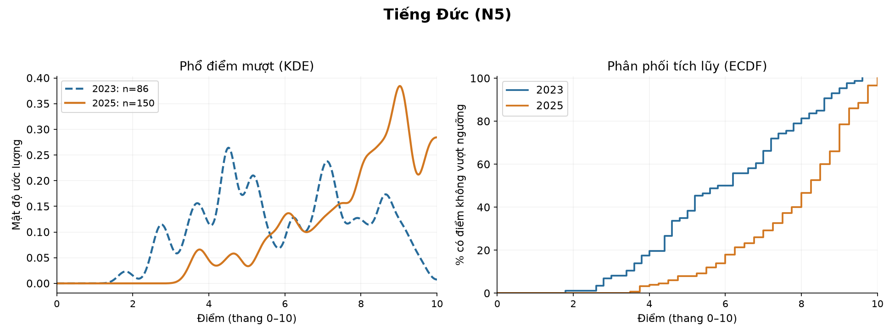

**Diễn giải hình:** Xanh nét đứt là 2023, cam nét liền là 2025; KDE mượt là mật độ, diện tích trên thang điểm bằng 1, không phải số người tuyệt đối. Ở ECDF, chiều cao là % điểm không vượt ngưỡng. Khoảng cách lớn nhất hai ECDF là D=0,428, gần mốc 7,20; đây là 42,8 điểm phần trăm ở mốc đó, không phải tỷ lệ người tiến bộ.

**Ý nghĩa và giới hạn:** Kết quả có bằng chứng chênh trung bình theo mô hình ở mức 0,05 sau Holm. Điều này cần đọc cùng mức đổi 1,838 điểm, |d| và hình dạng; p lớn không chứng minh tương đương. So sánh là giữa hai tập điểm quan sát, không tách được độ khó, chương trình, cách chấm và thành phần thí sinh.

### 2.4.10. Tiếng Nhật (N6)

| Năm | Số có điểm | Trung bình | Trung vị | SD | IQR | <5 (%) | ≥8 (%) | ≥9 (%) |
| --- | --- | --- | --- | --- | --- | --- | --- | --- |
| 2023 | 659 | 7,01 | 7,40 | 2,19 | 3,80 | 21,70 | 43,70 | 25,19 |
| 2025 | 491 | 6,29 | 6,50 | 2,09 | 3,50 | 29,12 | 26,27 | 14,26 |

**Diễn giải bảng:** n là số có điểm hợp lệ của riêng mục này, không phải mọi dòng trong năm. SD đo độ trải rộng; IQR là độ rộng vùng 50% ở giữa. Các tỷ lệ chia cho n của đúng hàng; nhóm ≥90% thang điểm đã nằm trong nhóm ≥80%, không cộng hai tỷ lệ.

**Nhận xét bằng số:** Trung bình 7,01 → 6,29, giảm 0,72 điểm; trung vị 7,40 → 6,50. Cohen’s d=-0,335 (trong khoảng 0,2–0,5 về |d| theo quy ước tham khảo). Tỷ số phương sai 2025/2023=0,911. Không dùng nhãn độ lớn như kết luận hai năm tương đương.

| Câu hỏi/phép thử | Thống kê | p gốc | p Holm / q BH |
| --- | --- | --- | --- |
| Welch: trung bình | t=-5,653, df=1.080,9 | 2.02e-08 | 6.05e-08 |
| MWU: thứ hạng | U=129.092,0 | 4.37e-09 | 8.73e-09 |
| KS: toàn phân phối | D=0,212; tại điểm 7,75 | 5.00e-04 | 6.36e-04 |
| Brown–Forsythe: độ phân tán | W=1,532 | 0,2161 | 0,2214 |

**Diễn giải bảng:** Welch dùng Holm trong family 14 phép thử trung bình; ba phép thăm dò dùng BH chung trong family 42 p hữu hạn. KS dùng hoán vị 1,999 lần, p nhỏ nhất phân giải được là 0,0005. Giá trị “≈0” ở các phép tiệm cận là giới hạn tính số, không phải xác suất bằng 0.

**Khoảng tin cậy và độ lớn:** Chênh trung bình có CI 95% [-0,967; -0,469] **điểm**. d có CI bootstrap 95% [-0,466; -0,223] **SD gộp**; Hedges’ g=-0,335. A=0,399 là xác suất thắng cộng nửa xác suất hòa, không phải chỉ P(2025>2023).

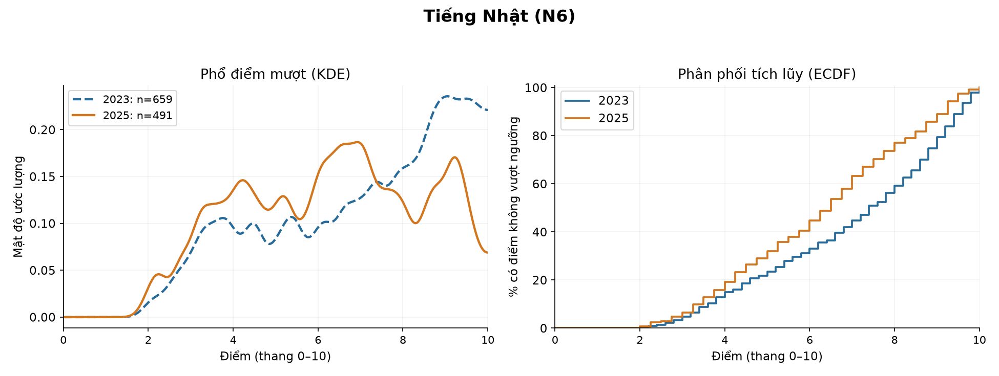

**Diễn giải hình:** Xanh nét đứt là 2023, cam nét liền là 2025; KDE mượt là mật độ, diện tích trên thang điểm bằng 1, không phải số người tuyệt đối. Ở ECDF, chiều cao là % điểm không vượt ngưỡng. Khoảng cách lớn nhất hai ECDF là D=0,212, gần mốc 7,75; đây là 21,2 điểm phần trăm ở mốc đó, không phải tỷ lệ người tiến bộ.

**Ý nghĩa và giới hạn:** Kết quả có bằng chứng chênh trung bình theo mô hình ở mức 0,05 sau Holm. Điều này cần đọc cùng mức đổi -0,718 điểm, |d| và hình dạng; p lớn không chứng minh tương đương. So sánh là giữa hai tập điểm quan sát, không tách được độ khó, chương trình, cách chấm và thành phần thí sinh.

### 2.4.11. Tiếng Hàn (N7)

| Năm | Số có điểm | Trung bình | Trung vị | SD | IQR | <5 (%) | ≥8 (%) | ≥9 (%) |
| --- | --- | --- | --- | --- | --- | --- | --- | --- |
| 2023 | 407 | 6,29 | 6,40 | 1,92 | 3,00 | 25,80 | 23,34 | 10,57 |
| 2025 | 541 | 5,90 | 5,75 | 1,92 | 3,00 | 34,01 | 17,38 | 7,95 |

**Diễn giải bảng:** n là số có điểm hợp lệ của riêng mục này, không phải mọi dòng trong năm. SD đo độ trải rộng; IQR là độ rộng vùng 50% ở giữa. Các tỷ lệ chia cho n của đúng hàng; nhóm ≥90% thang điểm đã nằm trong nhóm ≥80%, không cộng hai tỷ lệ.

**Nhận xét bằng số:** Trung bình 6,29 → 5,90, giảm 0,39 điểm; trung vị 6,40 → 5,75. Cohen’s d=-0,203 (trong khoảng 0,2–0,5 về |d| theo quy ước tham khảo). Tỷ số phương sai 2025/2023=1,005. Không dùng nhãn độ lớn như kết luận hai năm tương đương.

| Câu hỏi/phép thử | Thống kê | p gốc | p Holm / q BH |
| --- | --- | --- | --- |
| Welch: trung bình | t=-3,100, df=875,7 | 0,0020 | 0,0040 |
| MWU: thứ hạng | U=97.103,0 | 0,0018 | 0,0022 |
| KS: toàn phân phối | D=0,122; tại điểm 5,75 | 0,0010 | 0,0012 |
| Brown–Forsythe: độ phân tán | W=0,000 | 0,9971 | 0,9971 |

**Diễn giải bảng:** Welch dùng Holm trong family 14 phép thử trung bình; ba phép thăm dò dùng BH chung trong family 42 p hữu hạn. KS dùng hoán vị 1,999 lần, p nhỏ nhất phân giải được là 0,0005. Giá trị “≈0” ở các phép tiệm cận là giới hạn tính số, không phải xác suất bằng 0.

**Khoảng tin cậy và độ lớn:** Chênh trung bình có CI 95% [-0,638; -0,143] **điểm**. d có CI bootstrap 95% [-0,334; -0,070] **SD gộp**; Hedges’ g=-0,203. A=0,441 là xác suất thắng cộng nửa xác suất hòa, không phải chỉ P(2025>2023).

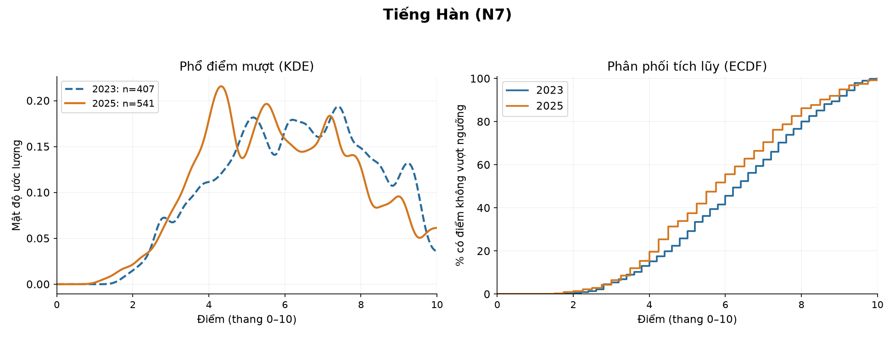

**Diễn giải hình:** Xanh nét đứt là 2023, cam nét liền là 2025; KDE mượt là mật độ, diện tích trên thang điểm bằng 1, không phải số người tuyệt đối. Ở ECDF, chiều cao là % điểm không vượt ngưỡng. Khoảng cách lớn nhất hai ECDF là D=0,122, gần mốc 5,75; đây là 12,2 điểm phần trăm ở mốc đó, không phải tỷ lệ người tiến bộ.

**Ý nghĩa và giới hạn:** Kết quả có bằng chứng chênh trung bình theo mô hình ở mức 0,05 sau Holm. Điều này cần đọc cùng mức đổi -0,390 điểm, |d| và hình dạng; p lớn không chứng minh tương đương. So sánh là giữa hai tập điểm quan sát, không tách được độ khó, chương trình, cách chấm và thành phần thí sinh.

### 2.4.12. Địa lý

| Năm | Số có điểm | Trung bình | Trung vị | SD | IQR | <5 (%) | ≥8 (%) | ≥9 (%) |
| --- | --- | --- | --- | --- | --- | --- | --- | --- |
| 2023 | 682.134 | 6,15 | 6,25 | 1,17 | 1,50 | 13,35 | 6,64 | 0,87 |
| 2025 | 476.472 | 6,63 | 6,75 | 1,75 | 2,65 | 18,69 | 26,68 | 11,26 |

**Diễn giải bảng:** n là số có điểm hợp lệ của riêng mục này, không phải mọi dòng trong năm. SD đo độ trải rộng; IQR là độ rộng vùng 50% ở giữa. Các tỷ lệ chia cho n của đúng hàng; nhóm ≥90% thang điểm đã nằm trong nhóm ≥80%, không cộng hai tỷ lệ.

**Nhận xét bằng số:** Trung bình 6,15 → 6,63, tăng 0,48 điểm; trung vị 6,25 → 6,75. Cohen’s d=0,334 (trong khoảng 0,2–0,5 về |d| theo quy ước tham khảo). Tỷ số phương sai 2025/2023=2,242. Không dùng nhãn độ lớn như kết luận hai năm tương đương.

| Câu hỏi/phép thử | Thống kê | p gốc | p Holm / q BH |
| --- | --- | --- | --- |
| Welch: trung bình | t=165,448, df=767.625,1 | ≈0 (dưới độ phân giải số) | ≈0 (dưới độ phân giải số) |
| MWU: thứ hạng | U=191.752.582.073,5 | ≈0 (dưới độ phân giải số) | ≈0 (dưới độ phân giải số) |
| KS: toàn phân phối | D=0,226; tại điểm 7,25 | 5.00e-04 | 6.36e-04 |
| Brown–Forsythe: độ phân tán | W=112.574,321 | ≈0 (dưới độ phân giải số) | ≈0 (dưới độ phân giải số) |

**Diễn giải bảng:** Welch dùng Holm trong family 14 phép thử trung bình; ba phép thăm dò dùng BH chung trong family 42 p hữu hạn. KS dùng hoán vị 1,999 lần, p nhỏ nhất phân giải được là 0,0005. Giá trị “≈0” ở các phép tiệm cận là giới hạn tính số, không phải xác suất bằng 0.

**Khoảng tin cậy và độ lớn:** Chênh trung bình có CI 95% [0,475; 0,486] **điểm**. d có CI bootstrap 95% [0,331; 0,338] **SD gộp**; Hedges’ g=0,334. A=0,590 là xác suất thắng cộng nửa xác suất hòa, không phải chỉ P(2025>2023).

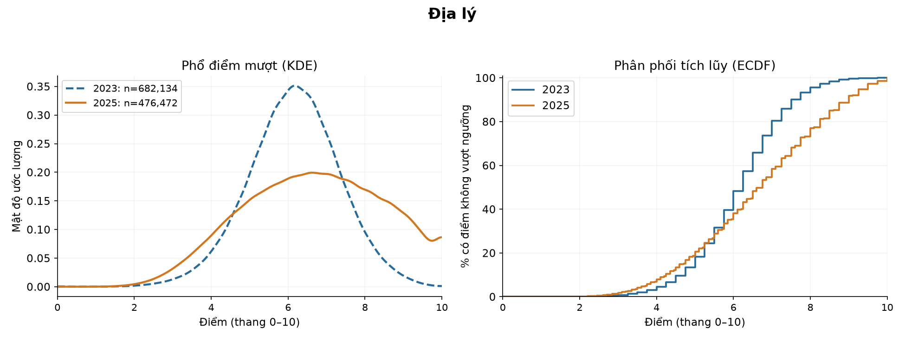

**Diễn giải hình:** Xanh nét đứt là 2023, cam nét liền là 2025; KDE mượt là mật độ, diện tích trên thang điểm bằng 1, không phải số người tuyệt đối. Ở ECDF, chiều cao là % điểm không vượt ngưỡng. Khoảng cách lớn nhất hai ECDF là D=0,226, gần mốc 7,25; đây là 22,6 điểm phần trăm ở mốc đó, không phải tỷ lệ người tiến bộ.

**Ý nghĩa và giới hạn:** Kết quả có bằng chứng chênh trung bình theo mô hình ở mức 0,05 sau Holm. Điều này cần đọc cùng mức đổi 0,480 điểm, |d| và hình dạng; p lớn không chứng minh tương đương. So sánh là giữa hai tập điểm quan sát, không tách được độ khó, chương trình, cách chấm và thành phần thí sinh.

### 2.4.13. Lịch sử

| Năm | Số có điểm | Trung bình | Trung vị | SD | IQR | <5 (%) | ≥8 (%) | ≥9 (%) |
| --- | --- | --- | --- | --- | --- | --- | --- | --- |
| 2023 | 683.447 | 6,03 | 6,00 | 1,55 | 2,25 | 24,91 | 13,07 | 3,06 |
| 2025 | 481.293 | 6,52 | 6,60 | 1,63 | 2,50 | 18,63 | 23,03 | 6,88 |

**Diễn giải bảng:** n là số có điểm hợp lệ của riêng mục này, không phải mọi dòng trong năm. SD đo độ trải rộng; IQR là độ rộng vùng 50% ở giữa. Các tỷ lệ chia cho n của đúng hàng; nhóm ≥90% thang điểm đã nằm trong nhóm ≥80%, không cộng hai tỷ lệ.

**Nhận xét bằng số:** Trung bình 6,03 → 6,52, tăng 0,49 điểm; trung vị 6,00 → 6,60. Cohen’s d=0,311 (trong khoảng 0,2–0,5 về |d| theo quy ước tham khảo). Tỷ số phương sai 2025/2023=1,106. Không dùng nhãn độ lớn như kết luận hai năm tương đương.

| Câu hỏi/phép thử | Thống kê | p gốc | p Holm / q BH |
| --- | --- | --- | --- |
| Welch: trung bình | t=163,919, df=1.003.086,4 | ≈0 (dưới độ phân giải số) | ≈0 (dưới độ phân giải số) |
| MWU: thứ hạng | U=193.784.815.670,5 | ≈0 (dưới độ phân giải số) | ≈0 (dưới độ phân giải số) |
| KS: toàn phân phối | D=0,141; tại điểm 6,50 | 5.00e-04 | 6.36e-04 |
| Brown–Forsythe: độ phân tán | W=2.173,638 | ≈0 (dưới độ phân giải số) | ≈0 (dưới độ phân giải số) |

**Diễn giải bảng:** Welch dùng Holm trong family 14 phép thử trung bình; ba phép thăm dò dùng BH chung trong family 42 p hữu hạn. KS dùng hoán vị 1,999 lần, p nhỏ nhất phân giải được là 0,0005. Giá trị “≈0” ở các phép tiệm cận là giới hạn tính số, không phải xác suất bằng 0.

**Khoảng tin cậy và độ lớn:** Chênh trung bình có CI 95% [0,488; 0,500] **điểm**. d có CI bootstrap 95% [0,308; 0,315] **SD gộp**; Hedges’ g=0,311. A=0,589 là xác suất thắng cộng nửa xác suất hòa, không phải chỉ P(2025>2023).

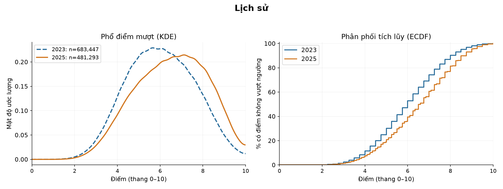

**Diễn giải hình:** Xanh nét đứt là 2023, cam nét liền là 2025; KDE mượt là mật độ, diện tích trên thang điểm bằng 1, không phải số người tuyệt đối. Ở ECDF, chiều cao là % điểm không vượt ngưỡng. Khoảng cách lớn nhất hai ECDF là D=0,141, gần mốc 6,50; đây là 14,1 điểm phần trăm ở mốc đó, không phải tỷ lệ người tiến bộ.

**Ý nghĩa và giới hạn:** Kết quả có bằng chứng chênh trung bình theo mô hình ở mức 0,05 sau Holm. Điều này cần đọc cùng mức đổi 0,494 điểm, |d| và hình dạng; p lớn không chứng minh tương đương. So sánh là giữa hai tập điểm quan sát, không tách được độ khó, chương trình, cách chấm và thành phần thí sinh.

### 2.4.14. Tin học

| Năm | Số có điểm | Trung bình | Trung vị | SD | IQR | <5 (%) | ≥8 (%) | ≥9 (%) |
| --- | --- | --- | --- | --- | --- | --- | --- | --- |
| 2025 | 7.602 | 6,78 | 6,75 | 1,48 | 2,10 | 11,22 | 24,80 | 8,47 |

**Diễn giải bảng:** n là số có điểm hợp lệ của riêng mục này, không phải mọi dòng trong năm. SD đo độ trải rộng; IQR là độ rộng vùng 50% ở giữa. Các tỷ lệ chia cho n của đúng hàng; nhóm ≥90% thang điểm đã nằm trong nhóm ≥80%, không cộng hai tỷ lệ.

**Phạm vi so sánh:** Không có điểm ở một năm; không tạo mẫu bằng 0. Có thống kê và hình cho năm hiện có; ô thiếu không được thay bằng 0 và không tạo p-value/CI liên năm giả.

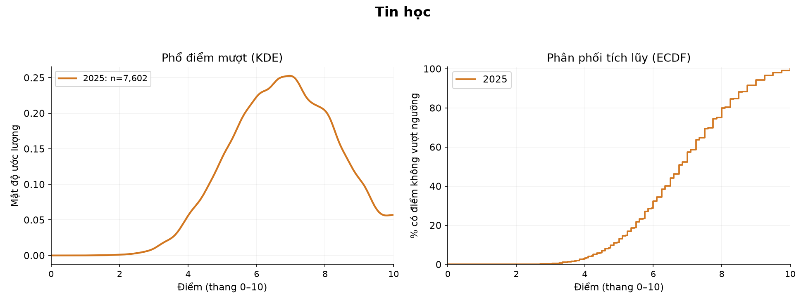

**Diễn giải hình:** Chỉ vẽ các năm có điểm thực. KDE là mật độ mượt từ điểm quan sát; ECDF mô tả phần tích lũy. Không có đường của một năm không có nghĩa điểm của năm đó bằng 0.

**Ý nghĩa và giới hạn:** Kết quả mô tả đúng mẫu có điểm. Mục này không được đưa vào family kiểm định liên năm chính; khác môn/chương trình không được diễn giải như cùng một thang năng lực.

### 2.4.15. Ngữ văn

| Năm | Số có điểm | Trung bình | Trung vị | SD | IQR | <5 (%) | ≥8 (%) | ≥9 (%) |
| --- | --- | --- | --- | --- | --- | --- | --- | --- |
| 2023 | 1.008.239 | 6,86 | 7,00 | 1,33 | 1,75 | 7,31 | 24,42 | 4,30 |
| 2025 | 1.126.726 | 7,00 | 7,25 | 1,28 | 1,75 | 6,24 | 26,69 | 3,91 |

**Diễn giải bảng:** n là số có điểm hợp lệ của riêng mục này, không phải mọi dòng trong năm. SD đo độ trải rộng; IQR là độ rộng vùng 50% ở giữa. Các tỷ lệ chia cho n của đúng hàng; nhóm ≥90% thang điểm đã nằm trong nhóm ≥80%, không cộng hai tỷ lệ.

**Nhận xét bằng số:** Trung bình 6,86 → 7,00, tăng 0,14 điểm; trung vị 7,00 → 7,25. Cohen’s d=0,111 (dưới mốc 0,2 về |d| theo quy ước tham khảo). Tỷ số phương sai 2025/2023=0,929. Không dùng nhãn độ lớn như kết luận hai năm tương đương.

| Câu hỏi/phép thử | Thống kê | p gốc | p Holm / q BH |
| --- | --- | --- | --- |
| Welch: trung bình | t=80,498, df=2.089.349,0 | ≈0 (dưới độ phân giải số) | ≈0 (dưới độ phân giải số) |
| MWU: thứ hạng | U=607.954.346.839,0 | ≈0 (dưới độ phân giải số) | ≈0 (dưới độ phân giải số) |
| KS: toàn phân phối | D=0,070; tại điểm 6,91 | 5.00e-04 | 6.36e-04 |
| Brown–Forsythe: độ phân tán | W=2.873,677 | ≈0 (dưới độ phân giải số) | ≈0 (dưới độ phân giải số) |

**Diễn giải bảng:** Welch dùng Holm trong family 14 phép thử trung bình; ba phép thăm dò dùng BH chung trong family 42 p hữu hạn. KS dùng hoán vị 1,999 lần, p nhỏ nhất phân giải được là 0,0005. Giá trị “≈0” ở các phép tiệm cận là giới hạn tính số, không phải xác suất bằng 0.

**Khoảng tin cậy và độ lớn:** Chênh trung bình có CI 95% [0,140; 0,147] **điểm**. d có CI bootstrap 95% [0,108; 0,113] **SD gộp**; Hedges’ g=0,111. A=0,535 là xác suất thắng cộng nửa xác suất hòa, không phải chỉ P(2025>2023).

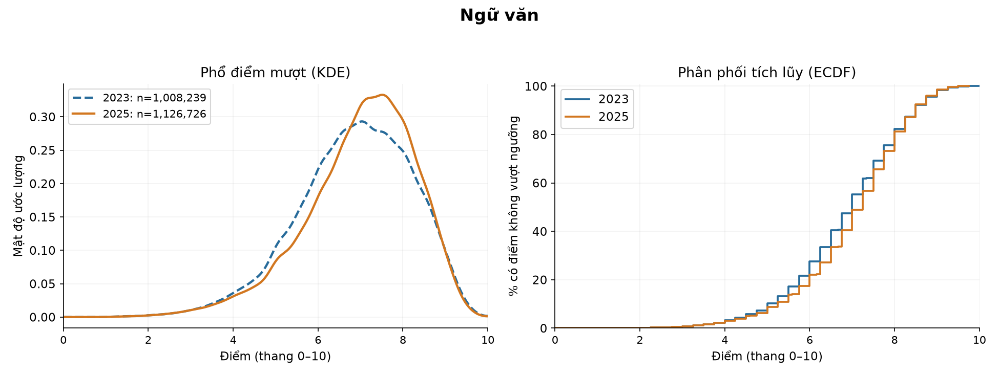

**Diễn giải hình:** Xanh nét đứt là 2023, cam nét liền là 2025; KDE mượt là mật độ, diện tích trên thang điểm bằng 1, không phải số người tuyệt đối. Ở ECDF, chiều cao là % điểm không vượt ngưỡng. Khoảng cách lớn nhất hai ECDF là D=0,070, gần mốc 6,91; đây là 7,0 điểm phần trăm ở mốc đó, không phải tỷ lệ người tiến bộ.

**Ý nghĩa và giới hạn:** Kết quả có bằng chứng chênh trung bình theo mô hình ở mức 0,05 sau Holm. Điều này cần đọc cùng mức đổi 0,144 điểm, |d| và hình dạng; p lớn không chứng minh tương đương. So sánh là giữa hai tập điểm quan sát, không tách được độ khó, chương trình, cách chấm và thành phần thí sinh.

### 2.4.16. Toán

| Năm | Số có điểm | Trung bình | Trung vị | SD | IQR | <5 (%) | ≥8 (%) | ≥9 (%) |
| --- | --- | --- | --- | --- | --- | --- | --- | --- |
| 2023 | 1.003.373 | 6,25 | 6,60 | 1,63 | 2,40 | 21,64 | 15,16 | 1,00 |
| 2025 | 1.126.172 | 4,78 | 4,60 | 1,68 | 2,35 | 56,39 | 5,45 | 1,43 |

**Diễn giải bảng:** n là số có điểm hợp lệ của riêng mục này, không phải mọi dòng trong năm. SD đo độ trải rộng; IQR là độ rộng vùng 50% ở giữa. Các tỷ lệ chia cho n của đúng hàng; nhóm ≥90% thang điểm đã nằm trong nhóm ≥80%, không cộng hai tỷ lệ.

**Nhận xét bằng số:** Trung bình 6,25 → 4,78, giảm 1,47 điểm; trung vị 6,60 → 4,60. Cohen’s d=-0,886 (từ 0,8 trở lên về |d| theo quy ước tham khảo). Tỷ số phương sai 2025/2023=1,054. Không dùng nhãn độ lớn như kết luận hai năm tương đương.

| Câu hỏi/phép thử | Thống kê | p gốc | p Holm / q BH |
| --- | --- | --- | --- |
| Welch: trung bình | t=-646,218, df=2.112.800,0 | ≈0 (dưới độ phân giải số) | ≈0 (dưới độ phân giải số) |
| MWU: thứ hạng | U=295.469.370.372,0 | ≈0 (dưới độ phân giải số) | ≈0 (dưới độ phân giải số) |
| KS: toàn phân phối | D=0,414; tại điểm 5,75 | 5.00e-04 | 6.36e-04 |
| Brown–Forsythe: độ phân tán | W=200,931 | 1.31e-45 | 3.68e-45 |

**Diễn giải bảng:** Welch dùng Holm trong family 14 phép thử trung bình; ba phép thăm dò dùng BH chung trong family 42 p hữu hạn. KS dùng hoán vị 1,999 lần, p nhỏ nhất phân giải được là 0,0005. Giá trị “≈0” ở các phép tiệm cận là giới hạn tính số, không phải xác suất bằng 0.

**Khoảng tin cậy và độ lớn:** Chênh trung bình có CI 95% [-1,472; -1,463] **điểm**. d có CI bootstrap 95% [-0,889; -0,883] **SD gộp**; Hedges’ g=-0,886. A=0,261 là xác suất thắng cộng nửa xác suất hòa, không phải chỉ P(2025>2023).

**Diễn giải hình:** Xanh nét đứt là 2023, cam nét liền là 2025; KDE mượt là mật độ, diện tích trên thang điểm bằng 1, không phải số người tuyệt đối. Ở ECDF, chiều cao là % điểm không vượt ngưỡng. Khoảng cách lớn nhất hai ECDF là D=0,414, gần mốc 5,75; đây là 41,4 điểm phần trăm ở mốc đó, không phải tỷ lệ người tiến bộ.

**Ý nghĩa và giới hạn:** Kết quả có bằng chứng chênh trung bình theo mô hình ở mức 0,05 sau Holm. Điều này cần đọc cùng mức đổi -1,467 điểm, |d| và hình dạng; p lớn không chứng minh tương đương. So sánh là giữa hai tập điểm quan sát, không tách được độ khó, chương trình, cách chấm và thành phần thí sinh.

### 2.4.17. Vật lý

| Năm | Số có điểm | Trung bình | Trung vị | SD | IQR | <5 (%) | ≥8 (%) | ≥9 (%) |
| --- | --- | --- | --- | --- | --- | --- | --- | --- |
| 2023 | 327.189 | 6,57 | 6,75 | 1,49 | 2,25 | 14,79 | 21,32 | 2,97 |
| 2025 | 347.599 | 6,99 | 7,00 | 1,52 | 2,40 | 9,79 | 30,79 | 11,53 |

**Diễn giải bảng:** n là số có điểm hợp lệ của riêng mục này, không phải mọi dòng trong năm. SD đo độ trải rộng; IQR là độ rộng vùng 50% ở giữa. Các tỷ lệ chia cho n của đúng hàng; nhóm ≥90% thang điểm đã nằm trong nhóm ≥80%, không cộng hai tỷ lệ.

**Nhận xét bằng số:** Trung bình 6,57 → 6,99, tăng 0,41 điểm; trung vị 6,75 → 7,00. Cohen’s d=0,274 (trong khoảng 0,2–0,5 về |d| theo quy ước tham khảo). Tỷ số phương sai 2025/2023=1,041. Không dùng nhãn độ lớn như kết luận hai năm tương đương.

| Câu hỏi/phép thử | Thống kê | p gốc | p Holm / q BH |
| --- | --- | --- | --- |
| Welch: trung bình | t=112,406, df=673.696,1 | ≈0 (dưới độ phân giải số) | ≈0 (dưới độ phân giải số) |
| MWU: thứ hạng | U=64.870.946.315,5 | ≈0 (dưới độ phân giải số) | ≈0 (dưới độ phân giải số) |
| KS: toàn phân phối | D=0,106; tại điểm 8,25 | 5.00e-04 | 6.36e-04 |
| Brown–Forsythe: độ phân tán | W=342,476 | 1.93e-76 | 5.78e-76 |

**Diễn giải bảng:** Welch dùng Holm trong family 14 phép thử trung bình; ba phép thăm dò dùng BH chung trong family 42 p hữu hạn. KS dùng hoán vị 1,999 lần, p nhỏ nhất phân giải được là 0,0005. Giá trị “≈0” ở các phép tiệm cận là giới hạn tính số, không phải xác suất bằng 0.

**Khoảng tin cậy và độ lớn:** Chênh trung bình có CI 95% [0,404; 0,418] **điểm**. d có CI bootstrap 95% [0,269; 0,279] **SD gộp**; Hedges’ g=0,274. A=0,570 là xác suất thắng cộng nửa xác suất hòa, không phải chỉ P(2025>2023).

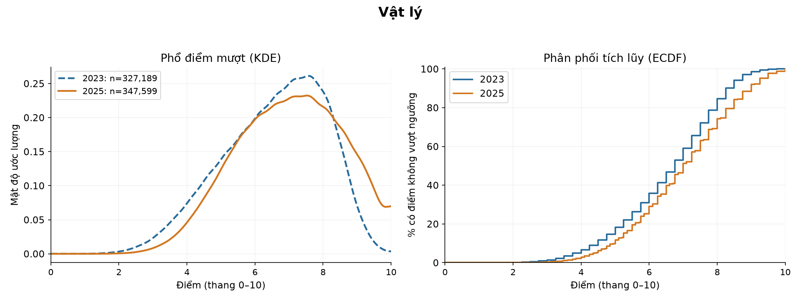

**Diễn giải hình:** Xanh nét đứt là 2023, cam nét liền là 2025; KDE mượt là mật độ, diện tích trên thang điểm bằng 1, không phải số người tuyệt đối. Ở ECDF, chiều cao là % điểm không vượt ngưỡng. Khoảng cách lớn nhất hai ECDF là D=0,106, gần mốc 8,25; đây là 10,6 điểm phần trăm ở mốc đó, không phải tỷ lệ người tiến bộ.

**Ý nghĩa và giới hạn:** Kết quả có bằng chứng chênh trung bình theo mô hình ở mức 0,05 sau Holm. Điều này cần đọc cùng mức đổi 0,411 điểm, |d| và hình dạng; p lớn không chứng minh tương đương. So sánh là giữa hai tập điểm quan sát, không tách được độ khó, chương trình, cách chấm và thành phần thí sinh.

### 2.4.18. Công nghệ

| Năm | Số có điểm | Trung bình | Trung vị | SD | IQR | <5 (%) | ≥8 (%) | ≥9 (%) |
| --- | --- | --- | --- | --- | --- | --- | --- | --- |
| 2025 | 24.338 | 7,53 | 7,75 | 1,33 | 1,75 | 5,15 | 45,26 | 14,55 |

**Diễn giải bảng:** n là số có điểm hợp lệ của riêng mục này, không phải mọi dòng trong năm. SD đo độ trải rộng; IQR là độ rộng vùng 50% ở giữa. Các tỷ lệ chia cho n của đúng hàng; nhóm ≥90% thang điểm đã nằm trong nhóm ≥80%, không cộng hai tỷ lệ.

**Phạm vi so sánh:** Không có điểm ở một năm; không tạo mẫu bằng 0. Có thống kê và hình cho năm hiện có; ô thiếu không được thay bằng 0 và không tạo p-value/CI liên năm giả.

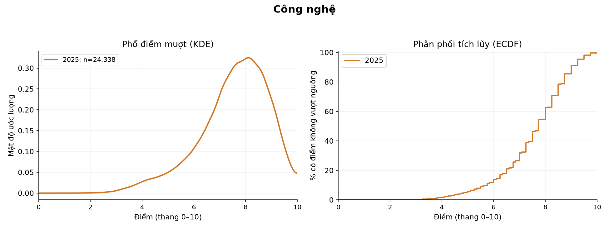

**Diễn giải hình:** Chỉ vẽ các năm có điểm thực. KDE là mật độ mượt từ điểm quan sát; ECDF mô tả phần tích lũy. Không có đường của một năm không có nghĩa điểm của năm đó bằng 0.

**Ý nghĩa và giới hạn:** Kết quả mô tả đúng mẫu có điểm. Mục này không được đưa vào family kiểm định liên năm chính; khác môn/chương trình không được diễn giải như cùng một thang năng lực.

## 2.5. Tổng điểm mọi khối có điểm — sau phần từng môn

| Khối | Môn 2023 | Môn 2025 | n2023 | n2025 | Phạm vi |
| --- | --- | --- | --- | --- | --- |
| A00 | Toán + Vật lý + Hóa học | Toán + Vật lý + Hóa học | 325.902 | 162.200 | So được điểm quan sát |
| A01 | Toán + Vật lý + Tiếng Anh (N1) | Toán + Vật lý + Tiếng Anh (N1) | 314.412 | 146.960 | So được điểm quan sát |
| A02 | Toán + Vật lý + Sinh học | Toán + Vật lý + Sinh học | 322.538 | 4.795 | So được điểm quan sát |
| A08 | Toán + Lịch sử + GDCD | Toán + Lịch sử + GDKT&PL | 564.507 | 68.313 | Đổi môn: chỉ mô tả |
| A09 | Toán + Địa lý + GDCD | Toán + Địa lý + GDKT&PL | 564.517 | 109.404 | Đổi môn: chỉ mô tả |
| B00 | Toán + Hóa học + Sinh học | Toán + Hóa học + Sinh học | 324.554 | 44.964 | So được điểm quan sát |
| B08 | Toán + Sinh học + Tiếng Anh (N1) | Toán + Sinh học + Tiếng Anh (N1) | 313.063 | 4.227 | So được điểm quan sát |
| C00 | Ngữ văn + Lịch sử + Địa lý | Ngữ văn + Lịch sử + Địa lý | 681.723 | 297.377 | So được điểm quan sát |
| C01 | Ngữ văn + Toán + Vật lý | Ngữ văn + Toán + Vật lý | 320.523 | 345.014 | So được điểm quan sát |
| C02 | Ngữ văn + Toán + Hóa học | Ngữ văn + Toán + Hóa học | 320.465 | 237.064 | So được điểm quan sát |
| C03 | Ngữ văn + Toán + Lịch sử | Ngữ văn + Toán + Lịch sử | 669.692 | 476.660 | So được điểm quan sát |
| C04 | Ngữ văn + Toán + Địa lý | Ngữ văn + Toán + Địa lý | 668.369 | 472.025 | So được điểm quan sát |
| C14 | Ngữ văn + Toán + GDCD | Ngữ văn + Toán + GDKT&PL | 564.516 | 246.298 | Đổi môn: chỉ mô tả |
| C19 | Ngữ văn + Lịch sử + GDCD | Ngữ văn + Lịch sử + GDKT&PL | 565.211 | 68.351 | Đổi môn: chỉ mô tả |
| C20 | Ngữ văn + Địa lý + GDCD | Ngữ văn + Địa lý + GDKT&PL | 565.249 | 109.423 | Đổi môn: chỉ mô tả |
| D01 | Toán + Ngữ văn + Tiếng Anh (N1) | Toán + Ngữ văn + Tiếng Anh (N1) | 873.126 | 350.654 | So được điểm quan sát |
| D07 | Toán + Hóa học + Tiếng Anh (N1) | Toán + Hóa học + Tiếng Anh (N1) | 313.538 | 24.478 | So được điểm quan sát |
| D08 | Toán + Sinh học + Tiếng Anh (N1) | Toán + Sinh học + Tiếng Anh (N1) | 313.063 | 4.227 | Dùng chung B08 |
| D09 | Toán + Lịch sử + Tiếng Anh (N1) | Toán + Lịch sử + Tiếng Anh (N1) | 557.198 | 69.904 | So được điểm quan sát |
| D10 | Toán + Địa lý + Tiếng Anh (N1) | Toán + Địa lý + Tiếng Anh (N1) | 557.086 | 53.567 | So được điểm quan sát |
| D14 | Ngữ văn + Lịch sử + Tiếng Anh (N1) | Ngữ văn + Lịch sử + Tiếng Anh (N1) | 557.405 | 69.989 | So được điểm quan sát |
| D15 | Ngữ văn + Địa lý + Tiếng Anh (N1) | Ngữ văn + Địa lý + Tiếng Anh (N1) | 557.312 | 53.592 | So được điểm quan sát |
| D66 | Ngữ văn + GDCD + Tiếng Anh (N1) | Ngữ văn + GDKT&PL + Tiếng Anh (N1) | 556.185 | 47.905 | Đổi môn: chỉ mô tả |
| D84 | Toán + GDCD + Tiếng Anh (N1) | Toán + GDKT&PL + Tiếng Anh (N1) | 556.034 | 47.902 | Đổi môn: chỉ mô tả |

**Diễn giải bảng:** Đủ 24 mã có điểm trong nguồn; B08/D08 cùng Toán–Sinh–Anh nên chỉ tính một bộ. Bảy khối A08/A09/C14/C19/C20/D66/D84 đổi GDCD sang GDKT&PL: PCA riêng từng năm và mô tả điểm, không đưa vào family kiểm định chính liên năm. N1 là Tiếng Anh; đây là các mã nguồn có sẵn, không là mọi tổ hợp ba môn có thể tưởng tượng. Tin học/Công nghệ và N2–N7 đã phân tích ở từng môn nhưng chưa có mã khối tương ứng trong nguồn. Tổng n của các khối không phải số người vì một người có thể thuộc nhiều khối.

| Bất đồng | data/danh_muc_to_hop.csv cũ | Quy tắc thực dùng |
| --- | --- | --- |
| D04 trong danh mục | Toán–Văn–Hóa | Nguồn dùng C02; không tạo khối D04 mới |
| D09/D10 | Danh mục ghi D09 là Toán–Địa–Ngoại ngữ | Nguồn: D09=Toán–Sử–N1; D10=Toán–Địa–N1 |
| D96/D84 | Danh mục ghi D96 là Toán–GDCD–Ngoại ngữ | Nguồn có D84; 2023 dùng GDCD,2025 dùng GDKT&PL |
| A01/D90; B08/D99 | Ghi chú danh mục coi là alias | Không sử dụng các alias này; chỉ B08/D08 cùng bộ trong nguồn |
| Ngoại ngữ | Danh mục ghi chung, không chỉ mã | Tổng đã lưu khớp Tiếng Anh N1; không gộp N2–N7 |

**Diễn giải bảng:** Đây là bất đồng đã biết giữa danh mục cũ và các cột diem_* trong tệp điểm, việc tổng đã lưu khớp không có nghĩa mọi tài liệu đều thống nhất. Ưu tiên mapping đã kiểm chứng bằng tổng ba môn và số mẫu phần 3; không sửa danh mục gốc, không tự thêm/đổi mã theo ghi chú cũ. Phạm vi24 mã là theo bộ dữ liệu này, không là xác nhận danh mục tuyển sinh chính thức.

**Quy tắc tính:** Chỉ cộng khi có đủ ba môn cùng người/cùng năm, giữ điểm0, tổng trong0–30. Không cộng hai điểm rồi bỏ qua môn thiếu. Chỉ chuẩn hóa sai số cộng dấu phẩy động ở mức 10⁻¹⁰ điểm, không làm tròn về bước điểm bài thi. Bandwidth KDE tổng là0,35 điểm, phản xạ ở0/30. Phép thử dùng tổng gốc sau chuẩn hóa sai số này.

| Khối | n2023 | n2025 | TB2023 | TB2025 | Δ tổng | d |
| --- | --- | --- | --- | --- | --- | --- |
| B00 | 324.554 | 44.964 | 20,605 | 18,289 | -2,315 | -0,762 |
| B08/D08 | 313.063 | 4.227 | 20,066 | 15,657 | -4,409 | -1,465 |
| A02 | 322.538 | 4.795 | 20,426 | 15,320 | -5,107 | -1,870 |
| D07 | 313.538 | 24.478 | 20,422 | 17,508 | -2,914 | -0,936 |
| C02 | 320.465 | 237.064 | 21,173 | 19,115 | -2,059 | -0,691 |
| A00 | 325.902 | 162.200 | 20,774 | 19,369 | -1,405 | -0,395 |
| D66 | 556.185 | 47.905 | 20,308 | 21,110 | 0,802 | — |
| D84 | 556.034 | 47.902 | 19,152 | 18,556 | -0,596 | — |
| C20 | 565.249 | 109.423 | 21,533 | 20,314 | -1,218 | — |
| A09 | 564.517 | 109.404 | 20,383 | 17,390 | -2,993 | — |
| C19 | 565.211 | 68.351 | 21,442 | 20,251 | -1,191 | — |
| A08 | 564.507 | 68.313 | 20,291 | 17,287 | -3,003 | — |
| C14 | 564.516 | 246.298 | 21,174 | 18,463 | -2,711 | — |
| D15 | 557.312 | 53.592 | 18,249 | 20,631 | 2,382 | 0,715 |
| D10 | 557.086 | 53.567 | 17,094 | 18,189 | 1,095 | 0,306 |
| D14 | 557.405 | 69.989 | 18,155 | 20,449 | 2,294 | 0,634 |
| D09 | 557.198 | 69.904 | 16,999 | 17,857 | 0,858 | 0,223 |
| D01 | 873.126 | 350.654 | 18,889 | 18,582 | -0,307 | -0,086 |
| A01 | 314.412 | 146.960 | 20,274 | 18,869 | -1,406 | -0,410 |
| C00 | 681.723 | 297.377 | 18,975 | 19,721 | 0,746 | 0,203 |
| C04 | 668.369 | 472.025 | 18,610 | 17,289 | -1,321 | -0,379 |
| C03 | 669.692 | 476.660 | 18,479 | 17,281 | -1,198 | -0,330 |
| C01 | 320.523 | 345.014 | 21,011 | 20,088 | -0,923 | -0,312 |

**Diễn giải bảng:** Δ cùng chiều2025−2023, đơn vị điểm trên thang 30. Family Welch chỉ gồm 16 bộ không đổi môn (Holm); MWU/KS/BF gồm 48 p hữu hạn (BH chung). Khối đổi môn vẫn có Δ mô tả, d/p chính bỏ trống để tránh trình bày như cùng nội dung. Tổng lớn hơn không đồng nghĩa năng lực cao hơn.

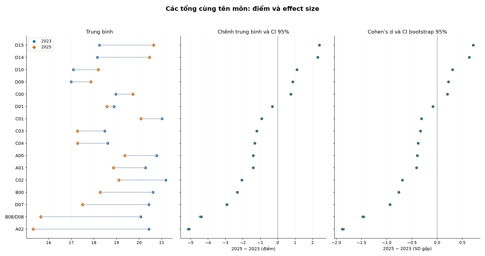

**Diễn giải hình:** Đọc mean/Δ trên thang 30 và d theo SD gộp. Chỉ16 bộ cùng tên môn có kiểm định chính; B08/D08 hiện một lần.

### 2.5.1. B00

| Năm | Số có điểm | Trung bình | Trung vị | SD | IQR | <15 (%) | ≥24 (%) | ≥27 (%) |
| --- | --- | --- | --- | --- | --- | --- | --- | --- |
| 2023 | 324.554 | 20,60 | 20,85 | 2,78 | 3,60 | 3,35 | 9,64 | 0,44 |
| 2025 | 44.964 | 18,29 | 18,00 | 4,51 | 6,90 | 25,89 | 13,22 | 2,35 |

**Diễn giải bảng:** n là số có điểm hợp lệ của riêng mục này, không phải mọi dòng trong năm. SD đo độ trải rộng; IQR là độ rộng vùng 50% ở giữa. Các tỷ lệ chia cho n của đúng hàng; nhóm ≥90% thang điểm đã nằm trong nhóm ≥80%, không cộng hai tỷ lệ.

**Nhận xét bằng số:** Trung bình 20,60 → 18,29, giảm 2,32 điểm; trung vị 20,85 → 18,00. Cohen’s d=-0,762 (trong khoảng 0,5–0,8 về |d| theo quy ước tham khảo). Tỷ số phương sai 2025/2023=2,635. Không dùng nhãn độ lớn như kết luận hai năm tương đương.

| Câu hỏi/phép thử | Thống kê | p gốc | p Holm / q BH |
| --- | --- | --- | --- |
| Welch: trung bình | t=-106,190, df=49.796,9 | ≈0 (dưới độ phân giải số) | ≈0 (dưới độ phân giải số) |
| MWU: thứ hạng | U=4.868.818.947,5 | ≈0 (dưới độ phân giải số) | ≈0 (dưới độ phân giải số) |
| KS: toàn phân phối | D=0,331; tại điểm 18,10 | 5.00e-04 | 5.00e-04 |
| Brown–Forsythe: độ phân tán | W=28.179,048 | ≈0 (dưới độ phân giải số) | ≈0 (dưới độ phân giải số) |

**Diễn giải bảng:** Welch dùng Holm trong family 16 phép thử trung bình; ba phép thăm dò dùng BH chung trong family 48 p hữu hạn. KS dùng hoán vị 1,999 lần, p nhỏ nhất phân giải được là 0,0005. Giá trị “≈0” ở các phép tiệm cận là giới hạn tính số, không phải xác suất bằng 0.

**Khoảng tin cậy và độ lớn:** Chênh trung bình có CI 95% [-2,358; -2,273] **điểm**. d có CI bootstrap 95% [-0,775; -0,748] **SD gộp**; Hedges’ g=-0,762. A=0,334 là xác suất thắng cộng nửa xác suất hòa, không phải chỉ P(2025>2023).

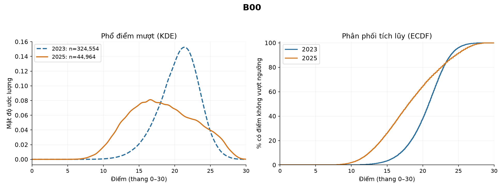

**Diễn giải hình:** Xanh nét đứt là 2023, cam nét liền là 2025; KDE mượt là mật độ, diện tích trên thang điểm bằng 1, không phải số người tuyệt đối. Ở ECDF, chiều cao là % điểm không vượt ngưỡng. Khoảng cách lớn nhất hai ECDF là D=0,331, gần mốc 18,10; đây là 33,1 điểm phần trăm ở mốc đó, không phải tỷ lệ người tiến bộ.

**Ý nghĩa và giới hạn:** Kết quả có bằng chứng chênh trung bình theo mô hình ở mức 0,05 sau Holm. Điều này cần đọc cùng mức đổi -2,315 điểm, |d| và hình dạng; p lớn không chứng minh tương đương. So sánh là giữa hai tập điểm quan sát, không tách được độ khó, chương trình, cách chấm và thành phần thí sinh.

### 2.5.2. B08/D08

| Năm | Số có điểm | Trung bình | Trung vị | SD | IQR | <15 (%) | ≥24 (%) | ≥27 (%) |
| --- | --- | --- | --- | --- | --- | --- | --- | --- |
| 2023 | 313.063 | 20,07 | 20,20 | 3,00 | 4,30 | 5,09 | 9,58 | 0,21 |
| 2025 | 4.227 | 15,66 | 15,45 | 3,40 | 4,75 | 44,48 | 1,42 | 0,02 |

**Diễn giải bảng:** n là số có điểm hợp lệ của riêng mục này, không phải mọi dòng trong năm. SD đo độ trải rộng; IQR là độ rộng vùng 50% ở giữa. Các tỷ lệ chia cho n của đúng hàng; nhóm ≥90% thang điểm đã nằm trong nhóm ≥80%, không cộng hai tỷ lệ.

**Nhận xét bằng số:** Trung bình 20,07 → 15,66, giảm 4,41 điểm; trung vị 20,20 → 15,45. Cohen’s d=-1,465 (từ 0,8 trở lên về |d| theo quy ước tham khảo). Tỷ số phương sai 2025/2023=1,278. Không dùng nhãn độ lớn như kết luận hai năm tương đương.

| Câu hỏi/phép thử | Thống kê | p gốc | p Holm / q BH |
| --- | --- | --- | --- |
| Welch: trung bình | t=-83,948, df=4.315,8 | ≈0 (dưới độ phân giải số) | ≈0 (dưới độ phân giải số) |
| MWU: thứ hạng | U=222.337.576,5 | ≈0 (dưới độ phân giải số) | ≈0 (dưới độ phân giải số) |
| KS: toàn phân phối | D=0,519; tại điểm 17,35 | 5.00e-04 | 5.00e-04 |
| Brown–Forsythe: độ phân tán | W=113,728 | 1.51e-26 | 2.34e-26 |

**Diễn giải bảng:** Welch dùng Holm trong family 16 phép thử trung bình; ba phép thăm dò dùng BH chung trong family 48 p hữu hạn. KS dùng hoán vị 1,999 lần, p nhỏ nhất phân giải được là 0,0005. Giá trị “≈0” ở các phép tiệm cận là giới hạn tính số, không phải xác suất bằng 0.

**Khoảng tin cậy và độ lớn:** Chênh trung bình có CI 95% [-4,512; -4,306] **điểm**. d có CI bootstrap 95% [-1,498; -1,430] **SD gộp**; Hedges’ g=-1,465. A=0,168 là xác suất thắng cộng nửa xác suất hòa, không phải chỉ P(2025>2023).

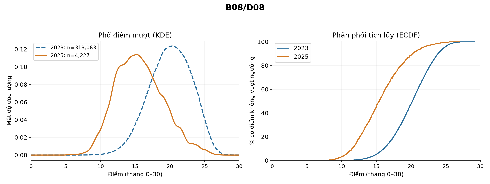

**Diễn giải hình:** Xanh nét đứt là 2023, cam nét liền là 2025; KDE mượt là mật độ, diện tích trên thang điểm bằng 1, không phải số người tuyệt đối. Ở ECDF, chiều cao là % điểm không vượt ngưỡng. Khoảng cách lớn nhất hai ECDF là D=0,519, gần mốc 17,35; đây là 51,9 điểm phần trăm ở mốc đó, không phải tỷ lệ người tiến bộ.

**Ý nghĩa và giới hạn:** Kết quả có bằng chứng chênh trung bình theo mô hình ở mức 0,05 sau Holm. Điều này cần đọc cùng mức đổi -4,409 điểm, |d| và hình dạng; p lớn không chứng minh tương đương. So sánh là giữa hai tập điểm quan sát, không tách được độ khó, chương trình, cách chấm và thành phần thí sinh.

### 2.5.3. A02

| Năm | Số có điểm | Trung bình | Trung vị | SD | IQR | <15 (%) | ≥24 (%) | ≥27 (%) |
| --- | --- | --- | --- | --- | --- | --- | --- | --- |
| 2023 | 322.538 | 20,43 | 20,70 | 2,73 | 3,65 | 3,64 | 7,72 | 0,09 |
| 2025 | 4.795 | 15,32 | 15,10 | 3,07 | 4,05 | 48,80 | 0,86 | 0,02 |

**Diễn giải bảng:** n là số có điểm hợp lệ của riêng mục này, không phải mọi dòng trong năm. SD đo độ trải rộng; IQR là độ rộng vùng 50% ở giữa. Các tỷ lệ chia cho n của đúng hàng; nhóm ≥90% thang điểm đã nằm trong nhóm ≥80%, không cộng hai tỷ lệ.

**Nhận xét bằng số:** Trung bình 20,43 → 15,32, giảm 5,11 điểm; trung vị 20,70 → 15,10. Cohen’s d=-1,870 (từ 0,8 trở lên về |d| theo quy ước tham khảo). Tỷ số phương sai 2025/2023=1,265. Không dùng nhãn độ lớn như kết luận hai năm tương đương.

| Câu hỏi/phép thử | Thống kê | p gốc | p Holm / q BH |
| --- | --- | --- | --- |
| Welch: trung bình | t=-114,698, df=4.907,4 | ≈0 (dưới độ phân giải số) | ≈0 (dưới độ phân giải số) |
| MWU: thứ hạng | U=172.061.691,5 | ≈0 (dưới độ phân giải số) | ≈0 (dưới độ phân giải số) |
| KS: toàn phân phối | D=0,640; tại điểm 17,85 | 5.00e-04 | 5.00e-04 |
| Brown–Forsythe: độ phân tán | W=104,644 | 1.47e-24 | 2.21e-24 |

**Diễn giải bảng:** Welch dùng Holm trong family 16 phép thử trung bình; ba phép thăm dò dùng BH chung trong family 48 p hữu hạn. KS dùng hoán vị 1,999 lần, p nhỏ nhất phân giải được là 0,0005. Giá trị “≈0” ở các phép tiệm cận là giới hạn tính số, không phải xác suất bằng 0.

**Khoảng tin cậy và độ lớn:** Chênh trung bình có CI 95% [-5,194; -5,020] **điểm**. d có CI bootstrap 95% [-1,902; -1,836] **SD gộp**; Hedges’ g=-1,870. A=0,111 là xác suất thắng cộng nửa xác suất hòa, không phải chỉ P(2025>2023).

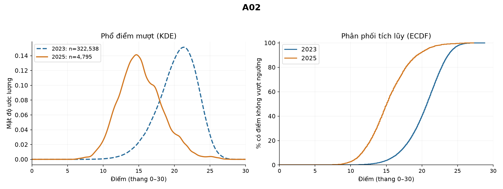

**Diễn giải hình:** Xanh nét đứt là 2023, cam nét liền là 2025; KDE mượt là mật độ, diện tích trên thang điểm bằng 1, không phải số người tuyệt đối. Ở ECDF, chiều cao là % điểm không vượt ngưỡng. Khoảng cách lớn nhất hai ECDF là D=0,640, gần mốc 17,85; đây là 64,0 điểm phần trăm ở mốc đó, không phải tỷ lệ người tiến bộ.

**Ý nghĩa và giới hạn:** Kết quả có bằng chứng chênh trung bình theo mô hình ở mức 0,05 sau Holm. Điều này cần đọc cùng mức đổi -5,107 điểm, |d| và hình dạng; p lớn không chứng minh tương đương. So sánh là giữa hai tập điểm quan sát, không tách được độ khó, chương trình, cách chấm và thành phần thí sinh.

### 2.5.4. D07

| Năm | Số có điểm | Trung bình | Trung vị | SD | IQR | <15 (%) | ≥24 (%) | ≥27 (%) |
| --- | --- | --- | --- | --- | --- | --- | --- | --- |
| 2023 | 313.538 | 20,42 | 20,65 | 3,06 | 4,05 | 5,08 | 11,63 | 0,37 |
| 2025 | 24.478 | 17,51 | 17,35 | 3,71 | 5,15 | 26,15 | 5,13 | 0,31 |

**Diễn giải bảng:** n là số có điểm hợp lệ của riêng mục này, không phải mọi dòng trong năm. SD đo độ trải rộng; IQR là độ rộng vùng 50% ở giữa. Các tỷ lệ chia cho n của đúng hàng; nhóm ≥90% thang điểm đã nằm trong nhóm ≥80%, không cộng hai tỷ lệ.

**Nhận xét bằng số:** Trung bình 20,42 → 17,51, giảm 2,91 điểm; trung vị 20,65 → 17,35. Cohen’s d=-0,936 (từ 0,8 trở lên về |d| theo quy ước tham khảo). Tỷ số phương sai 2025/2023=1,467. Không dùng nhãn độ lớn như kết luận hai năm tương đương.

| Câu hỏi/phép thử | Thống kê | p gốc | p Holm / q BH |
| --- | --- | --- | --- |
| Welch: trung bình | t=-119,790, df=27.145,5 | ≈0 (dưới độ phân giải số) | ≈0 (dưới độ phân giải số) |
| MWU: thứ hạng | U=2.069.938.546,5 | ≈0 (dưới độ phân giải số) | ≈0 (dưới độ phân giải số) |
| KS: toàn phân phối | D=0,372; tại điểm 18,50 | 5.00e-04 | 5.00e-04 |
| Brown–Forsythe: độ phân tán | W=2.166,091 | ≈0 (dưới độ phân giải số) | ≈0 (dưới độ phân giải số) |

**Diễn giải bảng:** Welch dùng Holm trong family 16 phép thử trung bình; ba phép thăm dò dùng BH chung trong family 48 p hữu hạn. KS dùng hoán vị 1,999 lần, p nhỏ nhất phân giải được là 0,0005. Giá trị “≈0” ở các phép tiệm cận là giới hạn tính số, không phải xác suất bằng 0.

**Khoảng tin cậy và độ lớn:** Chênh trung bình có CI 95% [-2,962; -2,866] **điểm**. d có CI bootstrap 95% [-0,951; -0,920] **SD gộp**; Hedges’ g=-0,936. A=0,270 là xác suất thắng cộng nửa xác suất hòa, không phải chỉ P(2025>2023).

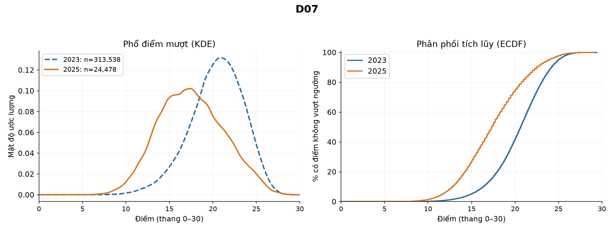

**Diễn giải hình:** Xanh nét đứt là 2023, cam nét liền là 2025; KDE mượt là mật độ, diện tích trên thang điểm bằng 1, không phải số người tuyệt đối. Ở ECDF, chiều cao là % điểm không vượt ngưỡng. Khoảng cách lớn nhất hai ECDF là D=0,372, gần mốc 18,50; đây là 37,2 điểm phần trăm ở mốc đó, không phải tỷ lệ người tiến bộ.

**Ý nghĩa và giới hạn:** Kết quả có bằng chứng chênh trung bình theo mô hình ở mức 0,05 sau Holm. Điều này cần đọc cùng mức đổi -2,914 điểm, |d| và hình dạng; p lớn không chứng minh tương đương. So sánh là giữa hai tập điểm quan sát, không tách được độ khó, chương trình, cách chấm và thành phần thí sinh.

### 2.5.5. C02

| Năm | Số có điểm | Trung bình | Trung vị | SD | IQR | <15 (%) | ≥24 (%) | ≥27 (%) |
| --- | --- | --- | --- | --- | --- | --- | --- | --- |
| 2023 | 320.465 | 21,17 | 21,45 | 2,53 | 3,35 | 1,72 | 11,97 | 0,11 |
| 2025 | 237.064 | 19,11 | 19,00 | 3,49 | 5,15 | 12,04 | 10,01 | 0,57 |

**Diễn giải bảng:** n là số có điểm hợp lệ của riêng mục này, không phải mọi dòng trong năm. SD đo độ trải rộng; IQR là độ rộng vùng 50% ở giữa. Các tỷ lệ chia cho n của đúng hàng; nhóm ≥90% thang điểm đã nằm trong nhóm ≥80%, không cộng hai tỷ lệ.

**Nhận xét bằng số:** Trung bình 21,17 → 19,11, giảm 2,06 điểm; trung vị 21,45 → 19,00. Cohen’s d=-0,691 (trong khoảng 0,5–0,8 về |d| theo quy ước tham khảo). Tỷ số phương sai 2025/2023=1,909. Không dùng nhãn độ lớn như kết luận hai năm tương đương.

| Câu hỏi/phép thử | Thống kê | p gốc | p Holm / q BH |
| --- | --- | --- | --- |
| Welch: trung bình | t=-243,562, df=410.728,5 | ≈0 (dưới độ phân giải số) | ≈0 (dưới độ phân giải số) |
| MWU: thứ hạng | U=23.984.416.813,0 | ≈0 (dưới độ phân giải số) | ≈0 (dưới độ phân giải số) |
| KS: toàn phân phối | D=0,322; tại điểm 19,50 | 5.00e-04 | 5.00e-04 |
| Brown–Forsythe: độ phân tán | W=32.225,012 | ≈0 (dưới độ phân giải số) | ≈0 (dưới độ phân giải số) |

**Diễn giải bảng:** Welch dùng Holm trong family 16 phép thử trung bình; ba phép thăm dò dùng BH chung trong family 48 p hữu hạn. KS dùng hoán vị 1,999 lần, p nhỏ nhất phân giải được là 0,0005. Giá trị “≈0” ở các phép tiệm cận là giới hạn tính số, không phải xác suất bằng 0.

**Khoảng tin cậy và độ lớn:** Chênh trung bình có CI 95% [-2,076; -2,042] **điểm**. d có CI bootstrap 95% [-0,697; -0,686] **SD gộp**; Hedges’ g=-0,691. A=0,316 là xác suất thắng cộng nửa xác suất hòa, không phải chỉ P(2025>2023).

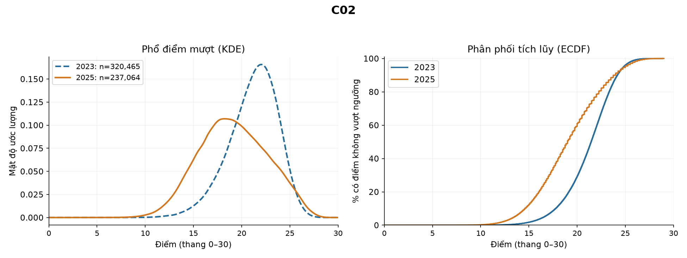

**Diễn giải hình:** Xanh nét đứt là 2023, cam nét liền là 2025; KDE mượt là mật độ, diện tích trên thang điểm bằng 1, không phải số người tuyệt đối. Ở ECDF, chiều cao là % điểm không vượt ngưỡng. Khoảng cách lớn nhất hai ECDF là D=0,322, gần mốc 19,50; đây là 32,2 điểm phần trăm ở mốc đó, không phải tỷ lệ người tiến bộ.

**Ý nghĩa và giới hạn:** Kết quả có bằng chứng chênh trung bình theo mô hình ở mức 0,05 sau Holm. Điều này cần đọc cùng mức đổi -2,059 điểm, |d| và hình dạng; p lớn không chứng minh tương đương. So sánh là giữa hai tập điểm quan sát, không tách được độ khó, chương trình, cách chấm và thành phần thí sinh.

### 2.5.6. A00

| Năm | Số có điểm | Trung bình | Trung vị | SD | IQR | <15 (%) | ≥24 (%) | ≥27 (%) |
| --- | --- | --- | --- | --- | --- | --- | --- | --- |
| 2023 | 325.902 | 20,77 | 21,15 | 3,09 | 4,10 | 4,71 | 13,94 | 0,63 |
| 2025 | 162.200 | 19,37 | 19,25 | 4,34 | 6,50 | 17,09 | 17,57 | 4,02 |

**Diễn giải bảng:** n là số có điểm hợp lệ của riêng mục này, không phải mọi dòng trong năm. SD đo độ trải rộng; IQR là độ rộng vùng 50% ở giữa. Các tỷ lệ chia cho n của đúng hàng; nhóm ≥90% thang điểm đã nằm trong nhóm ≥80%, không cộng hai tỷ lệ.

**Nhận xét bằng số:** Trung bình 20,77 → 19,37, giảm 1,41 điểm; trung vị 21,15 → 19,25. Cohen’s d=-0,395 (trong khoảng 0,2–0,5 về |d| theo quy ước tham khảo). Tỷ số phương sai 2025/2023=1,965. Không dùng nhãn độ lớn như kết luận hai năm tương đương.

| Câu hỏi/phép thử | Thống kê | p gốc | p Holm / q BH |
| --- | --- | --- | --- |
| Welch: trung bình | t=-116,566, df=246.904,0 | ≈0 (dưới độ phân giải số) | ≈0 (dưới độ phân giải số) |
| MWU: thứ hạng | U=20.824.419.025,5 | ≈0 (dưới độ phân giải số) | ≈0 (dưới độ phân giải số) |
| KS: toàn phân phối | D=0,227; tại điểm 18,50 | 5.00e-04 | 5.00e-04 |
| Brown–Forsythe: độ phân tán | W=32.615,718 | ≈0 (dưới độ phân giải số) | ≈0 (dưới độ phân giải số) |

**Diễn giải bảng:** Welch dùng Holm trong family 16 phép thử trung bình; ba phép thăm dò dùng BH chung trong family 48 p hữu hạn. KS dùng hoán vị 1,999 lần, p nhỏ nhất phân giải được là 0,0005. Giá trị “≈0” ở các phép tiệm cận là giới hạn tính số, không phải xác suất bằng 0.

**Khoảng tin cậy và độ lớn:** Chênh trung bình có CI 95% [-1,429; -1,382] **điểm**. d có CI bootstrap 95% [-0,402; -0,388] **SD gộp**; Hedges’ g=-0,395. A=0,394 là xác suất thắng cộng nửa xác suất hòa, không phải chỉ P(2025>2023).

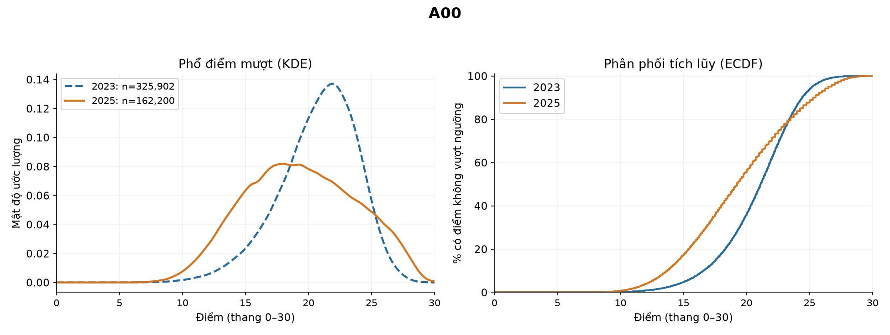

**Diễn giải hình:** Xanh nét đứt là 2023, cam nét liền là 2025; KDE mượt là mật độ, diện tích trên thang điểm bằng 1, không phải số người tuyệt đối. Ở ECDF, chiều cao là % điểm không vượt ngưỡng. Khoảng cách lớn nhất hai ECDF là D=0,227, gần mốc 18,50; đây là 22,7 điểm phần trăm ở mốc đó, không phải tỷ lệ người tiến bộ.

**Ý nghĩa và giới hạn:** Kết quả có bằng chứng chênh trung bình theo mô hình ở mức 0,05 sau Holm. Điều này cần đọc cùng mức đổi -1,405 điểm, |d| và hình dạng; p lớn không chứng minh tương đương. So sánh là giữa hai tập điểm quan sát, không tách được độ khó, chương trình, cách chấm và thành phần thí sinh.

### 2.5.7. D66

| Năm | Số có điểm | Trung bình | Trung vị | SD | IQR | <15 (%) | ≥24 (%) | ≥27 (%) |
| --- | --- | --- | --- | --- | --- | --- | --- | --- |
| 2023 | 556.185 | 20,31 | 20,25 | 3,48 | 4,85 | 6,09 | 15,95 | 2,36 |
| 2025 | 47.905 | 21,11 | 21,10 | 2,47 | 3,25 | 0,80 | 13,11 | 0,77 |

**Diễn giải bảng:** n là số có điểm hợp lệ của riêng mục này, không phải mọi dòng trong năm. SD đo độ trải rộng; IQR là độ rộng vùng 50% ở giữa. Các tỷ lệ chia cho n của đúng hàng; nhóm ≥90% thang điểm đã nằm trong nhóm ≥80%, không cộng hai tỷ lệ.

**Phạm vi so sánh:** GDCD 2023 được thay bằng GDKT&PL 2025; chỉ mô tả riêng, không kiểm định chính liên năm. Có thống kê và hình riêng cho cả hai năm hiện có; ô thiếu không được thay bằng 0 và không tạo p-value/CI liên năm giả.

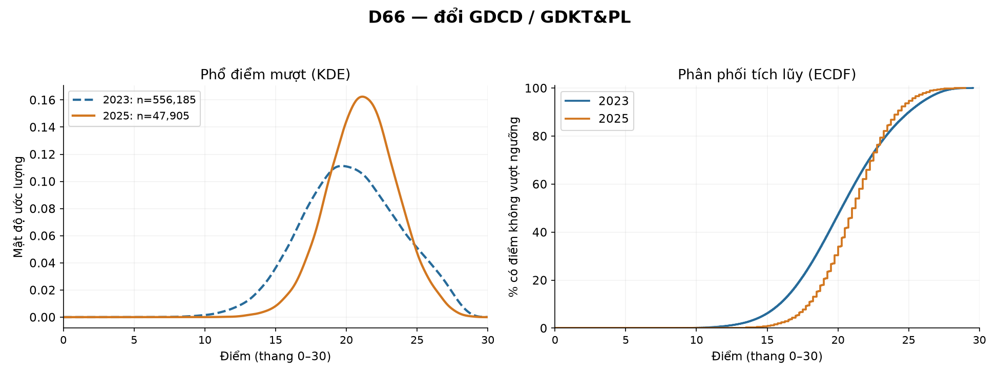

**Diễn giải hình:** Hai đường mô tả hai bộ môn khác nội dung, không là cùng thang đã quy đổi. KDE là mật độ mượt từ điểm quan sát; ECDF mô tả phần tích lũy. Không có đường của một năm không có nghĩa điểm của năm đó bằng 0.

**Ý nghĩa và giới hạn:** Kết quả mô tả đúng mẫu có điểm. Mục này không được đưa vào family kiểm định liên năm chính; khác môn/chương trình không được diễn giải như cùng một thang năng lực.

### 2.5.8. D84

| Năm | Số có điểm | Trung bình | Trung vị | SD | IQR | <15 (%) | ≥24 (%) | ≥27 (%) |
| --- | --- | --- | --- | --- | --- | --- | --- | --- |
| 2023 | 556.034 | 19,15 | 19,10 | 3,72 | 5,25 | 13,77 | 11,11 | 0,85 |
| 2025 | 47.902 | 18,56 | 18,50 | 2,77 | 3,55 | 8,79 | 3,56 | 0,18 |

**Diễn giải bảng:** n là số có điểm hợp lệ của riêng mục này, không phải mọi dòng trong năm. SD đo độ trải rộng; IQR là độ rộng vùng 50% ở giữa. Các tỷ lệ chia cho n của đúng hàng; nhóm ≥90% thang điểm đã nằm trong nhóm ≥80%, không cộng hai tỷ lệ.

**Phạm vi so sánh:** GDCD 2023 được thay bằng GDKT&PL 2025; chỉ mô tả riêng, không kiểm định chính liên năm. Có thống kê và hình riêng cho cả hai năm hiện có; ô thiếu không được thay bằng 0 và không tạo p-value/CI liên năm giả.

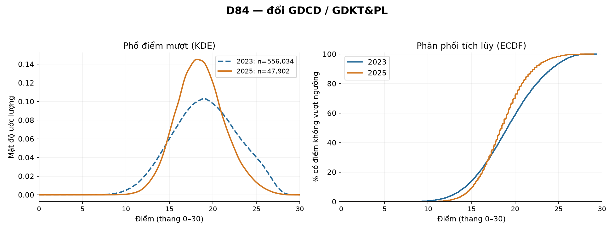

**Diễn giải hình:** Hai đường mô tả hai bộ môn khác nội dung, không là cùng thang đã quy đổi. KDE là mật độ mượt từ điểm quan sát; ECDF mô tả phần tích lũy. Không có đường của một năm không có nghĩa điểm của năm đó bằng 0.

**Ý nghĩa và giới hạn:** Kết quả mô tả đúng mẫu có điểm. Mục này không được đưa vào family kiểm định liên năm chính; khác môn/chương trình không được diễn giải như cùng một thang năng lực.

### 2.5.9. C20

| Năm | Số có điểm | Trung bình | Trung vị | SD | IQR | <15 (%) | ≥24 (%) | ≥27 (%) |
| --- | --- | --- | --- | --- | --- | --- | --- | --- |
| 2023 | 565.249 | 21,53 | 21,75 | 2,90 | 3,75 | 2,16 | 21,68 | 1,45 |
| 2025 | 109.423 | 20,31 | 20,60 | 3,23 | 4,35 | 6,11 | 12,77 | 0,65 |

**Diễn giải bảng:** n là số có điểm hợp lệ của riêng mục này, không phải mọi dòng trong năm. SD đo độ trải rộng; IQR là độ rộng vùng 50% ở giữa. Các tỷ lệ chia cho n của đúng hàng; nhóm ≥90% thang điểm đã nằm trong nhóm ≥80%, không cộng hai tỷ lệ.

**Phạm vi so sánh:** GDCD 2023 được thay bằng GDKT&PL 2025; chỉ mô tả riêng, không kiểm định chính liên năm. Có thống kê và hình riêng cho cả hai năm hiện có; ô thiếu không được thay bằng 0 và không tạo p-value/CI liên năm giả.

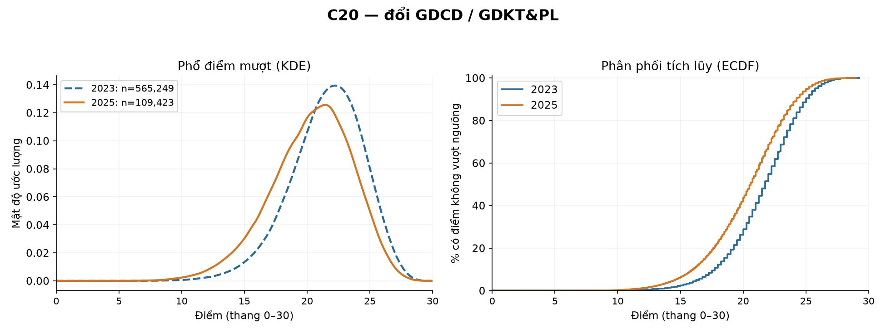

**Diễn giải hình:** Hai đường mô tả hai bộ môn khác nội dung, không là cùng thang đã quy đổi. KDE là mật độ mượt từ điểm quan sát; ECDF mô tả phần tích lũy. Không có đường của một năm không có nghĩa điểm của năm đó bằng 0.

**Ý nghĩa và giới hạn:** Kết quả mô tả đúng mẫu có điểm. Mục này không được đưa vào family kiểm định liên năm chính; khác môn/chương trình không được diễn giải như cùng một thang năng lực.

### 2.5.10. A09

| Năm | Số có điểm | Trung bình | Trung vị | SD | IQR | <15 (%) | ≥24 (%) | ≥27 (%) |
| --- | --- | --- | --- | --- | --- | --- | --- | --- |
| 2023 | 564.517 | 20,38 | 20,70 | 3,06 | 4,15 | 5,33 | 10,99 | 0,20 |
| 2025 | 109.404 | 17,39 | 17,50 | 3,09 | 4,30 | 22,00 | 1,08 | 0,01 |

**Diễn giải bảng:** n là số có điểm hợp lệ của riêng mục này, không phải mọi dòng trong năm. SD đo độ trải rộng; IQR là độ rộng vùng 50% ở giữa. Các tỷ lệ chia cho n của đúng hàng; nhóm ≥90% thang điểm đã nằm trong nhóm ≥80%, không cộng hai tỷ lệ.

**Phạm vi so sánh:** GDCD 2023 được thay bằng GDKT&PL 2025; chỉ mô tả riêng, không kiểm định chính liên năm. Có thống kê và hình riêng cho cả hai năm hiện có; ô thiếu không được thay bằng 0 và không tạo p-value/CI liên năm giả.

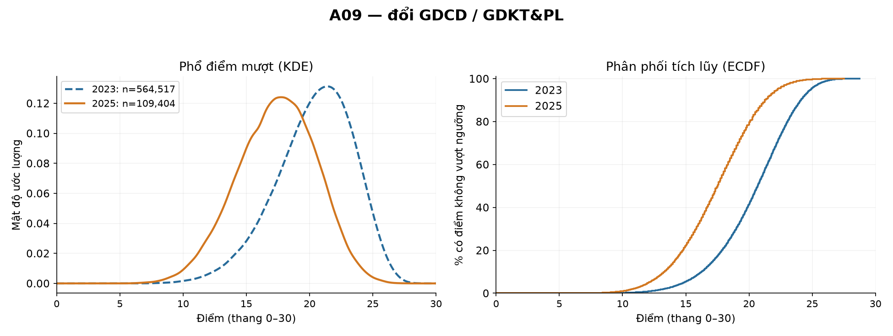

**Diễn giải hình:** Hai đường mô tả hai bộ môn khác nội dung, không là cùng thang đã quy đổi. KDE là mật độ mượt từ điểm quan sát; ECDF mô tả phần tích lũy. Không có đường của một năm không có nghĩa điểm của năm đó bằng 0.

**Ý nghĩa và giới hạn:** Kết quả mô tả đúng mẫu có điểm. Mục này không được đưa vào family kiểm định liên năm chính; khác môn/chương trình không được diễn giải như cùng một thang năng lực.

### 2.5.11. C19

| Năm | Số có điểm | Trung bình | Trung vị | SD | IQR | <15 (%) | ≥24 (%) | ≥27 (%) |
| --- | --- | --- | --- | --- | --- | --- | --- | --- |
| 2023 | 565.211 | 21,44 | 21,75 | 3,24 | 4,50 | 2,96 | 24,51 | 2,86 |
| 2025 | 68.351 | 20,25 | 20,50 | 3,26 | 4,35 | 6,64 | 12,70 | 0,52 |

**Diễn giải bảng:** n là số có điểm hợp lệ của riêng mục này, không phải mọi dòng trong năm. SD đo độ trải rộng; IQR là độ rộng vùng 50% ở giữa. Các tỷ lệ chia cho n của đúng hàng; nhóm ≥90% thang điểm đã nằm trong nhóm ≥80%, không cộng hai tỷ lệ.

**Phạm vi so sánh:** GDCD 2023 được thay bằng GDKT&PL 2025; chỉ mô tả riêng, không kiểm định chính liên năm. Có thống kê và hình riêng cho cả hai năm hiện có; ô thiếu không được thay bằng 0 và không tạo p-value/CI liên năm giả.

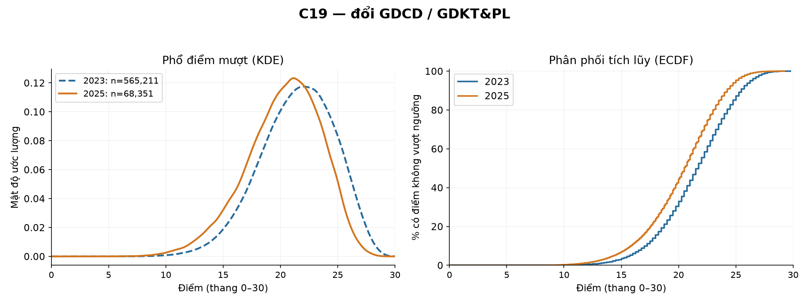

**Diễn giải hình:** Hai đường mô tả hai bộ môn khác nội dung, không là cùng thang đã quy đổi. KDE là mật độ mượt từ điểm quan sát; ECDF mô tả phần tích lũy. Không có đường của một năm không có nghĩa điểm của năm đó bằng 0.

**Ý nghĩa và giới hạn:** Kết quả mô tả đúng mẫu có điểm. Mục này không được đưa vào family kiểm định liên năm chính; khác môn/chương trình không được diễn giải như cùng một thang năng lực.

### 2.5.12. A08

| Năm | Số có điểm | Trung bình | Trung vị | SD | IQR | <15 (%) | ≥24 (%) | ≥27 (%) |
| --- | --- | --- | --- | --- | --- | --- | --- | --- |
| 2023 | 564.507 | 20,29 | 20,55 | 3,39 | 4,80 | 7,22 | 14,18 | 0,50 |
| 2025 | 68.313 | 17,29 | 17,45 | 3,06 | 4,30 | 22,76 | 0,70 | 0,01 |

**Diễn giải bảng:** n là số có điểm hợp lệ của riêng mục này, không phải mọi dòng trong năm. SD đo độ trải rộng; IQR là độ rộng vùng 50% ở giữa. Các tỷ lệ chia cho n của đúng hàng; nhóm ≥90% thang điểm đã nằm trong nhóm ≥80%, không cộng hai tỷ lệ.

**Phạm vi so sánh:** GDCD 2023 được thay bằng GDKT&PL 2025; chỉ mô tả riêng, không kiểm định chính liên năm. Có thống kê và hình riêng cho cả hai năm hiện có; ô thiếu không được thay bằng 0 và không tạo p-value/CI liên năm giả.

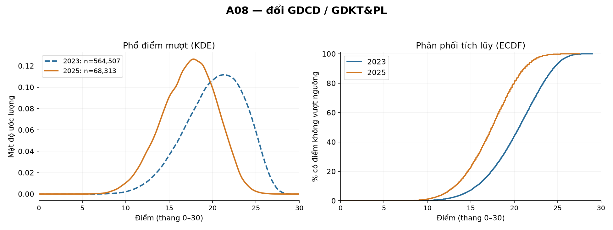

**Diễn giải hình:** Hai đường mô tả hai bộ môn khác nội dung, không là cùng thang đã quy đổi. KDE là mật độ mượt từ điểm quan sát; ECDF mô tả phần tích lũy. Không có đường của một năm không có nghĩa điểm của năm đó bằng 0.

**Ý nghĩa và giới hạn:** Kết quả mô tả đúng mẫu có điểm. Mục này không được đưa vào family kiểm định liên năm chính; khác môn/chương trình không được diễn giải như cùng một thang năng lực.

### 2.5.13. C14

| Năm | Số có điểm | Trung bình | Trung vị | SD | IQR | <15 (%) | ≥24 (%) | ≥27 (%) |
| --- | --- | --- | --- | --- | --- | --- | --- | --- |
| 2023 | 564.516 | 21,17 | 21,55 | 3,24 | 4,50 | 4,27 | 20,92 | 0,78 |
| 2025 | 246.298 | 18,46 | 18,60 | 2,98 | 3,90 | 12,17 | 2,64 | 0,07 |

**Diễn giải bảng:** n là số có điểm hợp lệ của riêng mục này, không phải mọi dòng trong năm. SD đo độ trải rộng; IQR là độ rộng vùng 50% ở giữa. Các tỷ lệ chia cho n của đúng hàng; nhóm ≥90% thang điểm đã nằm trong nhóm ≥80%, không cộng hai tỷ lệ.

**Phạm vi so sánh:** GDCD 2023 được thay bằng GDKT&PL 2025; chỉ mô tả riêng, không kiểm định chính liên năm. Có thống kê và hình riêng cho cả hai năm hiện có; ô thiếu không được thay bằng 0 và không tạo p-value/CI liên năm giả.

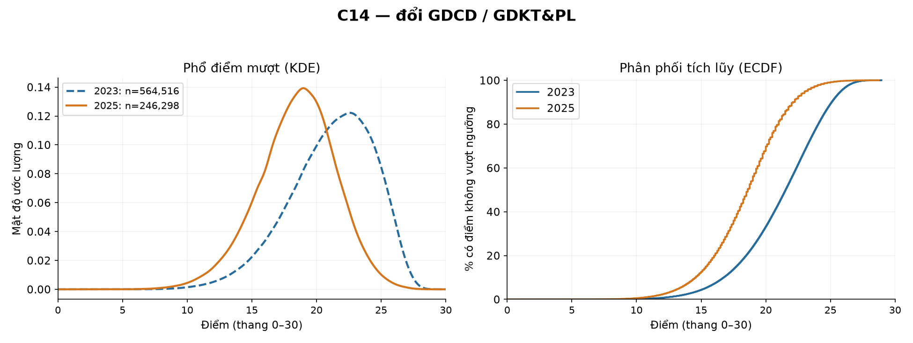

**Diễn giải hình:** Hai đường mô tả hai bộ môn khác nội dung, không là cùng thang đã quy đổi. KDE là mật độ mượt từ điểm quan sát; ECDF mô tả phần tích lũy. Không có đường của một năm không có nghĩa điểm của năm đó bằng 0.

**Ý nghĩa và giới hạn:** Kết quả mô tả đúng mẫu có điểm. Mục này không được đưa vào family kiểm định liên năm chính; khác môn/chương trình không được diễn giải như cùng một thang năng lực.

### 2.5.14. D15

| Năm | Số có điểm | Trung bình | Trung vị | SD | IQR | <15 (%) | ≥24 (%) | ≥27 (%) |
| --- | --- | --- | --- | --- | --- | --- | --- | --- |
| 2023 | 557.312 | 18,25 | 18,10 | 3,38 | 4,75 | 16,94 | 5,29 | 0,17 |
| 2025 | 53.592 | 20,63 | 20,75 | 2,74 | 3,75 | 2,45 | 11,55 | 0,49 |

**Diễn giải bảng:** n là số có điểm hợp lệ của riêng mục này, không phải mọi dòng trong năm. SD đo độ trải rộng; IQR là độ rộng vùng 50% ở giữa. Các tỷ lệ chia cho n của đúng hàng; nhóm ≥90% thang điểm đã nằm trong nhóm ≥80%, không cộng hai tỷ lệ.

**Nhận xét bằng số:** Trung bình 18,25 → 20,63, tăng 2,38 điểm; trung vị 18,10 → 20,75. Cohen’s d=0,715 (trong khoảng 0,5–0,8 về |d| theo quy ước tham khảo). Tỷ số phương sai 2025/2023=0,657. Không dùng nhãn độ lớn như kết luận hai năm tương đương.

| Câu hỏi/phép thử | Thống kê | p gốc | p Holm / q BH |
| --- | --- | --- | --- |
| Welch: trung bình | t=187,801, df=70.286,5 | ≈0 (dưới độ phân giải số) | ≈0 (dưới độ phân giải số) |
| MWU: thứ hạng | U=21.174.018.757,0 | ≈0 (dưới độ phân giải số) | ≈0 (dưới độ phân giải số) |
| KS: toàn phân phối | D=0,336; tại điểm 18,73 | 5.00e-04 | 5.00e-04 |
| Brown–Forsythe: độ phân tán | W=3.746,412 | ≈0 (dưới độ phân giải số) | ≈0 (dưới độ phân giải số) |

**Diễn giải bảng:** Welch dùng Holm trong family 16 phép thử trung bình; ba phép thăm dò dùng BH chung trong family 48 p hữu hạn. KS dùng hoán vị 1,999 lần, p nhỏ nhất phân giải được là 0,0005. Giá trị “≈0” ở các phép tiệm cận là giới hạn tính số, không phải xác suất bằng 0.

**Khoảng tin cậy và độ lớn:** Chênh trung bình có CI 95% [2,357; 2,407] **điểm**. d có CI bootstrap 95% [0,707; 0,722] **SD gộp**; Hedges’ g=0,715. A=0,709 là xác suất thắng cộng nửa xác suất hòa, không phải chỉ P(2025>2023).

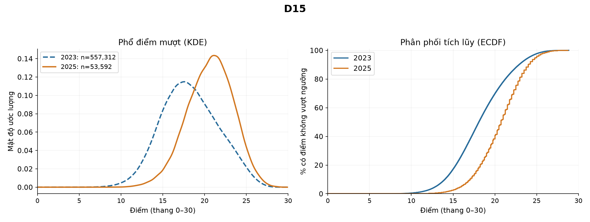

**Diễn giải hình:** Xanh nét đứt là 2023, cam nét liền là 2025; KDE mượt là mật độ, diện tích trên thang điểm bằng 1, không phải số người tuyệt đối. Ở ECDF, chiều cao là % điểm không vượt ngưỡng. Khoảng cách lớn nhất hai ECDF là D=0,336, gần mốc 18,73; đây là 33,6 điểm phần trăm ở mốc đó, không phải tỷ lệ người tiến bộ.

**Ý nghĩa và giới hạn:** Kết quả có bằng chứng chênh trung bình theo mô hình ở mức 0,05 sau Holm. Điều này cần đọc cùng mức đổi 2,382 điểm, |d| và hình dạng; p lớn không chứng minh tương đương. So sánh là giữa hai tập điểm quan sát, không tách được độ khó, chương trình, cách chấm và thành phần thí sinh.

### 2.5.15. D10

| Năm | Số có điểm | Trung bình | Trung vị | SD | IQR | <15 (%) | ≥24 (%) | ≥27 (%) |
| --- | --- | --- | --- | --- | --- | --- | --- | --- |
| 2023 | 557.086 | 17,09 | 16,95 | 3,63 | 5,15 | 29,49 | 2,89 | 0,04 |
| 2025 | 53.567 | 18,19 | 18,25 | 3,09 | 4,15 | 15,22 | 3,13 | 0,14 |

**Diễn giải bảng:** n là số có điểm hợp lệ của riêng mục này, không phải mọi dòng trong năm. SD đo độ trải rộng; IQR là độ rộng vùng 50% ở giữa. Các tỷ lệ chia cho n của đúng hàng; nhóm ≥90% thang điểm đã nằm trong nhóm ≥80%, không cộng hai tỷ lệ.

**Nhận xét bằng số:** Trung bình 17,09 → 18,19, tăng 1,10 điểm; trung vị 16,95 → 18,25. Cohen’s d=0,306 (trong khoảng 0,2–0,5 về |d| theo quy ước tham khảo). Tỷ số phương sai 2025/2023=0,728. Không dùng nhãn độ lớn như kết luận hai năm tương đương.

| Câu hỏi/phép thử | Thống kê | p gốc | p Holm / q BH |
| --- | --- | --- | --- |
| Welch: trung bình | t=76,980, df=68.537,9 | ≈0 (dưới độ phân giải số) | ≈0 (dưới độ phân giải số) |
| MWU: thứ hạng | U=17.673.179.583,0 | ≈0 (dưới độ phân giải số) | ≈0 (dưới độ phân giải số) |
| KS: toàn phân phối | D=0,161; tại điểm 16,20 | 5.00e-04 | 5.00e-04 |
| Brown–Forsythe: độ phân tán | W=2.496,558 | ≈0 (dưới độ phân giải số) | ≈0 (dưới độ phân giải số) |

**Diễn giải bảng:** Welch dùng Holm trong family 16 phép thử trung bình; ba phép thăm dò dùng BH chung trong family 48 p hữu hạn. KS dùng hoán vị 1,999 lần, p nhỏ nhất phân giải được là 0,0005. Giá trị “≈0” ở các phép tiệm cận là giới hạn tính số, không phải xác suất bằng 0.

**Khoảng tin cậy và độ lớn:** Chênh trung bình có CI 95% [1,067; 1,123] **điểm**. d có CI bootstrap 95% [0,298; 0,313] **SD gộp**; Hedges’ g=0,306. A=0,592 là xác suất thắng cộng nửa xác suất hòa, không phải chỉ P(2025>2023).

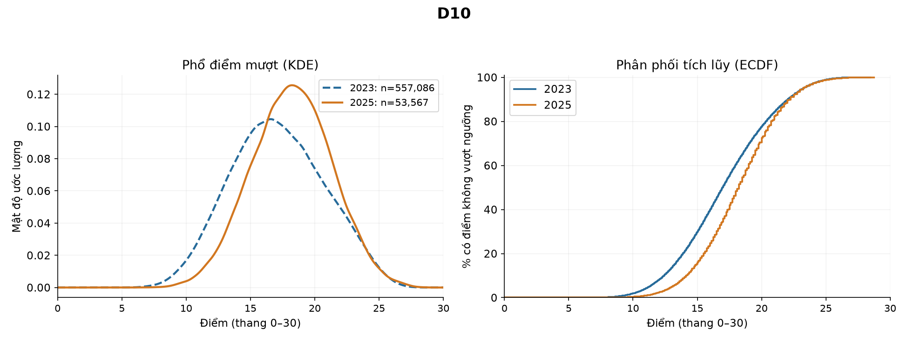

**Diễn giải hình:** Xanh nét đứt là 2023, cam nét liền là 2025; KDE mượt là mật độ, diện tích trên thang điểm bằng 1, không phải số người tuyệt đối. Ở ECDF, chiều cao là % điểm không vượt ngưỡng. Khoảng cách lớn nhất hai ECDF là D=0,161, gần mốc 16,20; đây là 16,1 điểm phần trăm ở mốc đó, không phải tỷ lệ người tiến bộ.

**Ý nghĩa và giới hạn:** Kết quả có bằng chứng chênh trung bình theo mô hình ở mức 0,05 sau Holm. Điều này cần đọc cùng mức đổi 1,095 điểm, |d| và hình dạng; p lớn không chứng minh tương đương. So sánh là giữa hai tập điểm quan sát, không tách được độ khó, chương trình, cách chấm và thành phần thí sinh.

### 2.5.16. D14

| Năm | Số có điểm | Trung bình | Trung vị | SD | IQR | <15 (%) | ≥24 (%) | ≥27 (%) |
| --- | --- | --- | --- | --- | --- | --- | --- | --- |
| 2023 | 557.405 | 18,15 | 18,00 | 3,71 | 5,35 | 20,82 | 6,84 | 0,39 |
| 2025 | 69.989 | 20,45 | 20,75 | 2,82 | 3,90 | 3,43 | 10,32 | 0,25 |

**Diễn giải bảng:** n là số có điểm hợp lệ của riêng mục này, không phải mọi dòng trong năm. SD đo độ trải rộng; IQR là độ rộng vùng 50% ở giữa. Các tỷ lệ chia cho n của đúng hàng; nhóm ≥90% thang điểm đã nằm trong nhóm ≥80%, không cộng hai tỷ lệ.

**Nhận xét bằng số:** Trung bình 18,15 → 20,45, tăng 2,29 điểm; trung vị 18,00 → 20,75. Cohen’s d=0,634 (trong khoảng 0,5–0,8 về |d| theo quy ước tham khảo). Tỷ số phương sai 2025/2023=0,577. Không dùng nhãn độ lớn như kết luận hai năm tương đương.

| Câu hỏi/phép thử | Thống kê | p gốc | p Holm / q BH |
| --- | --- | --- | --- |
| Welch: trung bình | t=195,345, df=103.176,2 | ≈0 (dưới độ phân giải số) | ≈0 (dưới độ phân giải số) |
| MWU: thứ hạng | U=26.921.978.655,0 | ≈0 (dưới độ phân giải số) | ≈0 (dưới độ phân giải số) |
| KS: toàn phân phối | D=0,320; tại điểm 18,73 | 5.00e-04 | 5.00e-04 |
| Brown–Forsythe: độ phân tán | W=8.586,656 | ≈0 (dưới độ phân giải số) | ≈0 (dưới độ phân giải số) |

**Diễn giải bảng:** Welch dùng Holm trong family 16 phép thử trung bình; ba phép thăm dò dùng BH chung trong family 48 p hữu hạn. KS dùng hoán vị 1,999 lần, p nhỏ nhất phân giải được là 0,0005. Giá trị “≈0” ở các phép tiệm cận là giới hạn tính số, không phải xác suất bằng 0.

**Khoảng tin cậy và độ lớn:** Chênh trung bình có CI 95% [2,271; 2,317] **điểm**. d có CI bootstrap 95% [0,627; 0,641] **SD gộp**; Hedges’ g=0,634. A=0,690 là xác suất thắng cộng nửa xác suất hòa, không phải chỉ P(2025>2023).

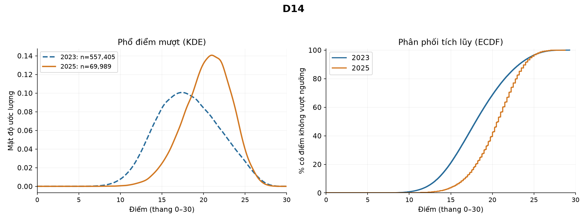

**Diễn giải hình:** Xanh nét đứt là 2023, cam nét liền là 2025; KDE mượt là mật độ, diện tích trên thang điểm bằng 1, không phải số người tuyệt đối. Ở ECDF, chiều cao là % điểm không vượt ngưỡng. Khoảng cách lớn nhất hai ECDF là D=0,320, gần mốc 18,73; đây là 32,0 điểm phần trăm ở mốc đó, không phải tỷ lệ người tiến bộ.

**Ý nghĩa và giới hạn:** Kết quả có bằng chứng chênh trung bình theo mô hình ở mức 0,05 sau Holm. Điều này cần đọc cùng mức đổi 2,294 điểm, |d| và hình dạng; p lớn không chứng minh tương đương. So sánh là giữa hai tập điểm quan sát, không tách được độ khó, chương trình, cách chấm và thành phần thí sinh.

### 2.5.17. D09

| Năm | Số có điểm | Trung bình | Trung vị | SD | IQR | <15 (%) | ≥24 (%) | ≥27 (%) |
| --- | --- | --- | --- | --- | --- | --- | --- | --- |
| 2023 | 557.198 | 17,00 | 16,90 | 3,94 | 5,75 | 32,32 | 4,05 | 0,10 |
| 2025 | 69.904 | 17,86 | 18,00 | 3,12 | 4,25 | 17,84 | 2,23 | 0,06 |

**Diễn giải bảng:** n là số có điểm hợp lệ của riêng mục này, không phải mọi dòng trong năm. SD đo độ trải rộng; IQR là độ rộng vùng 50% ở giữa. Các tỷ lệ chia cho n của đúng hàng; nhóm ≥90% thang điểm đã nằm trong nhóm ≥80%, không cộng hai tỷ lệ.

**Nhận xét bằng số:** Trung bình 17,00 → 17,86, tăng 0,86 điểm; trung vị 16,90 → 18,00. Cohen’s d=0,223 (trong khoảng 0,2–0,5 về |d| theo quy ước tham khảo). Tỷ số phương sai 2025/2023=0,626. Không dùng nhãn độ lớn như kết luận hai năm tương đương.

| Câu hỏi/phép thử | Thống kê | p gốc | p Holm / q BH |
| --- | --- | --- | --- |
| Welch: trung bình | t=66,480, df=100.215,5 | ≈0 (dưới độ phân giải số) | ≈0 (dưới độ phân giải số) |
| MWU: thứ hạng | U=22.223.319.590,5 | ≈0 (dưới độ phân giải số) | ≈0 (dưới độ phân giải số) |
| KS: toàn phân phối | D=0,148; tại điểm 15,70 | 5.00e-04 | 5.00e-04 |
| Brown–Forsythe: độ phân tán | W=6.786,812 | ≈0 (dưới độ phân giải số) | ≈0 (dưới độ phân giải số) |

**Diễn giải bảng:** Welch dùng Holm trong family 16 phép thử trung bình; ba phép thăm dò dùng BH chung trong family 48 p hữu hạn. KS dùng hoán vị 1,999 lần, p nhỏ nhất phân giải được là 0,0005. Giá trị “≈0” ở các phép tiệm cận là giới hạn tính số, không phải xác suất bằng 0.

**Khoảng tin cậy và độ lớn:** Chênh trung bình có CI 95% [0,833; 0,884] **điểm**. d có CI bootstrap 95% [0,216; 0,230] **SD gộp**; Hedges’ g=0,223. A=0,571 là xác suất thắng cộng nửa xác suất hòa, không phải chỉ P(2025>2023).

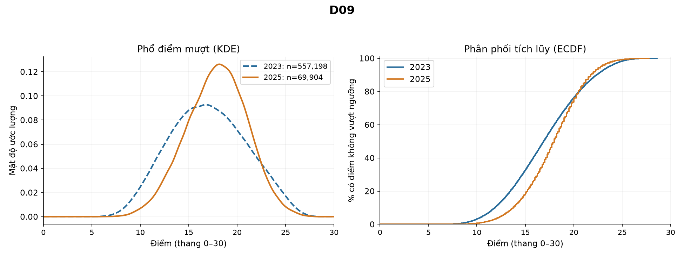

**Diễn giải hình:** Xanh nét đứt là 2023, cam nét liền là 2025; KDE mượt là mật độ, diện tích trên thang điểm bằng 1, không phải số người tuyệt đối. Ở ECDF, chiều cao là % điểm không vượt ngưỡng. Khoảng cách lớn nhất hai ECDF là D=0,148, gần mốc 15,70; đây là 14,8 điểm phần trăm ở mốc đó, không phải tỷ lệ người tiến bộ.

**Ý nghĩa và giới hạn:** Kết quả có bằng chứng chênh trung bình theo mô hình ở mức 0,05 sau Holm. Điều này cần đọc cùng mức đổi 0,858 điểm, |d| và hình dạng; p lớn không chứng minh tương đương. So sánh là giữa hai tập điểm quan sát, không tách được độ khó, chương trình, cách chấm và thành phần thí sinh.

### 2.5.18. D01

| Năm | Số có điểm | Trung bình | Trung vị | SD | IQR | <15 (%) | ≥24 (%) | ≥27 (%) |
| --- | --- | --- | --- | --- | --- | --- | --- | --- |
| 2023 | 873.126 | 18,89 | 19,05 | 3,81 | 5,50 | 16,38 | 9,40 | 0,27 |
| 2025 | 350.654 | 18,58 | 18,50 | 2,91 | 4,00 | 10,38 | 3,56 | 0,07 |

**Diễn giải bảng:** n là số có điểm hợp lệ của riêng mục này, không phải mọi dòng trong năm. SD đo độ trải rộng; IQR là độ rộng vùng 50% ở giữa. Các tỷ lệ chia cho n của đúng hàng; nhóm ≥90% thang điểm đã nằm trong nhóm ≥80%, không cộng hai tỷ lệ.

**Nhận xét bằng số:** Trung bình 18,89 → 18,58, giảm 0,31 điểm; trung vị 19,05 → 18,50. Cohen’s d=-0,086 (dưới mốc 0,2 về |d| theo quy ước tham khảo). Tỷ số phương sai 2025/2023=0,584. Không dùng nhãn độ lớn như kết luận hai năm tương đương.

| Câu hỏi/phép thử | Thống kê | p gốc | p Holm / q BH |
| --- | --- | --- | --- |
| Welch: trung bình | t=-47,967, df=839.369,4 | ≈0 (dưới độ phân giải số) | ≈0 (dưới độ phân giải số) |
| MWU: thứ hạng | U=143.072.766.015,5 | ≈0 (dưới độ phân giải số) | ≈0 (dưới độ phân giải số) |
| KS: toàn phân phối | D=0,114; tại điểm 21,25 | 5.00e-04 | 5.00e-04 |
| Brown–Forsythe: độ phân tán | W=34.973,673 | ≈0 (dưới độ phân giải số) | ≈0 (dưới độ phân giải số) |

**Diễn giải bảng:** Welch dùng Holm trong family 16 phép thử trung bình; ba phép thăm dò dùng BH chung trong family 48 p hữu hạn. KS dùng hoán vị 1,999 lần, p nhỏ nhất phân giải được là 0,0005. Giá trị “≈0” ở các phép tiệm cận là giới hạn tính số, không phải xác suất bằng 0.

**Khoảng tin cậy và độ lớn:** Chênh trung bình có CI 95% [-0,319; -0,294] **điểm**. d có CI bootstrap 95% [-0,089; -0,082] **SD gộp**; Hedges’ g=-0,086. A=0,467 là xác suất thắng cộng nửa xác suất hòa, không phải chỉ P(2025>2023).

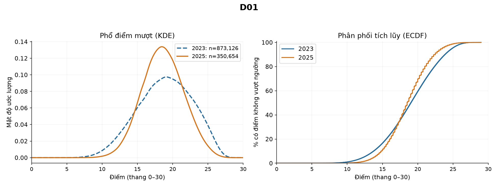

**Diễn giải hình:** Xanh nét đứt là 2023, cam nét liền là 2025; KDE mượt là mật độ, diện tích trên thang điểm bằng 1, không phải số người tuyệt đối. Ở ECDF, chiều cao là % điểm không vượt ngưỡng. Khoảng cách lớn nhất hai ECDF là D=0,114, gần mốc 21,25; đây là 11,4 điểm phần trăm ở mốc đó, không phải tỷ lệ người tiến bộ.

**Ý nghĩa và giới hạn:** Kết quả có bằng chứng chênh trung bình theo mô hình ở mức 0,05 sau Holm. Điều này cần đọc cùng mức đổi -0,307 điểm, |d| và hình dạng; p lớn không chứng minh tương đương. So sánh là giữa hai tập điểm quan sát, không tách được độ khó, chương trình, cách chấm và thành phần thí sinh.

### 2.5.19. A01

| Năm | Số có điểm | Trung bình | Trung vị | SD | IQR | <15 (%) | ≥24 (%) | ≥27 (%) |
| --- | --- | --- | --- | --- | --- | --- | --- | --- |
| 2023 | 314.412 | 20,27 | 20,45 | 3,34 | 4,60 | 6,67 | 14,02 | 0,70 |
| 2025 | 146.960 | 18,87 | 18,75 | 3,62 | 5,25 | 14,74 | 9,18 | 0,79 |

**Diễn giải bảng:** n là số có điểm hợp lệ của riêng mục này, không phải mọi dòng trong năm. SD đo độ trải rộng; IQR là độ rộng vùng 50% ở giữa. Các tỷ lệ chia cho n của đúng hàng; nhóm ≥90% thang điểm đã nằm trong nhóm ≥80%, không cộng hai tỷ lệ.

**Nhận xét bằng số:** Trung bình 20,27 → 18,87, giảm 1,41 điểm; trung vị 20,45 → 18,75. Cohen’s d=-0,410 (trong khoảng 0,2–0,5 về |d| theo quy ước tham khảo). Tỷ số phương sai 2025/2023=1,176. Không dùng nhãn độ lớn như kết luận hai năm tương đương.

| Câu hỏi/phép thử | Thống kê | p gốc | p Holm / q BH |
| --- | --- | --- | --- |
| Welch: trung bình | t=-125,838, df=267.219,1 | ≈0 (dưới độ phân giải số) | ≈0 (dưới độ phân giải số) |
| MWU: thứ hạng | U=17.758.378.777,0 | ≈0 (dưới độ phân giải số) | ≈0 (dưới độ phân giải số) |
| KS: toàn phân phối | D=0,185; tại điểm 19,00 | 5.00e-04 | 5.00e-04 |
| Brown–Forsythe: độ phân tán | W=1.726,411 | ≈0 (dưới độ phân giải số) | ≈0 (dưới độ phân giải số) |

**Diễn giải bảng:** Welch dùng Holm trong family 16 phép thử trung bình; ba phép thăm dò dùng BH chung trong family 48 p hữu hạn. KS dùng hoán vị 1,999 lần, p nhỏ nhất phân giải được là 0,0005. Giá trị “≈0” ở các phép tiệm cận là giới hạn tính số, không phải xác suất bằng 0.

**Khoảng tin cậy và độ lớn:** Chênh trung bình có CI 95% [-1,428; -1,384] **điểm**. d có CI bootstrap 95% [-0,417; -0,403] **SD gộp**; Hedges’ g=-0,410. A=0,384 là xác suất thắng cộng nửa xác suất hòa, không phải chỉ P(2025>2023).

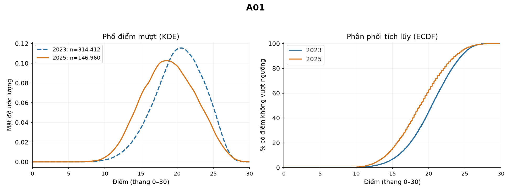

**Diễn giải hình:** Xanh nét đứt là 2023, cam nét liền là 2025; KDE mượt là mật độ, diện tích trên thang điểm bằng 1, không phải số người tuyệt đối. Ở ECDF, chiều cao là % điểm không vượt ngưỡng. Khoảng cách lớn nhất hai ECDF là D=0,185, gần mốc 19,00; đây là 18,5 điểm phần trăm ở mốc đó, không phải tỷ lệ người tiến bộ.

**Ý nghĩa và giới hạn:** Kết quả có bằng chứng chênh trung bình theo mô hình ở mức 0,05 sau Holm. Điều này cần đọc cùng mức đổi -1,406 điểm, |d| và hình dạng; p lớn không chứng minh tương đương. So sánh là giữa hai tập điểm quan sát, không tách được độ khó, chương trình, cách chấm và thành phần thí sinh.

### 2.5.20. C00

| Năm | Số có điểm | Trung bình | Trung vị | SD | IQR | <15 (%) | ≥24 (%) | ≥27 (%) |
| --- | --- | --- | --- | --- | --- | --- | --- | --- |
| 2023 | 681.723 | 18,97 | 19,00 | 3,38 | 4,50 | 11,35 | 7,25 | 0,54 |
| 2025 | 297.377 | 19,72 | 19,85 | 4,27 | 6,40 | 14,77 | 18,82 | 3,11 |

**Diễn giải bảng:** n là số có điểm hợp lệ của riêng mục này, không phải mọi dòng trong năm. SD đo độ trải rộng; IQR là độ rộng vùng 50% ở giữa. Các tỷ lệ chia cho n của đúng hàng; nhóm ≥90% thang điểm đã nằm trong nhóm ≥80%, không cộng hai tỷ lệ.

**Nhận xét bằng số:** Trung bình 18,97 → 19,72, tăng 0,75 điểm; trung vị 19,00 → 19,85. Cohen’s d=0,203 (trong khoảng 0,2–0,5 về |d| theo quy ước tham khảo). Tỷ số phương sai 2025/2023=1,596. Không dùng nhãn độ lớn như kết luận hai năm tương đương.

| Câu hỏi/phép thử | Thống kê | p gốc | p Holm / q BH |
| --- | --- | --- | --- |
| Welch: trung bình | t=84,434, df=466.893,5 | ≈0 (dưới độ phân giải số) | ≈0 (dưới độ phân giải số) |
| MWU: thứ hạng | U=113.125.431.379,0 | ≈0 (dưới độ phân giải số) | ≈0 (dưới độ phân giải số) |
| KS: toàn phân phối | D=0,142; tại điểm 22,00 | 5.00e-04 | 5.00e-04 |
| Brown–Forsythe: độ phân tán | W=30.406,783 | ≈0 (dưới độ phân giải số) | ≈0 (dưới độ phân giải số) |

**Diễn giải bảng:** Welch dùng Holm trong family 16 phép thử trung bình; ba phép thăm dò dùng BH chung trong family 48 p hữu hạn. KS dùng hoán vị 1,999 lần, p nhỏ nhất phân giải được là 0,0005. Giá trị “≈0” ở các phép tiệm cận là giới hạn tính số, không phải xác suất bằng 0.

**Khoảng tin cậy và độ lớn:** Chênh trung bình có CI 95% [0,729; 0,763] **điểm**. d có CI bootstrap 95% [0,198; 0,208] **SD gộp**; Hedges’ g=0,203. A=0,558 là xác suất thắng cộng nửa xác suất hòa, không phải chỉ P(2025>2023).

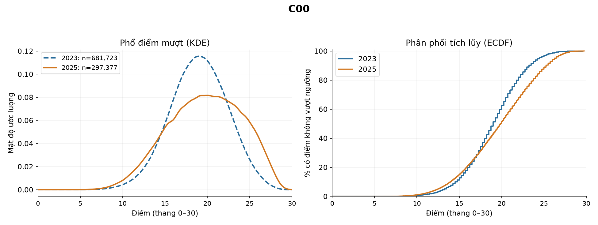

**Diễn giải hình:** Xanh nét đứt là 2023, cam nét liền là 2025; KDE mượt là mật độ, diện tích trên thang điểm bằng 1, không phải số người tuyệt đối. Ở ECDF, chiều cao là % điểm không vượt ngưỡng. Khoảng cách lớn nhất hai ECDF là D=0,142, gần mốc 22,00; đây là 14,2 điểm phần trăm ở mốc đó, không phải tỷ lệ người tiến bộ.

**Ý nghĩa và giới hạn:** Kết quả có bằng chứng chênh trung bình theo mô hình ở mức 0,05 sau Holm. Điều này cần đọc cùng mức đổi 0,746 điểm, |d| và hình dạng; p lớn không chứng minh tương đương. So sánh là giữa hai tập điểm quan sát, không tách được độ khó, chương trình, cách chấm và thành phần thí sinh.

### 2.5.21. C04

| Năm | Số có điểm | Trung bình | Trung vị | SD | IQR | <15 (%) | ≥24 (%) | ≥27 (%) |
| --- | --- | --- | --- | --- | --- | --- | --- | --- |
| 2023 | 668.369 | 18,61 | 18,85 | 3,37 | 4,70 | 14,75 | 3,92 | 0,02 |
| 2025 | 472.025 | 17,29 | 17,45 | 3,64 | 5,25 | 26,82 | 2,36 | 0,06 |

**Diễn giải bảng:** n là số có điểm hợp lệ của riêng mục này, không phải mọi dòng trong năm. SD đo độ trải rộng; IQR là độ rộng vùng 50% ở giữa. Các tỷ lệ chia cho n của đúng hàng; nhóm ≥90% thang điểm đã nằm trong nhóm ≥80%, không cộng hai tỷ lệ.

**Nhận xét bằng số:** Trung bình 18,61 → 17,29, giảm 1,32 điểm; trung vị 18,85 → 17,45. Cohen’s d=-0,379 (trong khoảng 0,2–0,5 về |d| theo quy ước tham khảo). Tỷ số phương sai 2025/2023=1,165. Không dùng nhãn độ lớn như kết luận hai năm tương đương.

| Câu hỏi/phép thử | Thống kê | p gốc | p Holm / q BH |
| --- | --- | --- | --- |
| Welch: trung bình | t=-196,833, df=966.718,8 | ≈0 (dưới độ phân giải số) | ≈0 (dưới độ phân giải số) |
| MWU: thứ hạng | U=124.427.017.327,5 | ≈0 (dưới độ phân giải số) | ≈0 (dưới độ phân giải số) |
| KS: toàn phân phối | D=0,157; tại điểm 17,60 | 5.00e-04 | 5.00e-04 |
| Brown–Forsythe: độ phân tán | W=4.125,788 | ≈0 (dưới độ phân giải số) | ≈0 (dưới độ phân giải số) |

**Diễn giải bảng:** Welch dùng Holm trong family 16 phép thử trung bình; ba phép thăm dò dùng BH chung trong family 48 p hữu hạn. KS dùng hoán vị 1,999 lần, p nhỏ nhất phân giải được là 0,0005. Giá trị “≈0” ở các phép tiệm cận là giới hạn tính số, không phải xác suất bằng 0.

**Khoảng tin cậy và độ lớn:** Chênh trung bình có CI 95% [-1,334; -1,308] **điểm**. d có CI bootstrap 95% [-0,383; -0,376] **SD gộp**; Hedges’ g=-0,379. A=0,394 là xác suất thắng cộng nửa xác suất hòa, không phải chỉ P(2025>2023).

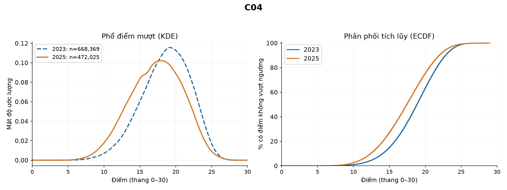

**Diễn giải hình:** Xanh nét đứt là 2023, cam nét liền là 2025; KDE mượt là mật độ, diện tích trên thang điểm bằng 1, không phải số người tuyệt đối. Ở ECDF, chiều cao là % điểm không vượt ngưỡng. Khoảng cách lớn nhất hai ECDF là D=0,157, gần mốc 17,60; đây là 15,7 điểm phần trăm ở mốc đó, không phải tỷ lệ người tiến bộ.

**Ý nghĩa và giới hạn:** Kết quả có bằng chứng chênh trung bình theo mô hình ở mức 0,05 sau Holm. Điều này cần đọc cùng mức đổi -1,321 điểm, |d| và hình dạng; p lớn không chứng minh tương đương. So sánh là giữa hai tập điểm quan sát, không tách được độ khó, chương trình, cách chấm và thành phần thí sinh.

### 2.5.22. C03

| Năm | Số có điểm | Trung bình | Trung vị | SD | IQR | <15 (%) | ≥24 (%) | ≥27 (%) |
| --- | --- | --- | --- | --- | --- | --- | --- | --- |
| 2023 | 669.692 | 18,48 | 18,70 | 3,69 | 5,30 | 18,12 | 5,75 | 0,07 |
| 2025 | 476.660 | 17,28 | 17,45 | 3,54 | 5,00 | 26,28 | 1,98 | 0,04 |

**Diễn giải bảng:** n là số có điểm hợp lệ của riêng mục này, không phải mọi dòng trong năm. SD đo độ trải rộng; IQR là độ rộng vùng 50% ở giữa. Các tỷ lệ chia cho n của đúng hàng; nhóm ≥90% thang điểm đã nằm trong nhóm ≥80%, không cộng hai tỷ lệ.

**Nhận xét bằng số:** Trung bình 18,48 → 17,28, giảm 1,20 điểm; trung vị 18,70 → 17,45. Cohen’s d=-0,330 (trong khoảng 0,2–0,5 về |d| theo quy ước tham khảo). Tỷ số phương sai 2025/2023=0,924. Không dùng nhãn độ lớn như kết luận hai năm tương đương.

| Câu hỏi/phép thử | Thống kê | p gốc | p Holm / q BH |
| --- | --- | --- | --- |
| Welch: trung bình | t=-175,361, df=1.050.335,2 | ≈0 (dưới độ phân giải số) | ≈0 (dưới độ phân giải số) |
| MWU: thứ hạng | U=129.775.828.187,5 | ≈0 (dưới độ phân giải số) | ≈0 (dưới độ phân giải số) |
| KS: toàn phân phối | D=0,136; tại điểm 19,27 | 5.00e-04 | 5.00e-04 |
| Brown–Forsythe: độ phân tán | W=889,322 | 2.44e-195 | 3.91e-195 |

**Diễn giải bảng:** Welch dùng Holm trong family 16 phép thử trung bình; ba phép thăm dò dùng BH chung trong family 48 p hữu hạn. KS dùng hoán vị 1,999 lần, p nhỏ nhất phân giải được là 0,0005. Giá trị “≈0” ở các phép tiệm cận là giới hạn tính số, không phải xác suất bằng 0.

**Khoảng tin cậy và độ lớn:** Chênh trung bình có CI 95% [-1,211; -1,185] **điểm**. d có CI bootstrap 95% [-0,334; -0,326] **SD gộp**; Hedges’ g=-0,330. A=0,407 là xác suất thắng cộng nửa xác suất hòa, không phải chỉ P(2025>2023).

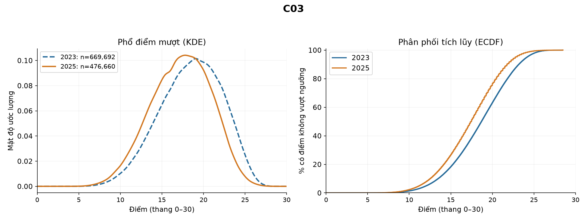

**Diễn giải hình:** Xanh nét đứt là 2023, cam nét liền là 2025; KDE mượt là mật độ, diện tích trên thang điểm bằng 1, không phải số người tuyệt đối. Ở ECDF, chiều cao là % điểm không vượt ngưỡng. Khoảng cách lớn nhất hai ECDF là D=0,136, gần mốc 19,27; đây là 13,6 điểm phần trăm ở mốc đó, không phải tỷ lệ người tiến bộ.

**Ý nghĩa và giới hạn:** Kết quả có bằng chứng chênh trung bình theo mô hình ở mức 0,05 sau Holm. Điều này cần đọc cùng mức đổi -1,198 điểm, |d| và hình dạng; p lớn không chứng minh tương đương. So sánh là giữa hai tập điểm quan sát, không tách được độ khó, chương trình, cách chấm và thành phần thí sinh.

### 2.5.23. C01

| Năm | Số có điểm | Trung bình | Trung vị | SD | IQR | <15 (%) | ≥24 (%) | ≥27 (%) |
| --- | --- | --- | --- | --- | --- | --- | --- | --- |
| 2023 | 320.523 | 21,01 | 21,25 | 2,62 | 3,55 | 2,09 | 11,92 | 0,12 |
| 2025 | 345.014 | 20,09 | 20,20 | 3,24 | 4,65 | 6,10 | 12,99 | 0,74 |

**Diễn giải bảng:** n là số có điểm hợp lệ của riêng mục này, không phải mọi dòng trong năm. SD đo độ trải rộng; IQR là độ rộng vùng 50% ở giữa. Các tỷ lệ chia cho n của đúng hàng; nhóm ≥90% thang điểm đã nằm trong nhóm ≥80%, không cộng hai tỷ lệ.

**Nhận xét bằng số:** Trung bình 21,01 → 20,09, giảm 0,92 điểm; trung vị 21,25 → 20,20. Cohen’s d=-0,312 (trong khoảng 0,2–0,5 về |d| theo quy ước tham khảo). Tỷ số phương sai 2025/2023=1,530. Không dùng nhãn độ lớn như kết luận hai năm tương đương.

| Câu hỏi/phép thử | Thống kê | p gốc | p Holm / q BH |
| --- | --- | --- | --- |
| Welch: trung bình | t=-128,151, df=653.243,4 | ≈0 (dưới độ phân giải số) | ≈0 (dưới độ phân giải số) |
| MWU: thứ hạng | U=45.441.676.968,0 | ≈0 (dưới độ phân giải số) | ≈0 (dưới độ phân giải số) |
| KS: toàn phân phối | D=0,166; tại điểm 19,52 | 5.00e-04 | 5.00e-04 |
| Brown–Forsythe: độ phân tán | W=16.485,537 | ≈0 (dưới độ phân giải số) | ≈0 (dưới độ phân giải số) |

**Diễn giải bảng:** Welch dùng Holm trong family 16 phép thử trung bình; ba phép thăm dò dùng BH chung trong family 48 p hữu hạn. KS dùng hoán vị 1,999 lần, p nhỏ nhất phân giải được là 0,0005. Giá trị “≈0” ở các phép tiệm cận là giới hạn tính số, không phải xác suất bằng 0.

**Khoảng tin cậy và độ lớn:** Chênh trung bình có CI 95% [-0,937; -0,909] **điểm**. d có CI bootstrap 95% [-0,317; -0,307] **SD gộp**; Hedges’ g=-0,312. A=0,411 là xác suất thắng cộng nửa xác suất hòa, không phải chỉ P(2025>2023).

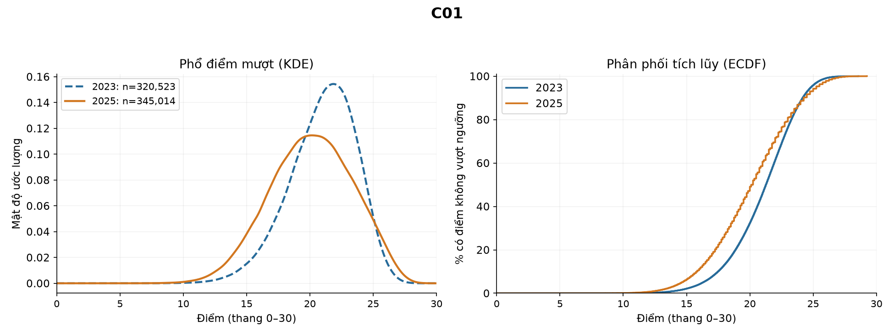

**Diễn giải hình:** Xanh nét đứt là 2023, cam nét liền là 2025; KDE mượt là mật độ, diện tích trên thang điểm bằng 1, không phải số người tuyệt đối. Ở ECDF, chiều cao là % điểm không vượt ngưỡng. Khoảng cách lớn nhất hai ECDF là D=0,166, gần mốc 19,52; đây là 16,6 điểm phần trăm ở mốc đó, không phải tỷ lệ người tiến bộ.

**Ý nghĩa và giới hạn:** Kết quả có bằng chứng chênh trung bình theo mô hình ở mức 0,05 sau Holm. Điều này cần đọc cùng mức đổi -0,923 điểm, |d| và hình dạng; p lớn không chứng minh tương đương. So sánh là giữa hai tập điểm quan sát, không tách được độ khó, chương trình, cách chấm và thành phần thí sinh.

## Nguồn, khả năng tái lập và giới hạn

Mọi so sánh dùng nguồn điểm của riêng môn, không ép các môn về một tập thí sinh chung. Không suy rằng tăng/giảm do riêng chương trình hoặc đề thi. Muốn đánh giá độ phân biệt câu hỏi cần dữ liệu theo câu, không thay bằng p hoặc SD tổng điểm.

Tài liệu phương pháp: [Welch/CI](https://docs.scipy.org/doc/scipy/reference/generated/scipy.stats.ttest_ind.html), [MWU và ties](https://docs.scipy.org/doc/scipy/reference/generated/scipy.stats.mannwhitneyu.html), [KS](https://docs.scipy.org/doc/scipy/reference/generated/scipy.stats.ks_2samp.html), [Levene](https://docs.scipy.org/doc/scipy/reference/generated/scipy.stats.levene.html), [nguyên tắc p-value của ASA](https://www.amstat.org/asa/files/pdfs/P-ValueStatement.pdf).

## Phụ lục — Levene gốc và kiểm tra độ phân tán

### Từng môn

| Môn/khối | SD2023 | SD2025 | Var2025/2023 | p Levene mean | p BF median | q BF BH |
| --- | --- | --- | --- | --- | --- | --- |
| Sinh học | 1,207 | 1,581 | 1,716 | ≈0 (dưới độ phân giải số) | ≈0 (dưới độ phân giải số) | ≈0 (dưới độ phân giải số) |
| Hóa học | 1,428 | 1,811 | 1,607 | ≈0 (dưới độ phân giải số) | ≈0 (dưới độ phân giải số) | ≈0 (dưới độ phân giải số) |
| Tiếng Anh (N1) | 1,962 | 1,449 | 0,545 | ≈0 (dưới độ phân giải số) | ≈0 (dưới độ phân giải số) | ≈0 (dưới độ phân giải số) |
| Tiếng Nga (N2) | 1,851 | 1,157 | 0,390 | 0,0019 | 0,0398 | 0,0418 |
| Tiếng Pháp (N3) | 2,100 | 1,468 | 0,489 | 2.58e-23 | 3.35e-21 | 8.80e-21 |
| Tiếng Trung (N4) | 2,002 | 2,033 | 1,031 | 0,0158 | 0,0168 | 0,0191 |
| Tiếng Đức (N5) | 1,989 | 1,641 | 0,681 | 0,0030 | 0,0024 | 0,0028 |
| Tiếng Nhật (N6) | 2,188 | 2,088 | 0,911 | 0,0829 | 0,2161 | 0,2214 |
| Tiếng Hàn (N7) | 1,917 | 1,922 | 1,005 | 0,9596 | 0,9971 | 0,9971 |
| Địa lý | 1,169 | 1,750 | 2,242 | ≈0 (dưới độ phân giải số) | ≈0 (dưới độ phân giải số) | ≈0 (dưới độ phân giải số) |
| Lịch sử | 1,553 | 1,633 | 1,106 | ≈0 (dưới độ phân giải số) | ≈0 (dưới độ phân giải số) | ≈0 (dưới độ phân giải số) |
| Ngữ văn | 1,326 | 1,279 | 0,929 | ≈0 (dưới độ phân giải số) | ≈0 (dưới độ phân giải số) | ≈0 (dưới độ phân giải số) |
| Toán | 1,633 | 1,677 | 1,054 | 0,0357 | 1.31e-45 | 3.68e-45 |
| Vật lý | 1,487 | 1,517 | 1,041 | 2.82e-45 | 1.93e-76 | 5.78e-76 |

**Diễn giải bảng:** Levene gốc lấy độ lệch tuyệt đối quanh mean; Brown–Forsythe lấy quanh median, bền hơn khi lệch phân phối. p Levene mean là đối chiếu chưa hiệu chỉnh, không thêm vào family chính đã định trước. BF dùng BH cùng MWU và KS. Tỷ số phương sai>1 cho biết2025 trải rộng hơn trong mẫu; đây chưa phải độ phân biệt câu hỏi.

### Tổng các khối không đổi môn

| Môn/khối | SD2023 | SD2025 | Var2025/2023 | p Levene mean | p BF median | q BF BH |
| --- | --- | --- | --- | --- | --- | --- |
| B00 | 2,776 | 4,506 | 2,635 | ≈0 (dưới độ phân giải số) | ≈0 (dưới độ phân giải số) | ≈0 (dưới độ phân giải số) |
| B08/D08 | 3,005 | 3,397 | 1,278 | 1.61e-27 | 1.51e-26 | 2.34e-26 |
| A02 | 2,726 | 3,065 | 1,265 | 5.80e-25 | 1.47e-24 | 2.21e-24 |
| D07 | 3,062 | 3,709 | 1,467 | ≈0 (dưới độ phân giải số) | ≈0 (dưới độ phân giải số) | ≈0 (dưới độ phân giải số) |
| C02 | 2,529 | 3,494 | 1,909 | ≈0 (dưới độ phân giải số) | ≈0 (dưới độ phân giải số) | ≈0 (dưới độ phân giải số) |
| A00 | 3,094 | 4,337 | 1,965 | ≈0 (dưới độ phân giải số) | ≈0 (dưới độ phân giải số) | ≈0 (dưới độ phân giải số) |
| D15 | 3,384 | 2,743 | 0,657 | ≈0 (dưới độ phân giải số) | ≈0 (dưới độ phân giải số) | ≈0 (dưới độ phân giải số) |
| D10 | 3,627 | 3,094 | 0,728 | ≈0 (dưới độ phân giải số) | ≈0 (dưới độ phân giải số) | ≈0 (dưới độ phân giải số) |
| D14 | 3,707 | 2,815 | 0,577 | ≈0 (dưới độ phân giải số) | ≈0 (dưới độ phân giải số) | ≈0 (dưới độ phân giải số) |
| D09 | 3,937 | 3,115 | 0,626 | ≈0 (dưới độ phân giải số) | ≈0 (dưới độ phân giải số) | ≈0 (dưới độ phân giải số) |
| D01 | 3,814 | 2,914 | 0,584 | ≈0 (dưới độ phân giải số) | ≈0 (dưới độ phân giải số) | ≈0 (dưới độ phân giải số) |
| A01 | 3,340 | 3,623 | 1,176 | ≈0 (dưới độ phân giải số) | ≈0 (dưới độ phân giải số) | ≈0 (dưới độ phân giải số) |
| C00 | 3,379 | 4,269 | 1,596 | ≈0 (dưới độ phân giải số) | ≈0 (dưới độ phân giải số) | ≈0 (dưới độ phân giải số) |
| C04 | 3,370 | 3,639 | 1,165 | ≈0 (dưới độ phân giải số) | ≈0 (dưới độ phân giải số) | ≈0 (dưới độ phân giải số) |
| C03 | 3,688 | 3,545 | 0,924 | 2.05e-205 | 2.44e-195 | 3.91e-195 |
| C01 | 2,621 | 3,242 | 1,530 | ≈0 (dưới độ phân giải số) | ≈0 (dưới độ phân giải số) | ≈0 (dưới độ phân giải số) |

**Diễn giải bảng:** Levene gốc lấy độ lệch tuyệt đối quanh mean; Brown–Forsythe lấy quanh median, bền hơn khi lệch phân phối. p Levene mean là đối chiếu chưa hiệu chỉnh, không thêm vào family chính đã định trước. BF dùng BH cùng MWU và KS. Tỷ số phương sai>1 cho biết2025 trải rộng hơn trong mẫu; đây chưa phải độ phân biệt câu hỏi.

**Kế thừa Sơn:** Bản Sơn có Welch/MWU/KS/Levene/BF và effect size; bổ sung ở đây là phạm vi mọi môn/ngôn ngữ, giải nghĩa bên cạnh số, đồ thị KDE/ECDF, hiệu chỉnh đa kiểm định, KS có xử lý đồng hạng và phần mọi khối đủ điểm. Không ghép GDCD và GDKT&PL thành một môn.

## Hồ sơ tính toán và đối chiếu

| Năm | Số dòng nguồn | Tệp gốc | SHA-256 |
| --- | --- | --- | --- |
| 2023 | 1.022.060 | original.csv | cdf22a6b45f8e23b522beb1c521782e36486cac39d3fb64bca2a2395edec39b5 |
| 2025 | 1.131.136 | dataset_diem_thi_thpt_2025.csv | 0db00925d51bcb14dfb6c92efeee9926524aba8938288987a95c38d34484e6ed |

**Diễn giải bảng:** Hash khóa đúng hai phiên bản dữ liệu đã tính. Số dòng nguồn gồm cả người không có điểm; n trong từng phép tính chỉ đếm điểm hợp lệ/đủ cặp/đủ khối. Dữ liệu gốc và kết quả phần 3 được giữ nguyên. Không sao chép lại bộ dữ liệu cho báo cáo này.

**Cấu hình tái lập:** Seed gốc 20261021; thứ tự môn theo ID sắp xếp, seed riêng mỗi mục bằng seed gốc cộng chỉ số từ 0; khối cộng thêm 10000, d bootstrap cộng tiếp 100. KS hoán vị 1999 lần theo phân bổ hypergeometric trên tần số điểm, p=(1+số D hoán vị≥D quan sát)/(1999+1). CI d percentile từ 999 mẫu bootstrap multinomial độc lập từng năm. Tương quan ba cặp minh họa bootstrap 999 lần trên tần số cặp điểm cùng người; seed theo thứ tự cặp. Mọi CI 95%, các phép thử hai phía. P80 dùng quantile method=higher, tính cả đồng hạng ở ngưỡng; không ép nhóm cao đúng 20%.

**Môi trường thực thi:** python 3.12.14, numpy 2.5.3, pandas 3.0.1, scipy 1.18.1, matplotlib 3.11.2. PCA dùng NumPy SVD trên z có SD mẫu ddof1, eigenvalue=s²/(n−1), loading=v√λ. Thư viện và phương pháp đã tra tài liệu chính thức SciPy cùng Context7.

**Kiểm chứng số:** 8 môn chung khớp n/mean/d với Sơn (sai số tuyệt đối<10⁻¹⁰); 56 dòng cặp của Duy khớp n/r/rho, kể cả ô không đồng quan sát; 10 mô hình của 5 khối Duy khớp n và EVR (sai số<10⁻⁸ điểm phần trăm). 48 số đếm mã–năm khớp phần 3; mọi tổng 2025 đã lưu được so với tổng đủ ba môn và không có sai lệch trên ngưỡng10⁻⁸ điểm. B08/D08 dùng chung, 23 bộ/năm. Các quy tắc thiếu/zero/alias/biến hằng và bất biến dấu PCA đã được kiểm tra trên dữ liệu thử riêng.

**Nguồn phương pháp:** [Welch](https://docs.scipy.org/doc/scipy/reference/generated/scipy.stats.ttest_ind.html), [MWU](https://docs.scipy.org/doc/scipy/reference/generated/scipy.stats.mannwhitneyu.html), [KS hai mẫu](https://docs.scipy.org/doc/scipy/reference/generated/scipy.stats.ks_2samp.html), [Levene/Brown–Forsythe](https://docs.scipy.org/doc/scipy/reference/generated/scipy.stats.levene.html), [PCA](https://scikit-learn.org/stable/modules/decomposition.html#pca). Các nguồn định nghĩa phương pháp; số liệu trong bài được tính từ hai tệp điểm trên.

**Kiểm tra trước bàn giao:** 15 trường hợp QA đều đạt; hai notebook kiểm chứng chạy hết 13 ô code, không lỗi. Tính lại cùng seed cho các bảng kiểm định, tương quan, xác suất điểm cao và PCA cho kết quả khớp. Rà soát độc lập từ bảng xác nhận Welch/d/CI và loading PCA phù hợp; các điểm cần ghi rõ mẫu nhỏ và mapping đã được bổ sung. Bộ bàn giao chỉ giữ hai Markdown và ảnh được dùng trong bài; mã/CSV/notebook/kế hoạch trung gian do phiên này tạo được dọn theo yêu cầu. Dữ liệu và phần3 được bảo toàn.
