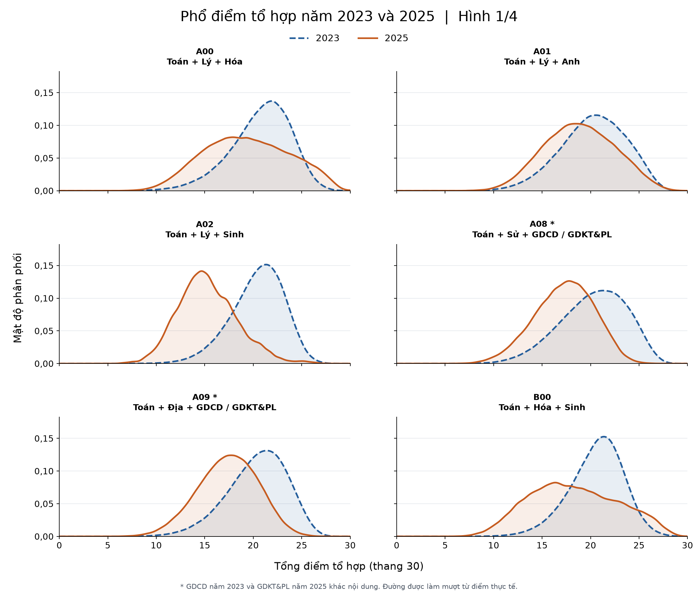
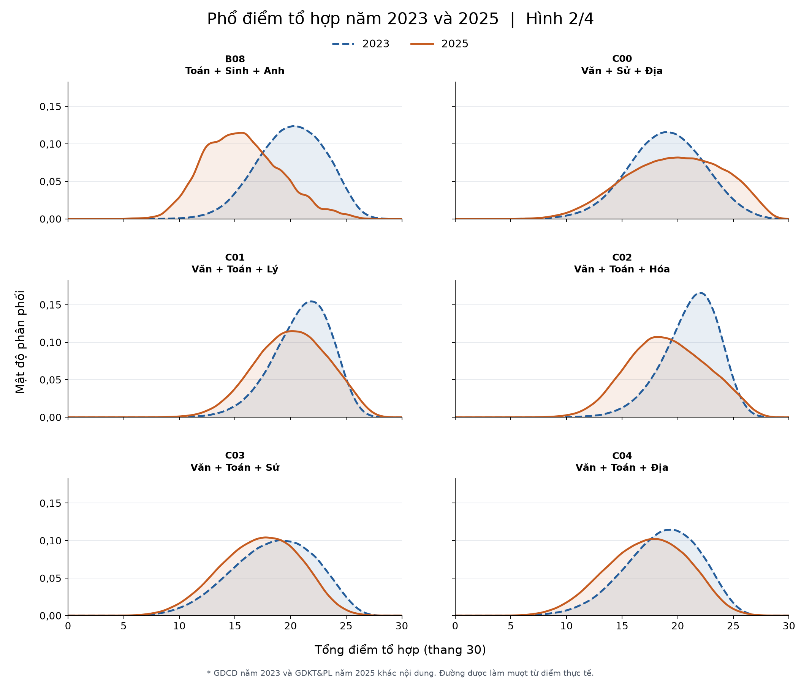
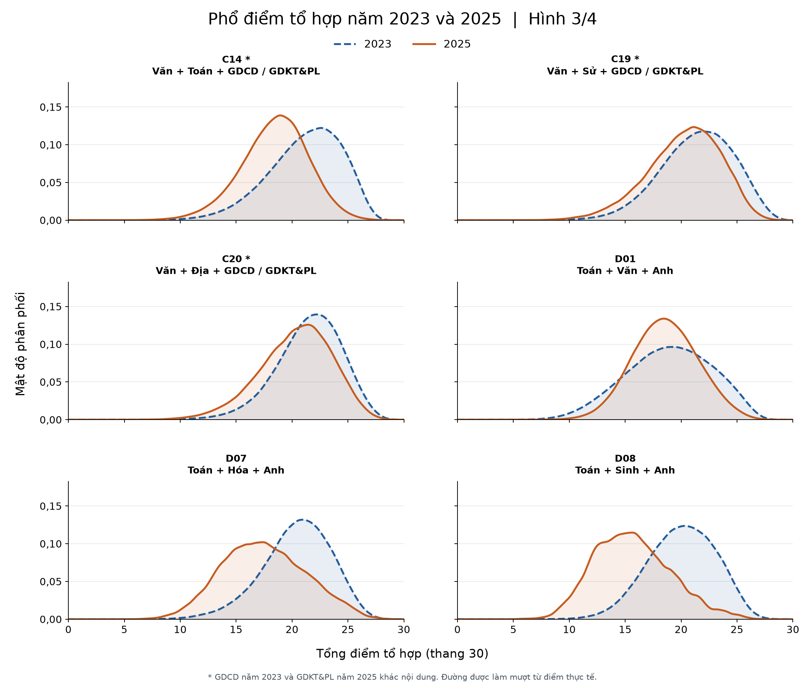
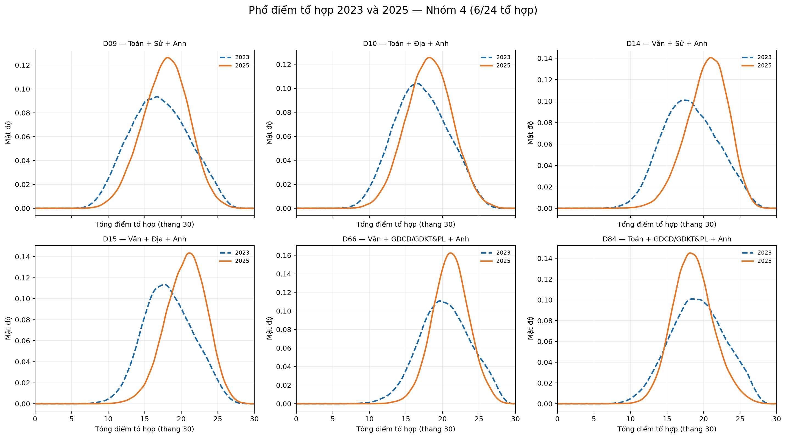

# Phần 3 Phân tích theo khối thi và tổ hợp môn

So sánh năm **2023 và 2025** theo đủ **24 mã tổ hợp**: điểm tổ hợp, xu hướng chọn môn và ngưỡng điểm vào nhóm cao nhất. Mọi mũi tên trong bảng đều chỉ **2023 → 2025**.

**Tệp tạo biểu đồ:** [scripts/analysis/plot_combinations_kde.py](../scripts/analysis/plot_combinations_kde.py). Workflow [Generate combination KDE plots](../.github/workflows/combination-kde.yml) được cấu hình để chạy khi script hoặc dữ liệu liên quan thay đổi trên nhánh `thanh`, sau đó lưu 4 hình PNG vào `outputs/combinations/figures/`. Mỗi hình gồm 6 tổ hợp, tổng cộng đủ 24 mã. Nếu vừa cập nhật dữ liệu, kiểm tra tab **Actions** của GitHub để xác nhận workflow chạy thành công trước khi sử dụng hình.

## 3.1 So sánh điểm của 24 tổ hợp

Điểm tổ hợp là tổng ba môn, thang 30, chưa cộng ưu tiên hay nhân hệ số. Chỉ tính người có đủ điểm cả ba môn; một người có thể thuộc nhiều tổ hợp.

| Tổ hợp | Ba môn | Số thí sinh đủ điểm | Điểm trung bình |
| --- | --- | ---: | ---: |
| A00 | Toán + Lý + Hóa | 325.902 → 162.200 | 20,77 → 19,37 |
| A01 | Toán + Lý + Anh | 314.412 → 146.960 | 20,27 → 18,87 |
| A02 | Toán + Lý + Sinh | 322.538 → 4.795 | 20,43 → 15,32 |
| A08 | Toán + Sử + GDCD/GDKT&PL* | 564.507 → 68.313 | 20,29 → 17,29 |
| A09 | Toán + Địa + GDCD/GDKT&PL* | 564.517 → 109.404 | 20,38 → 17,39 |
| B00 | Toán + Hóa + Sinh | 324.554 → 44.964 | 20,60 → 18,29 |
| B08 | Toán + Sinh + Anh | 313.063 → 4.227 | 20,07 → 15,66 |
| C00 | Văn + Sử + Địa | 681.723 → 297.377 | 18,97 → 19,72 |
| C01 | Văn + Toán + Lý | 320.523 → 345.014 | 21,01 → 20,09 |
| C02 | Văn + Toán + Hóa | 320.465 → 237.064 | 21,17 → 19,11 |
| C03 | Văn + Toán + Sử | 669.692 → 476.660 | 18,48 → 17,28 |
| C04 | Văn + Toán + Địa | 668.369 → 472.025 | 18,61 → 17,29 |
| C14 | Văn + Toán + GDCD/GDKT&PL* | 564.516 → 246.298 | 21,17 → 18,46 |
| C19 | Văn + Sử + GDCD/GDKT&PL* | 565.211 → 68.351 | 21,44 → 20,25 |
| C20 | Văn + Địa + GDCD/GDKT&PL* | 565.249 → 109.423 | 21,53 → 20,31 |
| D01 | Toán + Văn + Anh | 873.126 → 350.654 | 18,89 → 18,58 |
| D07 | Toán + Hóa + Anh | 313.538 → 24.478 | 20,42 → 17,51 |
| D08 | Toán + Sinh + Anh | 313.063 → 4.227 | 20,07 → 15,66 |
| D09 | Toán + Sử + Anh | 557.198 → 69.904 | 17,00 → 17,86 |
| D10 | Toán + Địa + Anh | 557.086 → 53.567 | 17,09 → 18,19 |
| D14 | Văn + Sử + Anh | 557.405 → 69.989 | 18,15 → 20,45 |
| D15 | Văn + Địa + Anh | 557.312 → 53.592 | 18,25 → 20,63 |
| D66 | Văn + GDCD/GDKT&PL* + Anh | 556.185 → 47.905 | 20,31 → 21,11 |
| D84 | Toán + GDCD/GDKT&PL* + Anh | 556.034 → 47.902 | 19,15 → 18,56 |

**Nhận xét:** Điểm trung bình giảm ở 18/24 mã, tăng ở 6 mã. A00 và A01 cùng giảm khoảng 1,4 điểm; B00 giảm khoảng 2,3 điểm; C00 tăng 0,75 điểm; D01 giảm 0,31 điểm. A02 giảm mạnh nhất (5,11 điểm), còn D15 tăng nhiều nhất (2,38 điểm).

**So sánh các nhóm tổ hợp:** Các tổ hợp có Toán và môn khoa học tự nhiên như A00, A01, A02, B00, C01, C02 đều giảm điểm trung bình. Trong nhóm có Sử hoặc Địa, C00, D09, D10, D14, D15 tăng, còn C03 và C04 giảm. Vì vậy, không thể kết luận tất cả tổ hợp tự nhiên đều biến động giống nhau hoặc mọi tổ hợp có môn xã hội đều tăng điểm; cần nhìn vào đúng ba môn của từng mã.

**Số người đủ điểm cũng thay đổi mạnh:** A00 giảm 50,23%, B00 giảm 86,15%, A02 giảm 98,51%. Riêng C01 tăng từ 320.523 lên 345.014 người, tương đương 7,64%, dù điểm trung bình giảm. Số người có thể tính điểm tổ hợp và mức điểm của nhóm đó là hai thông tin khác nhau. Những số đếm này cũng không cho biết có bao nhiêu người thực sự đăng ký xét tuyển bằng tổ hợp đó.

\* GDCD năm 2023 và Giáo dục kinh tế và pháp luật (GDKT&PL) năm 2025 khác nội dung, nên các mã có môn này chỉ được đối chiếu để tham khảo. B08 và D08 có cùng ba môn nên kết quả giống nhau.

**Phổ điểm hai năm:** Đường xanh nét đứt là 2023, đường cam nét liền là 2025. Đường lệch sang phải cho thấy điểm tập trung ở mức cao hơn; đường trải rộng cho thấy điểm phân tán hơn. Các đường dùng KDE để làm mượt điểm thực tế, không ép dữ liệu thành phân phối chuẩn. Trục dọc là mật độ, không phải số thí sinh; diện tích dưới mỗi đường bằng 1.

**Nhận xét hình 1:** Vùng tập trung điểm của A01, A02, A08 và A09 năm 2025 nằm thấp hơn năm 2023; A02 có thay đổi rõ nhất. A00 và B00 có phổ năm 2025 trải rộng hơn: nhiều điểm tập trung ở vùng thấp hơn, đồng thời phần điểm cao vẫn hiện rõ. Điều này phù hợp với việc điểm trung bình giảm nhưng ngưỡng top 10% tăng ở hai tổ hợp này.

**Nhận xét hình 2:** B08, C01 và C02 có vùng tập trung điểm năm 2025 thấp hơn khá rõ; C03 và C04 cũng giảm nhưng hai đường còn chồng lấp nhiều. C00 có phần giữa và vùng điểm cao chuyển sang mức cao hơn, đồng thời phổ trải rộng hơn. Vì vậy, C00 vừa tăng điểm trung bình vừa tăng ngưỡng top 10% và top 20%.

**Nhận xét hình 3:** C14, D07 và D08 có vùng tập trung điểm năm 2025 thấp hơn rõ; C19 và C20 thay đổi nhẹ hơn. Với D01, đường năm 2025 hẹp và cao hơn ở vùng giữa, còn vùng điểm cao thu hẹp. Đỉnh đường cao hơn thể hiện điểm tập trung hơn, không có nghĩa số người dự thi tăng. D01 chỉ giảm nhẹ điểm trung bình nhưng ngưỡng top 10% giảm 1,35 điểm.

**Nhận xét hình 4:** D09, D10, D14 và D15 có vùng tập trung điểm năm 2025 cao hơn, nổi bật nhất là D14 và D15. D66 tập trung hơn ở vùng giữa: điểm trung bình tăng nhưng ngưỡng top 10% lại giảm 0,75 điểm. D84 có vùng tập trung điểm thấp hơn. Các ví dụ này cho thấy cần đọc cả vị trí, độ trải rộng và vùng điểm cao của đường phân phối.

## 3.2 Xu hướng chọn môn

Dùng **tỷ lệ có điểm** để phản ánh xu hướng dự thi: số người có điểm môn đó chia cho tổng người có ít nhất một điểm. Tổng này là **1.017.584 người năm 2023** và **1.130.984 người năm 2025**. Đây không phải tỷ lệ đăng ký ban đầu.

| Môn | Tỷ lệ có điểm 2023 | Tỷ lệ có điểm 2025 | Mức giảm (điểm phần trăm) |
| --- | ---: | ---: | ---: |
| Vật lý | 32,15% | 30,73% | 1,42 |
| Hóa học | 32,24% | 21,23% | 11,01 |
| Sinh học | 31,90% | 6,18% | 25,72 |
| Lịch sử | 67,16% | 42,56% | 24,61 |
| Địa lý | 67,03% | 42,13% | 24,91 |
| Tiếng Anh | 86,10% | 31,11% | 54,99 |

**Nhận xét:** Tỷ lệ có điểm giảm ở cả sáu môn trên, mạnh nhất là Tiếng Anh và Sinh học. Riêng Vật lý tăng số người có điểm (327.189 → 347.599), nhưng tỷ lệ vẫn giảm vì tổng số thí sinh tăng.

Năm 2025, tỷ lệ có điểm GDKT&PL là **21,79%**, Tin học **0,67%**, Công nghệ **2,15%**. GDCD năm 2023 đạt **55,57%**, nhưng không so trực tiếp với GDKT&PL vì khác nội dung.

Việc chuyển từ thi theo bài tổ hợp sang chọn hai môn tự chọn làm thay đổi nhóm người dự thi. Trước đây, người thi bài Khoa học tự nhiên thường có cả điểm Lý, Hóa và Sinh; năm 2025, có điểm một môn không có nghĩa sẽ có điểm hai môn còn lại. Ví dụ, năm 2025 có 69.895 người có điểm Sinh nhưng chỉ 44.964 người đủ Toán, Hóa, Sinh để tính B00. Vì vậy, số người đủ điểm tổ hợp giảm có thể liên quan đến cách chọn môn, chưa đủ để kết luận học sinh ít yêu thích môn đó hơn hay năng lực học tập giảm.

## 3.3 Bao nhiêu điểm để vào top 20% và top 10%

**Top 20%** là nhóm có điểm thuộc khoảng 20% cao nhất; **top 10%** là nhóm thuộc khoảng 10% cao nhất trong số người đủ điểm từng tổ hợp, từng năm. Đây là ngưỡng tham khảo theo phân phối điểm, **không phải điểm trúng tuyển**.

| Tổ hợp | Ngưỡng top 20% | Ngưỡng top 10% |
| --- | ---: | ---: |
| A00 | 23,40 → 23,50 | 24,45 → 25,25 |
| A01 | 23,25 → 22,10 | 24,55 → 23,75 |
| A02 | 22,75 → 17,75 | 23,70 → 19,35 |
| A08 | 23,35 → 20,00 | 24,50 → 21,20 |
| A09 | 23,05 → 20,10 | 24,10 → 21,25 |
| B00 | 22,90 → 22,60 | 23,95 → 24,75 |
| B08 | 22,75 → 18,50 | 23,90 → 20,25 |
| C00 | 22,00 → 23,75 | 23,25 → 25,25 |
| C01 | 23,25 → 23,00 | 24,15 → 24,25 |
| C02 | 23,35 → 22,25 | 24,15 → 24,00 |
| C03 | 21,80 → 20,50 | 23,20 → 21,75 |
| C04 | 21,60 → 20,50 | 22,80 → 22,00 |
| C14 | 24,05 → 21,00 | 25,10 → 22,10 |
| C19 | 24,25 → 23,00 | 25,50 → 24,25 |
| C20 | 24,00 → 23,10 | 25,00 → 24,25 |
| D01 | 22,40 → 21,00 | 23,85 → 22,50 |
| D07 | 23,05 → 20,75 | 24,20 → 22,50 |
| D08 | 22,75 → 18,50 | 23,90 → 20,25 |
| D09 | 20,55 → 20,50 | 22,35 → 21,75 |
| D10 | 20,35 → 20,75 | 22,05 → 22,25 |
| D14 | 21,50 → 23,00 | 23,25 → 24,00 |
| D15 | 21,25 → 23,00 | 22,90 → 24,00 |
| D66 | 23,40 → 23,25 | 25,00 → 24,25 |
| D84 | 22,50 → 20,75 | 24,20 → 22,25 |

**Cách đọc và kết quả nổi bật:** A00 năm 2025 cần khoảng **25,25 điểm** để chạm ngưỡng top 10%, so với **24,45 điểm** năm 2023. B00 cũng tăng ngưỡng này thêm **0,80 điểm**, dù cả hai tổ hợp đều giảm điểm trung bình. Điều đó cho thấy phần giữa và vùng điểm cao thay đổi khác nhau. Với C00, cả top 20% và top 10% đều tăng, lần lượt **1,75** và **2 điểm**; với A01 và D01, cả hai ngưỡng đều giảm.

**Ý nghĩa khi so sánh giữa hai năm:** Cùng một tổng điểm có thể ứng với vị trí khác nhau. Chẳng hạn, **24,50 điểm A00** vượt ngưỡng top 10% năm 2023, nhưng năm 2025 chỉ vượt ngưỡng top 20% và chưa chạm top 10%. Vì thế, ngưỡng top giúp đánh giá vị trí tương đối của mức điểm trong từng năm; không dùng riêng điểm trung bình để suy đoán nhóm điểm cao. Do đồng điểm, số người đạt từ ngưỡng trở lên có thể nhỉnh hơn 10% hoặc 20%.

**Lưu ý chung:** Hai năm gồm những thí sinh khác nhau và cách thi khác nhau. Các kết quả mô tả sự thay đổi quan sát được, chưa chứng minh chương trình mới hay độ khó đề là nguyên nhân riêng của thay đổi đó.

**Nguồn số liệu:** [Điểm 24 tổ hợp](../outputs/combinations/combination_summary.csv), [ngưỡng top](../outputs/combinations/top_thresholds.csv), [tỷ lệ có điểm](../outputs/combinations/participation.csv). Phổ điểm tính từ hai file điểm gốc của dự án, làm mượt cùng mức 0,35 điểm.
