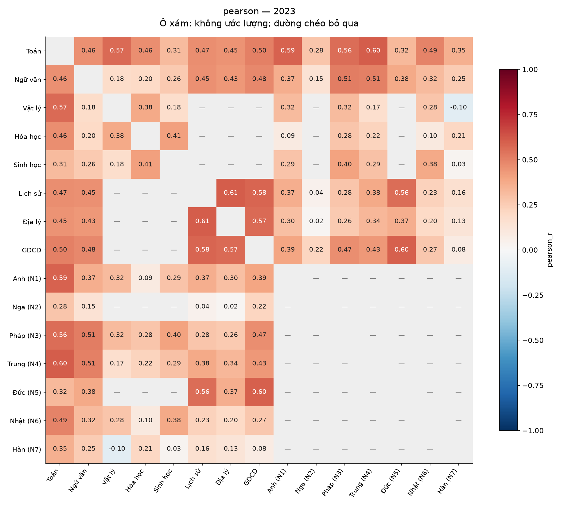
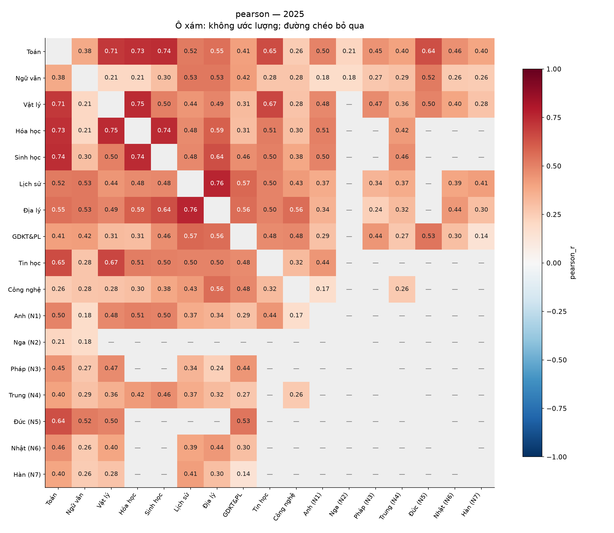
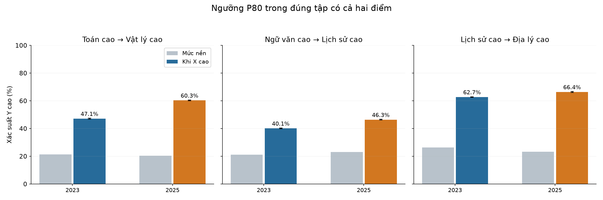
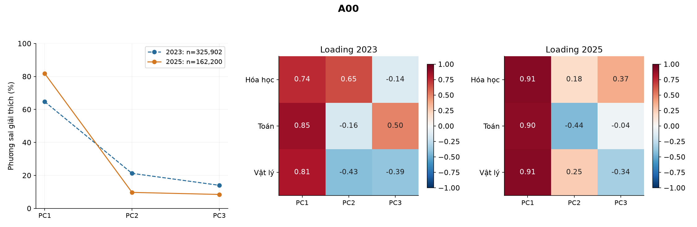

# Phần 4 — Tương quan và PCA (tóm tắt)

So sánh **2023 → 2025**: môn nào đi cùng nhau, cấu trúc liên hệ thay đổi ra sao và điểm ba môn trong mỗi khối tập trung quanh những trục nào. [Bản đầy đủ](phan_4_tuong_quan_pca_2023_2025.md) có mọi cặp môn, số mẫu, CI, ma trận Spearman và loading của mọi khối.

## 4.1. Những môn nào thường đi cùng nhau?

| Cặp môn | n đủ cặp 2023 → 2025 | Pearson r | Spearman rho |
| --- | --- | --- | --- |
| Lịch sử – Địa lý | 681.846 → 297.403 | 0,608 → 0,759 | 0,594 → 0,763 |
| Toán – Vật lý | 327.173 → 347.591 | 0,568 → 0,709 | 0,556 → 0,708 |
| Toán – Hóa học | 328.097 → 240.129 | 0,463 → 0,728 | 0,445 → 0,720 |
| Toán – Sinh học | 324.596 → 69.894 | 0,313 → 0,739 | 0,294 → 0,732 |
| Vật lý – Hóa học | 325.918 → 162.206 | 0,378 → 0,745 | 0,374 → 0,750 |
| Hóa học – Sinh học | 324.571 → 44.964 | 0,407 → 0,743 | 0,390 → 0,745 |
| Ngữ văn – Lịch sử | 683.263 → 481.156 | 0,453 → 0,527 | 0,441 → 0,521 |
| Toán – Tiếng Anh (N1) | 875.554 → 351.679 | 0,592 → 0,497 | 0,607 → 0,496 |

**Diễn giải bảng:** Pearson r đo liên hệ tuyến tính; Spearman rho đo liên hệ thứ hạng. Hai hệ số nằm trong [−1; 1], càng gần 1 càng đồng biến mạnh. r=0,7 không có nghĩa 70% học sinh giỏi cả hai môn. Mỗi cặp chỉ dùng người có đủ đúng hai điểm; không cộng các số n thành tổng người.

**Nhận xét:** Sử–Địa là cặp mạnh nhất trong mọi môn đủ tiêu chí xếp hạng n≥100: **r=0,608 → 0,759**. Toán–Lý tăng **0,568 → 0,709**; Văn–Sử tăng **0,453 → 0,527**. Các cặp tự nhiên tăng rõ hơn, như Toán–Sinh **0,313 → 0,739**, Hóa–Lý **0,378 → 0,745**. Chiều ngược lại, Toán–Anh giảm **0,592 → 0,497**. Không phải mọi liên hệ đều tăng.

**Diễn giải hình:** Mỗi ô là r của người có đủ hai điểm năm 2023. Màu đỏ đậm hơn biểu thị đồng biến mạnh hơn. Ô xám là không ước lượng được; các mã ngoại ngữ không đồng quan sát không được thay bằng tương quan 0. Ngoại ngữ đã tách N1–N7, Tiếng Anh không bị tính hai lần.

**Diễn giải hình:** Dùng cùng thang màu với 2023 để so sánh. Nhiều cặp tự nhiên có r cao hơn; Tin học và Công nghệ được giữ như môn riêng. Một số cặp có ít người nên không được ước lượng hoặc không vào xếp hạng chính. Số n chính xác và ma trận n xem ở bản đầy đủ.

**Giới hạn khi so hai năm:** Có **105 cặp năm 2023**, **136 cặp năm 2025**, tương ứng **69** và **88** cặp đủ điều kiện ước lượng. Có **48 cặp** so được cả hai năm. Các cặp dùng những nhóm thí sinh khác nhau; năm 2025 thay đổi cách chọn môn. Vì vậy r tăng chỉ mô tả nhóm có điểm, chưa chứng minh đề hay chương trình tạo ra sự liên kết kiến thức tốt hơn. Các cặp n<30 không báo hệ số; 30≤n<100 có cờ mẫu nhỏ và không xếp hạng chính.

## 4.2. Giỏi Toán có thường giỏi Lý không?

Định nghĩa **cao** là đạt từ P80 trở lên trong đúng tập có cả hai điểm, mỗi năm tính ngưỡng riêng. P80 là ngưỡng vào khoảng 20% cao nhất; đồng điểm có thể làm nhóm này lớn hơn 20%.

| X cao → Y cao | n X cao 2023 → 2025 | Nền Y cao (%) | Y cao khi X cao (%) | CI điều kiện 2025 (%) |
| --- | --- | --- | --- | --- |
| Toán → Vật lý | 80.963 → 70.919 | 21,32 → 20,35 | 47,13 → 60,29 | 59,93–60,65 |
| Ngữ văn → Lịch sử | 173.525 → 119.627 | 21,19 → 23,03 | 40,11 → 46,34 | 46,06–46,63 |
| Lịch sử → Địa lý | 144.142 → 67.653 | 26,35 → 23,34 | 62,72 → 66,38 | 66,02–66,73 |

**Diễn giải bảng:** Các mũi tên đều là 2023 → 2025. “Nền” là tỷ lệ Y cao trong toàn bộ tập đủ cặp; “khi X cao” chỉ chia cho số người X cao ở cột n. CI Wilson 95% ở cột cuối áp dụng cho xác suất có điều kiện năm 2025. Ngưỡng theo từng năm không phải cùng mức điểm tuyệt đối.

**Diễn giải hình:** Cột xám là mức nền; xanh là 2023 và cam là 2025 khi X cao. Năm 2025, Lý cao từ nền 20,35% lên 60,29% ở nhóm Toán cao, gấp khoảng 2,96 lần. Văn cao đi cùng Sử cao ở 46,34%, so với nền 23,03%. Sử cao đi cùng Địa cao ở 66,38%. Đây là liên hệ quan sát, không có nghĩa học tốt X gây ra điểm Y cao.

## 4.3. PCA: điểm các môn quy về những trục nào?

**PCA** tìm các tổ hợp tuyến tính của điểm chuẩn hóa. **PC1** là trục giữ nhiều biến thiên nhất; **EVR** là phần trăm phương sai được trục giải thích. Mỗi môn được chuẩn hóa riêng trong từng khối/năm để tránh môn có SD lớn lấn át. Không có người đủ cả 8 môn chung ở hai năm, nên PCA thực hiện **trên nhóm đủ ba điểm của từng khối**, không điền thiếu để ép thành một ma trận mọi môn.

| Khối | n đủ ba môn 2023 → 2025 | PC1 giải thích (%) 2023 → 2025 |
| --- | --- | --- |
| A00 | 325.902 → 162.200 | 64,731 → 81,807 |
| A01 | 314.412 → 146.960 | 61,976 → 70,353 |
| A02 | 322.538 → 4.795 | 57,638 → 68,132 |
| A08* | 564.507 → 68.313 | 67,033 → 64,416 |
| A09* | 564.517 → 109.404 | 66,308 → 64,624 |
| B00 | 324.554 → 44.964 | 59,644 → 82,742 |
| B08/D08 | 313.063 → 4.227 | 55,338 → 67,348 |
| C00 | 681.723 → 297.377 | 66,681 → 74,586 |
| C01 | 320.523 → 345.014 | 56,271 → 60,933 |
| C02 | 320.465 → 237.064 | 53,612 → 61,022 |
| C03 | 669.692 → 476.660 | 66,489 → 67,082 |
| C04 | 668.369 → 472.025 | 65,499 → 67,641 |
| C14* | 564.516 → 246.298 | 66,911 → 61,867 |
| C19* | 565.211 → 68.351 | 66,434 → 64,691 |
| C20* | 565.249 → 109.423 | 65,617 → 63,395 |
| D01 | 873.126 → 350.654 | 63,543 → 54,127 |
| D07 | 313.538 → 24.478 | 54,780 → 70,655 |
| D09 | 557.198 → 69.904 | 64,622 → 59,902 |
| D10 | 557.086 → 53.567 | 62,975 → 59,845 |
| D14 | 557.405 → 69.989 | 61,506 → 56,207 |
| D15 | 557.312 → 53.592 | 59,681 → 53,677 |
| D66* | 556.185 → 47.905 | 63,372 → 51,663 |
| D84* | 556.034 → 47.902 | 66,793 → 57,095 |

**Diễn giải bảng:** Đủ **24 mã khối**, tương ứng **23 bộ môn × 2 năm = 46 PCA**; B08/D08 chung một mô hình mỗi năm. Dấu * là bảy khối đổi GDCD sang GDKT&PL: hai PCA mô tả riêng, không so loading như cùng nội dung. EVR cao nghĩa điểm trong chính nhóm đó tập trung quanh ít trục hơn, không phải “thí sinh có năng lực cao hơn”.

**Nhận xét:** PC1 của A00 tăng khoảng **64,73% → 81,81%**, B00 **59,64% → 82,74%**, C00 **66,68% → 74,59%**. Trong các nhóm này, một trục thành tích cùng tăng tóm tắt được nhiều biến thiên hơn ở năm 2025. D01 đi chiều ngược lại: **63,54% → 54,13%**, nên một trục riêng lẻ tóm tắt kém hơn. Đây là mô tả các nhóm thi khác nhau, không là đánh giá năng lực chung của cả khóa.

### Ví dụ đọc PCA A00

**Diễn giải hình:** Trái là tỷ lệ phương sai do PC1/PC2/PC3 giải thích; giữa và phải là loading từng môn của hai năm. PC1 năm 2025 giải thích 81,81%, so với 64,73% năm 2023. Cả ba môn gắn dương với PC1 nên có thể gọi đây là trục thành tích cùng tăng trong A00; không tự gắn nhãn năng lực bẩm sinh hay IQ.

| Môn trong A00 năm 2025 | Loading PC1 | Loading PC2 |
| --- | --- | --- |
| Hóa học | 0,910 | 0,181 |
| Toán | 0,897 | -0,441 |
| Vật lý | 0,907 | 0,254 |

**Diễn giải bảng:** Loading là tương quan môn với PC trên đúng tập chuẩn hóa, khác hệ số dùng để tính điểm PC. Cả Toán, Lý, Hóa có loading PC1 gần 0,9. PC2 đặt Toán ở phía âm, Lý/Hóa phía dương: đó là tương phản điểm tương đối sau chuẩn hóa, không phải Toán tốt khiến Lý/Hóa kém. Đảo dấu toàn một PC không làm thay đổi mô hình.

## 4.4. Ý nghĩa đối với độ phân hóa của đề

Kết quả cho thấy người đạt cao ở một số môn thường đạt cao ở môn liên quan, nổi bật Sử–Địa và các cặp tự nhiên. PCA giúp tóm tắt cấu trúc đồng biến hoặc tương phản trong từng khối. **Tương quan, SD và PCA của tổng điểm chưa đo trực tiếp độ phân biệt câu hỏi**; muốn đánh giá chất lượng phân hóa đề cần dữ liệu từng câu và phương pháp đo lường phù hợp.

**Nguồn:** r/rho, xác suất điểm cao và 46 PCA đều rút từ [báo cáo phần 4 đầy đủ](phan_4_tuong_quan_pca_2023_2025.md). Các hình dùng lại thư mục hiện có. Những ngôn ngữ và môn không có mã khối trong nguồn vẫn có phân tích từng môn; không tự tạo thêm mã tuyển sinh.
