# Phần 4 — Tương quan giữa các môn và PCA tổ hợp THPT 2023–2025

**2023 — CT2006** so với **2025 — CT2018**. Mỗi hệ số dùng người có đủ cả hai điểm. Không điền thiếu, không tạo mẫu thi đủ mọi môn. Ngoại ngữ tách N1–N7, GDCD và GDKT&PL giữ riêng.

## Kết quả chính — đọc phần này trước

- **2023:** cặp mạnh nhất trong mọi môn được xếp hạng (n ≥ 100) là Địa lý–Lịch sử, r=0,608, n=681.846. Trong riêng 8 môn chung để đối chiếu Duy, cặp cao nhất là Địa lý–Lịch sử, r=0,608.

- **2025:** cặp mạnh nhất trong mọi môn được xếp hạng (n ≥ 100) là Địa lý–Lịch sử, r=0,759, n=297.403. Trong riêng 8 môn chung để đối chiếu Duy, cặp cao nhất là Địa lý–Lịch sử, r=0,759.

## 4.1. Cách đọc r, rho, ma trận và số mẫu

**Pearson r** đo liên hệ tuyến tính trong [−1,1]; dương là xu hướng cùng tăng, âm là ngược chiều. r=0,7 không nghĩa 70% học sinh giỏi cả hai môn; r gần0 cũng không loại mọi quan hệ phi tuyến. **Spearman rho** đo liên hệ thứ hạng/đơn điệu, được rank lại sau khi lọc đúng cặp.

**n_pair** là người có đủ cả hai điểm, không phải số người cả năm. Một người có thể thuộc nhiều cặp; không cộng n các cặp thành số người. Các cặp Ngoại ngữ khác mã thường không có điểm đồng thời; ô trống là không ước lượng được, không phải r=0. Đường chéo tự tương quan được bỏ qua để tập trung cặp khác môn.

**Chính sách mẫu:** n < 30 hoặc một biến hằng thì không báo r/rho; 30≤n<100 có cờ mẫu nhỏ, không xếp hạng chính. Mốc100 đồng bộ tiêu chí chất lượng của phần 3, không là định luật thống kê. CI Fisher là xấp xỉ, không loại được sai lệch chọn mẫu.

## 4.2. Ma trận mỗi năm — mọi môn có điểm

### 4.2.1. Năm 2023

| Tổng cặp | Ước lượng được | Không người đủ cặp | Có mẫu nhưng n < 30 |
| --- | --- | --- | --- |
| 105 | 69 | 30 | 6 |

**Diễn giải bảng:** Tổng cặp là mọi cặp môn/ngôn ngữ trong năm đó, kể cả cặp không thể ước lượng. Thiếu theo cấu trúc thi không được lấp bằng 0 để tạo ma trận đầy.

**Diễn giải hình:** Số trong ô là Pearson r; thang màu chung −1 đến1, ô xám không có ước lượng. Đọc cùng heatmap n phía dưới; không so độ đậm mà bỏ qua khác biệt tập mẫu.

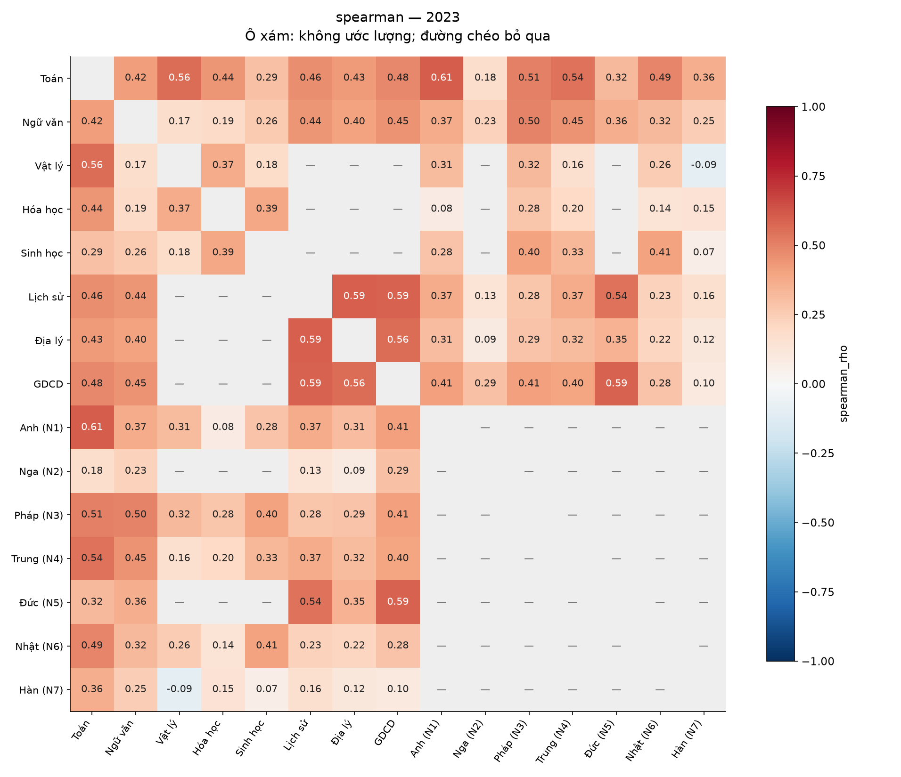

**Diễn giải hình:** Spearman đối chiếu theo thứ hạng. Khi r và rho khác nhiều, cần xem hình cặp điểm, các điểm tập trung và quan hệ phi tuyến; không chọn chỉ hệ số lớn hơn để kết luận.

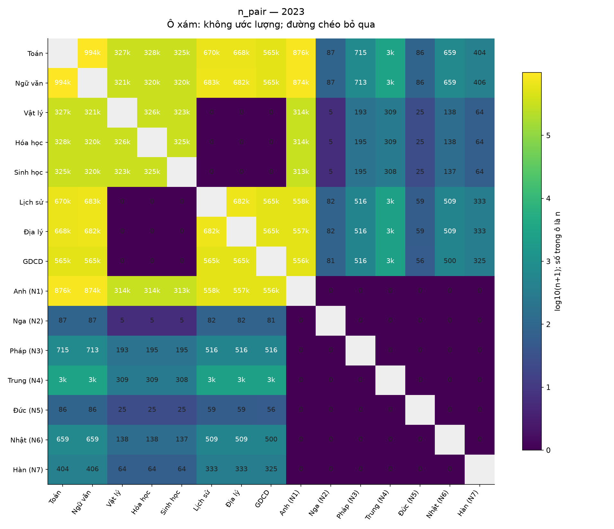

**Diễn giải hình:** Số trong ô là n (k=nghìn, làm tròn để đọc); màu dùng log10(n+1) để thấy cả mẫu nhỏ/lớn. Bảng phụ lục giữ số đếm chính xác. n=0 ở cặp không đồng quan sát không có nghĩa tương quan bằng0.

### 4.2.2. Năm 2025

| Tổng cặp | Ước lượng được | Không người đủ cặp | Có mẫu nhưng n < 30 |
| --- | --- | --- | --- |
| 136 | 88 | 24 | 24 |

**Diễn giải bảng:** Tổng cặp là mọi cặp môn/ngôn ngữ trong năm đó, kể cả cặp không thể ước lượng. Thiếu theo cấu trúc thi không được lấp bằng 0 để tạo ma trận đầy.

**Diễn giải hình:** Số trong ô là Pearson r; thang màu chung −1 đến1, ô xám không có ước lượng. Đọc cùng heatmap n phía dưới; không so độ đậm mà bỏ qua khác biệt tập mẫu.

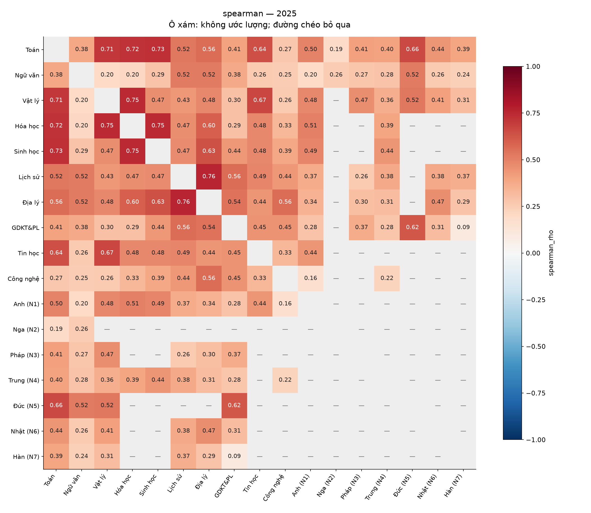

**Diễn giải hình:** Spearman đối chiếu theo thứ hạng. Khi r và rho khác nhiều, cần xem hình cặp điểm, các điểm tập trung và quan hệ phi tuyến; không chọn chỉ hệ số lớn hơn để kết luận.

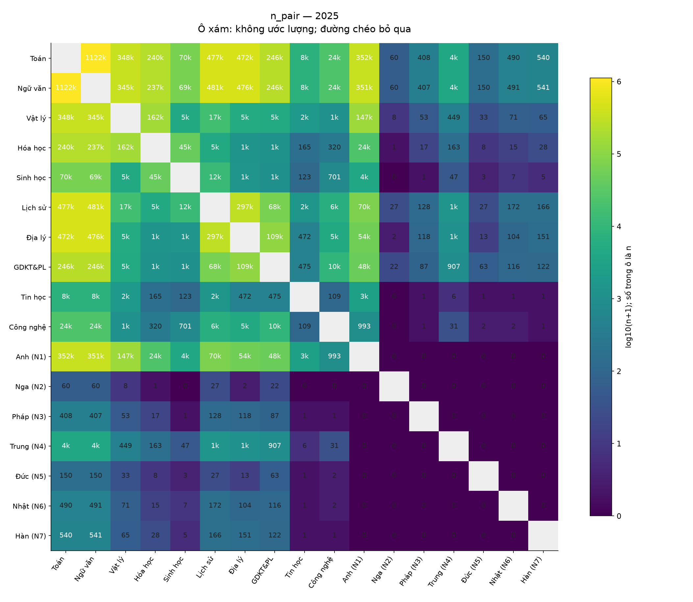

**Diễn giải hình:** Số trong ô là n (k=nghìn, làm tròn để đọc); màu dùng log10(n+1) để thấy cả mẫu nhỏ/lớn. Bảng phụ lục giữ số đếm chính xác. n=0 ở cặp không đồng quan sát không có nghĩa tương quan bằng0.

## 4.3. Cặp môn nào đi cùng nhau nhất?

| Năm | Môn X | Môn Y | n cặp | Pearson r | Spearman rho |
| --- | --- | --- | --- | --- | --- |
| 2023 | Địa lý | Lịch sử | 681.846 | 0,608 | 0,594 |
| 2023 | Tiếng Trung (N4) | Toán | 2.934 | 0,605 | 0,545 |
| 2023 | Tiếng Anh (N1) | Toán | 875.554 | 0,592 | 0,607 |
| 2023 | GDCD | Lịch sử | 565.289 | 0,580 | 0,592 |
| 2023 | Toán | Vật lý | 327.173 | 0,568 | 0,556 |
| 2023 | GDCD | Địa lý | 565.328 | 0,567 | 0,560 |
| 2023 | Tiếng Pháp (N3) | Toán | 715 | 0,556 | 0,508 |
| 2023 | Tiếng Pháp (N3) | Ngữ văn | 713 | 0,510 | 0,496 |
| 2023 | Tiếng Trung (N4) | Ngữ văn | 2.938 | 0,507 | 0,447 |
| 2023 | GDCD | Toán | 564.584 | 0,502 | 0,480 |
| 2025 | Địa lý | Lịch sử | 297.403 | 0,759 | 0,763 |
| 2025 | Hóa học | Vật lý | 162.206 | 0,745 | 0,750 |
| 2025 | Sinh học | Hóa học | 44.964 | 0,743 | 0,745 |
| 2025 | Sinh học | Toán | 69.894 | 0,739 | 0,732 |
| 2025 | Hóa học | Toán | 240.129 | 0,728 | 0,720 |
| 2025 | Toán | Vật lý | 347.591 | 0,709 | 0,708 |
| 2025 | Tin học | Vật lý | 1.733 | 0,668 | 0,665 |
| 2025 | Tin học | Toán | 7.601 | 0,652 | 0,643 |
| 2025 | Tiếng Đức (N5) | Toán | 150 | 0,644 | 0,660 |
| 2025 | Sinh học | Địa lý | 1.442 | 0,641 | 0,635 |

**Diễn giải bảng:** Xếp hạng dương theo Pearson trong tập n ≥ 100, không là bảng chất lượng môn học. Nên đọc rho và n cùng r; các ngôn ngữ/nhóm ít người có thành phần chọn mẫu riêng. Đây không phải quan hệ nhân quả. Bảng đầy đủ tất cả cặp ở cuối báo cáo.

## 4.4. Cấu trúc tương quan thay đổi ra sao?

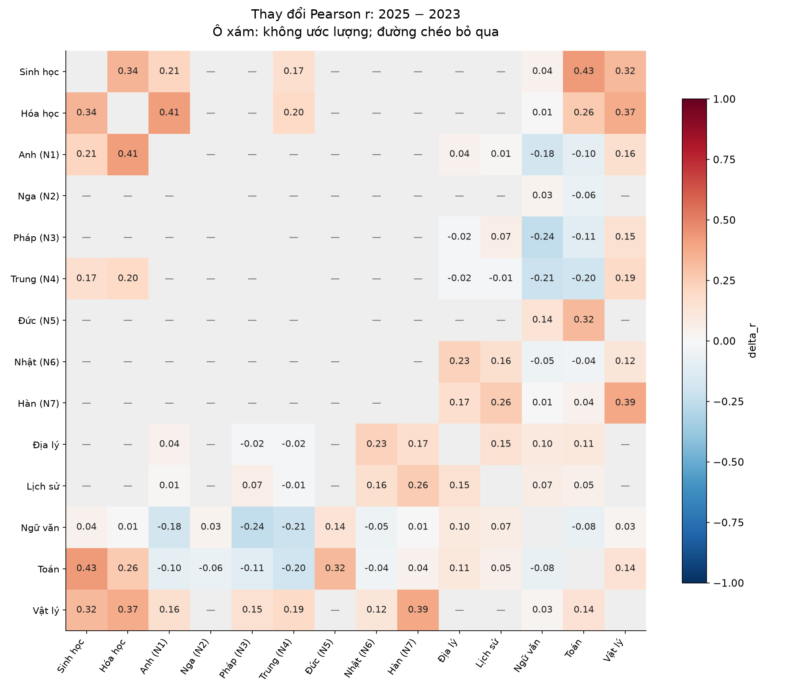

**Diễn giải hình:** Dương nghĩa r2025 cao hơn r2023 trong hai tập cặp tương ứng; âm là thấp hơn. Ô xám gồm cặp thiếu ở một năm hoặc không đủ mẫu, không phải delta0. Môn chỉ một năm không bị tạo một r giả ở năm còn lại.

| Môn X | Môn Y | n2023 | n2025 | r2023 | r2025 | Δr | Δrho |
| --- | --- | --- | --- | --- | --- | --- | --- |
| Sinh học | Toán | 324.596 | 69.894 | 0,313 | 0,739 | 0,426 | 0,437 |
| Hóa học | Tiếng Anh (N1) | 313.552 | 24.478 | 0,091 | 0,506 | 0,415 | 0,424 |
| Hóa học | Vật lý | 325.918 | 162.206 | 0,378 | 0,745 | 0,368 | 0,376 |
| Sinh học | Hóa học | 324.571 | 44.964 | 0,407 | 0,743 | 0,336 | 0,355 |
| Sinh học | Vật lý | 322.553 | 4.795 | 0,176 | 0,501 | 0,325 | 0,282 |
| Hóa học | Toán | 328.097 | 240.129 | 0,463 | 0,728 | 0,265 | 0,276 |
| Tiếng Hàn (N7) | Lịch sử | 333 | 166 | 0,159 | 0,414 | 0,255 | 0,208 |
| Tiếng Pháp (N3) | Ngữ văn | 713 | 407 | 0,510 | 0,268 | -0,242 | -0,222 |
| Tiếng Nhật (N6) | Địa lý | 509 | 104 | 0,203 | 0,437 | 0,234 | 0,248 |
| Tiếng Trung (N4) | Ngữ văn | 2.938 | 4.224 | 0,507 | 0,294 | -0,213 | -0,164 |
| Sinh học | Tiếng Anh (N1) | 313.081 | 4.228 | 0,286 | 0,497 | 0,211 | 0,208 |
| Tiếng Trung (N4) | Toán | 2.934 | 4.225 | 0,605 | 0,404 | -0,201 | -0,140 |
| Hóa học | Tiếng Trung (N4) | 309 | 163 | 0,223 | 0,423 | 0,200 | 0,191 |
| Tiếng Trung (N4) | Vật lý | 309 | 449 | 0,167 | 0,357 | 0,191 | 0,200 |
| Tiếng Anh (N1) | Ngữ văn | 873.568 | 350.821 | 0,366 | 0,184 | -0,182 | -0,170 |

**Diễn giải bảng:** Xếp hạng chính chỉ lấy cặp có n ≥ 100 ở cả hai năm. Đây là thay đổi lớn nhất về trị tuyệt đối trong các cặp đủ tiêu chí này, không là phép so cùng người. Phụ lục đầy đủ vẫn giữ cặp 30≤n<100, có số mẫu và cờ mẫu nhỏ. Fisher z và q BH ở phụ lục; CI chênh z dùng thang z, không gọi là CI Δr. Ba cặp minh họa có thêm CI Δr bootstrap theo cùng dòng/cặp điểm, độc lập giữa hai năm.

**Ý nghĩa và giới hạn:** Cách chọn môn và quy mô các tập cặp khác nhau giữa 2023/2025. Vì vậy r tăng không tự chứng minh chương trình làm kiến thức gắn kết hơn. Không lấy trung bình mọi ô ma trận như một kiểm định cấu trúc toàn cục; các ô có thể dùng người khác nhau.

## 4.5. Toán cao có thường đạt Lý cao?

### 4.5.1. Toán → Vật lý

| Năm | n cặp | Ngưỡng X | Ngưỡng Y | n X cao | Nền Y cao (%) | Y cao khi X cao (%) | Lift | CI thấp (%) | CI cao (%) |
| --- | --- | --- | --- | --- | --- | --- | --- | --- | --- |
| 2023 | 327.173 | 8,20 | 8,00 | 80.963 | 21,32 | 47,13 | 2,21 | 46,78 | 47,47 |
| 2025 | 347.591 | 7,50 | 8,50 | 70.919 | 20,35 | 60,29 | 2,96 | 59,93 | 60,65 |

**Diễn giải bảng:** Cao là từ P80 trở lên trong đúng tập cặp, tính cả bằng ngưỡng. “Nền” dùng toàn tập cặp; xác suất có điều kiện chỉ chia cho n X cao; lift là tỷ số hai xác suất. Đồng hạng khiến nhóm cao có thể hơn 20%. CI Wilson coi ngưỡng thực nghiệm cố định, nên là xấp xỉ có điều kiện.

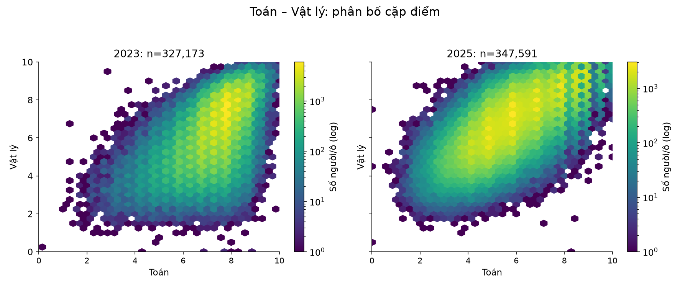

**Diễn giải hình:** Mỗi ô lục giác gom những người có cặp điểm gần nhau; màu theo số người/ô trên thang log. Cụm nghiêng lên phù hợp đồng biến; không hiểu đây là mật độ Gaussian hoặc tỷ lệ đạt cả hai môn.

**Nhận xét bằng số:** Năm2025, tỷ lệ Vật lý cao từ mức nền 20,35% lên 60,29% trong nhóm Toán cao, lift=2,96. Đây là đồng xuất hiện trong mẫu, không chứng minh giỏi X gây ra giỏi Y; ngưỡng riêng từng năm không là thang năng lực chung.

### 4.5.2. Ngữ văn → Lịch sử

| Năm | n cặp | Ngưỡng X | Ngưỡng Y | n X cao | Nền Y cao (%) | Y cao khi X cao (%) | Lift | CI thấp (%) | CI cao (%) |
| --- | --- | --- | --- | --- | --- | --- | --- | --- | --- |
| 2023 | 683.263 | 8,00 | 7,50 | 173.525 | 21,19 | 40,11 | 1,89 | 39,88 | 40,34 |
| 2025 | 481.156 | 8,00 | 8,00 | 119.627 | 23,03 | 46,34 | 2,01 | 46,06 | 46,63 |

**Diễn giải bảng:** Cao là từ P80 trở lên trong đúng tập cặp, tính cả bằng ngưỡng. “Nền” dùng toàn tập cặp; xác suất có điều kiện chỉ chia cho n X cao; lift là tỷ số hai xác suất. Đồng hạng khiến nhóm cao có thể hơn 20%. CI Wilson coi ngưỡng thực nghiệm cố định, nên là xấp xỉ có điều kiện.

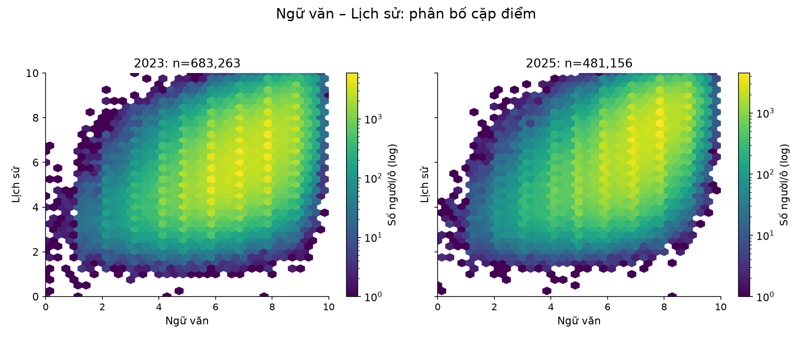

**Diễn giải hình:** Mỗi ô lục giác gom những người có cặp điểm gần nhau; màu theo số người/ô trên thang log. Cụm nghiêng lên phù hợp đồng biến; không hiểu đây là mật độ Gaussian hoặc tỷ lệ đạt cả hai môn.

**Nhận xét bằng số:** Năm2025, tỷ lệ Lịch sử cao từ mức nền 23,03% lên 46,34% trong nhóm Ngữ văn cao, lift=2,01. Đây là đồng xuất hiện trong mẫu, không chứng minh giỏi X gây ra giỏi Y; ngưỡng riêng từng năm không là thang năng lực chung.

### 4.5.3. Lịch sử → Địa lý

| Năm | n cặp | Ngưỡng X | Ngưỡng Y | n X cao | Nền Y cao (%) | Y cao khi X cao (%) | Lift | CI thấp (%) | CI cao (%) |
| --- | --- | --- | --- | --- | --- | --- | --- | --- | --- |
| 2023 | 681.846 | 7,50 | 7,00 | 144.142 | 26,35 | 62,72 | 2,38 | 62,47 | 62,97 |
| 2025 | 297.403 | 8,00 | 8,25 | 67.653 | 23,34 | 66,38 | 2,84 | 66,02 | 66,73 |

**Diễn giải bảng:** Cao là từ P80 trở lên trong đúng tập cặp, tính cả bằng ngưỡng. “Nền” dùng toàn tập cặp; xác suất có điều kiện chỉ chia cho n X cao; lift là tỷ số hai xác suất. Đồng hạng khiến nhóm cao có thể hơn 20%. CI Wilson coi ngưỡng thực nghiệm cố định, nên là xấp xỉ có điều kiện.

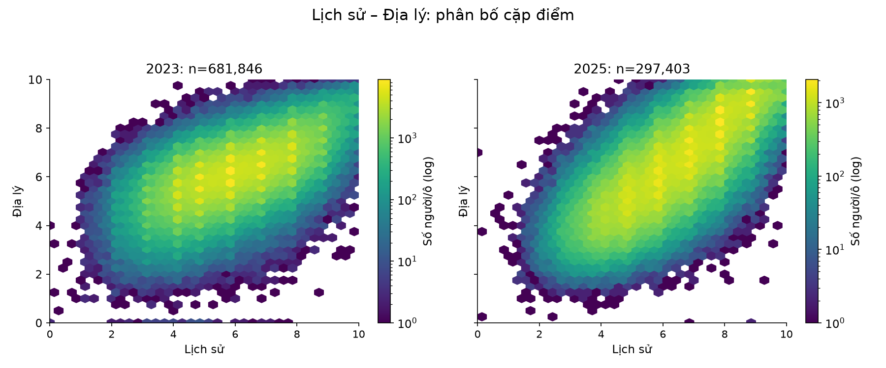

**Diễn giải hình:** Mỗi ô lục giác gom những người có cặp điểm gần nhau; màu theo số người/ô trên thang log. Cụm nghiêng lên phù hợp đồng biến; không hiểu đây là mật độ Gaussian hoặc tỷ lệ đạt cả hai môn.

**Nhận xét bằng số:** Năm2025, tỷ lệ Địa lý cao từ mức nền 23,34% lên 66,38% trong nhóm Lịch sử cao, lift=2,84. Đây là đồng xuất hiện trong mẫu, không chứng minh giỏi X gây ra giỏi Y; ngưỡng riêng từng năm không là thang năng lực chung.

**Diễn giải hình:** Cột xám là nền, cột màu là điều kiện X cao, thanh đen là CI Wilson. Các cặp đều được tính trong phụ lục đầy đủ, kể cả chiều ngược và sensitivity ngưỡng8 điểm; trang chính minh họa ba cặp để dễ đọc.

## 4.6. PCA mọi khối có điểm — sau tương quan từng môn

| Khối | Môn 2023 | Môn 2025 | n2023 | n2025 | Phạm vi |
| --- | --- | --- | --- | --- | --- |
| A00 | Toán + Vật lý + Hóa học | Toán + Vật lý + Hóa học | 325.902 | 162.200 | So được điểm quan sát |
| A01 | Toán + Vật lý + Tiếng Anh (N1) | Toán + Vật lý + Tiếng Anh (N1) | 314.412 | 146.960 | So được điểm quan sát |
| A02 | Toán + Vật lý + Sinh học | Toán + Vật lý + Sinh học | 322.538 | 4.795 | So được điểm quan sát |
| A08 | Toán + Lịch sử + GDCD | Toán + Lịch sử + GDKT&PL | 564.507 | 68.313 | Đổi môn: chỉ mô tả |
| A09 | Toán + Địa lý + GDCD | Toán + Địa lý + GDKT&PL | 564.517 | 109.404 | Đổi môn: chỉ mô tả |
| B00 | Toán + Hóa học + Sinh học | Toán + Hóa học + Sinh học | 324.554 | 44.964 | So được điểm quan sát |
| B08 | Toán + Sinh học + Tiếng Anh (N1) | Toán + Sinh học + Tiếng Anh (N1) | 313.063 | 4.227 | So được điểm quan sát |
| C00 | Ngữ văn + Lịch sử + Địa lý | Ngữ văn + Lịch sử + Địa lý | 681.723 | 297.377 | So được điểm quan sát |
| C01 | Ngữ văn + Toán + Vật lý | Ngữ văn + Toán + Vật lý | 320.523 | 345.014 | So được điểm quan sát |
| C02 | Ngữ văn + Toán + Hóa học | Ngữ văn + Toán + Hóa học | 320.465 | 237.064 | So được điểm quan sát |
| C03 | Ngữ văn + Toán + Lịch sử | Ngữ văn + Toán + Lịch sử | 669.692 | 476.660 | So được điểm quan sát |
| C04 | Ngữ văn + Toán + Địa lý | Ngữ văn + Toán + Địa lý | 668.369 | 472.025 | So được điểm quan sát |
| C14 | Ngữ văn + Toán + GDCD | Ngữ văn + Toán + GDKT&PL | 564.516 | 246.298 | Đổi môn: chỉ mô tả |
| C19 | Ngữ văn + Lịch sử + GDCD | Ngữ văn + Lịch sử + GDKT&PL | 565.211 | 68.351 | Đổi môn: chỉ mô tả |
| C20 | Ngữ văn + Địa lý + GDCD | Ngữ văn + Địa lý + GDKT&PL | 565.249 | 109.423 | Đổi môn: chỉ mô tả |
| D01 | Toán + Ngữ văn + Tiếng Anh (N1) | Toán + Ngữ văn + Tiếng Anh (N1) | 873.126 | 350.654 | So được điểm quan sát |
| D07 | Toán + Hóa học + Tiếng Anh (N1) | Toán + Hóa học + Tiếng Anh (N1) | 313.538 | 24.478 | So được điểm quan sát |
| D08 | Toán + Sinh học + Tiếng Anh (N1) | Toán + Sinh học + Tiếng Anh (N1) | 313.063 | 4.227 | Dùng chung B08 |
| D09 | Toán + Lịch sử + Tiếng Anh (N1) | Toán + Lịch sử + Tiếng Anh (N1) | 557.198 | 69.904 | So được điểm quan sát |
| D10 | Toán + Địa lý + Tiếng Anh (N1) | Toán + Địa lý + Tiếng Anh (N1) | 557.086 | 53.567 | So được điểm quan sát |
| D14 | Ngữ văn + Lịch sử + Tiếng Anh (N1) | Ngữ văn + Lịch sử + Tiếng Anh (N1) | 557.405 | 69.989 | So được điểm quan sát |
| D15 | Ngữ văn + Địa lý + Tiếng Anh (N1) | Ngữ văn + Địa lý + Tiếng Anh (N1) | 557.312 | 53.592 | So được điểm quan sát |
| D66 | Ngữ văn + GDCD + Tiếng Anh (N1) | Ngữ văn + GDKT&PL + Tiếng Anh (N1) | 556.185 | 47.905 | Đổi môn: chỉ mô tả |
| D84 | Toán + GDCD + Tiếng Anh (N1) | Toán + GDKT&PL + Tiếng Anh (N1) | 556.034 | 47.902 | Đổi môn: chỉ mô tả |

**Diễn giải bảng:** Đủ 24 mã có điểm trong nguồn; B08/D08 cùng Toán–Sinh–Anh nên chỉ tính một bộ. Bảy khối A08/A09/C14/C19/C20/D66/D84 đổi GDCD sang GDKT&PL: PCA riêng từng năm và mô tả điểm, không đưa vào family kiểm định chính liên năm. N1 là Tiếng Anh; đây là các mã nguồn có sẵn, không là mọi tổ hợp ba môn có thể tưởng tượng. Tin học/Công nghệ và N2–N7 đã phân tích ở từng môn nhưng chưa có mã khối tương ứng trong nguồn. Tổng n của các khối không phải số người vì một người có thể thuộc nhiều khối.

| Bất đồng | data/danh_muc_to_hop.csv cũ | Quy tắc thực dùng |
| --- | --- | --- |
| D04 trong danh mục | Toán–Văn–Hóa | Nguồn dùng C02; không tạo khối D04 mới |
| D09/D10 | Danh mục ghi D09 là Toán–Địa–Ngoại ngữ | Nguồn: D09=Toán–Sử–N1; D10=Toán–Địa–N1 |
| D96/D84 | Danh mục ghi D96 là Toán–GDCD–Ngoại ngữ | Nguồn có D84; 2023 dùng GDCD,2025 dùng GDKT&PL |
| A01/D90; B08/D99 | Ghi chú danh mục coi là alias | Không sử dụng các alias này; chỉ B08/D08 cùng bộ trong nguồn |
| Ngoại ngữ | Danh mục ghi chung, không chỉ mã | Tổng đã lưu khớp Tiếng Anh N1; không gộp N2–N7 |

**Diễn giải bảng:** Đây là bất đồng đã biết giữa danh mục cũ và các cột diem_* trong tệp điểm, việc tổng đã lưu khớp không có nghĩa mọi tài liệu đều thống nhất. Ưu tiên mapping đã kiểm chứng bằng tổng ba môn và số mẫu phần 3; không sửa danh mục gốc, không tự thêm/đổi mã theo ghi chú cũ. Phạm vi24 mã là theo bộ dữ liệu này, không là xác nhận danh mục tuyển sinh chính thức.

**Vì sao không PCA một ma trận mọi môn?** Không có người đủ cả 8 môn chung ở hai năm. Điền thiếu sẽ tạo tương quan phụ thuộc mô hình điền; vì vậy tương quan mọi môn dùng pairwise ở trên, còn PCA dùng người đủ ba môn trong từng khối. Bao phủ23 bộ ×2 năm =46 mô hình (24 nhãn ×2 =48 dòng tra cứu).

**PCA là gì?** PCA tìm các trục tổ hợp tuyến tính không tương quan của điểm chuẩn hóa. Trong từng năm/khối, z=(điểm−mean)/SD mẫu (ddof=1); không ghép hai năm để chuẩn hóa. SVD của z cho eigenvalue λ=s²/(n−1), EVR=λ/Σλ. Ba EVR cộng100%; PC1 giữ nhiều biến thiên nhất, không là tổng điểm thi, không phải điểm IQ hay bằng chứng về một năng lực bẩm sinh.

**Loading khác hệ số tính PC:** PC=z×v (v là eigenvector đơn vị); loading=v√λ là tương quan môn với PC trên chính tập chuẩn hóa. Ví dụ loading0,8 là tương quan0,8, không là “môn đóng góp80%”. Bình phương loading là phần phương sai của môn gắn với PC đó trong mô hình PCA. Dấu toàn bộ một PC có thể đảo mà kết quả không đổi; PC1 căn dương theo Toán hoặc Văn, PC2/3 căn theo2023 khi hai năm cùng bộ môn.

**Đọc các trục:** PC1 có loading dương tương tự cả ba môn thường là trục thành tích cùng tăng trong khối; loading trái dấu ở PC2/3 mô tả tương phản tương đối giữa các môn sau chuẩn hóa. Chỉ gọi là trục quan sát; muốn gắn nhãn “năng lực ngôn ngữ/tư duy” cần lý thuyết và kiểm chứng đo lường độc lập. Ba môn và mẫu tự chọn không đủ xác nhận cấu trúc năng lực chung.

| Năm | Khối chuẩn | n đủ 3 | PC1 (%) | PC2 (%) | PC3 (%) |
| --- | --- | --- | --- | --- | --- |
| 2023 | A00 | 325.902 | 64,731 | 21,260 | 14,009 |
| 2023 | A01 | 314.412 | 61,976 | 23,847 | 14,176 |
| 2023 | A02 | 322.538 | 57,638 | 28,472 | 13,890 |
| 2023 | A08 | 564.507 | 67,033 | 19,437 | 13,530 |
| 2023 | A09 | 564.517 | 66,308 | 19,943 | 13,749 |
| 2023 | B00 | 324.554 | 59,644 | 23,063 | 17,293 |
| 2023 | B08 | 313.063 | 55,338 | 24,392 | 20,271 |
| 2023 | C00 | 681.723 | 66,681 | 20,284 | 13,036 |
| 2023 | C01 | 320.523 | 56,271 | 29,387 | 14,341 |
| 2023 | C02 | 320.465 | 53,612 | 28,379 | 18,009 |
| 2023 | C03 | 669.692 | 66,489 | 19,046 | 14,465 |
| 2023 | C04 | 668.369 | 65,499 | 20,032 | 14,469 |
| 2023 | C14 | 564.516 | 66,911 | 17,463 | 15,626 |
| 2023 | C19 | 565.211 | 66,434 | 19,768 | 13,798 |
| 2023 | C20 | 565.249 | 65,617 | 20,363 | 14,021 |
| 2023 | D01 | 873.126 | 63,543 | 22,859 | 13,597 |
| 2023 | D07 | 313.538 | 54,780 | 30,326 | 14,893 |
| 2023 | D09 | 557.198 | 64,622 | 22,337 | 13,042 |
| 2023 | D10 | 557.086 | 62,975 | 24,254 | 12,772 |
| 2023 | D14 | 557.405 | 61,506 | 21,368 | 17,126 |
| 2023 | D15 | 557.312 | 59,681 | 23,499 | 16,821 |
| 2023 | D66 | 556.185 | 63,372 | 20,216 | 16,412 |
| 2023 | D84 | 556.034 | 66,793 | 20,636 | 12,571 |
| 2025 | A00 | 162.200 | 81,807 | 9,722 | 8,471 |
| 2025 | A01 | 146.960 | 70,353 | 18,481 | 11,167 |
| 2025 | A02 | 4.795 | 68,132 | 17,502 | 14,366 |
| 2025 | A08 | 68.313 | 64,416 | 21,699 | 13,886 |
| 2025 | A09 | 109.404 | 64,624 | 21,646 | 13,730 |
| 2025 | B00 | 44.964 | 82,742 | 9,864 | 7,394 |
| 2025 | B08 | 4.227 | 67,348 | 17,200 | 15,452 |
| 2025 | C00 | 297.377 | 74,586 | 17,388 | 8,027 |
| 2025 | C01 | 345.014 | 60,933 | 29,394 | 9,673 |
| 2025 | C02 | 237.064 | 61,022 | 29,940 | 9,039 |
| 2025 | C03 | 476.660 | 67,082 | 17,559 | 15,358 |
| 2025 | C04 | 472.025 | 67,641 | 18,096 | 14,263 |
| 2025 | C14 | 246.298 | 61,867 | 19,965 | 18,168 |
| 2025 | C19 | 68.351 | 64,691 | 21,129 | 14,180 |
| 2025 | C20 | 109.423 | 63,395 | 21,925 | 14,680 |
| 2025 | D01 | 350.654 | 54,127 | 29,144 | 16,729 |
| 2025 | D07 | 24.478 | 70,655 | 17,616 | 11,729 |
| 2025 | D09 | 69.904 | 59,902 | 21,516 | 18,582 |
| 2025 | D10 | 53.567 | 59,845 | 21,915 | 18,239 |
| 2025 | D14 | 69.989 | 56,207 | 23,168 | 20,624 |
| 2025 | D15 | 53.592 | 53,677 | 24,485 | 21,838 |
| 2025 | D66 | 47.905 | 51,663 | 24,840 | 23,497 |
| 2025 | D84 | 47.902 | 57,095 | 24,828 | 18,077 |

**Diễn giải bảng:** Có46 mô hình thực, mỗi dòng đúng tập người đủ ba điểm. Alias D08 tra B08. EVR cao nghĩa điểm tập trung quanh ít trục hơn trong chính mẫu khối/năm, không tự chứng minh năng lực đồng đều hơn hay đề tốt hơn. Các bộ đổi môn không so loading trực tiếp.

### 4.6.1. B00

| Năm | n đủ 3 | Tỷ lệ đủ 3 trên mọi dòng | PC1 (%) | PC2 (%) | PC3 (%) |
| --- | --- | --- | --- | --- | --- |
| 2023 | 324.554 | 0,318 | 59,644 | 23,063 | 17,293 |
| 2025 | 44.964 | 0,040 | 82,742 | 9,864 | 7,394 |

**Diễn giải bảng:** Tỷ lệ là n đủ ba điểm chia số dòng nguồn cùng năm, không là tỷ lệ đăng ký/nguyện vọng. Mỗi năm chuẩn hóa riêng; dùng EVR để mô tả hình dạng biến thiên của chính nhóm đó.

| Năm | Môn | Loading PC1 | Loading PC2 | Loading PC3 |
| --- | --- | --- | --- | --- |
| 2023 | Sinh học | 0,727 | 0,651 | -0,218 |
| 2023 | Hóa học | 0,821 | -0,104 | 0,562 |
| 2023 | Toán | 0,766 | -0,507 | -0,395 |
| 2025 | Sinh học | 0,897 | 0,427 | -0,114 |
| 2025 | Hóa học | 0,923 | -0,099 | 0,372 |
| 2025 | Toán | 0,909 | -0,322 | -0,265 |

**Diễn giải bảng:** Giá trị tuyệt đối gần1 là môn gắn chặt với PC; dấu cùng chiều cho biết xu hướng cùng tăng theo trục. So độ lớn và mô hình dấu chung; không diễn giải một đảo dấu toàn PC thành đổi bản chất môn.

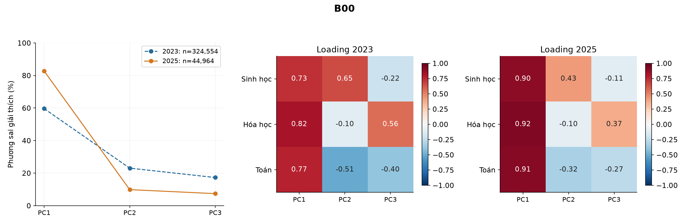

**Diễn giải hình:** Trái là scree/EVR của ba PC và n thực; giữa/phải là loading cùng thang −1..1. Tổng EVR bằng100%. Hai màu đường là hai năm, không là cùng người.

**Nhận xét bằng số:** PC1 giải thích 59,64% năm 2023 và 82,74% năm 2025; PC1+PC2 năm 2025 là 92,61%. Môn gắn mạnh nhất với PC1 năm 2025 theo |loading| là Hóa học (0,923). Trục này mô tả thành tích đồng biến/tương phản trong đúng ba môn đã chọn, không quy đổi được thành chênh năng lực tuyệt đối.

**Giải nghĩa trục bằng chính loading:** Năm2025, cả ba loading PC1 cùng dương, nên PC1 là trục thành tích cùng tăng trong khối này. PC2 đặt Sinh học (loading 0,427) ở một phía và Toán (-0,322) ở phía kia. Đây là tương phản sau chuẩn hóa: điểm nghiêng về môn phía dương so với phía âm làm PC2 tăng; không phải một môn gây giảm môn kia hoặc một “năng lực thứ hai” đã được xác nhận.

**Ổn định cấu trúc:** |cosine| PC1=0,999 (gần1 là cùng hướng sau căn dấu); góc lớn nhất giữa hai không gian PC1–PC2=3,61°. Không phát hiện cặp eigenvalues liền kề cách nhau dưới5% theo quy tắc kiểm tra này; vẫn chưa là kiểm định bất biến đo lường.

| Năm | Cặp | n đủ khối | r trong khối | r tập đủ cặp | Chênh r |
| --- | --- | --- | --- | --- | --- |
| 2023 | Sinh học – Hóa học | 324.554 | 0,407 | 0,407 | -0,000 |
| 2023 | Sinh học – Toán | 324.554 | 0,313 | 0,313 | -0,000 |
| 2023 | Hóa học – Toán | 324.554 | 0,460 | 0,463 | -0,004 |
| 2025 | Sinh học – Hóa học | 44.964 | 0,743 | 0,743 | 0,000 |
| 2025 | Sinh học – Toán | 44.964 | 0,708 | 0,739 | -0,031 |
| 2025 | Hóa học – Toán | 44.964 | 0,772 | 0,728 | 0,044 |

**Diễn giải bảng:** Đây là kiểm tra nhạy với cách chọn mẫu: r trong khối dùng cùng nhóm đủ cả 3 môn; r toàn cặp chỉ cần đủ2. Chênh r cho thấy điều kiện có thêm môn thứ ba có thể thay đổi liên hệ. Hai ước lượng dùng mẫu lồng nhau, không coi là hai mẫu độc lập; bảng không chứng minh đã kiểm soát mọi khác biệt thành phần thí sinh.

### 4.6.2. B08/D08

| Năm | n đủ 3 | Tỷ lệ đủ 3 trên mọi dòng | PC1 (%) | PC2 (%) | PC3 (%) |
| --- | --- | --- | --- | --- | --- |
| 2023 | 313.063 | 0,306 | 55,338 | 24,392 | 20,271 |
| 2025 | 4.227 | 0,004 | 67,348 | 17,200 | 15,452 |

**Diễn giải bảng:** Tỷ lệ là n đủ ba điểm chia số dòng nguồn cùng năm, không là tỷ lệ đăng ký/nguyện vọng. Mỗi năm chuẩn hóa riêng; dùng EVR để mô tả hình dạng biến thiên của chính nhóm đó.

| Năm | Môn | Loading PC1 | Loading PC2 | Loading PC3 |
| --- | --- | --- | --- | --- |
| 2023 | Sinh học | 0,694 | 0,715 | -0,085 |
| 2023 | Tiếng Anh (N1) | 0,759 | -0,399 | -0,515 |
| 2023 | Toán | 0,776 | -0,250 | 0,580 |
| 2025 | Sinh học | 0,829 | 0,271 | -0,490 |
| 2025 | Tiếng Anh (N1) | 0,806 | -0,591 | 0,019 |
| 2025 | Toán | 0,827 | 0,304 | 0,473 |

**Diễn giải bảng:** Giá trị tuyệt đối gần1 là môn gắn chặt với PC; dấu cùng chiều cho biết xu hướng cùng tăng theo trục. So độ lớn và mô hình dấu chung; không diễn giải một đảo dấu toàn PC thành đổi bản chất môn.

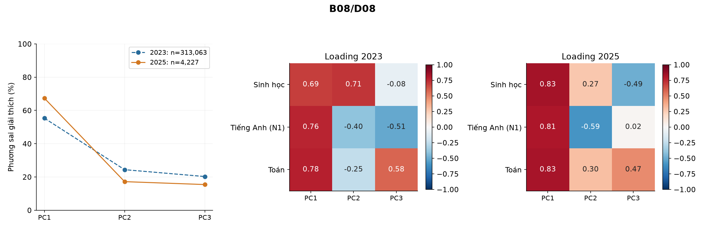

**Diễn giải hình:** Trái là scree/EVR của ba PC và n thực; giữa/phải là loading cùng thang −1..1. Tổng EVR bằng100%. Hai màu đường là hai năm, không là cùng người.

**Nhận xét bằng số:** PC1 giải thích 55,34% năm 2023 và 67,35% năm 2025; PC1+PC2 năm 2025 là 84,55%. Môn gắn mạnh nhất với PC1 năm 2025 theo |loading| là Sinh học (0,829). Trục này mô tả thành tích đồng biến/tương phản trong đúng ba môn đã chọn, không quy đổi được thành chênh năng lực tuyệt đối.

**Giải nghĩa trục bằng chính loading:** Năm2025, cả ba loading PC1 cùng dương, nên PC1 là trục thành tích cùng tăng trong khối này. PC2 đặt Toán (loading 0,304) ở một phía và Tiếng Anh (N1) (-0,591) ở phía kia. Đây là tương phản sau chuẩn hóa: điểm nghiêng về môn phía dương so với phía âm làm PC2 tăng; không phải một môn gây giảm môn kia hoặc một “năng lực thứ hai” đã được xác nhận.

**Ổn định cấu trúc:** |cosine| PC1=0,999 (gần1 là cùng hướng sau căn dấu); góc lớn nhất giữa hai không gian PC1–PC2=54,84°. Không phát hiện cặp eigenvalues liền kề cách nhau dưới5% theo quy tắc kiểm tra này; vẫn chưa là kiểm định bất biến đo lường.

| Năm | Cặp | n đủ khối | r trong khối | r tập đủ cặp | Chênh r |
| --- | --- | --- | --- | --- | --- |
| 2023 | Sinh học – Tiếng Anh (N1) | 313.063 | 0,286 | 0,286 | -0,000 |
| 2023 | Sinh học – Toán | 313.063 | 0,311 | 0,313 | -0,002 |
| 2023 | Tiếng Anh (N1) – Toán | 313.063 | 0,390 | 0,592 | -0,202 |
| 2025 | Sinh học – Tiếng Anh (N1) | 4.227 | 0,498 | 0,497 | 0,001 |
| 2025 | Sinh học – Toán | 4.227 | 0,536 | 0,739 | -0,203 |
| 2025 | Tiếng Anh (N1) – Toán | 4.227 | 0,496 | 0,497 | -0,001 |

**Diễn giải bảng:** Đây là kiểm tra nhạy với cách chọn mẫu: r trong khối dùng cùng nhóm đủ cả 3 môn; r toàn cặp chỉ cần đủ2. Chênh r cho thấy điều kiện có thêm môn thứ ba có thể thay đổi liên hệ. Hai ước lượng dùng mẫu lồng nhau, không coi là hai mẫu độc lập; bảng không chứng minh đã kiểm soát mọi khác biệt thành phần thí sinh.

### 4.6.3. A02

| Năm | n đủ 3 | Tỷ lệ đủ 3 trên mọi dòng | PC1 (%) | PC2 (%) | PC3 (%) |
| --- | --- | --- | --- | --- | --- |
| 2023 | 322.538 | 0,316 | 57,638 | 28,472 | 13,890 |
| 2025 | 4.795 | 0,004 | 68,132 | 17,502 | 14,366 |

**Diễn giải bảng:** Tỷ lệ là n đủ ba điểm chia số dòng nguồn cùng năm, không là tỷ lệ đăng ký/nguyện vọng. Mỗi năm chuẩn hóa riêng; dùng EVR để mô tả hình dạng biến thiên của chính nhóm đó.

| Năm | Môn | Loading PC1 | Loading PC2 | Loading PC3 |
| --- | --- | --- | --- | --- |
| 2023 | Sinh học | 0,567 | 0,814 | -0,126 |
| 2023 | Toán | 0,868 | -0,148 | 0,474 |
| 2023 | Vật lý | 0,809 | -0,412 | -0,420 |
| 2025 | Sinh học | 0,800 | 0,600 | 0,022 |
| 2025 | Toán | 0,836 | -0,307 | 0,454 |
| 2025 | Vật lý | 0,840 | -0,266 | -0,474 |

**Diễn giải bảng:** Giá trị tuyệt đối gần1 là môn gắn chặt với PC; dấu cùng chiều cho biết xu hướng cùng tăng theo trục. So độ lớn và mô hình dấu chung; không diễn giải một đảo dấu toàn PC thành đổi bản chất môn.

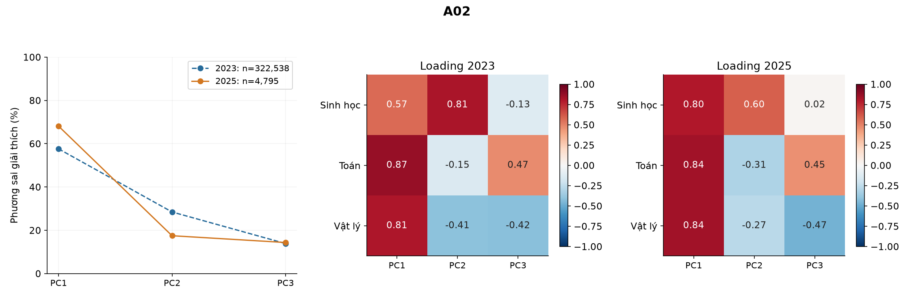

**Diễn giải hình:** Trái là scree/EVR của ba PC và n thực; giữa/phải là loading cùng thang −1..1. Tổng EVR bằng100%. Hai màu đường là hai năm, không là cùng người.

**Nhận xét bằng số:** PC1 giải thích 57,64% năm 2023 và 68,13% năm 2025; PC1+PC2 năm 2025 là 85,63%. Môn gắn mạnh nhất với PC1 năm 2025 theo |loading| là Vật lý (0,840). Trục này mô tả thành tích đồng biến/tương phản trong đúng ba môn đã chọn, không quy đổi được thành chênh năng lực tuyệt đối.

**Giải nghĩa trục bằng chính loading:** Năm2025, cả ba loading PC1 cùng dương, nên PC1 là trục thành tích cùng tăng trong khối này. PC2 đặt Sinh học (loading 0,600) ở một phía và Toán (-0,307) ở phía kia. Đây là tương phản sau chuẩn hóa: điểm nghiêng về môn phía dương so với phía âm làm PC2 tăng; không phải một môn gây giảm môn kia hoặc một “năng lực thứ hai” đã được xác nhận.

**Ổn định cấu trúc:** |cosine| PC1=0,989 (gần1 là cùng hướng sau căn dấu); góc lớn nhất giữa hai không gian PC1–PC2=14,02°. Không phát hiện cặp eigenvalues liền kề cách nhau dưới5% theo quy tắc kiểm tra này; vẫn chưa là kiểm định bất biến đo lường.

| Năm | Cặp | n đủ khối | r trong khối | r tập đủ cặp | Chênh r |
| --- | --- | --- | --- | --- | --- |
| 2023 | Sinh học – Toán | 322.538 | 0,312 | 0,313 | -0,001 |
| 2023 | Sinh học – Vật lý | 322.538 | 0,176 | 0,176 | -0,000 |
| 2023 | Toán – Vật lý | 322.538 | 0,564 | 0,568 | -0,003 |
| 2025 | Sinh học – Toán | 4.795 | 0,495 | 0,739 | -0,244 |
| 2025 | Sinh học – Vật lý | 4.795 | 0,501 | 0,501 | 0,000 |
| 2025 | Toán – Vật lý | 4.795 | 0,569 | 0,709 | -0,141 |

**Diễn giải bảng:** Đây là kiểm tra nhạy với cách chọn mẫu: r trong khối dùng cùng nhóm đủ cả 3 môn; r toàn cặp chỉ cần đủ2. Chênh r cho thấy điều kiện có thêm môn thứ ba có thể thay đổi liên hệ. Hai ước lượng dùng mẫu lồng nhau, không coi là hai mẫu độc lập; bảng không chứng minh đã kiểm soát mọi khác biệt thành phần thí sinh.

### 4.6.4. D07

| Năm | n đủ 3 | Tỷ lệ đủ 3 trên mọi dòng | PC1 (%) | PC2 (%) | PC3 (%) |
| --- | --- | --- | --- | --- | --- |
| 2023 | 313.538 | 0,307 | 54,780 | 30,326 | 14,893 |
| 2025 | 24.478 | 0,022 | 70,655 | 17,616 | 11,729 |

**Diễn giải bảng:** Tỷ lệ là n đủ ba điểm chia số dòng nguồn cùng năm, không là tỷ lệ đăng ký/nguyện vọng. Mỗi năm chuẩn hóa riêng; dùng EVR để mô tả hình dạng biến thiên của chính nhóm đó.

| Năm | Môn | Loading PC1 | Loading PC2 | Loading PC3 |
| --- | --- | --- | --- | --- |
| 2023 | Hóa học | 0,700 | -0,621 | -0,353 |
| 2023 | Tiếng Anh (N1) | 0,627 | 0,724 | -0,287 |
| 2023 | Toán | 0,871 | -0,022 | 0,490 |
| 2025 | Hóa học | 0,860 | -0,308 | -0,408 |
| 2025 | Tiếng Anh (N1) | 0,793 | 0,609 | -0,028 |
| 2025 | Toán | 0,867 | -0,251 | 0,430 |

**Diễn giải bảng:** Giá trị tuyệt đối gần1 là môn gắn chặt với PC; dấu cùng chiều cho biết xu hướng cùng tăng theo trục. So độ lớn và mô hình dấu chung; không diễn giải một đảo dấu toàn PC thành đổi bản chất môn.

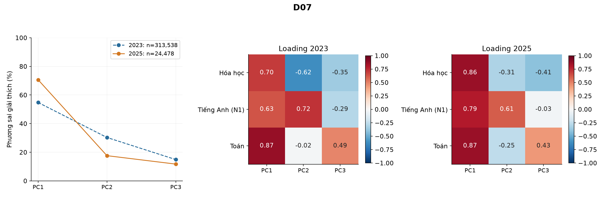

**Diễn giải hình:** Trái là scree/EVR của ba PC và n thực; giữa/phải là loading cùng thang −1..1. Tổng EVR bằng100%. Hai màu đường là hai năm, không là cùng người.

**Nhận xét bằng số:** PC1 giải thích 54,78% năm 2023 và 70,65% năm 2025; PC1+PC2 năm 2025 là 88,27%. Môn gắn mạnh nhất với PC1 năm 2025 theo |loading| là Toán (0,867). Trục này mô tả thành tích đồng biến/tương phản trong đúng ba môn đã chọn, không quy đổi được thành chênh năng lực tuyệt đối.

**Giải nghĩa trục bằng chính loading:** Năm2025, cả ba loading PC1 cùng dương, nên PC1 là trục thành tích cùng tăng trong khối này. PC2 đặt Tiếng Anh (N1) (loading 0,609) ở một phía và Hóa học (-0,308) ở phía kia. Đây là tương phản sau chuẩn hóa: điểm nghiêng về môn phía dương so với phía âm làm PC2 tăng; không phải một môn gây giảm môn kia hoặc một “năng lực thứ hai” đã được xác nhận.

**Ổn định cấu trúc:** |cosine| PC1=0,994 (gần1 là cùng hướng sau căn dấu); góc lớn nhất giữa hai không gian PC1–PC2=23,88°. Không phát hiện cặp eigenvalues liền kề cách nhau dưới5% theo quy tắc kiểm tra này; vẫn chưa là kiểm định bất biến đo lường.

| Năm | Cặp | n đủ khối | r trong khối | r tập đủ cặp | Chênh r |
| --- | --- | --- | --- | --- | --- |
| 2023 | Hóa học – Tiếng Anh (N1) | 313.538 | 0,091 | 0,091 | -0,000 |
| 2023 | Hóa học – Toán | 313.538 | 0,451 | 0,463 | -0,012 |
| 2023 | Tiếng Anh (N1) – Toán | 313.538 | 0,390 | 0,592 | -0,202 |
| 2025 | Hóa học – Tiếng Anh (N1) | 24.478 | 0,506 | 0,506 | 0,000 |
| 2025 | Hóa học – Toán | 24.478 | 0,648 | 0,728 | -0,081 |
| 2025 | Tiếng Anh (N1) – Toán | 24.478 | 0,522 | 0,497 | 0,025 |

**Diễn giải bảng:** Đây là kiểm tra nhạy với cách chọn mẫu: r trong khối dùng cùng nhóm đủ cả 3 môn; r toàn cặp chỉ cần đủ2. Chênh r cho thấy điều kiện có thêm môn thứ ba có thể thay đổi liên hệ. Hai ước lượng dùng mẫu lồng nhau, không coi là hai mẫu độc lập; bảng không chứng minh đã kiểm soát mọi khác biệt thành phần thí sinh.

### 4.6.5. C02

| Năm | n đủ 3 | Tỷ lệ đủ 3 trên mọi dòng | PC1 (%) | PC2 (%) | PC3 (%) |
| --- | --- | --- | --- | --- | --- |
| 2023 | 320.465 | 0,314 | 53,612 | 28,379 | 18,009 |
| 2025 | 237.064 | 0,210 | 61,022 | 29,940 | 9,039 |

**Diễn giải bảng:** Tỷ lệ là n đủ ba điểm chia số dòng nguồn cùng năm, không là tỷ lệ đăng ký/nguyện vọng. Mỗi năm chuẩn hóa riêng; dùng EVR để mô tả hình dạng biến thiên của chính nhóm đó.

| Năm | Môn | Loading PC1 | Loading PC2 | Loading PC3 |
| --- | --- | --- | --- | --- |
| 2023 | Hóa học | 0,796 | -0,324 | -0,510 |
| 2023 | Ngữ văn | 0,563 | 0,825 | -0,038 |
| 2023 | Toán | 0,810 | -0,255 | 0,528 |
| 2025 | Hóa học | 0,903 | -0,220 | -0,368 |
| 2025 | Ngữ văn | 0,447 | 0,894 | 0,001 |
| 2025 | Toán | 0,903 | -0,223 | 0,368 |

**Diễn giải bảng:** Giá trị tuyệt đối gần1 là môn gắn chặt với PC; dấu cùng chiều cho biết xu hướng cùng tăng theo trục. So độ lớn và mô hình dấu chung; không diễn giải một đảo dấu toàn PC thành đổi bản chất môn.

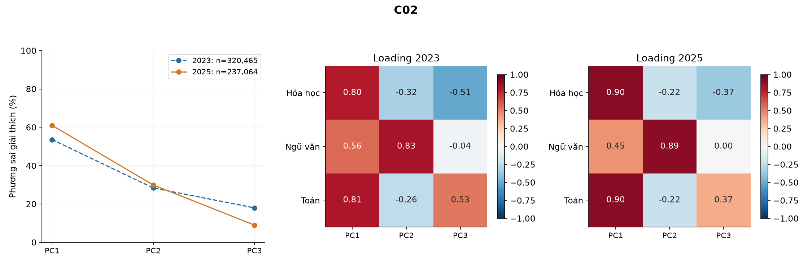

**Diễn giải hình:** Trái là scree/EVR của ba PC và n thực; giữa/phải là loading cùng thang −1..1. Tổng EVR bằng100%. Hai màu đường là hai năm, không là cùng người.

**Nhận xét bằng số:** PC1 giải thích 53,61% năm 2023 và 61,02% năm 2025; PC1+PC2 năm 2025 là 90,96%. Môn gắn mạnh nhất với PC1 năm 2025 theo |loading| là Hóa học (0,903). Trục này mô tả thành tích đồng biến/tương phản trong đúng ba môn đã chọn, không quy đổi được thành chênh năng lực tuyệt đối.

**Giải nghĩa trục bằng chính loading:** Năm2025, cả ba loading PC1 cùng dương, nên PC1 là trục thành tích cùng tăng trong khối này. PC2 đặt Ngữ văn (loading 0,894) ở một phía và Toán (-0,223) ở phía kia. Đây là tương phản sau chuẩn hóa: điểm nghiêng về môn phía dương so với phía âm làm PC2 tăng; không phải một môn gây giảm môn kia hoặc một “năng lực thứ hai” đã được xác nhận.

**Ổn định cấu trúc:** |cosine| PC1=0,992 (gần1 là cùng hướng sau căn dấu); góc lớn nhất giữa hai không gian PC1–PC2=3,24°. Không phát hiện cặp eigenvalues liền kề cách nhau dưới5% theo quy tắc kiểm tra này; vẫn chưa là kiểm định bất biến đo lường.

| Năm | Cặp | n đủ khối | r trong khối | r tập đủ cặp | Chênh r |
| --- | --- | --- | --- | --- | --- |
| 2023 | Hóa học – Ngữ văn | 320.465 | 0,200 | 0,200 | -0,000 |
| 2023 | Hóa học – Toán | 320.465 | 0,459 | 0,463 | -0,005 |
| 2023 | Ngữ văn – Toán | 320.465 | 0,226 | 0,459 | -0,232 |
| 2025 | Hóa học – Ngữ văn | 237.064 | 0,207 | 0,207 | -0,000 |
| 2025 | Hóa học – Toán | 237.064 | 0,729 | 0,728 | 0,001 |
| 2025 | Ngữ văn – Toán | 237.064 | 0,204 | 0,383 | -0,178 |

**Diễn giải bảng:** Đây là kiểm tra nhạy với cách chọn mẫu: r trong khối dùng cùng nhóm đủ cả 3 môn; r toàn cặp chỉ cần đủ2. Chênh r cho thấy điều kiện có thêm môn thứ ba có thể thay đổi liên hệ. Hai ước lượng dùng mẫu lồng nhau, không coi là hai mẫu độc lập; bảng không chứng minh đã kiểm soát mọi khác biệt thành phần thí sinh.

### 4.6.6. A00

| Năm | n đủ 3 | Tỷ lệ đủ 3 trên mọi dòng | PC1 (%) | PC2 (%) | PC3 (%) |
| --- | --- | --- | --- | --- | --- |
| 2023 | 325.902 | 0,319 | 64,731 | 21,260 | 14,009 |
| 2025 | 162.200 | 0,143 | 81,807 | 9,722 | 8,471 |

**Diễn giải bảng:** Tỷ lệ là n đủ ba điểm chia số dòng nguồn cùng năm, không là tỷ lệ đăng ký/nguyện vọng. Mỗi năm chuẩn hóa riêng; dùng EVR để mô tả hình dạng biến thiên của chính nhóm đó.

| Năm | Môn | Loading PC1 | Loading PC2 | Loading PC3 |
| --- | --- | --- | --- | --- |
| 2023 | Hóa học | 0,744 | 0,654 | -0,137 |
| 2023 | Toán | 0,854 | -0,161 | 0,495 |
| 2023 | Vật lý | 0,812 | -0,430 | -0,395 |
| 2025 | Hóa học | 0,910 | 0,181 | 0,374 |
| 2025 | Toán | 0,897 | -0,441 | -0,040 |
| 2025 | Vật lý | 0,907 | 0,254 | -0,336 |

**Diễn giải bảng:** Giá trị tuyệt đối gần1 là môn gắn chặt với PC; dấu cùng chiều cho biết xu hướng cùng tăng theo trục. So độ lớn và mô hình dấu chung; không diễn giải một đảo dấu toàn PC thành đổi bản chất môn.

**Diễn giải hình:** Trái là scree/EVR của ba PC và n thực; giữa/phải là loading cùng thang −1..1. Tổng EVR bằng100%. Hai màu đường là hai năm, không là cùng người.

**Nhận xét bằng số:** PC1 giải thích 64,73% năm 2023 và 81,81% năm 2025; PC1+PC2 năm 2025 là 91,53%. Môn gắn mạnh nhất với PC1 năm 2025 theo |loading| là Hóa học (0,910). Trục này mô tả thành tích đồng biến/tương phản trong đúng ba môn đã chọn, không quy đổi được thành chênh năng lực tuyệt đối.

**Giải nghĩa trục bằng chính loading:** Năm2025, cả ba loading PC1 cùng dương, nên PC1 là trục thành tích cùng tăng trong khối này. PC2 đặt Vật lý (loading 0,254) ở một phía và Toán (-0,441) ở phía kia. Đây là tương phản sau chuẩn hóa: điểm nghiêng về môn phía dương so với phía âm làm PC2 tăng; không phải một môn gây giảm môn kia hoặc một “năng lực thứ hai” đã được xác nhận.

**Ổn định cấu trúc:** |cosine| PC1=0,998 (gần1 là cùng hướng sau căn dấu); góc lớn nhất giữa hai không gian PC1–PC2=79,19°. Không phát hiện cặp eigenvalues liền kề cách nhau dưới5% theo quy tắc kiểm tra này; vẫn chưa là kiểm định bất biến đo lường.

| Năm | Cặp | n đủ khối | r trong khối | r tập đủ cặp | Chênh r |
| --- | --- | --- | --- | --- | --- |
| 2023 | Hóa học – Toán | 325.902 | 0,462 | 0,463 | -0,002 |
| 2023 | Hóa học – Vật lý | 325.902 | 0,378 | 0,378 | -0,000 |
| 2023 | Toán – Vật lý | 325.902 | 0,567 | 0,568 | -0,001 |
| 2025 | Hóa học – Toán | 162.200 | 0,721 | 0,728 | -0,007 |
| 2025 | Hóa học – Vật lý | 162.200 | 0,746 | 0,745 | 0,000 |
| 2025 | Toán – Vật lý | 162.200 | 0,715 | 0,709 | 0,005 |

**Diễn giải bảng:** Đây là kiểm tra nhạy với cách chọn mẫu: r trong khối dùng cùng nhóm đủ cả 3 môn; r toàn cặp chỉ cần đủ2. Chênh r cho thấy điều kiện có thêm môn thứ ba có thể thay đổi liên hệ. Hai ước lượng dùng mẫu lồng nhau, không coi là hai mẫu độc lập; bảng không chứng minh đã kiểm soát mọi khác biệt thành phần thí sinh.

### 4.6.7. D66

| Năm | n đủ 3 | Tỷ lệ đủ 3 trên mọi dòng | PC1 (%) | PC2 (%) | PC3 (%) |
| --- | --- | --- | --- | --- | --- |
| 2023 | 556.185 | 0,544 | 63,372 | 20,216 | 16,412 |
| 2025 | 47.905 | 0,042 | 51,663 | 24,840 | 23,497 |

**Diễn giải bảng:** Tỷ lệ là n đủ ba điểm chia số dòng nguồn cùng năm, không là tỷ lệ đăng ký/nguyện vọng. Mỗi năm chuẩn hóa riêng; dùng EVR để mô tả hình dạng biến thiên của chính nhóm đó.

| Năm | Môn | Loading PC1 | Loading PC2 | Loading PC3 |
| --- | --- | --- | --- | --- |
| 2023 | GDCD | 0,782 | -0,540 | -0,312 |
| 2023 | Tiếng Anh (N1) | 0,778 | 0,561 | -0,283 |
| 2023 | Ngữ văn | 0,828 | -0,018 | 0,561 |
| 2025 | GDKT&PL | 0,717 | -0,518 | -0,466 |
| 2025 | Tiếng Anh (N1) | 0,734 | -0,142 | 0,664 |
| 2025 | Ngữ văn | 0,704 | 0,676 | -0,217 |

**Diễn giải bảng:** Giá trị tuyệt đối gần1 là môn gắn chặt với PC; dấu cùng chiều cho biết xu hướng cùng tăng theo trục. So độ lớn và mô hình dấu chung; không diễn giải một đảo dấu toàn PC thành đổi bản chất môn.

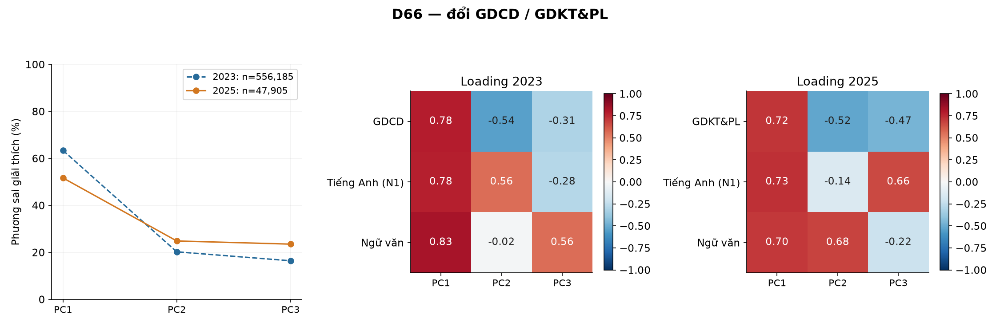

**Diễn giải hình:** Trái là scree/EVR của ba PC và n thực; giữa/phải là loading cùng thang −1..1. Tổng EVR bằng100%. Hai màu đường là hai năm, không là cùng người.

**Nhận xét bằng số:** PC1 giải thích 63,37% năm 2023 và 51,66% năm 2025; PC1+PC2 năm 2025 là 76,50%. Môn gắn mạnh nhất với PC1 năm 2025 theo |loading| là Tiếng Anh (N1) (0,734). Trục này mô tả thành tích đồng biến/tương phản trong đúng ba môn đã chọn, không quy đổi được thành chênh năng lực tuyệt đối.

**Giải nghĩa trục bằng chính loading:** Năm2025, cả ba loading PC1 cùng dương, nên PC1 là trục thành tích cùng tăng trong khối này. PC2 đặt Ngữ văn (loading 0,676) ở một phía và GDKT&PL (-0,518) ở phía kia. Đây là tương phản sau chuẩn hóa: điểm nghiêng về môn phía dương so với phía âm làm PC2 tăng; không phải một môn gây giảm môn kia hoặc một “năng lực thứ hai” đã được xác nhận.

**Giới hạn so sánh:** GDCD và GDKT&PL khác nội dung; hai PCA riêng mô tả hai bộ môn, không so loading/cosine như cùng một cấu trúc.

| Năm | Cặp | n đủ khối | r trong khối | r tập đủ cặp | Chênh r |
| --- | --- | --- | --- | --- | --- |
| 2023 | GDCD – Tiếng Anh (N1) | 556.185 | 0,394 | 0,394 | -0,000 |
| 2023 | GDCD – Ngữ văn | 556.185 | 0,481 | 0,480 | 0,002 |
| 2023 | Tiếng Anh (N1) – Ngữ văn | 556.185 | 0,475 | 0,366 | 0,109 |
| 2025 | GDKT&PL – Tiếng Anh (N1) | 47.905 | 0,291 | 0,291 | -0,000 |
| 2025 | GDKT&PL – Ngữ văn | 47.905 | 0,257 | 0,418 | -0,161 |
| 2025 | Tiếng Anh (N1) – Ngữ văn | 47.905 | 0,277 | 0,184 | 0,093 |

**Diễn giải bảng:** Đây là kiểm tra nhạy với cách chọn mẫu: r trong khối dùng cùng nhóm đủ cả 3 môn; r toàn cặp chỉ cần đủ2. Chênh r cho thấy điều kiện có thêm môn thứ ba có thể thay đổi liên hệ. Hai ước lượng dùng mẫu lồng nhau, không coi là hai mẫu độc lập; bảng không chứng minh đã kiểm soát mọi khác biệt thành phần thí sinh.

### 4.6.8. D84

| Năm | n đủ 3 | Tỷ lệ đủ 3 trên mọi dòng | PC1 (%) | PC2 (%) | PC3 (%) |
| --- | --- | --- | --- | --- | --- |
| 2023 | 556.034 | 0,544 | 66,793 | 20,636 | 12,571 |
| 2025 | 47.902 | 0,042 | 57,095 | 24,828 | 18,077 |

**Diễn giải bảng:** Tỷ lệ là n đủ ba điểm chia số dòng nguồn cùng năm, không là tỷ lệ đăng ký/nguyện vọng. Mỗi năm chuẩn hóa riêng; dùng EVR để mô tả hình dạng biến thiên của chính nhóm đó.

| Năm | Môn | Loading PC1 | Loading PC2 | Loading PC3 |
| --- | --- | --- | --- | --- |
| 2023 | GDCD | 0,757 | 0,636 | -0,152 |
| 2023 | Tiếng Anh (N1) | 0,820 | -0,443 | -0,362 |
| 2023 | Toán | 0,871 | -0,135 | 0,473 |
| 2025 | GDKT&PL | 0,673 | 0,738 | -0,044 |
| 2025 | Tiếng Anh (N1) | 0,787 | -0,353 | -0,505 |
| 2025 | Toán | 0,800 | -0,274 | 0,534 |

**Diễn giải bảng:** Giá trị tuyệt đối gần1 là môn gắn chặt với PC; dấu cùng chiều cho biết xu hướng cùng tăng theo trục. So độ lớn và mô hình dấu chung; không diễn giải một đảo dấu toàn PC thành đổi bản chất môn.

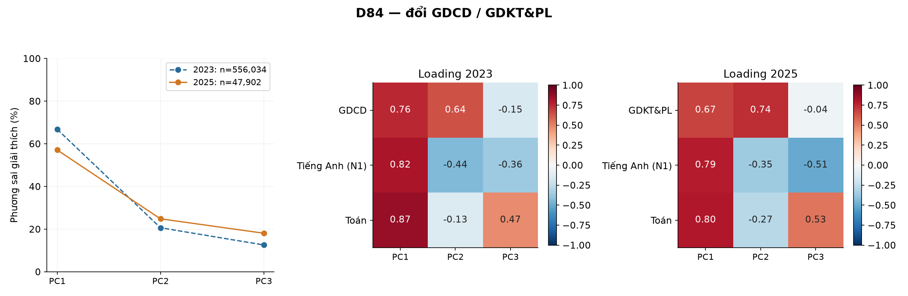

**Diễn giải hình:** Trái là scree/EVR của ba PC và n thực; giữa/phải là loading cùng thang −1..1. Tổng EVR bằng100%. Hai màu đường là hai năm, không là cùng người.

**Nhận xét bằng số:** PC1 giải thích 66,79% năm 2023 và 57,09% năm 2025; PC1+PC2 năm 2025 là 81,92%. Môn gắn mạnh nhất với PC1 năm 2025 theo |loading| là Toán (0,800). Trục này mô tả thành tích đồng biến/tương phản trong đúng ba môn đã chọn, không quy đổi được thành chênh năng lực tuyệt đối.

**Giải nghĩa trục bằng chính loading:** Năm2025, cả ba loading PC1 cùng dương, nên PC1 là trục thành tích cùng tăng trong khối này. PC2 đặt GDKT&PL (loading 0,738) ở một phía và Tiếng Anh (N1) (-0,353) ở phía kia. Đây là tương phản sau chuẩn hóa: điểm nghiêng về môn phía dương so với phía âm làm PC2 tăng; không phải một môn gây giảm môn kia hoặc một “năng lực thứ hai” đã được xác nhận.

**Giới hạn so sánh:** GDCD và GDKT&PL khác nội dung; hai PCA riêng mô tả hai bộ môn, không so loading/cosine như cùng một cấu trúc.

| Năm | Cặp | n đủ khối | r trong khối | r tập đủ cặp | Chênh r |
| --- | --- | --- | --- | --- | --- |
| 2023 | GDCD – Tiếng Anh (N1) | 556.034 | 0,394 | 0,394 | -0,000 |
| 2023 | GDCD – Toán | 556.034 | 0,502 | 0,502 | 0,000 |
| 2023 | Tiếng Anh (N1) – Toán | 556.034 | 0,603 | 0,592 | 0,011 |
| 2025 | GDKT&PL – Tiếng Anh (N1) | 47.902 | 0,291 | 0,291 | 0,000 |
| 2025 | GDKT&PL – Toán | 47.902 | 0,313 | 0,411 | -0,098 |
| 2025 | Tiếng Anh (N1) – Toán | 47.902 | 0,457 | 0,497 | -0,040 |

**Diễn giải bảng:** Đây là kiểm tra nhạy với cách chọn mẫu: r trong khối dùng cùng nhóm đủ cả 3 môn; r toàn cặp chỉ cần đủ2. Chênh r cho thấy điều kiện có thêm môn thứ ba có thể thay đổi liên hệ. Hai ước lượng dùng mẫu lồng nhau, không coi là hai mẫu độc lập; bảng không chứng minh đã kiểm soát mọi khác biệt thành phần thí sinh.

### 4.6.9. C20

| Năm | n đủ 3 | Tỷ lệ đủ 3 trên mọi dòng | PC1 (%) | PC2 (%) | PC3 (%) |
| --- | --- | --- | --- | --- | --- |
| 2023 | 565.249 | 0,553 | 65,617 | 20,363 | 14,021 |
| 2025 | 109.423 | 0,097 | 63,395 | 21,925 | 14,680 |

**Diễn giải bảng:** Tỷ lệ là n đủ ba điểm chia số dòng nguồn cùng năm, không là tỷ lệ đăng ký/nguyện vọng. Mỗi năm chuẩn hóa riêng; dùng EVR để mô tả hình dạng biến thiên của chính nhóm đó.

| Năm | Môn | Loading PC1 | Loading PC2 | Loading PC3 |
| --- | --- | --- | --- | --- |
| 2023 | GDCD | 0,853 | -0,153 | 0,499 |
| 2023 | Địa lý | 0,814 | -0,431 | -0,389 |
| 2023 | Ngữ văn | 0,760 | 0,634 | -0,144 |
| 2025 | GDKT&PL | 0,822 | -0,351 | -0,449 |
| 2025 | Địa lý | 0,837 | -0,250 | 0,486 |
| 2025 | Ngữ văn | 0,725 | 0,687 | -0,052 |

**Diễn giải bảng:** Giá trị tuyệt đối gần1 là môn gắn chặt với PC; dấu cùng chiều cho biết xu hướng cùng tăng theo trục. So độ lớn và mô hình dấu chung; không diễn giải một đảo dấu toàn PC thành đổi bản chất môn.

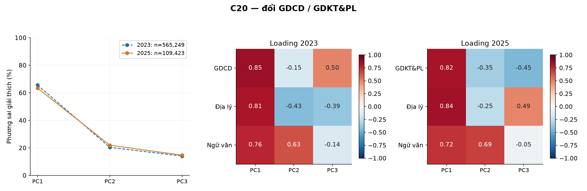

**Diễn giải hình:** Trái là scree/EVR của ba PC và n thực; giữa/phải là loading cùng thang −1..1. Tổng EVR bằng100%. Hai màu đường là hai năm, không là cùng người.

**Nhận xét bằng số:** PC1 giải thích 65,62% năm 2023 và 63,40% năm 2025; PC1+PC2 năm 2025 là 85,32%. Môn gắn mạnh nhất với PC1 năm 2025 theo |loading| là Địa lý (0,837). Trục này mô tả thành tích đồng biến/tương phản trong đúng ba môn đã chọn, không quy đổi được thành chênh năng lực tuyệt đối.

**Giải nghĩa trục bằng chính loading:** Năm2025, cả ba loading PC1 cùng dương, nên PC1 là trục thành tích cùng tăng trong khối này. PC2 đặt Ngữ văn (loading 0,687) ở một phía và GDKT&PL (-0,351) ở phía kia. Đây là tương phản sau chuẩn hóa: điểm nghiêng về môn phía dương so với phía âm làm PC2 tăng; không phải một môn gây giảm môn kia hoặc một “năng lực thứ hai” đã được xác nhận.

**Giới hạn so sánh:** GDCD và GDKT&PL khác nội dung; hai PCA riêng mô tả hai bộ môn, không so loading/cosine như cùng một cấu trúc.

| Năm | Cặp | n đủ khối | r trong khối | r tập đủ cặp | Chênh r |
| --- | --- | --- | --- | --- | --- |
| 2023 | GDCD – Địa lý | 565.249 | 0,567 | 0,567 | -0,000 |
| 2023 | GDCD – Ngữ văn | 565.249 | 0,480 | 0,480 | -0,000 |
| 2023 | Địa lý – Ngữ văn | 565.249 | 0,402 | 0,433 | -0,031 |
| 2025 | GDKT&PL – Địa lý | 109.423 | 0,558 | 0,558 | 0,000 |
| 2025 | GDKT&PL – Ngữ văn | 109.423 | 0,378 | 0,418 | -0,040 |
| 2025 | Địa lý – Ngữ văn | 109.423 | 0,410 | 0,529 | -0,120 |

**Diễn giải bảng:** Đây là kiểm tra nhạy với cách chọn mẫu: r trong khối dùng cùng nhóm đủ cả 3 môn; r toàn cặp chỉ cần đủ2. Chênh r cho thấy điều kiện có thêm môn thứ ba có thể thay đổi liên hệ. Hai ước lượng dùng mẫu lồng nhau, không coi là hai mẫu độc lập; bảng không chứng minh đã kiểm soát mọi khác biệt thành phần thí sinh.

### 4.6.10. A09

| Năm | n đủ 3 | Tỷ lệ đủ 3 trên mọi dòng | PC1 (%) | PC2 (%) | PC3 (%) |
| --- | --- | --- | --- | --- | --- |
| 2023 | 564.517 | 0,552 | 66,308 | 19,943 | 13,749 |
| 2025 | 109.404 | 0,097 | 64,624 | 21,646 | 13,730 |

**Diễn giải bảng:** Tỷ lệ là n đủ ba điểm chia số dòng nguồn cùng năm, không là tỷ lệ đăng ký/nguyện vọng. Mỗi năm chuẩn hóa riêng; dùng EVR để mô tả hình dạng biến thiên của chính nhóm đó.

| Năm | Môn | Loading PC1 | Loading PC2 | Loading PC3 |
| --- | --- | --- | --- | --- |
| 2023 | GDCD | 0,858 | -0,118 | 0,500 |
| 2023 | Địa lý | 0,812 | -0,457 | -0,363 |
| 2023 | Toán | 0,771 | 0,613 | -0,174 |
| 2025 | GDKT&PL | 0,797 | -0,491 | -0,352 |
| 2025 | Địa lý | 0,862 | -0,095 | 0,498 |
| 2025 | Toán | 0,749 | 0,632 | -0,199 |

**Diễn giải bảng:** Giá trị tuyệt đối gần1 là môn gắn chặt với PC; dấu cùng chiều cho biết xu hướng cùng tăng theo trục. So độ lớn và mô hình dấu chung; không diễn giải một đảo dấu toàn PC thành đổi bản chất môn.

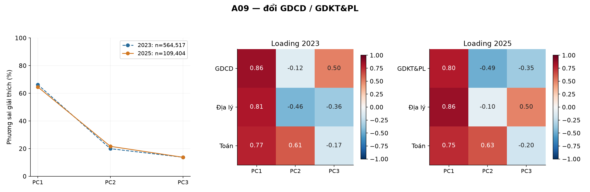

**Diễn giải hình:** Trái là scree/EVR của ba PC và n thực; giữa/phải là loading cùng thang −1..1. Tổng EVR bằng100%. Hai màu đường là hai năm, không là cùng người.

**Nhận xét bằng số:** PC1 giải thích 66,31% năm 2023 và 64,62% năm 2025; PC1+PC2 năm 2025 là 86,27%. Môn gắn mạnh nhất với PC1 năm 2025 theo |loading| là Địa lý (0,862). Trục này mô tả thành tích đồng biến/tương phản trong đúng ba môn đã chọn, không quy đổi được thành chênh năng lực tuyệt đối.

**Giải nghĩa trục bằng chính loading:** Năm2025, cả ba loading PC1 cùng dương, nên PC1 là trục thành tích cùng tăng trong khối này. PC2 đặt Toán (loading 0,632) ở một phía và GDKT&PL (-0,491) ở phía kia. Đây là tương phản sau chuẩn hóa: điểm nghiêng về môn phía dương so với phía âm làm PC2 tăng; không phải một môn gây giảm môn kia hoặc một “năng lực thứ hai” đã được xác nhận.

**Giới hạn so sánh:** GDCD và GDKT&PL khác nội dung; hai PCA riêng mô tả hai bộ môn, không so loading/cosine như cùng một cấu trúc.

| Năm | Cặp | n đủ khối | r trong khối | r tập đủ cặp | Chênh r |
| --- | --- | --- | --- | --- | --- |
| 2023 | GDCD – Địa lý | 564.517 | 0,569 | 0,567 | 0,002 |
| 2023 | GDCD – Toán | 564.517 | 0,501 | 0,502 | -0,000 |
| 2023 | Địa lý – Toán | 564.517 | 0,409 | 0,446 | -0,036 |
| 2025 | GDKT&PL – Địa lý | 109.404 | 0,558 | 0,558 | -0,000 |
| 2025 | GDKT&PL – Toán | 109.404 | 0,357 | 0,411 | -0,054 |
| 2025 | Địa lý – Toán | 109.404 | 0,486 | 0,554 | -0,068 |

**Diễn giải bảng:** Đây là kiểm tra nhạy với cách chọn mẫu: r trong khối dùng cùng nhóm đủ cả 3 môn; r toàn cặp chỉ cần đủ2. Chênh r cho thấy điều kiện có thêm môn thứ ba có thể thay đổi liên hệ. Hai ước lượng dùng mẫu lồng nhau, không coi là hai mẫu độc lập; bảng không chứng minh đã kiểm soát mọi khác biệt thành phần thí sinh.

### 4.6.11. C19

| Năm | n đủ 3 | Tỷ lệ đủ 3 trên mọi dòng | PC1 (%) | PC2 (%) | PC3 (%) |
| --- | --- | --- | --- | --- | --- |
| 2023 | 565.211 | 0,553 | 66,434 | 19,768 | 13,798 |
| 2025 | 68.351 | 0,060 | 64,691 | 21,129 | 14,180 |

**Diễn giải bảng:** Tỷ lệ là n đủ ba điểm chia số dòng nguồn cùng năm, không là tỷ lệ đăng ký/nguyện vọng. Mỗi năm chuẩn hóa riêng; dùng EVR để mô tả hình dạng biến thiên của chính nhóm đó.

| Năm | Môn | Loading PC1 | Loading PC2 | Loading PC3 |
| --- | --- | --- | --- | --- |
| 2023 | GDCD | 0,852 | -0,193 | 0,487 |
| 2023 | Lịch sử | 0,826 | -0,390 | -0,407 |
| 2023 | Ngữ văn | 0,765 | 0,635 | -0,103 |
| 2025 | GDKT&PL | 0,833 | -0,315 | -0,454 |
| 2025 | Lịch sử | 0,838 | -0,280 | 0,468 |
| 2025 | Ngữ văn | 0,738 | 0,675 | -0,018 |

**Diễn giải bảng:** Giá trị tuyệt đối gần1 là môn gắn chặt với PC; dấu cùng chiều cho biết xu hướng cùng tăng theo trục. So độ lớn và mô hình dấu chung; không diễn giải một đảo dấu toàn PC thành đổi bản chất môn.

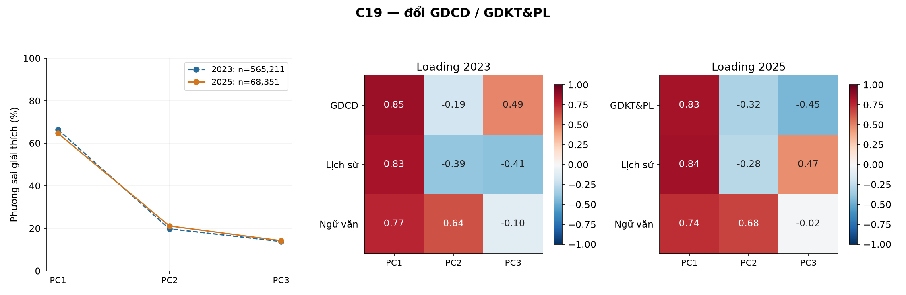

**Diễn giải hình:** Trái là scree/EVR của ba PC và n thực; giữa/phải là loading cùng thang −1..1. Tổng EVR bằng100%. Hai màu đường là hai năm, không là cùng người.

**Nhận xét bằng số:** PC1 giải thích 66,43% năm 2023 và 64,69% năm 2025; PC1+PC2 năm 2025 là 85,82%. Môn gắn mạnh nhất với PC1 năm 2025 theo |loading| là Lịch sử (0,838). Trục này mô tả thành tích đồng biến/tương phản trong đúng ba môn đã chọn, không quy đổi được thành chênh năng lực tuyệt đối.

**Giải nghĩa trục bằng chính loading:** Năm2025, cả ba loading PC1 cùng dương, nên PC1 là trục thành tích cùng tăng trong khối này. PC2 đặt Ngữ văn (loading 0,675) ở một phía và GDKT&PL (-0,315) ở phía kia. Đây là tương phản sau chuẩn hóa: điểm nghiêng về môn phía dương so với phía âm làm PC2 tăng; không phải một môn gây giảm môn kia hoặc một “năng lực thứ hai” đã được xác nhận.

**Giới hạn so sánh:** GDCD và GDKT&PL khác nội dung; hai PCA riêng mô tả hai bộ môn, không so loading/cosine như cùng một cấu trúc.

| Năm | Cặp | n đủ khối | r trong khối | r tập đủ cặp | Chênh r |
| --- | --- | --- | --- | --- | --- |
| 2023 | GDCD – Lịch sử | 565.211 | 0,580 | 0,580 | -0,000 |
| 2023 | GDCD – Ngữ văn | 565.211 | 0,480 | 0,480 | -0,000 |
| 2023 | Lịch sử – Ngữ văn | 565.211 | 0,426 | 0,453 | -0,027 |
| 2025 | GDKT&PL – Lịch sử | 68.351 | 0,574 | 0,574 | 0,000 |
| 2025 | GDKT&PL – Ngữ văn | 68.351 | 0,410 | 0,418 | -0,008 |
| 2025 | Lịch sử – Ngữ văn | 68.351 | 0,421 | 0,527 | -0,106 |

**Diễn giải bảng:** Đây là kiểm tra nhạy với cách chọn mẫu: r trong khối dùng cùng nhóm đủ cả 3 môn; r toàn cặp chỉ cần đủ2. Chênh r cho thấy điều kiện có thêm môn thứ ba có thể thay đổi liên hệ. Hai ước lượng dùng mẫu lồng nhau, không coi là hai mẫu độc lập; bảng không chứng minh đã kiểm soát mọi khác biệt thành phần thí sinh.

### 4.6.12. A08

| Năm | n đủ 3 | Tỷ lệ đủ 3 trên mọi dòng | PC1 (%) | PC2 (%) | PC3 (%) |
| --- | --- | --- | --- | --- | --- |
| 2023 | 564.507 | 0,552 | 67,033 | 19,437 | 13,530 |
| 2025 | 68.313 | 0,060 | 64,416 | 21,699 | 13,886 |

**Diễn giải bảng:** Tỷ lệ là n đủ ba điểm chia số dòng nguồn cùng năm, không là tỷ lệ đăng ký/nguyện vọng. Mỗi năm chuẩn hóa riêng; dùng EVR để mô tả hình dạng biến thiên của chính nhóm đó.

| Năm | Môn | Loading PC1 | Loading PC2 | Loading PC3 |
| --- | --- | --- | --- | --- |
| 2023 | GDCD | 0,858 | -0,152 | 0,491 |
| 2023 | Lịch sử | 0,822 | -0,423 | -0,381 |
| 2023 | Toán | 0,774 | 0,617 | -0,140 |
| 2025 | GDKT&PL | 0,817 | -0,406 | -0,409 |
| 2025 | Lịch sử | 0,853 | -0,188 | 0,487 |
| 2025 | Toán | 0,733 | 0,672 | -0,111 |

**Diễn giải bảng:** Giá trị tuyệt đối gần1 là môn gắn chặt với PC; dấu cùng chiều cho biết xu hướng cùng tăng theo trục. So độ lớn và mô hình dấu chung; không diễn giải một đảo dấu toàn PC thành đổi bản chất môn.

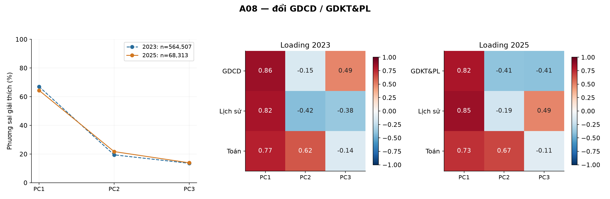

**Diễn giải hình:** Trái là scree/EVR của ba PC và n thực; giữa/phải là loading cùng thang −1..1. Tổng EVR bằng100%. Hai màu đường là hai năm, không là cùng người.

**Nhận xét bằng số:** PC1 giải thích 67,03% năm 2023 và 64,42% năm 2025; PC1+PC2 năm 2025 là 86,11%. Môn gắn mạnh nhất với PC1 năm 2025 theo |loading| là Lịch sử (0,853). Trục này mô tả thành tích đồng biến/tương phản trong đúng ba môn đã chọn, không quy đổi được thành chênh năng lực tuyệt đối.

**Giải nghĩa trục bằng chính loading:** Năm2025, cả ba loading PC1 cùng dương, nên PC1 là trục thành tích cùng tăng trong khối này. PC2 đặt Toán (loading 0,672) ở một phía và GDKT&PL (-0,406) ở phía kia. Đây là tương phản sau chuẩn hóa: điểm nghiêng về môn phía dương so với phía âm làm PC2 tăng; không phải một môn gây giảm môn kia hoặc một “năng lực thứ hai” đã được xác nhận.

**Giới hạn so sánh:** GDCD và GDKT&PL khác nội dung; hai PCA riêng mô tả hai bộ môn, không so loading/cosine như cùng một cấu trúc.

| Năm | Cặp | n đủ khối | r trong khối | r tập đủ cặp | Chênh r |
| --- | --- | --- | --- | --- | --- |
| 2023 | GDCD – Lịch sử | 564.507 | 0,582 | 0,580 | 0,002 |
| 2023 | GDCD – Toán | 564.507 | 0,501 | 0,502 | -0,000 |
| 2023 | Lịch sử – Toán | 564.507 | 0,429 | 0,469 | -0,040 |
| 2025 | GDKT&PL – Lịch sử | 68.313 | 0,574 | 0,574 | 0,000 |
| 2025 | GDKT&PL – Toán | 68.313 | 0,372 | 0,411 | -0,039 |
| 2025 | Lịch sử – Toán | 68.313 | 0,445 | 0,518 | -0,073 |

**Diễn giải bảng:** Đây là kiểm tra nhạy với cách chọn mẫu: r trong khối dùng cùng nhóm đủ cả 3 môn; r toàn cặp chỉ cần đủ2. Chênh r cho thấy điều kiện có thêm môn thứ ba có thể thay đổi liên hệ. Hai ước lượng dùng mẫu lồng nhau, không coi là hai mẫu độc lập; bảng không chứng minh đã kiểm soát mọi khác biệt thành phần thí sinh.

### 4.6.13. C14

| Năm | n đủ 3 | Tỷ lệ đủ 3 trên mọi dòng | PC1 (%) | PC2 (%) | PC3 (%) |
| --- | --- | --- | --- | --- | --- |
| 2023 | 564.516 | 0,552 | 66,911 | 17,463 | 15,626 |
| 2025 | 246.298 | 0,218 | 61,867 | 19,965 | 18,168 |

**Diễn giải bảng:** Tỷ lệ là n đủ ba điểm chia số dòng nguồn cùng năm, không là tỷ lệ đăng ký/nguyện vọng. Mỗi năm chuẩn hóa riêng; dùng EVR để mô tả hình dạng biến thiên của chính nhóm đó.

| Năm | Môn | Loading PC1 | Loading PC2 | Loading PC3 |
| --- | --- | --- | --- | --- |
| 2023 | GDCD | 0,804 | 0,580 | -0,129 |
| 2023 | Ngữ văn | 0,819 | -0,399 | -0,412 |
| 2023 | Toán | 0,830 | -0,168 | 0,531 |
| 2025 | GDKT&PL | 0,770 | 0,637 | -0,047 |
| 2025 | Ngữ văn | 0,797 | -0,267 | 0,542 |
| 2025 | Toán | 0,793 | -0,350 | -0,499 |

**Diễn giải bảng:** Giá trị tuyệt đối gần1 là môn gắn chặt với PC; dấu cùng chiều cho biết xu hướng cùng tăng theo trục. So độ lớn và mô hình dấu chung; không diễn giải một đảo dấu toàn PC thành đổi bản chất môn.

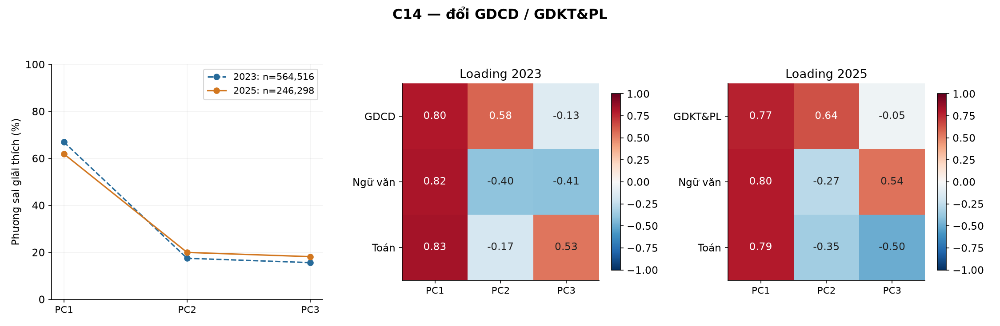

**Diễn giải hình:** Trái là scree/EVR của ba PC và n thực; giữa/phải là loading cùng thang −1..1. Tổng EVR bằng100%. Hai màu đường là hai năm, không là cùng người.

**Nhận xét bằng số:** PC1 giải thích 66,91% năm 2023 và 61,87% năm 2025; PC1+PC2 năm 2025 là 81,83%. Môn gắn mạnh nhất với PC1 năm 2025 theo |loading| là Ngữ văn (0,797). Trục này mô tả thành tích đồng biến/tương phản trong đúng ba môn đã chọn, không quy đổi được thành chênh năng lực tuyệt đối.

**Giải nghĩa trục bằng chính loading:** Năm2025, cả ba loading PC1 cùng dương, nên PC1 là trục thành tích cùng tăng trong khối này. PC2 đặt GDKT&PL (loading 0,637) ở một phía và Toán (-0,350) ở phía kia. Đây là tương phản sau chuẩn hóa: điểm nghiêng về môn phía dương so với phía âm làm PC2 tăng; không phải một môn gây giảm môn kia hoặc một “năng lực thứ hai” đã được xác nhận.

**Giới hạn so sánh:** GDCD và GDKT&PL khác nội dung; hai PCA riêng mô tả hai bộ môn, không so loading/cosine như cùng một cấu trúc.

| Năm | Cặp | n đủ khối | r trong khối | r tập đủ cặp | Chênh r |
| --- | --- | --- | --- | --- | --- |
| 2023 | GDCD – Ngữ văn | 564.516 | 0,481 | 0,480 | 0,001 |
| 2023 | GDCD – Toán | 564.516 | 0,501 | 0,502 | -0,000 |
| 2023 | Ngữ văn – Toán | 564.516 | 0,528 | 0,459 | 0,070 |
| 2025 | GDKT&PL – Ngữ văn | 246.298 | 0,418 | 0,418 | 0,000 |
| 2025 | GDKT&PL – Toán | 246.298 | 0,411 | 0,411 | -0,000 |
| 2025 | Ngữ văn – Toán | 246.298 | 0,455 | 0,383 | 0,072 |

**Diễn giải bảng:** Đây là kiểm tra nhạy với cách chọn mẫu: r trong khối dùng cùng nhóm đủ cả 3 môn; r toàn cặp chỉ cần đủ2. Chênh r cho thấy điều kiện có thêm môn thứ ba có thể thay đổi liên hệ. Hai ước lượng dùng mẫu lồng nhau, không coi là hai mẫu độc lập; bảng không chứng minh đã kiểm soát mọi khác biệt thành phần thí sinh.

### 4.6.14. D15

| Năm | n đủ 3 | Tỷ lệ đủ 3 trên mọi dòng | PC1 (%) | PC2 (%) | PC3 (%) |
| --- | --- | --- | --- | --- | --- |
| 2023 | 557.312 | 0,545 | 59,681 | 23,499 | 16,821 |
| 2025 | 53.592 | 0,047 | 53,677 | 24,485 | 21,838 |

**Diễn giải bảng:** Tỷ lệ là n đủ ba điểm chia số dòng nguồn cùng năm, không là tỷ lệ đăng ký/nguyện vọng. Mỗi năm chuẩn hóa riêng; dùng EVR để mô tả hình dạng biến thiên của chính nhóm đó.

| Năm | Môn | Loading PC1 | Loading PC2 | Loading PC3 |
| --- | --- | --- | --- | --- |
| 2023 | Tiếng Anh (N1) | 0,771 | -0,492 | -0,405 |
| 2023 | Địa lý | 0,716 | 0,669 | -0,199 |
| 2023 | Ngữ văn | 0,827 | -0,121 | 0,549 |
| 2025 | Tiếng Anh (N1) | 0,743 | 0,405 | -0,533 |
| 2025 | Địa lý | 0,754 | 0,259 | 0,603 |
| 2025 | Ngữ văn | 0,700 | -0,709 | -0,084 |

**Diễn giải bảng:** Giá trị tuyệt đối gần1 là môn gắn chặt với PC; dấu cùng chiều cho biết xu hướng cùng tăng theo trục. So độ lớn và mô hình dấu chung; không diễn giải một đảo dấu toàn PC thành đổi bản chất môn.

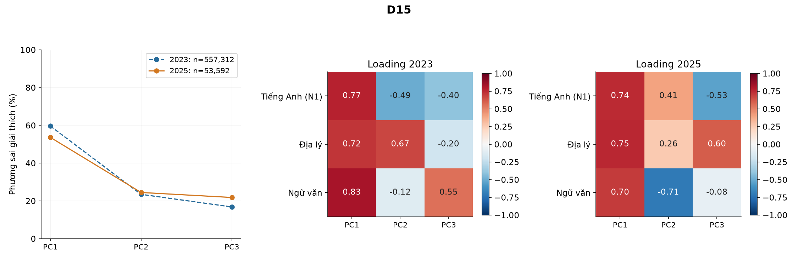

**Diễn giải hình:** Trái là scree/EVR của ba PC và n thực; giữa/phải là loading cùng thang −1..1. Tổng EVR bằng100%. Hai màu đường là hai năm, không là cùng người.

**Nhận xét bằng số:** PC1 giải thích 59,68% năm 2023 và 53,68% năm 2025; PC1+PC2 năm 2025 là 78,16%. Môn gắn mạnh nhất với PC1 năm 2025 theo |loading| là Địa lý (0,754). Trục này mô tả thành tích đồng biến/tương phản trong đúng ba môn đã chọn, không quy đổi được thành chênh năng lực tuyệt đối.

**Giải nghĩa trục bằng chính loading:** Năm2025, cả ba loading PC1 cùng dương, nên PC1 là trục thành tích cùng tăng trong khối này. PC2 đặt Tiếng Anh (N1) (loading 0,405) ở một phía và Ngữ văn (-0,709) ở phía kia. Đây là tương phản sau chuẩn hóa: điểm nghiêng về môn phía dương so với phía âm làm PC2 tăng; không phải một môn gây giảm môn kia hoặc một “năng lực thứ hai” đã được xác nhận.

**Ổn định cấu trúc:** |cosine| PC1=0,996 (gần1 là cùng hướng sau căn dấu); góc lớn nhất giữa hai không gian PC1–PC2=85,02°. Không phát hiện cặp eigenvalues liền kề cách nhau dưới5% theo quy tắc kiểm tra này; vẫn chưa là kiểm định bất biến đo lường.

| Năm | Cặp | n đủ khối | r trong khối | r tập đủ cặp | Chênh r |
| --- | --- | --- | --- | --- | --- |
| 2023 | Tiếng Anh (N1) – Địa lý | 557.312 | 0,303 | 0,303 | -0,000 |
| 2023 | Tiếng Anh (N1) – Ngữ văn | 557.312 | 0,475 | 0,366 | 0,108 |
| 2023 | Địa lý – Ngữ văn | 557.312 | 0,402 | 0,433 | -0,031 |
| 2025 | Tiếng Anh (N1) – Địa lý | 53.592 | 0,344 | 0,344 | -0,000 |
| 2025 | Tiếng Anh (N1) – Ngữ văn | 53.592 | 0,277 | 0,184 | 0,093 |
| 2025 | Địa lý – Ngữ văn | 53.592 | 0,293 | 0,529 | -0,236 |

**Diễn giải bảng:** Đây là kiểm tra nhạy với cách chọn mẫu: r trong khối dùng cùng nhóm đủ cả 3 môn; r toàn cặp chỉ cần đủ2. Chênh r cho thấy điều kiện có thêm môn thứ ba có thể thay đổi liên hệ. Hai ước lượng dùng mẫu lồng nhau, không coi là hai mẫu độc lập; bảng không chứng minh đã kiểm soát mọi khác biệt thành phần thí sinh.

### 4.6.15. D10

| Năm | n đủ 3 | Tỷ lệ đủ 3 trên mọi dòng | PC1 (%) | PC2 (%) | PC3 (%) |
| --- | --- | --- | --- | --- | --- |
| 2023 | 557.086 | 0,545 | 62,975 | 24,254 | 12,772 |
| 2025 | 53.567 | 0,047 | 59,845 | 21,915 | 18,239 |

**Diễn giải bảng:** Tỷ lệ là n đủ ba điểm chia số dòng nguồn cùng năm, không là tỷ lệ đăng ký/nguyện vọng. Mỗi năm chuẩn hóa riêng; dùng EVR để mô tả hình dạng biến thiên của chính nhóm đó.

| Năm | Môn | Loading PC1 | Loading PC2 | Loading PC3 |
| --- | --- | --- | --- | --- |
| 2023 | Tiếng Anh (N1) | 0,820 | -0,413 | -0,396 |
| 2023 | Địa lý | 0,679 | 0,725 | -0,112 |
| 2023 | Toán | 0,869 | -0,178 | 0,462 |
| 2025 | Tiếng Anh (N1) | 0,764 | -0,527 | -0,372 |
| 2025 | Địa lý | 0,749 | 0,613 | -0,253 |
| 2025 | Toán | 0,806 | -0,070 | 0,587 |

**Diễn giải bảng:** Giá trị tuyệt đối gần1 là môn gắn chặt với PC; dấu cùng chiều cho biết xu hướng cùng tăng theo trục. So độ lớn và mô hình dấu chung; không diễn giải một đảo dấu toàn PC thành đổi bản chất môn.

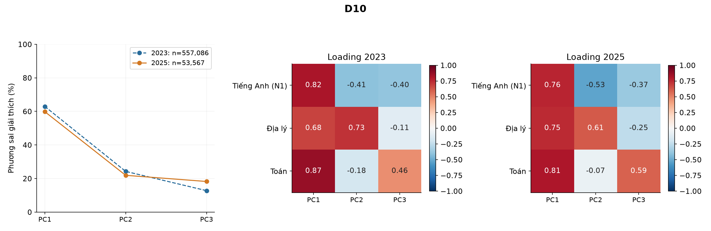

**Diễn giải hình:** Trái là scree/EVR của ba PC và n thực; giữa/phải là loading cùng thang −1..1. Tổng EVR bằng100%. Hai màu đường là hai năm, không là cùng người.

**Nhận xét bằng số:** PC1 giải thích 62,97% năm 2023 và 59,85% năm 2025; PC1+PC2 năm 2025 là 81,76%. Môn gắn mạnh nhất với PC1 năm 2025 theo |loading| là Toán (0,806). Trục này mô tả thành tích đồng biến/tương phản trong đúng ba môn đã chọn, không quy đổi được thành chênh năng lực tuyệt đối.

**Giải nghĩa trục bằng chính loading:** Năm2025, cả ba loading PC1 cùng dương, nên PC1 là trục thành tích cùng tăng trong khối này. PC2 đặt Địa lý (loading 0,613) ở một phía và Tiếng Anh (N1) (-0,527) ở phía kia. Đây là tương phản sau chuẩn hóa: điểm nghiêng về môn phía dương so với phía âm làm PC2 tăng; không phải một môn gây giảm môn kia hoặc một “năng lực thứ hai” đã được xác nhận.

**Ổn định cấu trúc:** |cosine| PC1=0,997 (gần1 là cùng hướng sau căn dấu); góc lớn nhất giữa hai không gian PC1–PC2=12,44°. Không phát hiện cặp eigenvalues liền kề cách nhau dưới5% theo quy tắc kiểm tra này; vẫn chưa là kiểm định bất biến đo lường.

| Năm | Cặp | n đủ khối | r trong khối | r tập đủ cặp | Chênh r |
| --- | --- | --- | --- | --- | --- |
| 2023 | Tiếng Anh (N1) – Địa lý | 557.086 | 0,303 | 0,303 | -0,000 |
| 2023 | Tiếng Anh (N1) – Toán | 557.086 | 0,603 | 0,592 | 0,011 |
| 2023 | Địa lý – Toán | 557.086 | 0,410 | 0,446 | -0,036 |
| 2025 | Tiếng Anh (N1) – Địa lý | 53.567 | 0,344 | 0,344 | 0,000 |
| 2025 | Tiếng Anh (N1) – Toán | 53.567 | 0,435 | 0,497 | -0,062 |
| 2025 | Địa lý – Toán | 53.567 | 0,413 | 0,554 | -0,142 |

**Diễn giải bảng:** Đây là kiểm tra nhạy với cách chọn mẫu: r trong khối dùng cùng nhóm đủ cả 3 môn; r toàn cặp chỉ cần đủ2. Chênh r cho thấy điều kiện có thêm môn thứ ba có thể thay đổi liên hệ. Hai ước lượng dùng mẫu lồng nhau, không coi là hai mẫu độc lập; bảng không chứng minh đã kiểm soát mọi khác biệt thành phần thí sinh.

### 4.6.16. D14

| Năm | n đủ 3 | Tỷ lệ đủ 3 trên mọi dòng | PC1 (%) | PC2 (%) | PC3 (%) |
| --- | --- | --- | --- | --- | --- |
| 2023 | 557.405 | 0,545 | 61,506 | 21,368 | 17,126 |
| 2025 | 69.989 | 0,062 | 56,207 | 23,168 | 20,624 |

**Diễn giải bảng:** Tỷ lệ là n đủ ba điểm chia số dòng nguồn cùng năm, không là tỷ lệ đăng ký/nguyện vọng. Mỗi năm chuẩn hóa riêng; dùng EVR để mô tả hình dạng biến thiên của chính nhóm đó.

| Năm | Môn | Loading PC1 | Loading PC2 | Loading PC3 |
| --- | --- | --- | --- | --- |
| 2023 | Tiếng Anh (N1) | 0,783 | -0,468 | -0,409 |
| 2023 | Lịch sử | 0,750 | 0,635 | -0,183 |
| 2023 | Ngữ văn | 0,818 | -0,134 | 0,560 |
| 2025 | Tiếng Anh (N1) | 0,749 | -0,488 | 0,448 |
| 2025 | Lịch sử | 0,774 | -0,147 | -0,616 |
| 2025 | Ngữ văn | 0,726 | 0,660 | 0,194 |

**Diễn giải bảng:** Giá trị tuyệt đối gần1 là môn gắn chặt với PC; dấu cùng chiều cho biết xu hướng cùng tăng theo trục. So độ lớn và mô hình dấu chung; không diễn giải một đảo dấu toàn PC thành đổi bản chất môn.

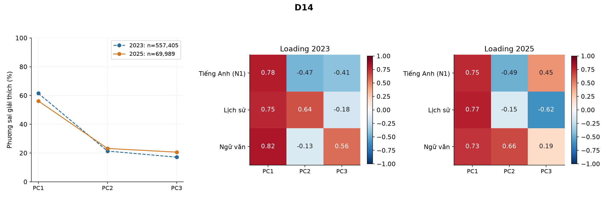

**Diễn giải hình:** Trái là scree/EVR của ba PC và n thực; giữa/phải là loading cùng thang −1..1. Tổng EVR bằng100%. Hai màu đường là hai năm, không là cùng người.

**Nhận xét bằng số:** PC1 giải thích 61,51% năm 2023 và 56,21% năm 2025; PC1+PC2 năm 2025 là 79,38%. Môn gắn mạnh nhất với PC1 năm 2025 theo |loading| là Lịch sử (0,774). Trục này mô tả thành tích đồng biến/tương phản trong đúng ba môn đã chọn, không quy đổi được thành chênh năng lực tuyệt đối.

**Giải nghĩa trục bằng chính loading:** Năm2025, cả ba loading PC1 cùng dương, nên PC1 là trục thành tích cùng tăng trong khối này. PC2 đặt Ngữ văn (loading 0,660) ở một phía và Tiếng Anh (N1) (-0,488) ở phía kia. Đây là tương phản sau chuẩn hóa: điểm nghiêng về môn phía dương so với phía âm làm PC2 tăng; không phải một môn gây giảm môn kia hoặc một “năng lực thứ hai” đã được xác nhận.

**Ổn định cấu trúc:** |cosine| PC1=0,998 (gần1 là cùng hướng sau căn dấu); góc lớn nhất giữa hai không gian PC1–PC2=86,12°. Không phát hiện cặp eigenvalues liền kề cách nhau dưới5% theo quy tắc kiểm tra này; vẫn chưa là kiểm định bất biến đo lường.

| Năm | Cặp | n đủ khối | r trong khối | r tập đủ cặp | Chênh r |
| --- | --- | --- | --- | --- | --- |
| 2023 | Tiếng Anh (N1) – Lịch sử | 557.405 | 0,365 | 0,365 | -0,000 |
| 2023 | Tiếng Anh (N1) – Ngữ văn | 557.405 | 0,475 | 0,366 | 0,109 |
| 2023 | Lịch sử – Ngữ văn | 557.405 | 0,426 | 0,453 | -0,027 |
| 2025 | Tiếng Anh (N1) – Lịch sử | 69.989 | 0,375 | 0,375 | 0,000 |
| 2025 | Tiếng Anh (N1) – Ngữ văn | 69.989 | 0,309 | 0,184 | 0,125 |
| 2025 | Lịch sử – Ngữ văn | 69.989 | 0,345 | 0,527 | -0,182 |

**Diễn giải bảng:** Đây là kiểm tra nhạy với cách chọn mẫu: r trong khối dùng cùng nhóm đủ cả 3 môn; r toàn cặp chỉ cần đủ2. Chênh r cho thấy điều kiện có thêm môn thứ ba có thể thay đổi liên hệ. Hai ước lượng dùng mẫu lồng nhau, không coi là hai mẫu độc lập; bảng không chứng minh đã kiểm soát mọi khác biệt thành phần thí sinh.

### 4.6.17. D09

| Năm | n đủ 3 | Tỷ lệ đủ 3 trên mọi dòng | PC1 (%) | PC2 (%) | PC3 (%) |
| --- | --- | --- | --- | --- | --- |
| 2023 | 557.198 | 0,545 | 64,622 | 22,337 | 13,042 |
| 2025 | 69.904 | 0,062 | 59,902 | 21,516 | 18,582 |

**Diễn giải bảng:** Tỷ lệ là n đủ ba điểm chia số dòng nguồn cùng năm, không là tỷ lệ đăng ký/nguyện vọng. Mỗi năm chuẩn hóa riêng; dùng EVR để mô tả hình dạng biến thiên của chính nhóm đó.

| Năm | Môn | Loading PC1 | Loading PC2 | Loading PC3 |
| --- | --- | --- | --- | --- |
| 2023 | Tiếng Anh (N1) | 0,830 | -0,377 | -0,412 |
| 2023 | Lịch sử | 0,715 | 0,695 | -0,080 |
| 2023 | Toán | 0,860 | -0,214 | 0,464 |
| 2025 | Tiếng Anh (N1) | 0,788 | -0,323 | -0,524 |
| 2025 | Lịch sử | 0,744 | 0,668 | -0,009 |
| 2025 | Toán | 0,789 | -0,307 | 0,532 |

**Diễn giải bảng:** Giá trị tuyệt đối gần1 là môn gắn chặt với PC; dấu cùng chiều cho biết xu hướng cùng tăng theo trục. So độ lớn và mô hình dấu chung; không diễn giải một đảo dấu toàn PC thành đổi bản chất môn.

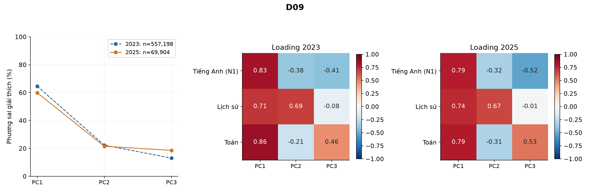

**Diễn giải hình:** Trái là scree/EVR của ba PC và n thực; giữa/phải là loading cùng thang −1..1. Tổng EVR bằng100%. Hai màu đường là hai năm, không là cùng người.

**Nhận xét bằng số:** PC1 giải thích 64,62% năm 2023 và 59,90% năm 2025; PC1+PC2 năm 2025 là 81,42%. Môn gắn mạnh nhất với PC1 năm 2025 theo |loading| là Toán (0,789). Trục này mô tả thành tích đồng biến/tương phản trong đúng ba môn đã chọn, không quy đổi được thành chênh năng lực tuyệt đối.

**Giải nghĩa trục bằng chính loading:** Năm2025, cả ba loading PC1 cùng dương, nên PC1 là trục thành tích cùng tăng trong khối này. PC2 đặt Lịch sử (loading 0,668) ở một phía và Tiếng Anh (N1) (-0,323) ở phía kia. Đây là tương phản sau chuẩn hóa: điểm nghiêng về môn phía dương so với phía âm làm PC2 tăng; không phải một môn gây giảm môn kia hoặc một “năng lực thứ hai” đã được xác nhận.

**Ổn định cấu trúc:** |cosine| PC1=0,999 (gần1 là cùng hướng sau căn dấu); góc lớn nhất giữa hai không gian PC1–PC2=7,35°. Không phát hiện cặp eigenvalues liền kề cách nhau dưới5% theo quy tắc kiểm tra này; vẫn chưa là kiểm định bất biến đo lường.

| Năm | Cặp | n đủ khối | r trong khối | r tập đủ cặp | Chênh r |
| --- | --- | --- | --- | --- | --- |
| 2023 | Tiếng Anh (N1) – Lịch sử | 557.198 | 0,365 | 0,365 | -0,000 |
| 2023 | Tiếng Anh (N1) – Toán | 557.198 | 0,603 | 0,592 | 0,011 |
| 2023 | Lịch sử – Toán | 557.198 | 0,429 | 0,469 | -0,040 |
| 2025 | Tiếng Anh (N1) – Lịch sử | 69.904 | 0,375 | 0,375 | 0,000 |
| 2025 | Tiếng Anh (N1) – Toán | 69.904 | 0,443 | 0,497 | -0,054 |
| 2025 | Lịch sử – Toán | 69.904 | 0,377 | 0,518 | -0,141 |

**Diễn giải bảng:** Đây là kiểm tra nhạy với cách chọn mẫu: r trong khối dùng cùng nhóm đủ cả 3 môn; r toàn cặp chỉ cần đủ2. Chênh r cho thấy điều kiện có thêm môn thứ ba có thể thay đổi liên hệ. Hai ước lượng dùng mẫu lồng nhau, không coi là hai mẫu độc lập; bảng không chứng minh đã kiểm soát mọi khác biệt thành phần thí sinh.

### 4.6.18. D01

| Năm | n đủ 3 | Tỷ lệ đủ 3 trên mọi dòng | PC1 (%) | PC2 (%) | PC3 (%) |
| --- | --- | --- | --- | --- | --- |
| 2023 | 873.126 | 0,854 | 63,543 | 22,859 | 13,597 |
| 2025 | 350.654 | 0,310 | 54,127 | 29,144 | 16,729 |

**Diễn giải bảng:** Tỷ lệ là n đủ ba điểm chia số dòng nguồn cùng năm, không là tỷ lệ đăng ký/nguyện vọng. Mỗi năm chuẩn hóa riêng; dùng EVR để mô tả hình dạng biến thiên của chính nhóm đó.

| Năm | Môn | Loading PC1 | Loading PC2 | Loading PC3 |
| --- | --- | --- | --- | --- |
| 2023 | Tiếng Anh (N1) | 0,836 | -0,327 | -0,441 |
| 2023 | Ngữ văn | 0,701 | 0,712 | -0,030 |
| 2023 | Toán | 0,846 | -0,267 | 0,461 |
| 2025 | Tiếng Anh (N1) | 0,814 | -0,306 | -0,493 |
| 2025 | Ngữ văn | 0,524 | 0,851 | -0,035 |
| 2025 | Toán | 0,828 | -0,238 | 0,507 |

**Diễn giải bảng:** Giá trị tuyệt đối gần1 là môn gắn chặt với PC; dấu cùng chiều cho biết xu hướng cùng tăng theo trục. So độ lớn và mô hình dấu chung; không diễn giải một đảo dấu toàn PC thành đổi bản chất môn.

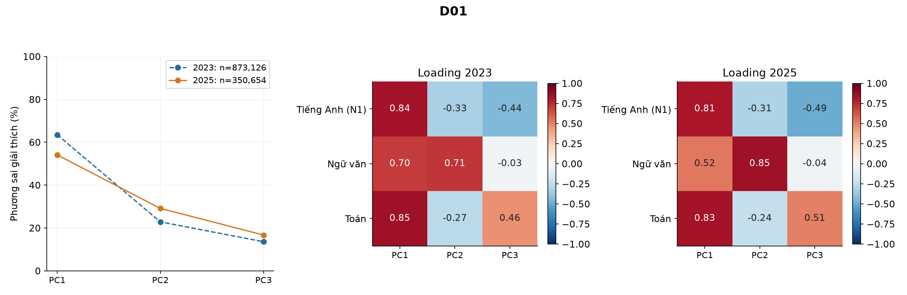

**Diễn giải hình:** Trái là scree/EVR của ba PC và n thực; giữa/phải là loading cùng thang −1..1. Tổng EVR bằng100%. Hai màu đường là hai năm, không là cùng người.

**Nhận xét bằng số:** PC1 giải thích 63,54% năm 2023 và 54,13% năm 2025; PC1+PC2 năm 2025 là 83,27%. Môn gắn mạnh nhất với PC1 năm 2025 theo |loading| là Toán (0,828). Trục này mô tả thành tích đồng biến/tương phản trong đúng ba môn đã chọn, không quy đổi được thành chênh năng lực tuyệt đối.

**Giải nghĩa trục bằng chính loading:** Năm2025, cả ba loading PC1 cùng dương, nên PC1 là trục thành tích cùng tăng trong khối này. PC2 đặt Ngữ văn (loading 0,851) ở một phía và Tiếng Anh (N1) (-0,306) ở phía kia. Đây là tương phản sau chuẩn hóa: điểm nghiêng về môn phía dương so với phía âm làm PC2 tăng; không phải một môn gây giảm môn kia hoặc một “năng lực thứ hai” đã được xác nhận.

**Ổn định cấu trúc:** |cosine| PC1=0,994 (gần1 là cùng hướng sau căn dấu); góc lớn nhất giữa hai không gian PC1–PC2=0,44°. Không phát hiện cặp eigenvalues liền kề cách nhau dưới5% theo quy tắc kiểm tra này; vẫn chưa là kiểm định bất biến đo lường.

| Năm | Cặp | n đủ khối | r trong khối | r tập đủ cặp | Chênh r |
| --- | --- | --- | --- | --- | --- |
| 2023 | Tiếng Anh (N1) – Ngữ văn | 873.126 | 0,366 | 0,366 | -0,000 |
| 2023 | Tiếng Anh (N1) – Toán | 873.126 | 0,591 | 0,592 | -0,000 |
| 2023 | Ngữ văn – Toán | 873.126 | 0,389 | 0,459 | -0,069 |
| 2025 | Tiếng Anh (N1) – Ngữ văn | 350.654 | 0,184 | 0,184 | -0,000 |
| 2025 | Tiếng Anh (N1) – Toán | 350.654 | 0,497 | 0,497 | 0,000 |
| 2025 | Ngữ văn – Toán | 350.654 | 0,214 | 0,383 | -0,169 |

**Diễn giải bảng:** Đây là kiểm tra nhạy với cách chọn mẫu: r trong khối dùng cùng nhóm đủ cả 3 môn; r toàn cặp chỉ cần đủ2. Chênh r cho thấy điều kiện có thêm môn thứ ba có thể thay đổi liên hệ. Hai ước lượng dùng mẫu lồng nhau, không coi là hai mẫu độc lập; bảng không chứng minh đã kiểm soát mọi khác biệt thành phần thí sinh.

### 4.6.19. A01

| Năm | n đủ 3 | Tỷ lệ đủ 3 trên mọi dòng | PC1 (%) | PC2 (%) | PC3 (%) |
| --- | --- | --- | --- | --- | --- |
| 2023 | 314.412 | 0,308 | 61,976 | 23,847 | 14,176 |
| 2025 | 146.960 | 0,130 | 70,353 | 18,481 | 11,167 |

**Diễn giải bảng:** Tỷ lệ là n đủ ba điểm chia số dòng nguồn cùng năm, không là tỷ lệ đăng ký/nguyện vọng. Mỗi năm chuẩn hóa riêng; dùng EVR để mô tả hình dạng biến thiên của chính nhóm đó.

| Năm | Môn | Loading PC1 | Loading PC2 | Loading PC3 |
| --- | --- | --- | --- | --- |
| 2023 | Tiếng Anh (N1) | 0,687 | 0,721 | -0,092 |
| 2023 | Toán | 0,850 | -0,207 | 0,484 |
| 2023 | Vật lý | 0,815 | -0,391 | -0,427 |
| 2025 | Tiếng Anh (N1) | 0,780 | 0,623 | -0,061 |
| 2025 | Toán | 0,876 | -0,218 | 0,429 |
| 2025 | Vật lý | 0,857 | -0,344 | -0,383 |

**Diễn giải bảng:** Giá trị tuyệt đối gần1 là môn gắn chặt với PC; dấu cùng chiều cho biết xu hướng cùng tăng theo trục. So độ lớn và mô hình dấu chung; không diễn giải một đảo dấu toàn PC thành đổi bản chất môn.

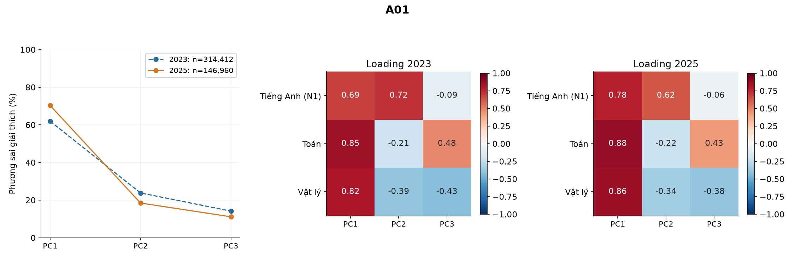

**Diễn giải hình:** Trái là scree/EVR của ba PC và n thực; giữa/phải là loading cùng thang −1..1. Tổng EVR bằng100%. Hai màu đường là hai năm, không là cùng người.

**Nhận xét bằng số:** PC1 giải thích 61,98% năm 2023 và 70,35% năm 2025; PC1+PC2 năm 2025 là 88,83%. Môn gắn mạnh nhất với PC1 năm 2025 theo |loading| là Toán (0,876). Trục này mô tả thành tích đồng biến/tương phản trong đúng ba môn đã chọn, không quy đổi được thành chênh năng lực tuyệt đối.

**Giải nghĩa trục bằng chính loading:** Năm2025, cả ba loading PC1 cùng dương, nên PC1 là trục thành tích cùng tăng trong khối này. PC2 đặt Tiếng Anh (N1) (loading 0,623) ở một phía và Vật lý (-0,344) ở phía kia. Đây là tương phản sau chuẩn hóa: điểm nghiêng về môn phía dương so với phía âm làm PC2 tăng; không phải một môn gây giảm môn kia hoặc một “năng lực thứ hai” đã được xác nhận.

**Ổn định cấu trúc:** |cosine| PC1=0,999 (gần1 là cùng hướng sau căn dấu); góc lớn nhất giữa hai không gian PC1–PC2=2,09°. Không phát hiện cặp eigenvalues liền kề cách nhau dưới5% theo quy tắc kiểm tra này; vẫn chưa là kiểm định bất biến đo lường.

| Năm | Cặp | n đủ khối | r trong khối | r tập đủ cặp | Chênh r |
| --- | --- | --- | --- | --- | --- |
| 2023 | Tiếng Anh (N1) – Toán | 314.412 | 0,390 | 0,592 | -0,202 |
| 2023 | Tiếng Anh (N1) – Vật lý | 314.412 | 0,318 | 0,318 | -0,000 |
| 2023 | Toán – Vật lý | 314.412 | 0,567 | 0,568 | -0,000 |
| 2025 | Tiếng Anh (N1) – Toán | 146.960 | 0,521 | 0,497 | 0,024 |
| 2025 | Tiếng Anh (N1) – Vật lý | 146.960 | 0,477 | 0,477 | 0,000 |
| 2025 | Toán – Vật lý | 146.960 | 0,662 | 0,709 | -0,048 |

**Diễn giải bảng:** Đây là kiểm tra nhạy với cách chọn mẫu: r trong khối dùng cùng nhóm đủ cả 3 môn; r toàn cặp chỉ cần đủ2. Chênh r cho thấy điều kiện có thêm môn thứ ba có thể thay đổi liên hệ. Hai ước lượng dùng mẫu lồng nhau, không coi là hai mẫu độc lập; bảng không chứng minh đã kiểm soát mọi khác biệt thành phần thí sinh.

### 4.6.20. C00

| Năm | n đủ 3 | Tỷ lệ đủ 3 trên mọi dòng | PC1 (%) | PC2 (%) | PC3 (%) |
| --- | --- | --- | --- | --- | --- |
| 2023 | 681.723 | 0,667 | 66,681 | 20,284 | 13,036 |
| 2025 | 297.377 | 0,263 | 74,586 | 17,388 | 8,027 |

**Diễn giải bảng:** Tỷ lệ là n đủ ba điểm chia số dòng nguồn cùng năm, không là tỷ lệ đăng ký/nguyện vọng. Mỗi năm chuẩn hóa riêng; dùng EVR để mô tả hình dạng biến thiên của chính nhóm đó.

| Năm | Môn | Loading PC1 | Loading PC2 | Loading PC3 |
| --- | --- | --- | --- | --- |
| 2023 | Địa lý | 0,843 | -0,323 | -0,430 |
| 2023 | Lịch sử | 0,852 | -0,262 | 0,453 |
| 2023 | Ngữ văn | 0,751 | 0,660 | -0,031 |
| 2025 | Địa lý | 0,901 | -0,252 | -0,352 |
| 2025 | Lịch sử | 0,895 | -0,287 | 0,341 |
| 2025 | Ngữ văn | 0,790 | 0,613 | 0,015 |

**Diễn giải bảng:** Giá trị tuyệt đối gần1 là môn gắn chặt với PC; dấu cùng chiều cho biết xu hướng cùng tăng theo trục. So độ lớn và mô hình dấu chung; không diễn giải một đảo dấu toàn PC thành đổi bản chất môn.

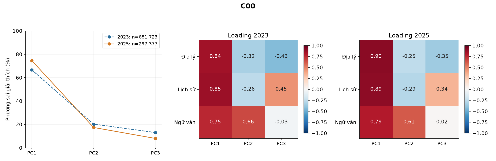

**Diễn giải hình:** Trái là scree/EVR của ba PC và n thực; giữa/phải là loading cùng thang −1..1. Tổng EVR bằng100%. Hai màu đường là hai năm, không là cùng người.

**Nhận xét bằng số:** PC1 giải thích 66,68% năm 2023 và 74,59% năm 2025; PC1+PC2 năm 2025 là 91,97%. Môn gắn mạnh nhất với PC1 năm 2025 theo |loading| là Địa lý (0,901). Trục này mô tả thành tích đồng biến/tương phản trong đúng ba môn đã chọn, không quy đổi được thành chênh năng lực tuyệt đối.

**Giải nghĩa trục bằng chính loading:** Năm2025, cả ba loading PC1 cùng dương, nên PC1 là trục thành tích cùng tăng trong khối này. PC2 đặt Ngữ văn (loading 0,613) ở một phía và Lịch sử (-0,287) ở phía kia. Đây là tương phản sau chuẩn hóa: điểm nghiêng về môn phía dương so với phía âm làm PC2 tăng; không phải một môn gây giảm môn kia hoặc một “năng lực thứ hai” đã được xác nhận.

**Ổn định cấu trúc:** |cosine| PC1=1,000 (gần1 là cùng hướng sau căn dấu); góc lớn nhất giữa hai không gian PC1–PC2=5,19°. Không phát hiện cặp eigenvalues liền kề cách nhau dưới5% theo quy tắc kiểm tra này; vẫn chưa là kiểm định bất biến đo lường.

| Năm | Cặp | n đủ khối | r trong khối | r tập đủ cặp | Chênh r |
| --- | --- | --- | --- | --- | --- |
| 2023 | Địa lý – Lịch sử | 681.723 | 0,608 | 0,608 | -0,000 |
| 2023 | Địa lý – Ngữ văn | 681.723 | 0,433 | 0,433 | -0,000 |
| 2023 | Lịch sử – Ngữ văn | 681.723 | 0,453 | 0,453 | -0,000 |
| 2025 | Địa lý – Lịch sử | 297.377 | 0,759 | 0,759 | -0,000 |
| 2025 | Địa lý – Ngữ văn | 297.377 | 0,552 | 0,529 | 0,023 |
| 2025 | Lịch sử – Ngữ văn | 297.377 | 0,536 | 0,527 | 0,009 |

**Diễn giải bảng:** Đây là kiểm tra nhạy với cách chọn mẫu: r trong khối dùng cùng nhóm đủ cả 3 môn; r toàn cặp chỉ cần đủ2. Chênh r cho thấy điều kiện có thêm môn thứ ba có thể thay đổi liên hệ. Hai ước lượng dùng mẫu lồng nhau, không coi là hai mẫu độc lập; bảng không chứng minh đã kiểm soát mọi khác biệt thành phần thí sinh.

### 4.6.21. C04

| Năm | n đủ 3 | Tỷ lệ đủ 3 trên mọi dòng | PC1 (%) | PC2 (%) | PC3 (%) |
| --- | --- | --- | --- | --- | --- |
| 2023 | 668.369 | 0,654 | 65,499 | 20,032 | 14,469 |
| 2025 | 472.025 | 0,417 | 67,641 | 18,096 | 14,263 |

**Diễn giải bảng:** Tỷ lệ là n đủ ba điểm chia số dòng nguồn cùng năm, không là tỷ lệ đăng ký/nguyện vọng. Mỗi năm chuẩn hóa riêng; dùng EVR để mô tả hình dạng biến thiên của chính nhóm đó.

| Năm | Môn | Loading PC1 | Loading PC2 | Loading PC3 |
| --- | --- | --- | --- | --- |
| 2023 | Địa lý | 0,758 | 0,651 | -0,027 |
| 2023 | Ngữ văn | 0,830 | -0,322 | -0,455 |
| 2023 | Toán | 0,837 | -0,271 | 0,476 |
| 2025 | Địa lý | 0,851 | 0,072 | -0,521 |
| 2025 | Ngữ văn | 0,801 | -0,559 | 0,215 |
| 2025 | Toán | 0,815 | 0,474 | 0,332 |

**Diễn giải bảng:** Giá trị tuyệt đối gần1 là môn gắn chặt với PC; dấu cùng chiều cho biết xu hướng cùng tăng theo trục. So độ lớn và mô hình dấu chung; không diễn giải một đảo dấu toàn PC thành đổi bản chất môn.

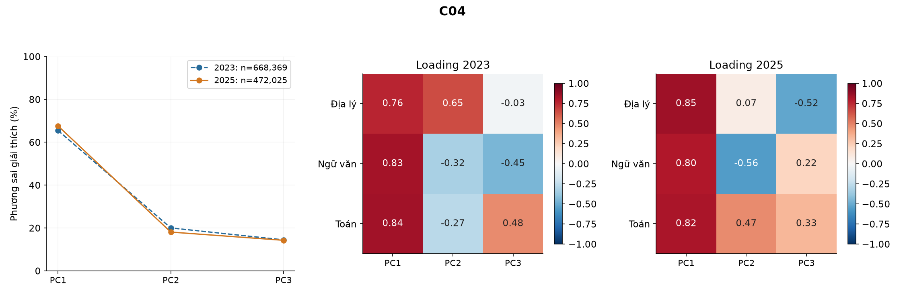

**Diễn giải hình:** Trái là scree/EVR của ba PC và n thực; giữa/phải là loading cùng thang −1..1. Tổng EVR bằng100%. Hai màu đường là hai năm, không là cùng người.

**Nhận xét bằng số:** PC1 giải thích 65,50% năm 2023 và 67,64% năm 2025; PC1+PC2 năm 2025 là 85,74%. Môn gắn mạnh nhất với PC1 năm 2025 theo |loading| là Địa lý (0,851). Trục này mô tả thành tích đồng biến/tương phản trong đúng ba môn đã chọn, không quy đổi được thành chênh năng lực tuyệt đối.

**Giải nghĩa trục bằng chính loading:** Năm2025, cả ba loading PC1 cùng dương, nên PC1 là trục thành tích cùng tăng trong khối này. PC2 đặt Toán (loading 0,474) ở một phía và Ngữ văn (-0,559) ở phía kia. Đây là tương phản sau chuẩn hóa: điểm nghiêng về môn phía dương so với phía âm làm PC2 tăng; không phải một môn gây giảm môn kia hoặc một “năng lực thứ hai” đã được xác nhận.

**Ổn định cấu trúc:** |cosine| PC1=0,998 (gần1 là cùng hướng sau căn dấu); góc lớn nhất giữa hai không gian PC1–PC2=80,09°. Không phát hiện cặp eigenvalues liền kề cách nhau dưới5% theo quy tắc kiểm tra này; vẫn chưa là kiểm định bất biến đo lường.

| Năm | Cặp | n đủ khối | r trong khối | r tập đủ cặp | Chênh r |
| --- | --- | --- | --- | --- | --- |
| 2023 | Địa lý – Ngữ văn | 668.369 | 0,432 | 0,433 | -0,001 |
| 2023 | Địa lý – Toán | 668.369 | 0,446 | 0,446 | -0,000 |
| 2023 | Ngữ văn – Toán | 668.369 | 0,566 | 0,459 | 0,107 |
| 2025 | Địa lý – Ngữ văn | 472.025 | 0,529 | 0,529 | -0,000 |
| 2025 | Địa lý – Toán | 472.025 | 0,554 | 0,554 | -0,000 |
| 2025 | Ngữ văn – Toán | 472.025 | 0,459 | 0,383 | 0,076 |

**Diễn giải bảng:** Đây là kiểm tra nhạy với cách chọn mẫu: r trong khối dùng cùng nhóm đủ cả 3 môn; r toàn cặp chỉ cần đủ2. Chênh r cho thấy điều kiện có thêm môn thứ ba có thể thay đổi liên hệ. Hai ước lượng dùng mẫu lồng nhau, không coi là hai mẫu độc lập; bảng không chứng minh đã kiểm soát mọi khác biệt thành phần thí sinh.

### 4.6.22. C03

| Năm | n đủ 3 | Tỷ lệ đủ 3 trên mọi dòng | PC1 (%) | PC2 (%) | PC3 (%) |
| --- | --- | --- | --- | --- | --- |
| 2023 | 669.692 | 0,655 | 66,489 | 19,046 | 14,465 |
| 2025 | 476.660 | 0,421 | 67,082 | 17,559 | 15,358 |

**Diễn giải bảng:** Tỷ lệ là n đủ ba điểm chia số dòng nguồn cùng năm, không là tỷ lệ đăng ký/nguyện vọng. Mỗi năm chuẩn hóa riêng; dùng EVR để mô tả hình dạng biến thiên của chính nhóm đó.

| Năm | Môn | Loading PC1 | Loading PC2 | Loading PC3 |
| --- | --- | --- | --- | --- |
| 2023 | Lịch sử | 0,775 | 0,631 | -0,033 |
| 2023 | Ngữ văn | 0,831 | -0,324 | -0,452 |
| 2023 | Toán | 0,838 | -0,262 | 0,478 |
| 2025 | Lịch sử | 0,836 | 0,043 | 0,547 |
| 2025 | Ngữ văn | 0,813 | 0,488 | -0,318 |
| 2025 | Toán | 0,808 | -0,535 | -0,246 |

**Diễn giải bảng:** Giá trị tuyệt đối gần1 là môn gắn chặt với PC; dấu cùng chiều cho biết xu hướng cùng tăng theo trục. So độ lớn và mô hình dấu chung; không diễn giải một đảo dấu toàn PC thành đổi bản chất môn.

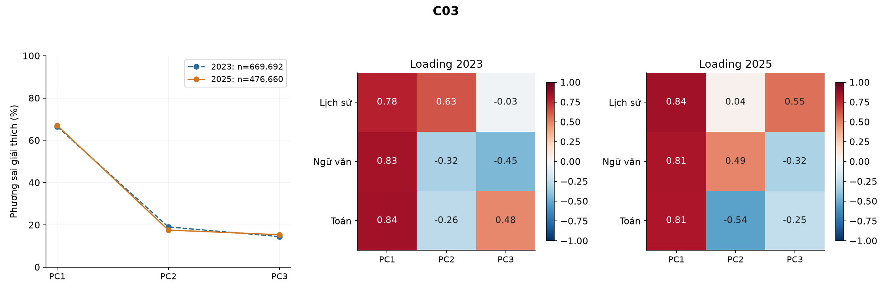

**Diễn giải hình:** Trái là scree/EVR của ba PC và n thực; giữa/phải là loading cùng thang −1..1. Tổng EVR bằng100%. Hai màu đường là hai năm, không là cùng người.

**Nhận xét bằng số:** PC1 giải thích 66,49% năm 2023 và 67,08% năm 2025; PC1+PC2 năm 2025 là 84,64%. Môn gắn mạnh nhất với PC1 năm 2025 theo |loading| là Lịch sử (0,836). Trục này mô tả thành tích đồng biến/tương phản trong đúng ba môn đã chọn, không quy đổi được thành chênh năng lực tuyệt đối.

**Giải nghĩa trục bằng chính loading:** Năm2025, cả ba loading PC1 cùng dương, nên PC1 là trục thành tích cùng tăng trong khối này. PC2 đặt Ngữ văn (loading 0,488) ở một phía và Toán (-0,535) ở phía kia. Đây là tương phản sau chuẩn hóa: điểm nghiêng về môn phía dương so với phía âm làm PC2 tăng; không phải một môn gây giảm môn kia hoặc một “năng lực thứ hai” đã được xác nhận.

**Ổn định cấu trúc:** |cosine| PC1=0,999 (gần1 là cùng hướng sau căn dấu); góc lớn nhất giữa hai không gian PC1–PC2=88,98°. Không phát hiện cặp eigenvalues liền kề cách nhau dưới5% theo quy tắc kiểm tra này; vẫn chưa là kiểm định bất biến đo lường.

| Năm | Cặp | n đủ khối | r trong khối | r tập đủ cặp | Chênh r |
| --- | --- | --- | --- | --- | --- |
| 2023 | Lịch sử – Ngữ văn | 669.692 | 0,455 | 0,453 | 0,002 |
| 2023 | Lịch sử – Toán | 669.692 | 0,469 | 0,469 | -0,000 |
| 2023 | Ngữ văn – Toán | 669.692 | 0,566 | 0,459 | 0,107 |
| 2025 | Lịch sử – Ngữ văn | 476.660 | 0,527 | 0,527 | -0,000 |
| 2025 | Lịch sử – Toán | 476.660 | 0,518 | 0,518 | 0,000 |
| 2025 | Ngữ văn – Toán | 476.660 | 0,474 | 0,383 | 0,091 |

**Diễn giải bảng:** Đây là kiểm tra nhạy với cách chọn mẫu: r trong khối dùng cùng nhóm đủ cả 3 môn; r toàn cặp chỉ cần đủ2. Chênh r cho thấy điều kiện có thêm môn thứ ba có thể thay đổi liên hệ. Hai ước lượng dùng mẫu lồng nhau, không coi là hai mẫu độc lập; bảng không chứng minh đã kiểm soát mọi khác biệt thành phần thí sinh.

### 4.6.23. C01

| Năm | n đủ 3 | Tỷ lệ đủ 3 trên mọi dòng | PC1 (%) | PC2 (%) | PC3 (%) |
| --- | --- | --- | --- | --- | --- |
| 2023 | 320.523 | 0,314 | 56,271 | 29,387 | 14,341 |
| 2025 | 345.014 | 0,305 | 60,933 | 29,394 | 9,673 |

**Diễn giải bảng:** Tỷ lệ là n đủ ba điểm chia số dòng nguồn cùng năm, không là tỷ lệ đăng ký/nguyện vọng. Mỗi năm chuẩn hóa riêng; dùng EVR để mô tả hình dạng biến thiên của chính nhóm đó.

| Năm | Môn | Loading PC1 | Loading PC2 | Loading PC3 |
| --- | --- | --- | --- | --- |
| 2023 | Ngữ văn | 0,502 | 0,864 | -0,043 |
| 2023 | Toán | 0,857 | -0,212 | 0,470 |
| 2023 | Vật lý | 0,838 | -0,300 | -0,455 |
| 2025 | Ngữ văn | 0,479 | 0,878 | -0,013 |
| 2025 | Toán | 0,898 | -0,219 | 0,383 |
| 2025 | Vật lý | 0,891 | -0,251 | -0,379 |

**Diễn giải bảng:** Giá trị tuyệt đối gần1 là môn gắn chặt với PC; dấu cùng chiều cho biết xu hướng cùng tăng theo trục. So độ lớn và mô hình dấu chung; không diễn giải một đảo dấu toàn PC thành đổi bản chất môn.

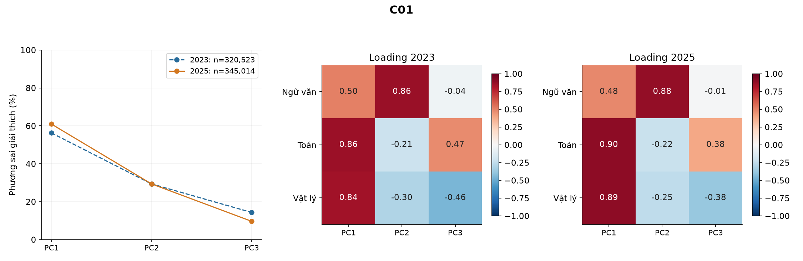

**Diễn giải hình:** Trái là scree/EVR của ba PC và n thực; giữa/phải là loading cùng thang −1..1. Tổng EVR bằng100%. Hai màu đường là hai năm, không là cùng người.

**Nhận xét bằng số:** PC1 giải thích 56,27% năm 2023 và 60,93% năm 2025; PC1+PC2 năm 2025 là 90,33%. Môn gắn mạnh nhất với PC1 năm 2025 theo |loading| là Toán (0,898). Trục này mô tả thành tích đồng biến/tương phản trong đúng ba môn đã chọn, không quy đổi được thành chênh năng lực tuyệt đối.

**Giải nghĩa trục bằng chính loading:** Năm2025, cả ba loading PC1 cùng dương, nên PC1 là trục thành tích cùng tăng trong khối này. PC2 đặt Ngữ văn (loading 0,878) ở một phía và Vật lý (-0,251) ở phía kia. Đây là tương phản sau chuẩn hóa: điểm nghiêng về môn phía dương so với phía âm làm PC2 tăng; không phải một môn gây giảm môn kia hoặc một “năng lực thứ hai” đã được xác nhận.

**Ổn định cấu trúc:** |cosine| PC1=0,999 (gần1 là cùng hướng sau căn dấu); góc lớn nhất giữa hai không gian PC1–PC2=2,43°. Không phát hiện cặp eigenvalues liền kề cách nhau dưới5% theo quy tắc kiểm tra này; vẫn chưa là kiểm định bất biến đo lường.

| Năm | Cặp | n đủ khối | r trong khối | r tập đủ cặp | Chênh r |
| --- | --- | --- | --- | --- | --- |
| 2023 | Ngữ văn – Toán | 320.523 | 0,226 | 0,459 | -0,232 |
| 2023 | Ngữ văn – Vật lý | 320.523 | 0,181 | 0,181 | -0,000 |
| 2023 | Toán – Vật lý | 320.523 | 0,568 | 0,568 | 0,000 |
| 2025 | Ngữ văn – Toán | 345.014 | 0,232 | 0,383 | -0,150 |
| 2025 | Ngữ văn – Vật lý | 345.014 | 0,211 | 0,211 | 0,000 |
| 2025 | Toán – Vật lý | 345.014 | 0,709 | 0,709 | 0,000 |

**Diễn giải bảng:** Đây là kiểm tra nhạy với cách chọn mẫu: r trong khối dùng cùng nhóm đủ cả 3 môn; r toàn cặp chỉ cần đủ2. Chênh r cho thấy điều kiện có thêm môn thứ ba có thể thay đổi liên hệ. Hai ước lượng dùng mẫu lồng nhau, không coi là hai mẫu độc lập; bảng không chứng minh đã kiểm soát mọi khác biệt thành phần thí sinh.

**Đối chiếu Duy và phạm vi bổ sung:** Năm khối A00/A01/B00/C00/D01 được đối chiếu n và EVR với bản Duy; phần này mở rộng lên đủ24 mã/23 bộ mỗi năm, bổ sung loading, ý nghĩa trục và kiểm tra chọn mẫu. Không tạo mô hình trùng B08/D08. [PCA/SVD](https://scikit-learn.org/stable/modules/decomposition.html#pca), [góc không gian con](https://docs.scipy.org/doc/scipy/reference/generated/scipy.linalg.subspace_angles.html).

## Độ trải rộng điểm và độ phân biệt của đề

SD/IQR mô tả độ trải rộng tổng điểm, r mô tả quan hệ giữa hai môn. Chúng không đo trực tiếp độ phân biệt của từng câu hỏi. Cần dữ liệu theo câu và mô hình đo lường phù hợp để kết luận về chất lượng phân hóa đề; không thay bằng phát biểu “Toán–Lý tương quan cao nên đề phân hóa tốt”.

## Phụ lục — mọi cặp môn, số mẫu và hệ số

### Mọi cặp năm 2023

| Môn X | Môn Y | n cặp | r | rho | Trạng thái |
| --- | --- | --- | --- | --- | --- |
| Sinh học | Hóa học | 324.571 | 0,407 | 0,390 | estimated |
| Sinh học | GDCD | 0 | — | — | insufficient_sample |
| Sinh học | Tiếng Anh (N1) | 313.081 | 0,286 | 0,284 | estimated |
| Sinh học | Tiếng Nga (N2) | 5 | — | — | insufficient_sample |
| Sinh học | Tiếng Pháp (N3) | 195 | 0,405 | 0,404 | estimated |
| Sinh học | Tiếng Trung (N4) | 308 | 0,293 | 0,334 | estimated |
| Sinh học | Tiếng Đức (N5) | 25 | — | — | insufficient_sample |
| Sinh học | Tiếng Nhật (N6) | 137 | 0,380 | 0,406 | estimated |
| Sinh học | Tiếng Hàn (N7) | 64 | 0,029 | 0,068 | limited_sample |
| Sinh học | Địa lý | 0 | — | — | insufficient_sample |
| Sinh học | Lịch sử | 0 | — | — | insufficient_sample |
| Sinh học | Ngữ văn | 320.399 | 0,263 | 0,259 | estimated |
| Sinh học | Toán | 324.596 | 0,313 | 0,294 | estimated |
| Sinh học | Vật lý | 322.553 | 0,176 | 0,184 | estimated |
| Hóa học | GDCD | 0 | — | — | insufficient_sample |
| Hóa học | Tiếng Anh (N1) | 313.552 | 0,091 | 0,082 | estimated |
| Hóa học | Tiếng Nga (N2) | 5 | — | — | insufficient_sample |
| Hóa học | Tiếng Pháp (N3) | 195 | 0,281 | 0,281 | estimated |
| Hóa học | Tiếng Trung (N4) | 309 | 0,223 | 0,200 | estimated |
| Hóa học | Tiếng Đức (N5) | 25 | — | — | insufficient_sample |
| Hóa học | Tiếng Nhật (N6) | 138 | 0,097 | 0,137 | estimated |
| Hóa học | Tiếng Hàn (N7) | 64 | 0,209 | 0,147 | limited_sample |
| Hóa học | Địa lý | 0 | — | — | insufficient_sample |
| Hóa học | Lịch sử | 0 | — | — | insufficient_sample |
| Hóa học | Ngữ văn | 320.474 | 0,200 | 0,188 | estimated |
| Hóa học | Toán | 328.097 | 0,463 | 0,445 | estimated |
| Hóa học | Vật lý | 325.918 | 0,378 | 0,374 | estimated |
| GDCD | Tiếng Anh (N1) | 556.258 | 0,394 | 0,411 | estimated |
| GDCD | Tiếng Nga (N2) | 81 | 0,217 | 0,293 | limited_sample |
| GDCD | Tiếng Pháp (N3) | 516 | 0,466 | 0,410 | estimated |
| GDCD | Tiếng Trung (N4) | 2.503 | 0,431 | 0,396 | estimated |
| GDCD | Tiếng Đức (N5) | 56 | 0,598 | 0,591 | limited_sample |
| GDCD | Tiếng Nhật (N6) | 500 | 0,273 | 0,285 | estimated |
| GDCD | Tiếng Hàn (N7) | 325 | 0,079 | 0,096 | estimated |
| GDCD | Địa lý | 565.328 | 0,567 | 0,560 | estimated |
| GDCD | Lịch sử | 565.289 | 0,580 | 0,592 | estimated |
| GDCD | Ngữ văn | 565.359 | 0,480 | 0,448 | estimated |
| GDCD | Toán | 564.584 | 0,502 | 0,480 | estimated |
| GDCD | Vật lý | 0 | — | — | insufficient_sample |
| Tiếng Anh (N1) | Tiếng Nga (N2) | 0 | — | — | insufficient_sample |
| Tiếng Anh (N1) | Tiếng Pháp (N3) | 0 | — | — | insufficient_sample |
| Tiếng Anh (N1) | Tiếng Trung (N4) | 0 | — | — | insufficient_sample |
| Tiếng Anh (N1) | Tiếng Đức (N5) | 0 | — | — | insufficient_sample |
| Tiếng Anh (N1) | Tiếng Nhật (N6) | 0 | — | — | insufficient_sample |
| Tiếng Anh (N1) | Tiếng Hàn (N7) | 0 | — | — | insufficient_sample |
| Tiếng Anh (N1) | Địa lý | 557.404 | 0,303 | 0,307 | estimated |
| Tiếng Anh (N1) | Lịch sử | 557.523 | 0,365 | 0,374 | estimated |
| Tiếng Anh (N1) | Ngữ văn | 873.568 | 0,366 | 0,368 | estimated |
| Tiếng Anh (N1) | Toán | 875.554 | 0,592 | 0,607 | estimated |
| Tiếng Anh (N1) | Vật lý | 314.421 | 0,318 | 0,313 | estimated |
| Tiếng Nga (N2) | Tiếng Pháp (N3) | 0 | — | — | insufficient_sample |
| Tiếng Nga (N2) | Tiếng Trung (N4) | 0 | — | — | insufficient_sample |
| Tiếng Nga (N2) | Tiếng Đức (N5) | 0 | — | — | insufficient_sample |
| Tiếng Nga (N2) | Tiếng Nhật (N6) | 0 | — | — | insufficient_sample |
| Tiếng Nga (N2) | Tiếng Hàn (N7) | 0 | — | — | insufficient_sample |
| Tiếng Nga (N2) | Địa lý | 82 | 0,021 | 0,092 | limited_sample |
| Tiếng Nga (N2) | Lịch sử | 82 | 0,041 | 0,135 | limited_sample |
| Tiếng Nga (N2) | Ngữ văn | 87 | 0,145 | 0,234 | limited_sample |
| Tiếng Nga (N2) | Toán | 87 | 0,276 | 0,177 | limited_sample |
| Tiếng Nga (N2) | Vật lý | 5 | — | — | insufficient_sample |
| Tiếng Pháp (N3) | Tiếng Trung (N4) | 0 | — | — | insufficient_sample |
| Tiếng Pháp (N3) | Tiếng Đức (N5) | 0 | — | — | insufficient_sample |
| Tiếng Pháp (N3) | Tiếng Nhật (N6) | 0 | — | — | insufficient_sample |
| Tiếng Pháp (N3) | Tiếng Hàn (N7) | 0 | — | — | insufficient_sample |
| Tiếng Pháp (N3) | Địa lý | 516 | 0,264 | 0,289 | estimated |
| Tiếng Pháp (N3) | Lịch sử | 516 | 0,277 | 0,276 | estimated |
| Tiếng Pháp (N3) | Ngữ văn | 713 | 0,510 | 0,496 | estimated |
| Tiếng Pháp (N3) | Toán | 715 | 0,556 | 0,508 | estimated |
| Tiếng Pháp (N3) | Vật lý | 193 | 0,317 | 0,325 | estimated |
| Tiếng Trung (N4) | Tiếng Đức (N5) | 0 | — | — | insufficient_sample |
| Tiếng Trung (N4) | Tiếng Nhật (N6) | 0 | — | — | insufficient_sample |
| Tiếng Trung (N4) | Tiếng Hàn (N7) | 0 | — | — | insufficient_sample |
| Tiếng Trung (N4) | Địa lý | 2.556 | 0,336 | 0,317 | estimated |
| Tiếng Trung (N4) | Lịch sử | 2.554 | 0,381 | 0,367 | estimated |
| Tiếng Trung (N4) | Ngữ văn | 2.938 | 0,507 | 0,447 | estimated |
| Tiếng Trung (N4) | Toán | 2.934 | 0,605 | 0,545 | estimated |
| Tiếng Trung (N4) | Vật lý | 309 | 0,167 | 0,163 | estimated |
| Tiếng Đức (N5) | Tiếng Nhật (N6) | 0 | — | — | insufficient_sample |
| Tiếng Đức (N5) | Tiếng Hàn (N7) | 0 | — | — | insufficient_sample |
| Tiếng Đức (N5) | Địa lý | 59 | 0,366 | 0,348 | limited_sample |
| Tiếng Đức (N5) | Lịch sử | 59 | 0,559 | 0,542 | limited_sample |
| Tiếng Đức (N5) | Ngữ văn | 86 | 0,378 | 0,363 | limited_sample |
| Tiếng Đức (N5) | Toán | 86 | 0,324 | 0,322 | limited_sample |
| Tiếng Đức (N5) | Vật lý | 25 | — | — | insufficient_sample |
| Tiếng Nhật (N6) | Tiếng Hàn (N7) | 0 | — | — | insufficient_sample |
| Tiếng Nhật (N6) | Địa lý | 509 | 0,203 | 0,218 | estimated |
| Tiếng Nhật (N6) | Lịch sử | 509 | 0,230 | 0,231 | estimated |
| Tiếng Nhật (N6) | Ngữ văn | 659 | 0,316 | 0,322 | estimated |
| Tiếng Nhật (N6) | Toán | 659 | 0,494 | 0,491 | estimated |
| Tiếng Nhật (N6) | Vật lý | 138 | 0,279 | 0,257 | estimated |
| Tiếng Hàn (N7) | Địa lý | 333 | 0,131 | 0,117 | estimated |
| Tiếng Hàn (N7) | Lịch sử | 333 | 0,159 | 0,159 | estimated |
| Tiếng Hàn (N7) | Ngữ văn | 406 | 0,250 | 0,246 | estimated |
| Tiếng Hàn (N7) | Toán | 404 | 0,353 | 0,364 | estimated |
| Tiếng Hàn (N7) | Vật lý | 64 | -0,103 | -0,087 | limited_sample |
| Địa lý | Lịch sử | 681.846 | 0,608 | 0,594 | estimated |
| Địa lý | Ngữ văn | 681.977 | 0,433 | 0,403 | estimated |
| Địa lý | Toán | 668.492 | 0,446 | 0,426 | estimated |
| Địa lý | Vật lý | 0 | — | — | insufficient_sample |
| Lịch sử | Ngữ văn | 683.263 | 0,453 | 0,441 | estimated |
| Lịch sử | Toán | 669.833 | 0,469 | 0,464 | estimated |
| Lịch sử | Vật lý | 0 | — | — | insufficient_sample |
| Ngữ văn | Toán | 994.167 | 0,459 | 0,415 | estimated |
| Ngữ văn | Vật lý | 320.531 | 0,181 | 0,173 | estimated |
| Toán | Vật lý | 327.173 | 0,568 | 0,556 | estimated |

**Diễn giải bảng:** Hàng thiếu r/rho vẫn được giữ để thể hiện phạm vi. estimated: đủ n ≥ 100; limited_sample: 30≤n<100; insufficient_sample: n < 30; constant_input: một biến hằng. Không cộng số người giữa các hàng.

### Mọi cặp năm 2025

| Môn X | Môn Y | n cặp | r | rho | Trạng thái |
| --- | --- | --- | --- | --- | --- |
| Sinh học | Hóa học | 44.964 | 0,743 | 0,745 | estimated |
| Sinh học | GDKT&PL | 1.077 | 0,465 | 0,436 | estimated |
| Sinh học | Tiếng Anh (N1) | 4.228 | 0,497 | 0,492 | estimated |
| Sinh học | Tiếng Nga (N2) | 0 | — | — | insufficient_sample |
| Sinh học | Tiếng Pháp (N3) | 1 | — | — | insufficient_sample |
| Sinh học | Tiếng Trung (N4) | 47 | 0,462 | 0,438 | limited_sample |
| Sinh học | Tiếng Đức (N5) | 3 | — | — | insufficient_sample |
| Sinh học | Tiếng Nhật (N6) | 7 | — | — | insufficient_sample |
| Sinh học | Tiếng Hàn (N7) | 5 | — | — | insufficient_sample |
| Sinh học | Địa lý | 1.442 | 0,641 | 0,635 | estimated |
| Sinh học | Lịch sử | 12.345 | 0,483 | 0,472 | estimated |
| Sinh học | Tin học | 123 | 0,503 | 0,478 | estimated |
| Sinh học | Ngữ văn | 68.592 | 0,304 | 0,288 | estimated |
| Sinh học | Toán | 69.894 | 0,739 | 0,732 | estimated |
| Sinh học | Vật lý | 4.795 | 0,501 | 0,466 | estimated |
| Sinh học | Công nghệ | 701 | 0,384 | 0,390 | estimated |
| Hóa học | GDKT&PL | 1.224 | 0,306 | 0,294 | estimated |
| Hóa học | Tiếng Anh (N1) | 24.478 | 0,506 | 0,506 | estimated |
| Hóa học | Tiếng Nga (N2) | 1 | — | — | insufficient_sample |
| Hóa học | Tiếng Pháp (N3) | 17 | — | — | insufficient_sample |
| Hóa học | Tiếng Trung (N4) | 163 | 0,423 | 0,391 | estimated |
| Hóa học | Tiếng Đức (N5) | 8 | — | — | insufficient_sample |
| Hóa học | Tiếng Nhật (N6) | 15 | — | — | insufficient_sample |
| Hóa học | Tiếng Hàn (N7) | 28 | — | — | insufficient_sample |
| Hóa học | Địa lý | 1.363 | 0,594 | 0,596 | estimated |
| Hóa học | Lịch sử | 4.633 | 0,475 | 0,466 | estimated |
| Hóa học | Tin học | 165 | 0,515 | 0,480 | estimated |
| Hóa học | Ngữ văn | 237.065 | 0,207 | 0,203 | estimated |
| Hóa học | Toán | 240.129 | 0,728 | 0,720 | estimated |
| Hóa học | Vật lý | 162.206 | 0,745 | 0,750 | estimated |
| Hóa học | Công nghệ | 320 | 0,303 | 0,329 | estimated |
| GDKT&PL | Tiếng Anh (N1) | 47.909 | 0,291 | 0,283 | estimated |
| GDKT&PL | Tiếng Nga (N2) | 22 | — | — | insufficient_sample |
| GDKT&PL | Tiếng Pháp (N3) | 87 | 0,440 | 0,372 | limited_sample |
| GDKT&PL | Tiếng Trung (N4) | 907 | 0,269 | 0,276 | estimated |
| GDKT&PL | Tiếng Đức (N5) | 63 | 0,535 | 0,619 | limited_sample |
| GDKT&PL | Tiếng Nhật (N6) | 116 | 0,299 | 0,312 | estimated |
| GDKT&PL | Tiếng Hàn (N7) | 122 | 0,143 | 0,094 | estimated |
| GDKT&PL | Địa lý | 109.427 | 0,558 | 0,541 | estimated |
| GDKT&PL | Lịch sử | 68.351 | 0,574 | 0,561 | estimated |
| GDKT&PL | Tin học | 475 | 0,476 | 0,450 | estimated |
| GDKT&PL | Ngữ văn | 246.377 | 0,418 | 0,378 | estimated |
| GDKT&PL | Toán | 246.322 | 0,411 | 0,405 | estimated |
| GDKT&PL | Vật lý | 4.976 | 0,313 | 0,296 | estimated |
| GDKT&PL | Công nghệ | 9.769 | 0,483 | 0,452 | estimated |
| Tiếng Anh (N1) | Tiếng Nga (N2) | 0 | — | — | insufficient_sample |
| Tiếng Anh (N1) | Tiếng Pháp (N3) | 0 | — | — | insufficient_sample |
| Tiếng Anh (N1) | Tiếng Trung (N4) | 0 | — | — | insufficient_sample |
| Tiếng Anh (N1) | Tiếng Đức (N5) | 0 | — | — | insufficient_sample |
| Tiếng Anh (N1) | Tiếng Nhật (N6) | 0 | — | — | insufficient_sample |
| Tiếng Anh (N1) | Tiếng Hàn (N7) | 0 | — | — | insufficient_sample |
| Tiếng Anh (N1) | Địa lý | 53.597 | 0,344 | 0,345 | estimated |
| Tiếng Anh (N1) | Lịch sử | 70.004 | 0,375 | 0,372 | estimated |
| Tiếng Anh (N1) | Tin học | 2.713 | 0,445 | 0,443 | estimated |
| Tiếng Anh (N1) | Ngữ văn | 350.821 | 0,184 | 0,198 | estimated |
| Tiếng Anh (N1) | Toán | 351.679 | 0,497 | 0,496 | estimated |
| Tiếng Anh (N1) | Vật lý | 146.962 | 0,477 | 0,483 | estimated |
| Tiếng Anh (N1) | Công nghệ | 993 | 0,173 | 0,164 | estimated |
| Tiếng Nga (N2) | Tiếng Pháp (N3) | 0 | — | — | insufficient_sample |
| Tiếng Nga (N2) | Tiếng Trung (N4) | 0 | — | — | insufficient_sample |
| Tiếng Nga (N2) | Tiếng Đức (N5) | 0 | — | — | insufficient_sample |
| Tiếng Nga (N2) | Tiếng Nhật (N6) | 0 | — | — | insufficient_sample |
| Tiếng Nga (N2) | Tiếng Hàn (N7) | 0 | — | — | insufficient_sample |
| Tiếng Nga (N2) | Địa lý | 2 | — | — | insufficient_sample |
| Tiếng Nga (N2) | Lịch sử | 27 | — | — | insufficient_sample |
| Tiếng Nga (N2) | Tin học | 0 | — | — | insufficient_sample |
| Tiếng Nga (N2) | Ngữ văn | 60 | 0,180 | 0,258 | limited_sample |
| Tiếng Nga (N2) | Toán | 60 | 0,212 | 0,193 | limited_sample |
| Tiếng Nga (N2) | Vật lý | 8 | — | — | insufficient_sample |
| Tiếng Nga (N2) | Công nghệ | 0 | — | — | insufficient_sample |
| Tiếng Pháp (N3) | Tiếng Trung (N4) | 0 | — | — | insufficient_sample |
| Tiếng Pháp (N3) | Tiếng Đức (N5) | 0 | — | — | insufficient_sample |
| Tiếng Pháp (N3) | Tiếng Nhật (N6) | 0 | — | — | insufficient_sample |
| Tiếng Pháp (N3) | Tiếng Hàn (N7) | 0 | — | — | insufficient_sample |
| Tiếng Pháp (N3) | Địa lý | 118 | 0,241 | 0,297 | estimated |
| Tiếng Pháp (N3) | Lịch sử | 128 | 0,344 | 0,263 | estimated |
| Tiếng Pháp (N3) | Tin học | 1 | — | — | insufficient_sample |
| Tiếng Pháp (N3) | Ngữ văn | 407 | 0,268 | 0,274 | estimated |
| Tiếng Pháp (N3) | Toán | 408 | 0,448 | 0,414 | estimated |
| Tiếng Pháp (N3) | Vật lý | 53 | 0,471 | 0,468 | limited_sample |
| Tiếng Pháp (N3) | Công nghệ | 1 | — | — | insufficient_sample |
| Tiếng Trung (N4) | Tiếng Đức (N5) | 0 | — | — | insufficient_sample |
| Tiếng Trung (N4) | Tiếng Nhật (N6) | 0 | — | — | insufficient_sample |
| Tiếng Trung (N4) | Tiếng Hàn (N7) | 0 | — | — | insufficient_sample |
| Tiếng Trung (N4) | Địa lý | 1.150 | 0,319 | 0,311 | estimated |
| Tiếng Trung (N4) | Lịch sử | 1.448 | 0,371 | 0,375 | estimated |
| Tiếng Trung (N4) | Tin học | 6 | — | — | insufficient_sample |
| Tiếng Trung (N4) | Ngữ văn | 4.224 | 0,294 | 0,282 | estimated |
| Tiếng Trung (N4) | Toán | 4.225 | 0,404 | 0,405 | estimated |
| Tiếng Trung (N4) | Vật lý | 449 | 0,357 | 0,363 | estimated |
| Tiếng Trung (N4) | Công nghệ | 31 | 0,260 | 0,220 | limited_sample |
| Tiếng Đức (N5) | Tiếng Nhật (N6) | 0 | — | — | insufficient_sample |
| Tiếng Đức (N5) | Tiếng Hàn (N7) | 0 | — | — | insufficient_sample |
| Tiếng Đức (N5) | Địa lý | 13 | — | — | insufficient_sample |
| Tiếng Đức (N5) | Lịch sử | 27 | — | — | insufficient_sample |
| Tiếng Đức (N5) | Tin học | 1 | — | — | insufficient_sample |
| Tiếng Đức (N5) | Ngữ văn | 150 | 0,516 | 0,520 | estimated |
| Tiếng Đức (N5) | Toán | 150 | 0,644 | 0,660 | estimated |
| Tiếng Đức (N5) | Vật lý | 33 | 0,498 | 0,524 | limited_sample |
| Tiếng Đức (N5) | Công nghệ | 2 | — | — | insufficient_sample |
| Tiếng Nhật (N6) | Tiếng Hàn (N7) | 0 | — | — | insufficient_sample |
| Tiếng Nhật (N6) | Địa lý | 104 | 0,437 | 0,465 | estimated |
| Tiếng Nhật (N6) | Lịch sử | 172 | 0,394 | 0,376 | estimated |
| Tiếng Nhật (N6) | Tin học | 1 | — | — | insufficient_sample |
| Tiếng Nhật (N6) | Ngữ văn | 491 | 0,263 | 0,262 | estimated |
| Tiếng Nhật (N6) | Toán | 490 | 0,458 | 0,441 | estimated |
| Tiếng Nhật (N6) | Vật lý | 71 | 0,398 | 0,411 | limited_sample |
| Tiếng Nhật (N6) | Công nghệ | 2 | — | — | insufficient_sample |
| Tiếng Hàn (N7) | Địa lý | 151 | 0,300 | 0,287 | estimated |
| Tiếng Hàn (N7) | Lịch sử | 166 | 0,414 | 0,367 | estimated |
| Tiếng Hàn (N7) | Tin học | 1 | — | — | insufficient_sample |
| Tiếng Hàn (N7) | Ngữ văn | 541 | 0,256 | 0,241 | estimated |
| Tiếng Hàn (N7) | Toán | 540 | 0,396 | 0,392 | estimated |
| Tiếng Hàn (N7) | Vật lý | 65 | 0,284 | 0,306 | limited_sample |
| Tiếng Hàn (N7) | Công nghệ | 1 | — | — | insufficient_sample |
| Địa lý | Lịch sử | 297.403 | 0,759 | 0,763 | estimated |
| Địa lý | Tin học | 472 | 0,499 | 0,444 | estimated |
| Địa lý | Ngữ văn | 476.434 | 0,529 | 0,518 | estimated |
| Địa lý | Toán | 472.060 | 0,554 | 0,561 | estimated |
| Địa lý | Vật lý | 5.194 | 0,491 | 0,482 | estimated |
| Địa lý | Công nghệ | 4.844 | 0,562 | 0,560 | estimated |
| Lịch sử | Tin học | 1.610 | 0,498 | 0,489 | estimated |
| Lịch sử | Ngữ văn | 481.156 | 0,527 | 0,521 | estimated |
| Lịch sử | Toán | 476.793 | 0,518 | 0,524 | estimated |
| Lịch sử | Vật lý | 16.895 | 0,439 | 0,432 | estimated |
| Lịch sử | Công nghệ | 6.414 | 0,427 | 0,436 | estimated |
| Tin học | Ngữ văn | 7.567 | 0,278 | 0,259 | estimated |
| Tin học | Toán | 7.601 | 0,652 | 0,643 | estimated |
| Tin học | Vật lý | 1.733 | 0,668 | 0,665 | estimated |
| Tin học | Công nghệ | 109 | 0,317 | 0,330 | estimated |
| Ngữ văn | Toán | 1.121.925 | 0,383 | 0,385 | estimated |
| Ngữ văn | Vật lý | 345.017 | 0,211 | 0,199 | estimated |
| Ngữ văn | Công nghệ | 24.220 | 0,278 | 0,254 | estimated |
| Toán | Vật lý | 347.591 | 0,709 | 0,708 | estimated |
| Toán | Công nghệ | 24.335 | 0,258 | 0,268 | estimated |
| Vật lý | Công nghệ | 1.121 | 0,284 | 0,260 | estimated |

**Diễn giải bảng:** Hàng thiếu r/rho vẫn được giữ để thể hiện phạm vi. estimated: đủ n ≥ 100; limited_sample: 30≤n<100; insufficient_sample: n < 30; constant_input: một biến hằng. Không cộng số người giữa các hàng.

Phương pháp: [Pearson/CI](https://docs.scipy.org/doc/scipy/reference/generated/scipy.stats.pearsonr.html), [Spearman](https://docs.scipy.org/doc/scipy/reference/generated/scipy.stats.spearmanr.html).

## Phụ lục — thay đổi tương quan, CI và đa kiểm định

**Fisher z:** Biến đổi atanh(r) giúp xấp xỉ chuẩn; kiểm định H0 hai tương quan tổng thể bằng nhau giữa hai nhóm độc lập. SE chênh z=√(1/(n2023−3)+1/(n2025−3)); q BH hiệu chỉnh trên48 cặp có p hữu hạn. CI chênh z giữ trên thang z, không tráo thành CI chênh r. Đây là xấp xỉ dựa trên mô hình, chưa điều chỉnh chọn môn/thí sinh và không phải kiểm định ma trận tương quan toàn cục. Với dữ liệu phi chuẩn, nên ưu tiên độ lớn chênh r và đối chiếu bootstrap ba ví dụ.

| X | Y | n2023 | n2025 | Cờ mẫu | r2023 | r2025 | Δr | Δrho | p Fisher | q BH | CI Δz thấp | CI Δz cao |
| --- | --- | --- | --- | --- | --- | --- | --- | --- | --- | --- | --- | --- |
| Sinh học | Hóa học | 324.571 | 44.964 | Đủ n ≥ 100 hai năm | 0,407 | 0,743 | 0,336 | 0,355 | ≈0 (dưới độ phân giải số) | ≈0 (dưới độ phân giải số) | 0,516 | 0,536 |
| Sinh học | Tiếng Anh (N1) | 313.081 | 4.228 | Đủ n ≥ 100 hai năm | 0,286 | 0,497 | 0,211 | 0,208 | 3.71e-59 | 1.05e-58 | 0,221 | 0,282 |
| Sinh học | Tiếng Trung (N4) | 308 | 47 | Mẫu nhỏ; không xếp hạng chính | 0,293 | 0,462 | 0,169 | 0,104 | 0,2202 | 0,2936 | -0,118 | 0,514 |
| Sinh học | Ngữ văn | 320.399 | 68.592 | Đủ n ≥ 100 hai năm | 0,263 | 0,304 | 0,041 | 0,029 | 2.59e-26 | 5.91e-26 | 0,036 | 0,053 |
| Sinh học | Toán | 324.596 | 69.894 | Đủ n ≥ 100 hai năm | 0,313 | 0,739 | 0,426 | 0,437 | ≈0 (dưới độ phân giải số) | ≈0 (dưới độ phân giải số) | 0,617 | 0,633 |
| Sinh học | Vật lý | 322.553 | 4.795 | Đủ n ≥ 100 hai năm | 0,176 | 0,501 | 0,325 | 0,282 | 1.22e-144 | 3.65e-144 | 0,344 | 0,401 |
| Hóa học | Tiếng Anh (N1) | 313.552 | 24.478 | Đủ n ≥ 100 hai năm | 0,091 | 0,506 | 0,415 | 0,424 | ≈0 (dưới độ phân giải số) | ≈0 (dưới độ phân giải số) | 0,453 | 0,479 |
| Hóa học | Tiếng Trung (N4) | 309 | 163 | Đủ n ≥ 100 hai năm | 0,223 | 0,423 | 0,200 | 0,191 | 0,0216 | 0,0334 | 0,033 | 0,415 |
| Hóa học | Ngữ văn | 320.474 | 237.065 | Đủ n ≥ 100 hai năm | 0,200 | 0,207 | 0,007 | 0,016 | 0,0100 | 0,0172 | 0,002 | 0,012 |
| Hóa học | Toán | 328.097 | 240.129 | Đủ n ≥ 100 hai năm | 0,463 | 0,728 | 0,265 | 0,276 | ≈0 (dưới độ phân giải số) | ≈0 (dưới độ phân giải số) | 0,418 | 0,429 |
| Hóa học | Vật lý | 325.918 | 162.206 | Đủ n ≥ 100 hai năm | 0,378 | 0,745 | 0,368 | 0,376 | ≈0 (dưới độ phân giải số) | ≈0 (dưới độ phân giải số) | 0,559 | 0,571 |
| Tiếng Anh (N1) | Địa lý | 557.404 | 53.597 | Đủ n ≥ 100 hai năm | 0,303 | 0,344 | 0,041 | 0,038 | 3.32e-24 | 7.24e-24 | 0,037 | 0,055 |
| Tiếng Anh (N1) | Lịch sử | 557.523 | 70.004 | Đủ n ≥ 100 hai năm | 0,365 | 0,375 | 0,010 | -0,002 | 0,0059 | 0,0105 | 0,003 | 0,019 |
| Tiếng Anh (N1) | Ngữ văn | 873.568 | 350.821 | Đủ n ≥ 100 hai năm | 0,366 | 0,184 | -0,182 | -0,170 | ≈0 (dưới độ phân giải số) | ≈0 (dưới độ phân giải số) | -0,202 | -0,194 |
| Tiếng Anh (N1) | Toán | 875.554 | 351.679 | Đủ n ≥ 100 hai năm | 0,592 | 0,497 | -0,095 | -0,110 | ≈0 (dưới độ phân giải số) | ≈0 (dưới độ phân giải số) | -0,139 | -0,131 |
| Tiếng Anh (N1) | Vật lý | 314.421 | 146.962 | Đủ n ≥ 100 hai năm | 0,318 | 0,477 | 0,160 | 0,170 | ≈0 (dưới độ phân giải số) | ≈0 (dưới độ phân giải số) | 0,184 | 0,196 |
| Tiếng Nga (N2) | Ngữ văn | 87 | 60 | Mẫu nhỏ; không xếp hạng chính | 0,145 | 0,180 | 0,035 | 0,023 | 0,8341 | 0,8519 | -0,300 | 0,372 |
| Tiếng Nga (N2) | Toán | 87 | 60 | Mẫu nhỏ; không xếp hạng chính | 0,276 | 0,212 | -0,063 | 0,015 | 0,6953 | 0,7585 | -0,404 | 0,269 |
| Tiếng Pháp (N3) | Địa lý | 516 | 118 | Đủ n ≥ 100 hai năm | 0,264 | 0,241 | -0,023 | 0,008 | 0,8139 | 0,8493 | -0,227 | 0,178 |
| Tiếng Pháp (N3) | Lịch sử | 516 | 128 | Đủ n ≥ 100 hai năm | 0,277 | 0,344 | 0,066 | -0,012 | 0,4618 | 0,5278 | -0,122 | 0,269 |
| Tiếng Pháp (N3) | Ngữ văn | 713 | 407 | Đủ n ≥ 100 hai năm | 0,510 | 0,268 | -0,242 | -0,222 | 3.71e-06 | 7.75e-06 | -0,410 | -0,166 |
| Tiếng Pháp (N3) | Toán | 715 | 408 | Đủ n ≥ 100 hai năm | 0,556 | 0,448 | -0,108 | -0,094 | 0,0205 | 0,0329 | -0,266 | -0,022 |
| Tiếng Pháp (N3) | Vật lý | 193 | 53 | Mẫu nhỏ; không xếp hạng chính | 0,317 | 0,471 | 0,154 | 0,143 | 0,2494 | 0,3235 | -0,128 | 0,495 |
| Tiếng Trung (N4) | Địa lý | 2.556 | 1.150 | Đủ n ≥ 100 hai năm | 0,336 | 0,319 | -0,017 | -0,006 | 0,6020 | 0,6720 | -0,088 | 0,051 |
| Tiếng Trung (N4) | Lịch sử | 2.554 | 1.448 | Đủ n ≥ 100 hai năm | 0,381 | 0,371 | -0,010 | 0,008 | 0,7235 | 0,7717 | -0,076 | 0,053 |
| Tiếng Trung (N4) | Ngữ văn | 2.938 | 4.224 | Đủ n ≥ 100 hai năm | 0,507 | 0,294 | -0,213 | -0,164 | 2.04e-26 | 4.89e-26 | -0,303 | -0,209 |
| Tiếng Trung (N4) | Toán | 2.934 | 4.225 | Đủ n ≥ 100 hai năm | 0,605 | 0,404 | -0,201 | -0,140 | 9.12e-30 | 2.30e-29 | -0,320 | -0,225 |
| Tiếng Trung (N4) | Vật lý | 309 | 449 | Đủ n ≥ 100 hai năm | 0,167 | 0,357 | 0,191 | 0,200 | 0,0056 | 0,0103 | 0,060 | 0,351 |
| Tiếng Đức (N5) | Ngữ văn | 86 | 150 | Mẫu nhỏ; không xếp hạng chính | 0,378 | 0,516 | 0,138 | 0,157 | 0,2064 | 0,2831 | -0,096 | 0,443 |
| Tiếng Đức (N5) | Toán | 86 | 150 | Mẫu nhỏ; không xếp hạng chính | 0,324 | 0,644 | 0,321 | 0,338 | 0,0017 | 0,0035 | 0,161 | 0,699 |
| Tiếng Nhật (N6) | Địa lý | 509 | 104 | Đủ n ≥ 100 hai năm | 0,203 | 0,437 | 0,234 | 0,248 | 0,0160 | 0,0264 | 0,049 | 0,476 |
| Tiếng Nhật (N6) | Lịch sử | 509 | 172 | Đủ n ≥ 100 hai năm | 0,230 | 0,394 | 0,164 | 0,145 | 0,0406 | 0,0591 | 0,008 | 0,356 |
| Tiếng Nhật (N6) | Ngữ văn | 659 | 491 | Đủ n ≥ 100 hai năm | 0,316 | 0,263 | -0,053 | -0,060 | 0,3323 | 0,4198 | -0,175 | 0,059 |
| Tiếng Nhật (N6) | Toán | 659 | 490 | Đủ n ≥ 100 hai năm | 0,494 | 0,458 | -0,036 | -0,051 | 0,4420 | 0,5278 | -0,163 | 0,071 |
| Tiếng Nhật (N6) | Vật lý | 138 | 71 | Mẫu nhỏ; không xếp hạng chính | 0,279 | 0,398 | 0,120 | 0,154 | 0,3627 | 0,4464 | -0,156 | 0,427 |
| Tiếng Hàn (N7) | Địa lý | 333 | 151 | Đủ n ≥ 100 hai năm | 0,131 | 0,300 | 0,169 | 0,170 | 0,0717 | 0,1012 | -0,016 | 0,372 |
| Tiếng Hàn (N7) | Lịch sử | 333 | 166 | Đủ n ≥ 100 hai năm | 0,159 | 0,414 | 0,255 | 0,208 | 0,0034 | 0,0065 | 0,093 | 0,468 |
| Tiếng Hàn (N7) | Ngữ văn | 406 | 541 | Đủ n ≥ 100 hai năm | 0,250 | 0,256 | 0,006 | -0,005 | 0,9243 | 0,9243 | -0,123 | 0,135 |
| Tiếng Hàn (N7) | Toán | 404 | 540 | Đủ n ≥ 100 hai năm | 0,353 | 0,396 | 0,043 | 0,028 | 0,4537 | 0,5278 | -0,080 | 0,179 |
| Tiếng Hàn (N7) | Vật lý | 64 | 65 | Mẫu nhỏ; không xếp hạng chính | -0,103 | 0,284 | 0,386 | 0,393 | 0,0286 | 0,0428 | 0,041 | 0,748 |
| Địa lý | Lịch sử | 681.846 | 297.403 | Đủ n ≥ 100 hai năm | 0,608 | 0,759 | 0,151 | 0,169 | ≈0 (dưới độ phân giải số) | ≈0 (dưới độ phân giải số) | 0,283 | 0,292 |
| Địa lý | Ngữ văn | 681.977 | 476.434 | Đủ n ≥ 100 hai năm | 0,433 | 0,529 | 0,097 | 0,115 | ≈0 (dưới độ phân giải số) | ≈0 (dưới độ phân giải số) | 0,122 | 0,130 |
| Địa lý | Toán | 668.492 | 472.060 | Đủ n ≥ 100 hai năm | 0,446 | 0,554 | 0,109 | 0,134 | ≈0 (dưới độ phân giải số) | ≈0 (dưới độ phân giải số) | 0,142 | 0,149 |
| Lịch sử | Ngữ văn | 683.263 | 481.156 | Đủ n ≥ 100 hai năm | 0,453 | 0,527 | 0,073 | 0,080 | ≈0 (dưới độ phân giải số) | ≈0 (dưới độ phân giải số) | 0,093 | 0,100 |
| Lịch sử | Toán | 669.833 | 476.793 | Đủ n ≥ 100 hai năm | 0,469 | 0,518 | 0,049 | 0,060 | 1.28e-258 | 4.09e-258 | 0,061 | 0,069 |
| Ngữ văn | Toán | 994.167 | 1.121.925 | Đủ n ≥ 100 hai năm | 0,459 | 0,383 | -0,076 | -0,030 | ≈0 (dưới độ phân giải số) | ≈0 (dưới độ phân giải số) | -0,095 | -0,090 |
| Ngữ văn | Vật lý | 320.531 | 345.017 | Đủ n ≥ 100 hai năm | 0,181 | 0,211 | 0,030 | 0,026 | 6.70e-37 | 1.79e-36 | 0,026 | 0,036 |
| Toán | Vật lý | 327.173 | 347.591 | Đủ n ≥ 100 hai năm | 0,568 | 0,709 | 0,142 | 0,152 | ≈0 (dưới độ phân giải số) | ≈0 (dưới độ phân giải số) | 0,237 | 0,247 |

**Diễn giải bảng:** Đủ48 cặp ước lượng được cả hai năm; thiếu một năm không tạo phép thử. Δr dương là hệ số mẫu2025 cao hơn; p nhỏ không tách được tác động chương trình hay cơ cấu chọn môn. “≈0” là giới hạn số học. CI Δz đo trên thang biến đổi, không là khoảng điểm hay tỷ lệ học sinh.

| X | Y | Δr | CI Δr thấp | CI Δr cao |
| --- | --- | --- | --- | --- |
| Địa lý | Lịch sử | 0,151 | 0,149 | 0,153 |
| Lịch sử | Ngữ văn | 0,073 | 0,070 | 0,076 |
| Toán | Vật lý | 0,142 | 0,139 | 0,145 |

**Diễn giải bảng:** Bootstrap giữ cùng cặp điểm của từng người, lấy mẫu độc lập giữa hai năm. CI thể hiện bất định theo mô hình lấy mẫu, không sửa được thiên lệch thành phần thí sinh. Chỉ ba ví dụ được bootstrap theo kế hoạch; các cặp khác không được gắn CI bootstrap giả.

## Phụ lục — điểm cao của mọi cặp quan sát được, hai chiều

**Cách đọc:** Mỗi hàng là một chiều X→Y; P80 và8 điểm là hai định nghĩa cao riêng. Nền Y và xác suất Y cao khi X cao khác mẫu số. Ngưỡng P80, n nhóm X cao và lift đều tính trong tập đủ cả hai điểm. Hàng n < 30 đã hiện trong phụ lục mọi cặp với trạng thái thiếu; không đưa một xác suất không đủ dữ liệu vào bảng dưới. Không tính thêm p cho bảng thăm dò này.

### Ngưỡng P80 — 2023

| X | Y | n cặp | P80 X | P80 Y | n X≥P80 | Nền (%) | Điều kiện (%) | CI thấp (%) | CI cao (%) | Lift |
| --- | --- | --- | --- | --- | --- | --- | --- | --- | --- | --- |
| Sinh học | Hóa học | 324.571 | 7,50 | 8,00 | 67.398 | 22,70 | 43,01 | 42,64 | 43,39 | 1,90 |
| Hóa học | Sinh học | 324.571 | 8,00 | 7,50 | 73.667 | 20,77 | 39,35 | 39,00 | 39,70 | 1,90 |
| Sinh học | Tiếng Anh (N1) | 313.081 | 7,50 | 8,00 | 63.492 | 22,93 | 33,70 | 33,34 | 34,07 | 1,47 |
| Tiếng Anh (N1) | Sinh học | 313.081 | 8,00 | 7,50 | 71.782 | 20,28 | 29,81 | 29,48 | 30,15 | 1,47 |
| Sinh học | Tiếng Pháp (N3) | 195 | 7,75 | 8,40 | 43 | 21,54 | 37,21 | 24,38 | 52,14 | 1,73 |
| Tiếng Pháp (N3) | Sinh học | 195 | 8,40 | 7,75 | 42 | 22,05 | 38,10 | 25,00 | 53,19 | 1,73 |
| Sinh học | Tiếng Trung (N4) | 308 | 7,50 | 8,80 | 66 | 26,95 | 46,97 | 35,43 | 58,84 | 1,74 |
| Tiếng Trung (N4) | Sinh học | 308 | 8,80 | 7,50 | 83 | 21,43 | 37,35 | 27,72 | 48,10 | 1,74 |
| Sinh học | Tiếng Nhật (N6) | 137 | 7,50 | 8,80 | 36 | 21,90 | 41,67 | 27,14 | 57,80 | 1,90 |
| Tiếng Nhật (N6) | Sinh học | 137 | 8,80 | 7,50 | 30 | 26,28 | 50,00 | 33,15 | 66,85 | 1,90 |
| Sinh học | Tiếng Hàn (N7) | 64 | 7,50 | 8,00 | 13 | 21,88 | 7,69 | 1,37 | 33,31 | 0,35 |
| Tiếng Hàn (N7) | Sinh học | 64 | 8,00 | 7,50 | 14 | 20,31 | 7,14 | 1,27 | 31,47 | 0,35 |
| Sinh học | Ngữ văn | 320.399 | 7,50 | 8,00 | 65.480 | 22,07 | 32,66 | 32,30 | 33,02 | 1,48 |
| Ngữ văn | Sinh học | 320.399 | 8,00 | 7,50 | 70.710 | 20,44 | 30,24 | 29,91 | 30,58 | 1,48 |
| Sinh học | Toán | 324.596 | 7,50 | 8,20 | 67.405 | 24,81 | 38,84 | 38,48 | 39,21 | 1,57 |
| Toán | Sinh học | 324.596 | 8,20 | 7,50 | 80.532 | 20,77 | 32,51 | 32,19 | 32,84 | 1,57 |
| Sinh học | Vật lý | 322.553 | 7,50 | 8,00 | 66.071 | 21,34 | 27,88 | 27,54 | 28,22 | 1,31 |
| Vật lý | Sinh học | 322.553 | 8,00 | 7,50 | 68.833 | 20,48 | 26,76 | 26,43 | 27,09 | 1,31 |
| Hóa học | Tiếng Anh (N1) | 313.552 | 8,00 | 8,20 | 70.646 | 20,02 | 21,02 | 20,72 | 21,32 | 1,05 |
| Tiếng Anh (N1) | Hóa học | 313.552 | 8,20 | 8,00 | 62.775 | 22,53 | 23,66 | 23,33 | 23,99 | 1,05 |
| Hóa học | Tiếng Pháp (N3) | 195 | 8,00 | 8,40 | 54 | 21,54 | 27,78 | 17,62 | 40,89 | 1,29 |
| Tiếng Pháp (N3) | Hóa học | 195 | 8,40 | 8,00 | 42 | 27,69 | 35,71 | 22,99 | 50,83 | 1,29 |
| Hóa học | Tiếng Trung (N4) | 309 | 7,75 | 8,80 | 62 | 26,86 | 32,26 | 21,95 | 44,63 | 1,20 |
| Tiếng Trung (N4) | Hóa học | 309 | 8,80 | 7,75 | 83 | 20,06 | 24,10 | 16,17 | 34,31 | 1,20 |
| Hóa học | Tiếng Nhật (N6) | 138 | 8,00 | 8,80 | 28 | 21,74 | 28,57 | 15,25 | 47,06 | 1,31 |
| Tiếng Nhật (N6) | Hóa học | 138 | 8,80 | 8,00 | 30 | 20,29 | 26,67 | 14,18 | 44,45 | 1,31 |
| Hóa học | Tiếng Hàn (N7) | 64 | 7,50 | 8,00 | 18 | 21,88 | 27,78 | 12,50 | 50,87 | 1,27 |
| Tiếng Hàn (N7) | Hóa học | 64 | 8,00 | 7,50 | 14 | 28,12 | 35,71 | 16,34 | 61,24 | 1,27 |
| Hóa học | Ngữ văn | 320.474 | 8,00 | 8,00 | 71.954 | 22,07 | 28,14 | 27,82 | 28,47 | 1,28 |
| Ngữ văn | Hóa học | 320.474 | 8,00 | 8,00 | 70.733 | 22,45 | 28,63 | 28,30 | 28,96 | 1,28 |
| Hóa học | Toán | 328.097 | 8,00 | 8,20 | 74.383 | 24,76 | 48,07 | 47,71 | 48,43 | 1,94 |
| Toán | Hóa học | 328.097 | 8,20 | 8,00 | 81.253 | 22,67 | 44,00 | 43,66 | 44,34 | 1,94 |
| Hóa học | Vật lý | 325.918 | 8,00 | 8,00 | 73.459 | 21,32 | 40,37 | 40,02 | 40,72 | 1,89 |
| Vật lý | Hóa học | 325.918 | 8,00 | 8,00 | 69.481 | 22,54 | 42,68 | 42,31 | 43,05 | 1,89 |
| GDCD | Tiếng Anh (N1) | 556.258 | 9,25 | 6,80 | 142.762 | 20,03 | 34,87 | 34,62 | 35,12 | 1,74 |
| Tiếng Anh (N1) | GDCD | 556.258 | 6,80 | 9,25 | 111.413 | 25,66 | 44,68 | 44,39 | 44,97 | 1,74 |
| GDCD | Tiếng Nga (N2) | 81 | 9,50 | 9,60 | 32 | 27,16 | 37,50 | 22,93 | 54,75 | 1,38 |
| Tiếng Nga (N2) | GDCD | 81 | 9,60 | 9,50 | 22 | 39,51 | 54,55 | 34,66 | 73,08 | 1,38 |
| GDCD | Tiếng Pháp (N3) | 516 | 9,50 | 9,40 | 113 | 23,64 | 38,05 | 29,63 | 47,26 | 1,61 |
| Tiếng Pháp (N3) | GDCD | 516 | 9,40 | 9,50 | 122 | 21,90 | 35,25 | 27,34 | 44,06 | 1,61 |
| GDCD | Tiếng Trung (N4) | 2.503 | 9,50 | 9,00 | 577 | 20,46 | 36,22 | 32,40 | 40,22 | 1,77 |
| Tiếng Trung (N4) | GDCD | 2.503 | 9,00 | 9,50 | 512 | 23,05 | 40,82 | 36,65 | 45,13 | 1,77 |
| GDCD | Tiếng Đức (N5) | 56 | 9,25 | 7,80 | 14 | 21,43 | 57,14 | 32,59 | 78,62 | 2,67 |
| Tiếng Đức (N5) | GDCD | 56 | 7,80 | 9,25 | 12 | 25,00 | 66,67 | 39,06 | 86,19 | 2,67 |
| GDCD | Tiếng Nhật (N6) | 500 | 9,50 | 9,20 | 124 | 22,20 | 32,26 | 24,67 | 40,91 | 1,45 |
| Tiếng Nhật (N6) | GDCD | 500 | 9,20 | 9,50 | 111 | 24,80 | 36,04 | 27,71 | 45,30 | 1,45 |
| GDCD | Tiếng Hàn (N7) | 325 | 9,50 | 8,00 | 78 | 22,77 | 24,36 | 16,19 | 34,94 | 1,07 |
| Tiếng Hàn (N7) | GDCD | 325 | 8,00 | 9,50 | 74 | 24,00 | 25,68 | 17,10 | 36,65 | 1,07 |
| GDCD | Địa lý | 565.328 | 9,25 | 7,25 | 145.828 | 21,05 | 45,90 | 45,65 | 46,16 | 2,18 |
| Địa lý | GDCD | 565.328 | 7,25 | 9,25 | 118.989 | 25,80 | 56,26 | 55,97 | 56,54 | 2,18 |
| GDCD | Lịch sử | 565.289 | 9,25 | 7,50 | 145.819 | 22,67 | 50,02 | 49,76 | 50,27 | 2,21 |
| Lịch sử | GDCD | 565.289 | 7,50 | 9,25 | 128.136 | 25,80 | 56,92 | 56,65 | 57,19 | 2,21 |
| GDCD | Ngữ văn | 565.359 | 9,25 | 8,25 | 145.844 | 22,36 | 39,62 | 39,37 | 39,87 | 1,77 |
| Ngữ văn | GDCD | 565.359 | 8,25 | 9,25 | 126.423 | 25,80 | 45,71 | 45,44 | 45,98 | 1,77 |
| GDCD | Toán | 564.584 | 9,25 | 7,20 | 145.658 | 23,30 | 42,37 | 42,11 | 42,62 | 1,82 |
| Toán | GDCD | 564.584 | 7,20 | 9,25 | 131.576 | 25,80 | 46,90 | 46,63 | 47,17 | 1,82 |
| Tiếng Anh (N1) | Địa lý | 557.404 | 6,80 | 7,25 | 111.774 | 20,96 | 32,91 | 32,64 | 33,19 | 1,57 |
| Địa lý | Tiếng Anh (N1) | 557.404 | 7,25 | 6,80 | 116.835 | 20,05 | 31,49 | 31,22 | 31,75 | 1,57 |
| Tiếng Anh (N1) | Lịch sử | 557.523 | 6,80 | 7,50 | 111.790 | 22,52 | 38,39 | 38,11 | 38,68 | 1,70 |
| Lịch sử | Tiếng Anh (N1) | 557.523 | 7,50 | 6,80 | 125.556 | 20,05 | 34,18 | 33,92 | 34,44 | 1,70 |
| Tiếng Anh (N1) | Ngữ văn | 873.568 | 7,40 | 8,00 | 184.022 | 26,89 | 44,94 | 44,71 | 45,17 | 1,67 |
| Ngữ văn | Tiếng Anh (N1) | 873.568 | 8,00 | 7,40 | 234.932 | 21,07 | 35,20 | 35,01 | 35,39 | 1,67 |
| Tiếng Anh (N1) | Toán | 875.554 | 7,40 | 7,80 | 185.163 | 22,48 | 51,71 | 51,48 | 51,93 | 2,30 |
| Toán | Tiếng Anh (N1) | 875.554 | 7,80 | 7,40 | 196.797 | 21,15 | 48,65 | 48,43 | 48,87 | 2,30 |
| Tiếng Anh (N1) | Vật lý | 314.421 | 8,20 | 8,00 | 63.041 | 21,56 | 37,73 | 37,35 | 38,11 | 1,75 |
| Vật lý | Tiếng Anh (N1) | 314.421 | 8,00 | 8,20 | 67.777 | 20,05 | 35,09 | 34,74 | 35,45 | 1,75 |
| Tiếng Nga (N2) | Địa lý | 82 | 9,60 | 7,00 | 22 | 28,05 | 27,27 | 13,15 | 48,15 | 0,97 |
| Địa lý | Tiếng Nga (N2) | 82 | 7,00 | 9,60 | 23 | 26,83 | 26,09 | 12,55 | 46,47 | 0,97 |
| Tiếng Nga (N2) | Lịch sử | 82 | 9,60 | 8,00 | 22 | 23,17 | 22,73 | 10,12 | 43,44 | 0,98 |
| Lịch sử | Tiếng Nga (N2) | 82 | 8,00 | 9,60 | 19 | 26,83 | 26,32 | 11,81 | 48,79 | 0,98 |
| Tiếng Nga (N2) | Ngữ văn | 87 | 9,60 | 8,50 | 23 | 34,48 | 47,83 | 29,24 | 67,04 | 1,39 |
| Ngữ văn | Tiếng Nga (N2) | 87 | 8,50 | 9,60 | 30 | 26,44 | 36,67 | 21,87 | 54,49 | 1,39 |
| Tiếng Nga (N2) | Toán | 87 | 9,60 | 8,20 | 23 | 22,99 | 13,04 | 4,54 | 32,13 | 0,57 |
| Toán | Tiếng Nga (N2) | 87 | 8,20 | 9,60 | 20 | 26,44 | 15,00 | 5,24 | 36,04 | 0,57 |
| Tiếng Pháp (N3) | Địa lý | 516 | 9,40 | 7,50 | 122 | 21,12 | 34,43 | 26,59 | 43,22 | 1,63 |
| Địa lý | Tiếng Pháp (N3) | 516 | 7,50 | 9,40 | 109 | 23,64 | 38,53 | 29,93 | 47,91 | 1,63 |
| Tiếng Pháp (N3) | Lịch sử | 516 | 9,40 | 7,75 | 122 | 24,03 | 33,61 | 25,84 | 42,38 | 1,40 |
| Lịch sử | Tiếng Pháp (N3) | 516 | 7,75 | 9,40 | 124 | 23,64 | 33,06 | 25,40 | 41,74 | 1,40 |
| Tiếng Pháp (N3) | Ngữ văn | 713 | 9,20 | 8,50 | 183 | 23,56 | 40,98 | 34,11 | 48,22 | 1,74 |
| Ngữ văn | Tiếng Pháp (N3) | 713 | 8,50 | 9,20 | 168 | 25,67 | 44,64 | 37,33 | 52,20 | 1,74 |
| Tiếng Pháp (N3) | Toán | 715 | 9,20 | 8,00 | 183 | 26,99 | 43,72 | 36,73 | 50,96 | 1,62 |
| Toán | Tiếng Pháp (N3) | 715 | 8,00 | 9,20 | 193 | 25,59 | 41,45 | 34,73 | 48,50 | 1,62 |
| Tiếng Pháp (N3) | Vật lý | 193 | 8,40 | 7,75 | 42 | 24,35 | 42,86 | 29,12 | 57,79 | 1,76 |
| Vật lý | Tiếng Pháp (N3) | 193 | 7,75 | 8,40 | 47 | 21,76 | 38,30 | 25,79 | 52,57 | 1,76 |
| Tiếng Trung (N4) | Địa lý | 2.556 | 9,00 | 7,25 | 515 | 23,71 | 36,50 | 32,46 | 40,75 | 1,54 |
| Địa lý | Tiếng Trung (N4) | 2.556 | 7,25 | 9,00 | 606 | 20,15 | 31,02 | 27,47 | 34,82 | 1,54 |
| Tiếng Trung (N4) | Lịch sử | 2.554 | 9,00 | 7,75 | 515 | 21,14 | 32,04 | 28,15 | 36,19 | 1,52 |
| Lịch sử | Tiếng Trung (N4) | 2.554 | 7,75 | 9,00 | 540 | 20,16 | 30,56 | 26,82 | 34,57 | 1,52 |
| Tiếng Trung (N4) | Ngữ văn | 2.938 | 9,00 | 8,50 | 590 | 30,50 | 49,66 | 45,64 | 53,68 | 1,63 |
| Ngữ văn | Tiếng Trung (N4) | 2.938 | 8,50 | 9,00 | 896 | 20,08 | 32,70 | 29,71 | 35,84 | 1,63 |
| Tiếng Trung (N4) | Toán | 2.934 | 9,00 | 7,80 | 589 | 24,16 | 45,84 | 41,86 | 49,88 | 1,90 |
| Toán | Tiếng Trung (N4) | 2.934 | 7,80 | 9,00 | 709 | 20,07 | 38,08 | 34,58 | 41,71 | 1,90 |
| Tiếng Trung (N4) | Vật lý | 309 | 8,80 | 7,50 | 83 | 20,39 | 25,30 | 17,19 | 35,60 | 1,24 |
| Vật lý | Tiếng Trung (N4) | 309 | 7,50 | 8,80 | 63 | 26,86 | 33,33 | 22,95 | 45,63 | 1,24 |
| Tiếng Đức (N5) | Địa lý | 59 | 7,80 | 7,25 | 12 | 22,03 | 50,00 | 25,38 | 74,62 | 2,27 |
| Địa lý | Tiếng Đức (N5) | 59 | 7,25 | 7,80 | 13 | 20,34 | 46,15 | 23,21 | 70,86 | 2,27 |
| Tiếng Đức (N5) | Lịch sử | 59 | 7,80 | 8,00 | 12 | 28,81 | 75,00 | 46,77 | 91,11 | 2,60 |
| Lịch sử | Tiếng Đức (N5) | 59 | 8,00 | 7,80 | 17 | 20,34 | 52,94 | 30,96 | 73,83 | 2,60 |
| Tiếng Đức (N5) | Ngữ văn | 86 | 8,00 | 8,25 | 18 | 30,23 | 61,11 | 38,62 | 79,69 | 2,02 |
| Ngữ văn | Tiếng Đức (N5) | 86 | 8,25 | 8,00 | 26 | 20,93 | 42,31 | 25,54 | 61,05 | 2,02 |
| Tiếng Đức (N5) | Toán | 86 | 8,00 | 8,00 | 18 | 25,58 | 55,56 | 33,72 | 75,44 | 2,17 |
| Toán | Tiếng Đức (N5) | 86 | 8,00 | 8,00 | 22 | 20,93 | 45,45 | 26,92 | 65,34 | 2,17 |
| Tiếng Nhật (N6) | Địa lý | 509 | 9,20 | 7,25 | 112 | 22,00 | 33,04 | 25,01 | 42,18 | 1,50 |
| Địa lý | Tiếng Nhật (N6) | 509 | 7,25 | 9,20 | 112 | 22,00 | 33,04 | 25,01 | 42,18 | 1,50 |
| Tiếng Nhật (N6) | Lịch sử | 509 | 9,20 | 7,75 | 112 | 24,36 | 34,82 | 26,63 | 44,01 | 1,43 |
| Lịch sử | Tiếng Nhật (N6) | 509 | 7,75 | 9,20 | 124 | 22,00 | 31,45 | 23,94 | 40,08 | 1,43 |
| Tiếng Nhật (N6) | Ngữ văn | 659 | 9,20 | 8,50 | 136 | 30,96 | 45,59 | 37,45 | 53,97 | 1,47 |
| Ngữ văn | Tiếng Nhật (N6) | 659 | 8,50 | 9,20 | 204 | 20,64 | 30,39 | 24,49 | 37,02 | 1,47 |
| Tiếng Nhật (N6) | Toán | 659 | 9,20 | 8,00 | 136 | 26,40 | 47,79 | 39,58 | 56,13 | 1,81 |
| Toán | Tiếng Nhật (N6) | 659 | 8,00 | 9,20 | 174 | 20,64 | 37,36 | 30,51 | 44,74 | 1,81 |
| Tiếng Nhật (N6) | Vật lý | 138 | 8,80 | 8,00 | 30 | 22,46 | 26,67 | 14,18 | 44,45 | 1,19 |
| Vật lý | Tiếng Nhật (N6) | 138 | 8,00 | 8,80 | 31 | 21,74 | 25,81 | 13,70 | 43,25 | 1,19 |
| Tiếng Hàn (N7) | Địa lý | 333 | 8,00 | 7,50 | 77 | 21,92 | 25,97 | 17,49 | 36,74 | 1,18 |
| Địa lý | Tiếng Hàn (N7) | 333 | 7,50 | 8,00 | 73 | 23,12 | 27,40 | 18,49 | 38,56 | 1,18 |
| Tiếng Hàn (N7) | Lịch sử | 333 | 8,00 | 7,75 | 77 | 26,43 | 36,36 | 26,51 | 47,52 | 1,38 |
| Lịch sử | Tiếng Hàn (N7) | 333 | 7,75 | 8,00 | 88 | 23,12 | 31,82 | 23,02 | 42,13 | 1,38 |
| Tiếng Hàn (N7) | Ngữ văn | 406 | 8,00 | 8,75 | 95 | 21,18 | 31,58 | 23,10 | 41,49 | 1,49 |
| Ngữ văn | Tiếng Hàn (N7) | 406 | 8,75 | 8,00 | 86 | 23,40 | 34,88 | 25,65 | 45,41 | 1,49 |
| Tiếng Hàn (N7) | Toán | 404 | 8,00 | 7,60 | 94 | 28,47 | 42,55 | 33,04 | 52,65 | 1,49 |
| Toán | Tiếng Hàn (N7) | 404 | 7,60 | 8,00 | 115 | 23,27 | 34,78 | 26,70 | 43,85 | 1,49 |
| Tiếng Hàn (N7) | Vật lý | 64 | 8,00 | 7,25 | 14 | 21,88 | 14,29 | 4,01 | 39,94 | 0,65 |
| Vật lý | Tiếng Hàn (N7) | 64 | 7,25 | 8,00 | 14 | 21,88 | 14,29 | 4,01 | 39,94 | 0,65 |
| Địa lý | Lịch sử | 681.846 | 7,00 | 7,50 | 179.698 | 21,14 | 50,31 | 50,08 | 50,54 | 2,38 |
| Lịch sử | Địa lý | 681.846 | 7,50 | 7,00 | 144.142 | 26,35 | 62,72 | 62,47 | 62,97 | 2,38 |
| Địa lý | Ngữ văn | 681.977 | 7,00 | 8,00 | 179.749 | 25,41 | 43,57 | 43,34 | 43,80 | 1,71 |
| Ngữ văn | Địa lý | 681.977 | 8,00 | 7,00 | 173.307 | 26,36 | 45,19 | 44,96 | 45,43 | 1,71 |
| Địa lý | Toán | 668.492 | 7,00 | 7,20 | 174.368 | 20,21 | 35,90 | 35,68 | 36,13 | 1,78 |
| Toán | Địa lý | 668.492 | 7,20 | 7,00 | 135.106 | 26,08 | 46,34 | 46,07 | 46,60 | 1,78 |
| Lịch sử | Ngữ văn | 683.263 | 7,50 | 8,00 | 144.816 | 25,40 | 48,06 | 47,80 | 48,32 | 1,89 |
| Ngữ văn | Lịch sử | 683.263 | 8,00 | 7,50 | 173.525 | 21,19 | 40,11 | 39,88 | 40,34 | 1,89 |
| Lịch sử | Toán | 669.833 | 7,50 | 7,20 | 138.920 | 20,23 | 39,28 | 39,02 | 39,54 | 1,94 |
| Toán | Lịch sử | 669.833 | 7,20 | 7,50 | 135.510 | 20,74 | 40,27 | 40,01 | 40,53 | 1,94 |
| Ngữ văn | Toán | 994.167 | 8,00 | 7,80 | 244.176 | 20,25 | 32,44 | 32,26 | 32,63 | 1,60 |
| Toán | Ngữ văn | 994.167 | 7,80 | 8,00 | 201.283 | 24,56 | 39,35 | 39,14 | 39,57 | 1,60 |
| Ngữ văn | Vật lý | 320.531 | 8,00 | 8,00 | 70.744 | 21,29 | 27,69 | 27,36 | 28,02 | 1,30 |
| Vật lý | Ngữ văn | 320.531 | 8,00 | 8,00 | 68.241 | 22,07 | 28,71 | 28,37 | 29,05 | 1,30 |
| Toán | Vật lý | 327.173 | 8,20 | 8,00 | 80.963 | 21,32 | 47,13 | 46,78 | 47,47 | 2,21 |
| Vật lý | Toán | 327.173 | 8,00 | 8,20 | 69.746 | 24,75 | 54,70 | 54,33 | 55,07 | 2,21 |

**Diễn giải bảng:** Mẫu số của tỷ lệ có điều kiện là n nhóm X cao, không phải n cặp. Đọc CI Wilson cùng tỷ lệ:100% với1/1 người có CI20,65–100%, không là bằng chứng gần chắc chắn. Chiều ngược có cùng n cặp nhưng mẫu số nhóm cao khác. Đồng hạng làm nhóm P80 có thể hơn 20%; lift gần1 nghĩa X cao ít làm đổi xác suất Y cao so với nền. Ô thiếu khi n X cao=0 không bị gán xác suất0. CI P80 coi ngưỡng thực nghiệm cố định; các CI là xấp xỉ theo mô hình độc lập.

### Ngưỡng 8 điểm — 2023

| X | Y | n cặp | n X≥8 | Nền (%) | Điều kiện (%) | CI thấp (%) | CI cao (%) | Lift |
| --- | --- | --- | --- | --- | --- | --- | --- | --- |
| Sinh học | Hóa học | 324.571 | 34.309 | 22,70 | 53,88 | 53,35 | 54,41 | 2,37 |
| Hóa học | Sinh học | 324.571 | 73.667 | 10,57 | 25,09 | 24,78 | 25,41 | 2,37 |
| Sinh học | Tiếng Anh (N1) | 313.081 | 31.694 | 22,93 | 35,64 | 35,12 | 36,17 | 1,55 |
| Tiếng Anh (N1) | Sinh học | 313.081 | 71.782 | 10,12 | 15,74 | 15,47 | 16,01 | 1,55 |
| Sinh học | Tiếng Pháp (N3) | 195 | 36 | 25,64 | 44,44 | 29,54 | 60,42 | 1,73 |
| Tiếng Pháp (N3) | Sinh học | 195 | 50 | 18,46 | 32,00 | 20,76 | 45,81 | 1,73 |
| Sinh học | Tiếng Trung (N4) | 308 | 29 | 49,68 | 79,31 | 61,61 | 90,15 | 1,60 |
| Tiếng Trung (N4) | Sinh học | 308 | 153 | 9,42 | 15,03 | 10,23 | 21,55 | 1,60 |
| Sinh học | Tiếng Nhật (N6) | 137 | 21 | 40,88 | 66,67 | 45,37 | 82,81 | 1,63 |
| Tiếng Nhật (N6) | Sinh học | 137 | 56 | 15,33 | 25,00 | 15,52 | 37,69 | 1,63 |
| Sinh học | Tiếng Hàn (N7) | 64 | 7 | 21,88 | 0,00 | 0,00 | 35,43 | 0,00 |
| Tiếng Hàn (N7) | Sinh học | 64 | 14 | 10,94 | 0,00 | 0,00 | 21,53 | 0,00 |
| Sinh học | Ngữ văn | 320.399 | 32.907 | 22,07 | 34,03 | 33,52 | 34,54 | 1,54 |
| Ngữ văn | Sinh học | 320.399 | 70.710 | 10,27 | 15,84 | 15,57 | 16,11 | 1,54 |
| Sinh học | Toán | 324.596 | 34.313 | 34,55 | 57,38 | 56,86 | 57,91 | 1,66 |
| Toán | Sinh học | 324.596 | 112.133 | 10,57 | 17,56 | 17,34 | 17,78 | 1,66 |
| Sinh học | Vật lý | 322.553 | 33.329 | 21,34 | 25,58 | 25,11 | 26,05 | 1,20 |
| Vật lý | Sinh học | 322.553 | 68.833 | 10,33 | 12,39 | 12,14 | 12,63 | 1,20 |
| Hóa học | Tiếng Anh (N1) | 313.552 | 70.646 | 22,95 | 24,19 | 23,87 | 24,51 | 1,05 |
| Tiếng Anh (N1) | Hóa học | 313.552 | 71.966 | 22,53 | 23,74 | 23,44 | 24,06 | 1,05 |
| Hóa học | Tiếng Pháp (N3) | 195 | 54 | 25,64 | 35,19 | 23,82 | 48,52 | 1,37 |
| Tiếng Pháp (N3) | Hóa học | 195 | 50 | 27,69 | 38,00 | 25,86 | 51,85 | 1,37 |
| Hóa học | Tiếng Trung (N4) | 309 | 43 | 49,51 | 72,09 | 57,31 | 83,25 | 1,46 |
| Tiếng Trung (N4) | Hóa học | 309 | 153 | 13,92 | 20,26 | 14,66 | 27,32 | 1,46 |
| Hóa học | Tiếng Nhật (N6) | 138 | 28 | 40,58 | 53,57 | 35,81 | 70,47 | 1,32 |
| Tiếng Nhật (N6) | Hóa học | 138 | 56 | 20,29 | 26,79 | 16,96 | 39,59 | 1,32 |
| Hóa học | Tiếng Hàn (N7) | 64 | 8 | 21,88 | 25,00 | 7,15 | 59,07 | 1,14 |
| Tiếng Hàn (N7) | Hóa học | 64 | 14 | 12,50 | 14,29 | 4,01 | 39,94 | 1,14 |
| Hóa học | Ngữ văn | 320.474 | 71.954 | 22,07 | 28,14 | 27,82 | 28,47 | 1,28 |
| Ngữ văn | Hóa học | 320.474 | 70.733 | 22,45 | 28,63 | 28,30 | 28,96 | 1,28 |
| Hóa học | Toán | 328.097 | 74.383 | 34,50 | 61,31 | 60,96 | 61,66 | 1,78 |
| Toán | Hóa học | 328.097 | 113.183 | 22,67 | 40,29 | 40,00 | 40,58 | 1,78 |
| Hóa học | Vật lý | 325.918 | 73.459 | 21,32 | 40,37 | 40,02 | 40,72 | 1,89 |
| Vật lý | Hóa học | 325.918 | 69.481 | 22,54 | 42,68 | 42,31 | 43,05 | 1,89 |
| GDCD | Tiếng Anh (N1) | 556.258 | 382.728 | 10,39 | 13,70 | 13,59 | 13,81 | 1,32 |
| Tiếng Anh (N1) | GDCD | 556.258 | 57.812 | 68,80 | 90,71 | 90,47 | 90,95 | 1,32 |
| GDCD | Tiếng Nga (N2) | 81 | 71 | 72,84 | 74,65 | 63,45 | 83,32 | 1,02 |
| Tiếng Nga (N2) | GDCD | 81 | 59 | 87,65 | 89,83 | 79,54 | 95,26 | 1,02 |
| GDCD | Tiếng Pháp (N3) | 516 | 415 | 52,52 | 60,24 | 55,46 | 64,83 | 1,15 |
| Tiếng Pháp (N3) | GDCD | 516 | 271 | 80,43 | 92,25 | 88,44 | 94,88 | 1,15 |
| GDCD | Tiếng Trung (N4) | 2.503 | 1.905 | 42,11 | 48,77 | 46,53 | 51,01 | 1,16 |
| Tiếng Trung (N4) | GDCD | 2.503 | 1.054 | 76,11 | 88,14 | 86,05 | 89,96 | 1,16 |
| GDCD | Tiếng Đức (N5) | 56 | 39 | 17,86 | 25,64 | 14,57 | 41,08 | 1,44 |
| Tiếng Đức (N5) | GDCD | 56 | 10 | 69,64 | 100,00 | 72,25 | 100,00 | 1,44 |
| GDCD | Tiếng Nhật (N6) | 500 | 408 | 44,80 | 49,26 | 44,44 | 54,10 | 1,10 |
| Tiếng Nhật (N6) | GDCD | 500 | 224 | 81,60 | 89,73 | 85,06 | 93,06 | 1,10 |
| GDCD | Tiếng Hàn (N7) | 325 | 283 | 22,77 | 23,67 | 19,10 | 28,96 | 1,04 |
| Tiếng Hàn (N7) | GDCD | 325 | 74 | 87,08 | 90,54 | 81,74 | 95,34 | 1,04 |
| GDCD | Địa lý | 565.328 | 389.839 | 7,20 | 10,11 | 10,01 | 10,20 | 1,40 |
| Địa lý | GDCD | 565.328 | 40.703 | 68,96 | 96,80 | 96,63 | 96,97 | 1,40 |
| GDCD | Lịch sử | 565.289 | 389.810 | 13,95 | 19,32 | 19,20 | 19,45 | 1,39 |
| Lịch sử | GDCD | 565.289 | 78.850 | 68,96 | 95,53 | 95,38 | 95,67 | 1,39 |
| GDCD | Ngữ văn | 565.359 | 389.873 | 29,56 | 37,42 | 37,27 | 37,57 | 1,27 |
| Ngữ văn | GDCD | 565.359 | 167.117 | 68,96 | 87,29 | 87,13 | 87,45 | 1,27 |
| GDCD | Toán | 564.584 | 389.388 | 6,59 | 8,77 | 8,68 | 8,86 | 1,33 |
| Toán | GDCD | 564.584 | 37.224 | 68,97 | 91,77 | 91,48 | 92,04 | 1,33 |
| Tiếng Anh (N1) | Địa lý | 557.404 | 57.973 | 7,15 | 14,72 | 14,43 | 15,01 | 2,06 |
| Địa lý | Tiếng Anh (N1) | 557.404 | 39.870 | 10,40 | 21,40 | 21,00 | 21,80 | 2,06 |
| Tiếng Anh (N1) | Lịch sử | 557.523 | 57.986 | 13,85 | 27,87 | 27,51 | 28,24 | 2,01 |
| Lịch sử | Tiếng Anh (N1) | 557.523 | 77.190 | 10,40 | 20,94 | 20,65 | 21,23 | 2,01 |
| Tiếng Anh (N1) | Ngữ văn | 873.568 | 130.738 | 26,89 | 46,76 | 46,49 | 47,03 | 1,74 |
| Ngữ văn | Tiếng Anh (N1) | 873.568 | 234.932 | 14,97 | 26,02 | 25,84 | 26,20 | 1,74 |
| Tiếng Anh (N1) | Toán | 875.554 | 131.572 | 16,65 | 44,81 | 44,54 | 45,08 | 2,69 |
| Toán | Tiếng Anh (N1) | 875.554 | 145.784 | 15,03 | 40,44 | 40,19 | 40,69 | 2,69 |
| Tiếng Anh (N1) | Vật lý | 314.421 | 72.274 | 21,56 | 36,52 | 36,17 | 36,87 | 1,69 |
| Vật lý | Tiếng Anh (N1) | 314.421 | 67.777 | 22,99 | 38,94 | 38,58 | 39,31 | 1,69 |
| Tiếng Nga (N2) | Địa lý | 82 | 60 | 8,54 | 6,67 | 2,62 | 15,93 | 0,78 |
| Địa lý | Tiếng Nga (N2) | 82 | 7 | 73,17 | 57,14 | 25,05 | 84,18 | 0,78 |
| Tiếng Nga (N2) | Lịch sử | 82 | 60 | 23,17 | 25,00 | 15,78 | 37,23 | 1,08 |
| Lịch sử | Tiếng Nga (N2) | 82 | 19 | 73,17 | 78,95 | 56,67 | 91,49 | 1,08 |
| Tiếng Nga (N2) | Ngữ văn | 87 | 61 | 54,02 | 63,93 | 51,39 | 74,83 | 1,18 |
| Ngữ văn | Tiếng Nga (N2) | 87 | 47 | 70,11 | 82,98 | 69,86 | 91,11 | 1,18 |
| Tiếng Nga (N2) | Toán | 87 | 61 | 32,18 | 34,43 | 23,75 | 46,95 | 1,07 |
| Toán | Tiếng Nga (N2) | 87 | 28 | 70,11 | 75,00 | 56,64 | 87,32 | 1,07 |
| Tiếng Pháp (N3) | Địa lý | 516 | 271 | 10,08 | 12,55 | 9,12 | 17,02 | 1,24 |
| Địa lý | Tiếng Pháp (N3) | 516 | 52 | 52,52 | 65,38 | 51,80 | 76,85 | 1,24 |
| Tiếng Pháp (N3) | Lịch sử | 516 | 271 | 18,02 | 20,66 | 16,27 | 25,88 | 1,15 |
| Lịch sử | Tiếng Pháp (N3) | 516 | 93 | 52,52 | 60,22 | 50,05 | 69,57 | 1,15 |
| Tiếng Pháp (N3) | Ngữ văn | 713 | 323 | 41,51 | 63,78 | 58,40 | 68,83 | 1,54 |
| Ngữ văn | Tiếng Pháp (N3) | 713 | 296 | 45,30 | 69,59 | 64,13 | 74,56 | 1,54 |
| Tiếng Pháp (N3) | Toán | 715 | 323 | 26,99 | 41,49 | 36,24 | 46,93 | 1,54 |
| Toán | Tiếng Pháp (N3) | 715 | 193 | 45,17 | 69,43 | 62,60 | 75,50 | 1,54 |
| Tiếng Pháp (N3) | Vật lý | 193 | 50 | 19,17 | 34,00 | 22,44 | 47,85 | 1,77 |
| Vật lý | Tiếng Pháp (N3) | 193 | 37 | 25,91 | 45,95 | 31,04 | 61,62 | 1,77 |
| Tiếng Trung (N4) | Địa lý | 2.556 | 1.075 | 8,14 | 12,28 | 10,45 | 14,38 | 1,51 |
| Địa lý | Tiếng Trung (N4) | 2.556 | 208 | 42,06 | 63,46 | 56,73 | 69,71 | 1,51 |
| Tiếng Trung (N4) | Lịch sử | 2.554 | 1.075 | 16,56 | 21,58 | 19,23 | 24,14 | 1,30 |
| Lịch sử | Tiếng Trung (N4) | 2.554 | 423 | 42,09 | 54,85 | 50,08 | 59,52 | 1,30 |
| Tiếng Trung (N4) | Ngữ văn | 2.938 | 1.266 | 49,29 | 65,80 | 63,14 | 68,36 | 1,34 |
| Ngữ văn | Tiếng Trung (N4) | 2.938 | 1.448 | 43,09 | 57,53 | 54,97 | 60,05 | 1,34 |
| Tiếng Trung (N4) | Toán | 2.934 | 1.264 | 16,60 | 28,09 | 25,68 | 30,63 | 1,69 |
| Toán | Tiếng Trung (N4) | 2.934 | 487 | 43,08 | 72,90 | 68,78 | 76,65 | 1,69 |
| Tiếng Trung (N4) | Vật lý | 309 | 153 | 9,06 | 5,88 | 3,13 | 10,80 | 0,65 |
| Vật lý | Tiếng Trung (N4) | 309 | 28 | 49,51 | 32,14 | 17,93 | 50,66 | 0,65 |
| Tiếng Đức (N5) | Địa lý | 59 | 10 | 8,47 | 20,00 | 5,67 | 50,98 | 2,36 |
| Địa lý | Tiếng Đức (N5) | 59 | 5 | 16,95 | 40,00 | 11,76 | 76,93 | 2,36 |
| Tiếng Đức (N5) | Lịch sử | 59 | 10 | 28,81 | 80,00 | 49,02 | 94,33 | 2,78 |
| Lịch sử | Tiếng Đức (N5) | 59 | 17 | 16,95 | 47,06 | 26,17 | 69,04 | 2,78 |
| Tiếng Đức (N5) | Ngữ văn | 86 | 18 | 38,37 | 66,67 | 43,75 | 83,72 | 1,74 |
| Ngữ văn | Tiếng Đức (N5) | 86 | 33 | 20,93 | 36,36 | 22,19 | 53,38 | 1,74 |
| Tiếng Đức (N5) | Toán | 86 | 18 | 25,58 | 55,56 | 33,72 | 75,44 | 2,17 |
| Toán | Tiếng Đức (N5) | 86 | 22 | 20,93 | 45,45 | 26,92 | 65,34 | 2,17 |
| Tiếng Nhật (N6) | Địa lý | 509 | 225 | 6,68 | 10,67 | 7,27 | 15,38 | 1,60 |
| Địa lý | Tiếng Nhật (N6) | 509 | 34 | 44,20 | 70,59 | 53,83 | 83,17 | 1,60 |
| Tiếng Nhật (N6) | Lịch sử | 509 | 225 | 19,25 | 22,22 | 17,28 | 28,10 | 1,15 |
| Lịch sử | Tiếng Nhật (N6) | 509 | 98 | 44,20 | 51,02 | 41,27 | 60,69 | 1,15 |
| Tiếng Nhật (N6) | Ngữ văn | 659 | 288 | 51,59 | 65,97 | 60,32 | 71,20 | 1,28 |
| Ngữ văn | Tiếng Nhật (N6) | 659 | 340 | 43,70 | 55,88 | 50,57 | 61,07 | 1,28 |
| Tiếng Nhật (N6) | Toán | 659 | 288 | 26,40 | 44,44 | 38,82 | 50,22 | 1,68 |
| Toán | Tiếng Nhật (N6) | 659 | 174 | 43,70 | 73,56 | 66,55 | 79,56 | 1,68 |
| Tiếng Nhật (N6) | Vật lý | 138 | 56 | 22,46 | 32,14 | 21,40 | 45,18 | 1,43 |
| Vật lý | Tiếng Nhật (N6) | 138 | 31 | 40,58 | 58,06 | 40,77 | 73,58 | 1,43 |
| Tiếng Hàn (N7) | Địa lý | 333 | 77 | 11,41 | 14,29 | 8,17 | 23,80 | 1,25 |
| Địa lý | Tiếng Hàn (N7) | 333 | 38 | 23,12 | 28,95 | 17,00 | 44,76 | 1,25 |
| Tiếng Hàn (N7) | Lịch sử | 333 | 77 | 18,92 | 24,68 | 16,40 | 35,35 | 1,30 |
| Lịch sử | Tiếng Hàn (N7) | 333 | 63 | 23,12 | 30,16 | 20,24 | 42,36 | 1,30 |
| Tiếng Hàn (N7) | Ngữ văn | 406 | 95 | 57,88 | 67,37 | 57,43 | 75,96 | 1,16 |
| Ngữ văn | Tiếng Hàn (N7) | 406 | 235 | 23,40 | 27,23 | 21,94 | 33,26 | 1,16 |
| Tiếng Hàn (N7) | Toán | 404 | 94 | 14,36 | 29,79 | 21,48 | 39,68 | 2,07 |
| Toán | Tiếng Hàn (N7) | 404 | 58 | 23,27 | 48,28 | 35,93 | 60,84 | 2,07 |
| Tiếng Hàn (N7) | Vật lý | 64 | 14 | 10,94 | 0,00 | 0,00 | 21,53 | 0,00 |
| Vật lý | Tiếng Hàn (N7) | 64 | 7 | 21,88 | 0,00 | 0,00 | 35,43 | 0,00 |
| Địa lý | Lịch sử | 681.846 | 45.277 | 13,02 | 62,41 | 61,96 | 62,85 | 4,79 |
| Lịch sử | Địa lý | 681.846 | 88.759 | 6,64 | 31,83 | 31,53 | 32,14 | 4,79 |
| Địa lý | Ngữ văn | 681.977 | 45.283 | 25,41 | 60,56 | 60,11 | 61,01 | 2,38 |
| Ngữ văn | Địa lý | 681.977 | 173.307 | 6,64 | 15,82 | 15,65 | 16,00 | 2,38 |
| Địa lý | Toán | 668.492 | 42.739 | 5,63 | 17,24 | 16,89 | 17,60 | 3,06 |
| Toán | Địa lý | 668.492 | 37.655 | 6,39 | 19,57 | 19,17 | 19,97 | 3,06 |
| Lịch sử | Ngữ văn | 683.263 | 89.313 | 25,40 | 53,59 | 53,26 | 53,91 | 2,11 |
| Ngữ văn | Lịch sử | 683.263 | 173.525 | 13,07 | 27,58 | 27,37 | 27,79 | 2,11 |
| Lịch sử | Toán | 669.833 | 84.557 | 5,64 | 14,24 | 14,01 | 14,48 | 2,52 |
| Toán | Lịch sử | 669.833 | 37.783 | 12,62 | 31,87 | 31,40 | 32,34 | 2,52 |
| Ngữ văn | Toán | 994.167 | 244.176 | 14,98 | 24,12 | 23,95 | 24,29 | 1,61 |
| Toán | Ngữ văn | 994.167 | 148.896 | 24,56 | 39,55 | 39,30 | 39,80 | 1,61 |
| Ngữ văn | Vật lý | 320.531 | 70.744 | 21,29 | 27,69 | 27,36 | 28,02 | 1,30 |
| Vật lý | Ngữ văn | 320.531 | 68.241 | 22,07 | 28,71 | 28,37 | 29,05 | 1,30 |
| Toán | Vật lý | 327.173 | 112.809 | 21,32 | 41,92 | 41,63 | 42,20 | 1,97 |
| Vật lý | Toán | 327.173 | 69.746 | 34,48 | 67,79 | 67,45 | 68,14 | 1,97 |

**Diễn giải bảng:** Mẫu số của tỷ lệ có điều kiện là n nhóm X cao, không phải n cặp. Đọc CI Wilson cùng tỷ lệ:100% với1/1 người có CI20,65–100%, không là bằng chứng gần chắc chắn. Chiều ngược có cùng n cặp nhưng mẫu số nhóm cao khác. Đồng hạng làm nhóm P80 có thể hơn 20%; lift gần1 nghĩa X cao ít làm đổi xác suất Y cao so với nền. Ô thiếu khi n X cao=0 không bị gán xác suất0. CI P80 coi ngưỡng thực nghiệm cố định; các CI là xấp xỉ theo mô hình độc lập.

### Ngưỡng P80 — 2025

| X | Y | n cặp | P80 X | P80 Y | n X≥P80 | Nền (%) | Điều kiện (%) | CI thấp (%) | CI cao (%) | Lift |
| --- | --- | --- | --- | --- | --- | --- | --- | --- | --- | --- |
| Sinh học | Hóa học | 44.964 | 7,75 | 8,00 | 9.201 | 22,89 | 67,56 | 66,59 | 68,51 | 2,95 |
| Hóa học | Sinh học | 44.964 | 8,00 | 7,75 | 10.293 | 20,46 | 60,39 | 59,44 | 61,33 | 2,95 |
| Sinh học | GDKT&PL | 1.077 | 5,60 | 8,75 | 230 | 20,89 | 38,26 | 32,22 | 44,69 | 1,83 |
| GDKT&PL | Sinh học | 1.077 | 8,75 | 5,60 | 225 | 21,36 | 39,11 | 32,97 | 45,62 | 1,83 |
| Sinh học | Tiếng Anh (N1) | 4.228 | 6,75 | 6,25 | 877 | 21,55 | 47,66 | 44,37 | 50,97 | 2,21 |
| Tiếng Anh (N1) | Sinh học | 4.228 | 6,25 | 6,75 | 911 | 20,74 | 45,88 | 42,67 | 49,13 | 2,21 |
| Sinh học | Tiếng Trung (N4) | 47 | 6,75 | 9,25 | 10 | 21,28 | 30,00 | 10,78 | 60,32 | 1,41 |
| Tiếng Trung (N4) | Sinh học | 47 | 9,25 | 6,75 | 10 | 21,28 | 30,00 | 10,78 | 60,32 | 1,41 |
| Sinh học | Địa lý | 1.442 | 5,60 | 7,50 | 314 | 23,72 | 58,28 | 52,76 | 63,60 | 2,46 |
| Địa lý | Sinh học | 1.442 | 7,50 | 5,60 | 342 | 21,78 | 53,51 | 48,21 | 58,73 | 2,46 |
| Sinh học | Lịch sử | 12.345 | 5,25 | 7,25 | 2.686 | 21,05 | 42,81 | 40,95 | 44,69 | 2,03 |
| Lịch sử | Sinh học | 12.345 | 7,25 | 5,25 | 2.599 | 21,76 | 44,25 | 42,35 | 46,16 | 2,03 |
| Sinh học | Tin học | 123 | 5,75 | 7,50 | 27 | 22,76 | 37,04 | 21,53 | 55,77 | 1,63 |
| Tin học | Sinh học | 123 | 7,50 | 5,75 | 28 | 21,95 | 35,71 | 20,71 | 54,17 | 1,63 |
| Sinh học | Ngữ văn | 68.592 | 7,25 | 8,00 | 14.272 | 22,40 | 32,51 | 31,75 | 33,28 | 1,45 |
| Ngữ văn | Sinh học | 68.592 | 8,00 | 7,25 | 15.363 | 20,81 | 30,20 | 29,48 | 30,93 | 1,45 |
| Sinh học | Toán | 69.894 | 7,25 | 6,60 | 14.727 | 20,27 | 64,49 | 63,71 | 65,26 | 3,18 |
| Toán | Sinh học | 69.894 | 6,60 | 7,25 | 14.171 | 21,07 | 67,02 | 66,24 | 67,79 | 3,18 |
| Sinh học | Vật lý | 4.795 | 6,00 | 6,75 | 1.115 | 23,77 | 50,85 | 47,92 | 53,78 | 2,14 |
| Vật lý | Sinh học | 4.795 | 6,75 | 6,00 | 1.140 | 23,25 | 49,74 | 46,84 | 52,64 | 2,14 |
| Sinh học | Công nghệ | 701 | 5,75 | 8,75 | 142 | 28,53 | 45,07 | 37,12 | 53,28 | 1,58 |
| Công nghệ | Sinh học | 701 | 8,75 | 5,75 | 200 | 20,26 | 32,00 | 25,93 | 38,75 | 1,58 |
| Hóa học | GDKT&PL | 1.224 | 5,50 | 8,75 | 274 | 23,69 | 39,05 | 33,46 | 44,94 | 1,65 |
| GDKT&PL | Hóa học | 1.224 | 8,75 | 5,50 | 290 | 22,39 | 36,90 | 31,55 | 42,59 | 1,65 |
| Hóa học | Tiếng Anh (N1) | 24.478 | 7,75 | 6,75 | 5.035 | 20,61 | 44,97 | 43,60 | 46,34 | 2,18 |
| Tiếng Anh (N1) | Hóa học | 24.478 | 6,75 | 7,75 | 5.045 | 20,57 | 44,88 | 43,51 | 46,25 | 2,18 |
| Hóa học | Tiếng Trung (N4) | 163 | 7,00 | 9,25 | 33 | 28,83 | 42,42 | 27,24 | 59,19 | 1,47 |
| Tiếng Trung (N4) | Hóa học | 163 | 9,25 | 7,00 | 47 | 20,25 | 29,79 | 18,65 | 43,98 | 1,47 |
| Hóa học | Địa lý | 1.363 | 5,50 | 8,00 | 287 | 21,72 | 53,31 | 47,53 | 59,00 | 2,45 |
| Địa lý | Hóa học | 1.363 | 8,00 | 5,50 | 296 | 21,06 | 51,69 | 46,01 | 57,32 | 2,45 |
| Hóa học | Lịch sử | 4.633 | 5,10 | 7,60 | 970 | 20,31 | 44,95 | 41,84 | 48,09 | 2,21 |
| Lịch sử | Hóa học | 4.633 | 7,60 | 5,10 | 941 | 20,94 | 46,33 | 43,17 | 49,53 | 2,21 |
| Hóa học | Tin học | 165 | 6,00 | 7,75 | 33 | 21,21 | 42,42 | 27,24 | 59,19 | 2,00 |
| Tin học | Hóa học | 165 | 7,75 | 6,00 | 35 | 20,00 | 40,00 | 25,55 | 56,43 | 2,00 |
| Hóa học | Ngữ văn | 237.065 | 7,75 | 8,00 | 53.542 | 23,57 | 31,75 | 31,35 | 32,14 | 1,35 |
| Ngữ văn | Hóa học | 237.065 | 8,00 | 7,75 | 55.872 | 22,59 | 30,42 | 30,04 | 30,81 | 1,35 |
| Hóa học | Toán | 240.129 | 7,75 | 7,50 | 54.326 | 20,15 | 59,47 | 59,05 | 59,88 | 2,95 |
| Toán | Hóa học | 240.129 | 7,50 | 7,75 | 48.386 | 22,62 | 66,77 | 66,35 | 67,19 | 2,95 |
| Hóa học | Vật lý | 162.206 | 7,75 | 8,50 | 37.269 | 23,42 | 65,51 | 65,03 | 65,99 | 2,80 |
| Vật lý | Hóa học | 162.206 | 8,50 | 7,75 | 37.985 | 22,98 | 64,28 | 63,79 | 64,76 | 2,80 |
| Hóa học | Công nghệ | 320 | 5,25 | 8,75 | 74 | 25,31 | 41,89 | 31,32 | 53,26 | 1,65 |
| Công nghệ | Hóa học | 320 | 8,75 | 5,25 | 81 | 23,12 | 38,27 | 28,45 | 49,16 | 1,65 |
| GDKT&PL | Tiếng Anh (N1) | 47.909 | 9,00 | 6,25 | 12.362 | 23,62 | 35,35 | 34,51 | 36,20 | 1,50 |
| Tiếng Anh (N1) | GDKT&PL | 47.909 | 6,25 | 9,00 | 11.318 | 25,80 | 38,61 | 37,72 | 39,51 | 1,50 |
| GDKT&PL | Tiếng Pháp (N3) | 87 | 9,25 | 9,75 | 30 | 22,99 | 23,33 | 11,79 | 40,93 | 1,01 |
| Tiếng Pháp (N3) | GDKT&PL | 87 | 9,75 | 9,25 | 20 | 34,48 | 35,00 | 18,12 | 56,71 | 1,01 |
| GDKT&PL | Tiếng Trung (N4) | 907 | 9,00 | 9,50 | 220 | 22,71 | 33,64 | 27,72 | 40,11 | 1,48 |
| Tiếng Trung (N4) | GDKT&PL | 907 | 9,50 | 9,00 | 206 | 24,26 | 35,92 | 29,68 | 42,68 | 1,48 |
| GDKT&PL | Tiếng Đức (N5) | 63 | 9,25 | 9,25 | 17 | 28,57 | 58,82 | 36,01 | 78,39 | 2,06 |
| Tiếng Đức (N5) | GDKT&PL | 63 | 9,25 | 9,25 | 18 | 26,98 | 55,56 | 33,72 | 75,44 | 2,06 |
| GDKT&PL | Tiếng Nhật (N6) | 116 | 9,25 | 9,00 | 26 | 23,28 | 46,15 | 28,76 | 64,54 | 1,98 |
| Tiếng Nhật (N6) | GDKT&PL | 116 | 9,00 | 9,25 | 27 | 22,41 | 44,44 | 27,59 | 62,69 | 1,98 |
| GDKT&PL | Tiếng Hàn (N7) | 122 | 9,00 | 7,75 | 33 | 20,49 | 36,36 | 22,19 | 53,38 | 1,77 |
| Tiếng Hàn (N7) | GDKT&PL | 122 | 7,75 | 9,00 | 25 | 27,05 | 48,00 | 30,03 | 66,50 | 1,77 |
| GDKT&PL | Địa lý | 109.427 | 8,50 | 7,60 | 27.285 | 20,10 | 41,22 | 40,64 | 41,81 | 2,05 |
| Địa lý | GDKT&PL | 109.427 | 7,60 | 8,50 | 21.993 | 24,93 | 51,14 | 50,48 | 51,80 | 2,05 |
| GDKT&PL | Lịch sử | 68.351 | 8,50 | 7,50 | 18.828 | 21,37 | 42,55 | 41,85 | 43,26 | 1,99 |
| Lịch sử | GDKT&PL | 68.351 | 7,50 | 8,50 | 14.607 | 27,55 | 54,85 | 54,04 | 55,66 | 1,99 |
| GDKT&PL | Tin học | 475 | 8,75 | 7,25 | 123 | 23,58 | 45,53 | 37,00 | 54,33 | 1,93 |
| Tin học | GDKT&PL | 475 | 7,25 | 8,75 | 112 | 25,89 | 50,00 | 40,89 | 59,11 | 1,93 |
| GDKT&PL | Ngữ văn | 246.377 | 8,75 | 8,00 | 53.729 | 22,67 | 37,79 | 37,38 | 38,20 | 1,67 |
| Ngữ văn | GDKT&PL | 246.377 | 8,00 | 8,75 | 55.857 | 21,81 | 36,35 | 35,95 | 36,75 | 1,67 |
| GDKT&PL | Toán | 246.322 | 8,75 | 5,00 | 53.707 | 21,65 | 39,63 | 39,22 | 40,05 | 1,83 |
| Toán | GDKT&PL | 246.322 | 5,00 | 8,75 | 53.328 | 21,80 | 39,91 | 39,50 | 40,33 | 1,83 |
| GDKT&PL | Vật lý | 4.976 | 8,75 | 6,75 | 1.116 | 23,95 | 34,86 | 32,12 | 37,70 | 1,46 |
| Vật lý | GDKT&PL | 4.976 | 6,75 | 8,75 | 1.192 | 22,43 | 32,63 | 30,03 | 35,35 | 1,46 |
| GDKT&PL | Công nghệ | 9.769 | 8,50 | 8,75 | 2.030 | 21,25 | 40,69 | 38,57 | 42,84 | 1,91 |
| Công nghệ | GDKT&PL | 9.769 | 8,75 | 8,50 | 2.076 | 20,78 | 39,79 | 37,70 | 41,91 | 1,91 |
| Tiếng Anh (N1) | Địa lý | 53.597 | 6,25 | 9,00 | 12.644 | 21,09 | 34,40 | 33,57 | 35,23 | 1,63 |
| Địa lý | Tiếng Anh (N1) | 53.597 | 9,00 | 6,25 | 11.304 | 23,59 | 38,47 | 37,58 | 39,37 | 1,63 |
| Tiếng Anh (N1) | Lịch sử | 70.004 | 6,50 | 8,50 | 14.284 | 25,30 | 40,18 | 39,38 | 40,99 | 1,59 |
| Lịch sử | Tiếng Anh (N1) | 70.004 | 8,50 | 6,50 | 17.712 | 20,40 | 32,41 | 31,72 | 33,10 | 1,59 |
| Tiếng Anh (N1) | Tin học | 2.713 | 7,25 | 8,50 | 544 | 22,78 | 46,32 | 42,17 | 50,52 | 2,03 |
| Tin học | Tiếng Anh (N1) | 2.713 | 8,50 | 7,25 | 618 | 20,05 | 40,78 | 36,97 | 44,70 | 2,03 |
| Tiếng Anh (N1) | Ngữ văn | 350.821 | 6,50 | 8,50 | 82.776 | 22,52 | 30,89 | 30,58 | 31,21 | 1,37 |
| Ngữ văn | Tiếng Anh (N1) | 350.821 | 8,50 | 6,50 | 78.995 | 23,59 | 32,37 | 32,05 | 32,70 | 1,37 |
| Tiếng Anh (N1) | Toán | 351.679 | 6,50 | 7,00 | 82.967 | 20,08 | 43,38 | 43,05 | 43,72 | 2,16 |
| Toán | Tiếng Anh (N1) | 351.679 | 7,00 | 6,50 | 70.628 | 23,59 | 50,96 | 50,59 | 51,33 | 2,16 |
| Tiếng Anh (N1) | Vật lý | 146.962 | 6,75 | 8,50 | 33.579 | 21,19 | 42,54 | 42,01 | 43,07 | 2,01 |
| Vật lý | Tiếng Anh (N1) | 146.962 | 8,50 | 6,75 | 31.136 | 22,85 | 45,88 | 45,32 | 46,43 | 2,01 |
| Tiếng Anh (N1) | Công nghệ | 993 | 5,50 | 8,75 | 231 | 20,54 | 27,27 | 21,94 | 33,35 | 1,33 |
| Công nghệ | Tiếng Anh (N1) | 993 | 8,75 | 5,50 | 204 | 23,26 | 30,88 | 24,94 | 37,53 | 1,33 |
| Tiếng Nga (N2) | Ngữ văn | 60 | 10,00 | 8,25 | 12 | 20,00 | 25,00 | 8,89 | 53,23 | 1,25 |
| Ngữ văn | Tiếng Nga (N2) | 60 | 8,25 | 10,00 | 12 | 20,00 | 25,00 | 8,89 | 53,23 | 1,25 |
| Tiếng Nga (N2) | Toán | 60 | 10,00 | 7,25 | 12 | 20,00 | 16,67 | 4,70 | 44,80 | 0,83 |
| Toán | Tiếng Nga (N2) | 60 | 7,25 | 10,00 | 12 | 20,00 | 16,67 | 4,70 | 44,80 | 0,83 |
| Tiếng Pháp (N3) | Địa lý | 118 | 9,75 | 8,75 | 31 | 26,27 | 45,16 | 29,16 | 62,23 | 1,72 |
| Địa lý | Tiếng Pháp (N3) | 118 | 8,75 | 9,75 | 31 | 26,27 | 45,16 | 29,16 | 62,23 | 1,72 |
| Tiếng Pháp (N3) | Lịch sử | 128 | 9,75 | 8,75 | 30 | 21,09 | 33,33 | 19,23 | 51,22 | 1,58 |
| Lịch sử | Tiếng Pháp (N3) | 128 | 8,75 | 9,75 | 27 | 23,44 | 37,04 | 21,53 | 55,77 | 1,58 |
| Tiếng Pháp (N3) | Ngữ văn | 407 | 9,75 | 8,75 | 91 | 24,57 | 26,37 | 18,41 | 36,25 | 1,07 |
| Ngữ văn | Tiếng Pháp (N3) | 407 | 8,75 | 9,75 | 100 | 22,36 | 24,00 | 16,69 | 33,23 | 1,07 |
| Tiếng Pháp (N3) | Toán | 408 | 9,75 | 7,00 | 91 | 24,02 | 40,66 | 31,14 | 50,93 | 1,69 |
| Toán | Tiếng Pháp (N3) | 408 | 7,00 | 9,75 | 98 | 22,30 | 37,76 | 28,79 | 47,64 | 1,69 |
| Tiếng Pháp (N3) | Vật lý | 53 | 9,50 | 8,25 | 12 | 24,53 | 58,33 | 31,95 | 80,67 | 2,38 |
| Vật lý | Tiếng Pháp (N3) | 53 | 8,25 | 9,50 | 13 | 22,64 | 53,85 | 29,14 | 76,79 | 2,38 |
| Tiếng Trung (N4) | Địa lý | 1.150 | 9,25 | 9,00 | 279 | 21,39 | 33,69 | 28,40 | 39,43 | 1,58 |
| Địa lý | Tiếng Trung (N4) | 1.150 | 9,00 | 9,25 | 246 | 24,26 | 38,21 | 32,36 | 44,42 | 1,58 |
| Tiếng Trung (N4) | Lịch sử | 1.448 | 9,25 | 8,50 | 342 | 22,51 | 40,94 | 35,85 | 46,22 | 1,82 |
| Lịch sử | Tiếng Trung (N4) | 1.448 | 8,50 | 9,25 | 326 | 23,62 | 42,94 | 37,68 | 48,37 | 1,82 |
| Tiếng Trung (N4) | Ngữ văn | 4.224 | 9,25 | 8,75 | 1.070 | 21,02 | 32,52 | 29,78 | 35,39 | 1,55 |
| Ngữ văn | Tiếng Trung (N4) | 4.224 | 8,75 | 9,25 | 888 | 25,33 | 39,19 | 36,03 | 42,44 | 1,55 |
| Tiếng Trung (N4) | Toán | 4.225 | 9,25 | 6,25 | 1.071 | 24,52 | 44,44 | 41,49 | 47,43 | 1,81 |
| Toán | Tiếng Trung (N4) | 4.225 | 6,25 | 9,25 | 1.036 | 25,35 | 45,95 | 42,93 | 48,99 | 1,81 |
| Tiếng Trung (N4) | Vật lý | 449 | 9,25 | 7,50 | 111 | 24,05 | 42,34 | 33,56 | 51,64 | 1,76 |
| Vật lý | Tiếng Trung (N4) | 449 | 7,50 | 9,25 | 108 | 24,72 | 43,52 | 34,55 | 52,93 | 1,76 |
| Tiếng Trung (N4) | Công nghệ | 31 | 8,75 | 9,00 | 9 | 29,03 | 22,22 | 6,32 | 54,74 | 0,77 |
| Công nghệ | Tiếng Trung (N4) | 31 | 9,00 | 8,75 | 9 | 29,03 | 22,22 | 6,32 | 54,74 | 0,77 |
| Tiếng Đức (N5) | Ngữ văn | 150 | 9,25 | 8,75 | 32 | 24,00 | 53,12 | 36,45 | 69,13 | 2,21 |
| Ngữ văn | Tiếng Đức (N5) | 150 | 8,75 | 9,25 | 36 | 21,33 | 47,22 | 31,99 | 62,99 | 2,21 |
| Tiếng Đức (N5) | Toán | 150 | 9,25 | 7,25 | 32 | 20,00 | 40,62 | 25,52 | 57,74 | 2,03 |
| Toán | Tiếng Đức (N5) | 150 | 7,25 | 9,25 | 30 | 21,33 | 43,33 | 27,38 | 60,80 | 2,03 |
| Tiếng Đức (N5) | Vật lý | 33 | 9,25 | 7,75 | 7 | 24,24 | 42,86 | 15,82 | 74,95 | 1,77 |
| Vật lý | Tiếng Đức (N5) | 33 | 7,75 | 9,25 | 8 | 21,21 | 37,50 | 13,68 | 69,43 | 1,77 |
| Tiếng Nhật (N6) | Địa lý | 104 | 8,75 | 8,85 | 21 | 20,19 | 42,86 | 24,47 | 63,45 | 2,12 |
| Địa lý | Tiếng Nhật (N6) | 104 | 8,85 | 8,75 | 21 | 20,19 | 42,86 | 24,47 | 63,45 | 2,12 |
| Tiếng Nhật (N6) | Lịch sử | 172 | 8,00 | 8,75 | 35 | 20,93 | 34,29 | 20,83 | 50,85 | 1,64 |
| Lịch sử | Tiếng Nhật (N6) | 172 | 8,75 | 8,00 | 36 | 20,35 | 33,33 | 20,21 | 49,67 | 1,64 |
| Tiếng Nhật (N6) | Ngữ văn | 491 | 8,50 | 8,75 | 103 | 24,03 | 29,13 | 21,23 | 38,52 | 1,21 |
| Ngữ văn | Tiếng Nhật (N6) | 491 | 8,75 | 8,50 | 118 | 20,98 | 25,42 | 18,43 | 33,97 | 1,21 |
| Tiếng Nhật (N6) | Toán | 490 | 8,50 | 7,00 | 103 | 20,00 | 40,78 | 31,78 | 50,43 | 2,04 |
| Toán | Tiếng Nhật (N6) | 490 | 7,00 | 8,50 | 98 | 21,02 | 42,86 | 33,51 | 52,74 | 2,04 |
| Tiếng Nhật (N6) | Vật lý | 71 | 8,00 | 8,50 | 16 | 22,54 | 31,25 | 14,16 | 55,60 | 1,39 |
| Vật lý | Tiếng Nhật (N6) | 71 | 8,50 | 8,00 | 16 | 22,54 | 31,25 | 14,16 | 55,60 | 1,39 |
| Tiếng Hàn (N7) | Địa lý | 151 | 7,50 | 9,00 | 34 | 25,83 | 35,29 | 21,49 | 52,09 | 1,37 |
| Địa lý | Tiếng Hàn (N7) | 151 | 9,00 | 7,50 | 39 | 22,52 | 30,77 | 18,57 | 46,42 | 1,37 |
| Tiếng Hàn (N7) | Lịch sử | 166 | 8,00 | 8,50 | 36 | 23,49 | 36,11 | 22,48 | 52,42 | 1,54 |
| Lịch sử | Tiếng Hàn (N7) | 166 | 8,50 | 8,00 | 39 | 21,69 | 33,33 | 20,63 | 49,02 | 1,54 |
| Tiếng Hàn (N7) | Ngữ văn | 541 | 7,75 | 8,50 | 115 | 27,36 | 39,13 | 30,70 | 48,26 | 1,43 |
| Ngữ văn | Tiếng Hàn (N7) | 541 | 8,50 | 7,75 | 148 | 21,26 | 30,41 | 23,57 | 38,23 | 1,43 |
| Tiếng Hàn (N7) | Toán | 540 | 7,75 | 6,25 | 115 | 20,37 | 39,13 | 30,70 | 48,26 | 1,92 |
| Toán | Tiếng Hàn (N7) | 540 | 6,25 | 7,75 | 110 | 21,30 | 40,91 | 32,18 | 50,25 | 1,92 |
| Tiếng Hàn (N7) | Vật lý | 65 | 7,25 | 7,25 | 14 | 26,15 | 35,71 | 16,34 | 61,24 | 1,37 |
| Vật lý | Tiếng Hàn (N7) | 65 | 7,25 | 7,25 | 17 | 21,54 | 29,41 | 13,28 | 53,13 | 1,37 |
| Địa lý | Lịch sử | 297.403 | 8,25 | 8,00 | 69.415 | 22,75 | 64,69 | 64,34 | 65,05 | 2,84 |
| Lịch sử | Địa lý | 297.403 | 8,00 | 8,25 | 67.653 | 23,34 | 66,38 | 66,02 | 66,73 | 2,84 |
| Địa lý | Tin học | 472 | 7,75 | 7,50 | 103 | 20,97 | 47,57 | 38,19 | 57,13 | 2,27 |
| Tin học | Địa lý | 472 | 7,50 | 7,75 | 99 | 21,82 | 49,49 | 39,85 | 59,18 | 2,27 |
| Địa lý | Ngữ văn | 476.434 | 8,25 | 8,00 | 107.193 | 23,31 | 47,60 | 47,31 | 47,90 | 2,04 |
| Ngữ văn | Địa lý | 476.434 | 8,00 | 8,25 | 111.052 | 22,50 | 45,95 | 45,66 | 46,24 | 2,04 |
| Địa lý | Toán | 472.060 | 8,25 | 5,00 | 104.976 | 20,15 | 44,78 | 44,48 | 45,08 | 2,22 |
| Toán | Địa lý | 472.060 | 5,00 | 8,25 | 95.115 | 22,24 | 49,42 | 49,10 | 49,74 | 2,22 |
| Địa lý | Vật lý | 5.194 | 8,25 | 7,00 | 1.128 | 21,20 | 43,26 | 40,40 | 46,17 | 2,04 |
| Vật lý | Địa lý | 5.194 | 7,00 | 8,25 | 1.101 | 21,72 | 44,32 | 41,41 | 47,27 | 2,04 |
| Địa lý | Công nghệ | 4.844 | 7,25 | 8,75 | 1.067 | 24,57 | 50,05 | 47,05 | 53,04 | 2,04 |
| Công nghệ | Địa lý | 4.844 | 8,75 | 7,25 | 1.190 | 22,03 | 44,87 | 42,07 | 47,71 | 2,04 |
| Lịch sử | Tin học | 1.610 | 6,85 | 6,60 | 333 | 20,81 | 46,85 | 41,55 | 52,21 | 2,25 |
| Tin học | Lịch sử | 1.610 | 6,60 | 6,85 | 335 | 20,68 | 46,57 | 41,29 | 51,92 | 2,25 |
| Lịch sử | Ngữ văn | 481.156 | 8,00 | 8,00 | 110.826 | 24,86 | 50,02 | 49,73 | 50,32 | 2,01 |
| Ngữ văn | Lịch sử | 481.156 | 8,00 | 8,00 | 119.627 | 23,03 | 46,34 | 46,06 | 46,63 | 2,01 |
| Lịch sử | Toán | 476.793 | 8,00 | 5,00 | 108.465 | 21,59 | 44,78 | 44,49 | 45,08 | 2,07 |
| Toán | Lịch sử | 476.793 | 5,00 | 8,00 | 102.940 | 22,75 | 47,19 | 46,88 | 47,49 | 2,07 |
| Lịch sử | Vật lý | 16.895 | 7,50 | 6,50 | 4.096 | 20,62 | 38,67 | 37,19 | 40,17 | 1,88 |
| Vật lý | Lịch sử | 16.895 | 6,50 | 7,50 | 3.483 | 24,24 | 45,48 | 43,83 | 47,14 | 1,88 |
| Lịch sử | Công nghệ | 6.414 | 6,85 | 8,50 | 1.331 | 25,02 | 47,56 | 44,89 | 50,24 | 1,90 |
| Công nghệ | Lịch sử | 6.414 | 8,50 | 6,85 | 1.605 | 20,75 | 39,44 | 37,08 | 41,85 | 1,90 |
| Tin học | Ngữ văn | 7.567 | 8,00 | 7,50 | 1.867 | 28,64 | 38,94 | 36,75 | 41,17 | 1,36 |
| Ngữ văn | Tin học | 7.567 | 7,50 | 8,00 | 2.167 | 24,67 | 33,55 | 31,59 | 35,56 | 1,36 |
| Tin học | Toán | 7.601 | 8,10 | 6,00 | 1.523 | 21,98 | 61,33 | 58,85 | 63,74 | 2,79 |
| Toán | Tin học | 7.601 | 6,00 | 8,10 | 1.671 | 20,04 | 55,89 | 53,50 | 58,26 | 2,79 |
| Tin học | Vật lý | 1.733 | 8,50 | 7,75 | 382 | 23,02 | 62,57 | 57,61 | 67,27 | 2,72 |
| Vật lý | Tin học | 1.733 | 7,75 | 8,50 | 399 | 22,04 | 59,90 | 55,02 | 64,59 | 2,72 |
| Tin học | Công nghệ | 109 | 6,85 | 8,00 | 23 | 23,85 | 39,13 | 22,16 | 59,21 | 1,64 |
| Công nghệ | Tin học | 109 | 8,00 | 6,85 | 26 | 21,10 | 34,62 | 19,41 | 53,78 | 1,64 |
| Ngữ văn | Toán | 1.121.925 | 8,00 | 6,25 | 299.372 | 20,62 | 31,40 | 31,24 | 31,57 | 1,52 |
| Toán | Ngữ văn | 1.121.925 | 6,25 | 8,00 | 231.300 | 26,68 | 40,65 | 40,45 | 40,85 | 1,52 |
| Ngữ văn | Vật lý | 345.017 | 8,00 | 8,50 | 87.044 | 20,35 | 26,35 | 26,06 | 26,65 | 1,30 |
| Vật lý | Ngữ văn | 345.017 | 8,50 | 8,00 | 70.194 | 25,23 | 32,68 | 32,33 | 33,03 | 1,30 |
| Ngữ văn | Công nghệ | 24.220 | 7,50 | 8,75 | 5.169 | 21,46 | 29,97 | 28,73 | 31,23 | 1,40 |
| Công nghệ | Ngữ văn | 24.220 | 8,75 | 7,50 | 5.198 | 21,34 | 29,80 | 28,57 | 31,06 | 1,40 |
| Toán | Vật lý | 347.591 | 7,50 | 8,50 | 70.919 | 20,35 | 60,29 | 59,93 | 60,65 | 2,96 |
| Vật lý | Toán | 347.591 | 8,50 | 7,50 | 70.743 | 20,40 | 60,44 | 60,08 | 60,80 | 2,96 |
| Toán | Công nghệ | 24.335 | 4,50 | 8,75 | 5.276 | 21,37 | 33,17 | 31,91 | 34,45 | 1,55 |
| Công nghệ | Toán | 24.335 | 8,75 | 4,50 | 5.201 | 21,68 | 33,65 | 32,38 | 34,94 | 1,55 |
| Vật lý | Công nghệ | 1.121 | 6,50 | 8,75 | 268 | 21,14 | 29,10 | 23,99 | 34,81 | 1,38 |
| Công nghệ | Vật lý | 1.121 | 8,75 | 6,50 | 237 | 23,91 | 32,91 | 27,24 | 39,12 | 1,38 |

**Diễn giải bảng:** Mẫu số của tỷ lệ có điều kiện là n nhóm X cao, không phải n cặp. Đọc CI Wilson cùng tỷ lệ:100% với1/1 người có CI20,65–100%, không là bằng chứng gần chắc chắn. Chiều ngược có cùng n cặp nhưng mẫu số nhóm cao khác. Đồng hạng làm nhóm P80 có thể hơn 20%; lift gần1 nghĩa X cao ít làm đổi xác suất Y cao so với nền. Ô thiếu khi n X cao=0 không bị gán xác suất0. CI P80 coi ngưỡng thực nghiệm cố định; các CI là xấp xỉ theo mô hình độc lập.

### Ngưỡng 8 điểm — 2025

| X | Y | n cặp | n X≥8 | Nền (%) | Điều kiện (%) | CI thấp (%) | CI cao (%) | Lift |
| --- | --- | --- | --- | --- | --- | --- | --- | --- |
| Sinh học | Hóa học | 44.964 | 7.245 | 22,89 | 72,31 | 71,27 | 73,33 | 3,16 |
| Hóa học | Sinh học | 44.964 | 10.293 | 16,11 | 50,90 | 49,93 | 51,86 | 3,16 |
| Sinh học | GDKT&PL | 1.077 | 4 | 47,91 | 100,00 | 51,01 | 100,00 | 2,09 |
| GDKT&PL | Sinh học | 1.077 | 516 | 0,37 | 0,78 | 0,30 | 1,98 | 2,09 |
| Sinh học | Tiếng Anh (N1) | 4.228 | 199 | 5,04 | 24,12 | 18,70 | 30,52 | 4,79 |
| Tiếng Anh (N1) | Sinh học | 4.228 | 213 | 4,71 | 22,54 | 17,44 | 28,60 | 4,79 |
| Sinh học | Tiếng Trung (N4) | 47 | 2 | 44,68 | 100,00 | 34,24 | 100,00 | 2,24 |
| Tiếng Trung (N4) | Sinh học | 47 | 21 | 4,26 | 9,52 | 2,65 | 28,91 | 2,24 |
| Sinh học | Địa lý | 1.442 | 11 | 15,81 | 81,82 | 52,30 | 94,86 | 5,17 |
| Địa lý | Sinh học | 1.442 | 228 | 0,76 | 3,95 | 2,09 | 7,33 | 5,17 |
| Sinh học | Lịch sử | 12.345 | 22 | 9,32 | 45,45 | 26,92 | 65,34 | 4,88 |
| Lịch sử | Sinh học | 12.345 | 1.151 | 0,18 | 0,87 | 0,47 | 1,59 | 4,88 |
| Sinh học | Tin học | 123 | 0 | 13,82 | — | — | — | — |
| Tin học | Sinh học | 123 | 17 | 0,00 | 0,00 | 0,00 | 18,43 | — |
| Sinh học | Ngữ văn | 68.592 | 7.346 | 22,40 | 33,80 | 32,73 | 34,89 | 1,51 |
| Ngữ văn | Sinh học | 68.592 | 15.363 | 10,71 | 16,16 | 15,59 | 16,75 | 1,51 |
| Sinh học | Toán | 69.894 | 7.567 | 7,95 | 45,37 | 44,25 | 46,49 | 5,71 |
| Toán | Sinh học | 69.894 | 5.558 | 10,83 | 61,77 | 60,48 | 63,04 | 5,71 |
| Sinh học | Vật lý | 4.795 | 64 | 5,67 | 54,69 | 42,57 | 66,27 | 9,64 |
| Vật lý | Sinh học | 4.795 | 272 | 1,33 | 12,87 | 9,40 | 17,37 | 9,64 |
| Sinh học | Công nghệ | 701 | 0 | 54,49 | — | — | — | — |
| Công nghệ | Sinh học | 701 | 382 | 0,00 | 0,00 | 0,00 | 1,00 | — |
| Hóa học | GDKT&PL | 1.224 | 6 | 54,98 | 66,67 | 30,00 | 90,32 | 1,21 |
| GDKT&PL | Hóa học | 1.224 | 673 | 0,49 | 0,59 | 0,23 | 1,52 | 1,21 |
| Hóa học | Tiếng Anh (N1) | 24.478 | 4.185 | 5,40 | 14,67 | 13,63 | 15,78 | 2,72 |
| Tiếng Anh (N1) | Hóa học | 24.478 | 1.321 | 17,10 | 46,48 | 43,80 | 49,18 | 2,72 |
| Hóa học | Tiếng Trung (N4) | 163 | 14 | 53,99 | 85,71 | 60,06 | 95,99 | 1,59 |
| Tiếng Trung (N4) | Hóa học | 163 | 88 | 8,59 | 13,64 | 7,98 | 22,34 | 1,59 |
| Hóa học | Địa lý | 1.363 | 15 | 21,72 | 73,33 | 48,05 | 89,10 | 3,38 |
| Địa lý | Hóa học | 1.363 | 296 | 1,10 | 3,72 | 2,09 | 6,53 | 3,38 |
| Hóa học | Lịch sử | 4.633 | 29 | 15,35 | 65,52 | 47,35 | 80,06 | 4,27 |
| Lịch sử | Hóa học | 4.633 | 711 | 0,63 | 2,67 | 1,72 | 4,14 | 4,27 |
| Hóa học | Tin học | 165 | 2 | 14,55 | 100,00 | 34,24 | 100,00 | 6,88 |
| Tin học | Hóa học | 165 | 24 | 1,21 | 8,33 | 2,32 | 25,85 | 6,88 |
| Hóa học | Ngữ văn | 237.065 | 45.681 | 23,57 | 32,05 | 31,63 | 32,48 | 1,36 |
| Ngữ văn | Hóa học | 237.065 | 55.872 | 19,27 | 26,21 | 25,84 | 26,57 | 1,36 |
| Hóa học | Toán | 240.129 | 46.323 | 13,70 | 48,85 | 48,40 | 49,31 | 3,57 |
| Toán | Hóa học | 240.129 | 32.894 | 19,29 | 68,79 | 68,29 | 69,29 | 3,57 |
| Hóa học | Vật lý | 162.206 | 31.644 | 34,90 | 84,54 | 84,14 | 84,93 | 2,42 |
| Vật lý | Hóa học | 162.206 | 56.617 | 19,51 | 47,25 | 46,84 | 47,66 | 2,42 |
| Hóa học | Công nghệ | 320 | 1 | 53,75 | 100,00 | 20,65 | 100,00 | 1,86 |
| Công nghệ | Hóa học | 320 | 172 | 0,31 | 0,58 | 0,10 | 3,22 | 1,86 |
| GDKT&PL | Tiếng Anh (N1) | 47.909 | 32.969 | 5,00 | 6,41 | 6,15 | 6,68 | 1,28 |
| Tiếng Anh (N1) | GDKT&PL | 47.909 | 2.397 | 68,82 | 88,11 | 86,75 | 89,35 | 1,28 |
| GDKT&PL | Tiếng Pháp (N3) | 87 | 72 | 66,67 | 73,61 | 62,42 | 82,41 | 1,10 |
| Tiếng Pháp (N3) | GDKT&PL | 87 | 58 | 82,76 | 91,38 | 81,36 | 96,26 | 1,10 |
| GDKT&PL | Tiếng Trung (N4) | 907 | 626 | 49,50 | 56,71 | 52,80 | 60,54 | 1,15 |
| Tiếng Trung (N4) | GDKT&PL | 907 | 449 | 69,02 | 79,06 | 75,06 | 82,57 | 1,15 |
| GDKT&PL | Tiếng Đức (N5) | 63 | 51 | 60,32 | 70,59 | 57,00 | 81,29 | 1,17 |
| Tiếng Đức (N5) | GDKT&PL | 63 | 38 | 80,95 | 94,74 | 82,71 | 98,54 | 1,17 |
| GDKT&PL | Tiếng Nhật (N6) | 116 | 86 | 40,52 | 44,19 | 34,16 | 54,71 | 1,09 |
| Tiếng Nhật (N6) | GDKT&PL | 116 | 47 | 74,14 | 80,85 | 67,46 | 89,58 | 1,09 |
| GDKT&PL | Tiếng Hàn (N7) | 122 | 94 | 17,21 | 19,15 | 12,47 | 28,25 | 1,11 |
| Tiếng Hàn (N7) | GDKT&PL | 122 | 21 | 77,05 | 85,71 | 65,36 | 95,02 | 1,11 |
| GDKT&PL | Địa lý | 109.427 | 47.028 | 15,38 | 27,32 | 26,92 | 27,72 | 1,78 |
| Địa lý | GDKT&PL | 109.427 | 16.831 | 42,98 | 76,33 | 75,68 | 76,97 | 1,78 |
| GDKT&PL | Lịch sử | 68.351 | 30.967 | 12,64 | 22,47 | 22,00 | 22,93 | 1,78 |
| Lịch sử | GDKT&PL | 68.351 | 8.637 | 45,31 | 80,55 | 79,70 | 81,37 | 1,78 |
| GDKT&PL | Tin học | 475 | 250 | 9,05 | 13,60 | 9,90 | 18,40 | 1,50 |
| Tin học | GDKT&PL | 475 | 43 | 52,63 | 79,07 | 64,79 | 88,58 | 1,50 |
| GDKT&PL | Ngữ văn | 246.377 | 121.019 | 22,67 | 31,82 | 31,56 | 32,08 | 1,40 |
| Ngữ văn | GDKT&PL | 246.377 | 55.857 | 49,12 | 68,94 | 68,56 | 69,33 | 1,40 |
| GDKT&PL | Toán | 246.322 | 120.973 | 0,52 | 0,94 | 0,89 | 1,00 | 1,81 |
| Toán | GDKT&PL | 246.322 | 1.286 | 49,11 | 88,65 | 86,80 | 90,27 | 1,81 |
| GDKT&PL | Vật lý | 4.976 | 2.691 | 4,36 | 5,98 | 5,15 | 6,94 | 1,37 |
| Vật lý | GDKT&PL | 4.976 | 217 | 54,08 | 74,19 | 67,99 | 79,56 | 1,37 |
| GDKT&PL | Công nghệ | 9.769 | 3.683 | 46,24 | 65,79 | 64,24 | 67,30 | 1,42 |
| Công nghệ | GDKT&PL | 9.769 | 4.517 | 37,70 | 53,64 | 52,19 | 55,09 | 1,42 |
| Tiếng Anh (N1) | Địa lý | 53.597 | 1.985 | 47,21 | 69,32 | 67,26 | 71,31 | 1,47 |
| Địa lý | Tiếng Anh (N1) | 53.597 | 25.305 | 3,70 | 5,44 | 5,16 | 5,72 | 1,47 |
| Tiếng Anh (N1) | Lịch sử | 70.004 | 2.852 | 40,59 | 60,55 | 58,75 | 62,33 | 1,49 |
| Lịch sử | Tiếng Anh (N1) | 70.004 | 28.418 | 4,07 | 6,08 | 5,81 | 6,36 | 1,49 |
| Tiếng Anh (N1) | Tin học | 2.713 | 327 | 35,75 | 61,16 | 55,78 | 66,29 | 1,71 |
| Tin học | Tiếng Anh (N1) | 2.713 | 970 | 12,05 | 20,62 | 18,19 | 23,28 | 1,71 |
| Tiếng Anh (N1) | Ngữ văn | 350.821 | 18.904 | 41,66 | 49,32 | 48,61 | 50,04 | 1,18 |
| Ngữ văn | Tiếng Anh (N1) | 350.821 | 146.153 | 5,39 | 6,38 | 6,26 | 6,51 | 1,18 |
| Tiếng Anh (N1) | Toán | 351.679 | 18.943 | 8,27 | 31,10 | 30,45 | 31,77 | 3,76 |
| Toán | Tiếng Anh (N1) | 351.679 | 29.093 | 5,39 | 20,25 | 19,79 | 20,72 | 3,76 |
| Tiếng Anh (N1) | Vật lý | 146.962 | 9.812 | 32,36 | 62,85 | 61,89 | 63,80 | 1,94 |
| Vật lý | Tiếng Anh (N1) | 146.962 | 47.556 | 6,68 | 12,97 | 12,67 | 13,27 | 1,94 |
| Tiếng Anh (N1) | Công nghệ | 993 | 19 | 48,14 | 68,42 | 46,01 | 84,64 | 1,42 |
| Công nghệ | Tiếng Anh (N1) | 993 | 478 | 1,91 | 2,72 | 1,60 | 4,60 | 1,42 |
| Tiếng Nga (N2) | Ngữ văn | 60 | 52 | 35,00 | 38,46 | 26,47 | 52,04 | 1,10 |
| Ngữ văn | Tiếng Nga (N2) | 60 | 21 | 86,67 | 95,24 | 77,33 | 99,15 | 1,10 |
| Tiếng Nga (N2) | Toán | 60 | 52 | 13,33 | 15,38 | 8,01 | 27,52 | 1,15 |
| Toán | Tiếng Nga (N2) | 60 | 8 | 86,67 | 100,00 | 67,56 | 100,00 | 1,15 |
| Tiếng Pháp (N3) | Địa lý | 118 | 92 | 55,08 | 58,70 | 48,48 | 68,21 | 1,07 |
| Địa lý | Tiếng Pháp (N3) | 118 | 65 | 77,97 | 83,08 | 72,18 | 90,28 | 1,07 |
| Tiếng Pháp (N3) | Lịch sử | 128 | 94 | 51,56 | 55,32 | 45,26 | 64,96 | 1,07 |
| Lịch sử | Tiếng Pháp (N3) | 128 | 66 | 73,44 | 78,79 | 67,49 | 86,92 | 1,07 |
| Tiếng Pháp (N3) | Ngữ văn | 407 | 289 | 57,25 | 65,40 | 59,74 | 70,65 | 1,14 |
| Ngữ văn | Tiếng Pháp (N3) | 407 | 233 | 71,01 | 81,12 | 75,60 | 85,62 | 1,14 |
| Tiếng Pháp (N3) | Toán | 408 | 289 | 7,35 | 9,69 | 6,79 | 13,65 | 1,32 |
| Toán | Tiếng Pháp (N3) | 408 | 30 | 70,83 | 93,33 | 78,68 | 98,15 | 1,32 |
| Tiếng Pháp (N3) | Vật lý | 53 | 33 | 28,30 | 36,36 | 22,19 | 53,38 | 1,28 |
| Vật lý | Tiếng Pháp (N3) | 53 | 15 | 62,26 | 80,00 | 54,81 | 92,95 | 1,28 |
| Tiếng Trung (N4) | Địa lý | 1.150 | 538 | 47,30 | 56,13 | 51,91 | 60,27 | 1,19 |
| Địa lý | Tiếng Trung (N4) | 1.150 | 544 | 46,78 | 55,51 | 51,31 | 59,64 | 1,19 |
| Tiếng Trung (N4) | Lịch sử | 1.448 | 679 | 37,22 | 51,40 | 47,64 | 55,14 | 1,38 |
| Lịch sử | Tiếng Trung (N4) | 1.448 | 539 | 46,89 | 64,75 | 60,62 | 68,67 | 1,38 |
| Tiếng Trung (N4) | Ngữ văn | 4.224 | 2.037 | 55,45 | 64,41 | 62,30 | 66,46 | 1,16 |
| Ngữ văn | Tiếng Trung (N4) | 4.224 | 2.342 | 48,22 | 56,02 | 54,00 | 58,02 | 1,16 |
| Tiếng Trung (N4) | Toán | 4.225 | 2.038 | 2,75 | 5,30 | 4,41 | 6,36 | 1,93 |
| Toán | Tiếng Trung (N4) | 4.225 | 116 | 48,24 | 93,10 | 86,98 | 96,46 | 1,93 |
| Tiếng Trung (N4) | Vật lý | 449 | 231 | 14,25 | 21,21 | 16,43 | 26,93 | 1,49 |
| Vật lý | Tiếng Trung (N4) | 449 | 64 | 51,45 | 76,56 | 64,87 | 85,25 | 1,49 |
| Tiếng Trung (N4) | Công nghệ | 31 | 16 | 64,52 | 75,00 | 50,50 | 89,82 | 1,16 |
| Công nghệ | Tiếng Trung (N4) | 31 | 20 | 51,61 | 60,00 | 38,66 | 78,12 | 1,16 |
| Tiếng Đức (N5) | Ngữ văn | 150 | 90 | 60,00 | 73,33 | 63,38 | 81,38 | 1,22 |
| Ngữ văn | Tiếng Đức (N5) | 150 | 90 | 60,00 | 73,33 | 63,38 | 81,38 | 1,22 |
| Tiếng Đức (N5) | Toán | 150 | 90 | 8,67 | 14,44 | 8,64 | 23,16 | 1,67 |
| Toán | Tiếng Đức (N5) | 150 | 13 | 60,00 | 100,00 | 77,19 | 100,00 | 1,67 |
| Tiếng Đức (N5) | Vật lý | 33 | 21 | 18,18 | 28,57 | 13,81 | 49,96 | 1,57 |
| Vật lý | Tiếng Đức (N5) | 33 | 6 | 63,64 | 100,00 | 60,97 | 100,00 | 1,57 |
| Tiếng Nhật (N6) | Địa lý | 104 | 28 | 49,04 | 75,00 | 56,64 | 87,32 | 1,53 |
| Địa lý | Tiếng Nhật (N6) | 104 | 51 | 26,92 | 41,18 | 28,75 | 54,83 | 1,53 |
| Tiếng Nhật (N6) | Lịch sử | 172 | 35 | 43,60 | 68,57 | 52,02 | 81,45 | 1,57 |
| Lịch sử | Tiếng Nhật (N6) | 172 | 75 | 20,35 | 32,00 | 22,54 | 43,21 | 1,57 |
| Tiếng Nhật (N6) | Ngữ văn | 491 | 129 | 57,84 | 68,99 | 60,56 | 76,33 | 1,19 |
| Ngữ văn | Tiếng Nhật (N6) | 491 | 284 | 26,27 | 31,34 | 26,22 | 36,95 | 1,19 |
| Tiếng Nhật (N6) | Toán | 490 | 129 | 6,12 | 16,28 | 10,90 | 23,61 | 2,66 |
| Toán | Tiếng Nhật (N6) | 490 | 30 | 26,33 | 70,00 | 52,12 | 83,34 | 2,66 |
| Tiếng Nhật (N6) | Vật lý | 71 | 16 | 26,76 | 43,75 | 23,10 | 66,82 | 1,63 |
| Vật lý | Tiếng Nhật (N6) | 71 | 19 | 22,54 | 36,84 | 19,15 | 58,96 | 1,63 |
| Tiếng Hàn (N7) | Địa lý | 151 | 20 | 49,67 | 70,00 | 48,10 | 85,45 | 1,41 |
| Địa lý | Tiếng Hàn (N7) | 151 | 75 | 13,25 | 18,67 | 11,46 | 28,93 | 1,41 |
| Tiếng Hàn (N7) | Lịch sử | 166 | 36 | 45,18 | 63,89 | 47,58 | 77,52 | 1,41 |
| Lịch sử | Tiếng Hàn (N7) | 166 | 75 | 21,69 | 30,67 | 21,39 | 41,83 | 1,41 |
| Tiếng Hàn (N7) | Ngữ văn | 541 | 94 | 48,43 | 64,89 | 54,83 | 73,78 | 1,34 |
| Ngữ văn | Tiếng Hàn (N7) | 541 | 262 | 17,38 | 23,28 | 18,57 | 28,76 | 1,34 |
| Tiếng Hàn (N7) | Toán | 540 | 94 | 2,78 | 8,51 | 4,38 | 15,90 | 3,06 |
| Toán | Tiếng Hàn (N7) | 540 | 15 | 17,41 | 53,33 | 30,12 | 75,19 | 3,06 |
| Tiếng Hàn (N7) | Vật lý | 65 | 10 | 6,15 | 0,00 | 0,00 | 27,75 | 0,00 |
| Vật lý | Tiếng Hàn (N7) | 65 | 4 | 15,38 | 0,00 | 0,00 | 48,99 | 0,00 |
| Địa lý | Lịch sử | 297.403 | 81.231 | 22,75 | 60,71 | 60,38 | 61,05 | 2,67 |
| Lịch sử | Địa lý | 297.403 | 67.653 | 27,31 | 72,90 | 72,56 | 73,23 | 2,67 |
| Địa lý | Tin học | 472 | 84 | 10,81 | 33,33 | 24,18 | 43,95 | 3,08 |
| Tin học | Địa lý | 472 | 51 | 17,80 | 54,90 | 41,38 | 67,73 | 3,08 |
| Địa lý | Ngữ văn | 476.434 | 127.129 | 23,31 | 45,47 | 45,20 | 45,74 | 1,95 |
| Ngữ văn | Địa lý | 476.434 | 111.052 | 26,68 | 52,05 | 51,76 | 52,35 | 1,95 |
| Địa lý | Toán | 472.060 | 124.729 | 0,43 | 1,33 | 1,26 | 1,39 | 3,10 |
| Toán | Địa lý | 472.060 | 2.022 | 26,42 | 81,80 | 80,06 | 83,42 | 3,10 |
| Địa lý | Vật lý | 5.194 | 1.402 | 5,60 | 12,34 | 10,72 | 14,16 | 2,20 |
| Vật lý | Địa lý | 5.194 | 291 | 26,99 | 59,45 | 53,72 | 64,93 | 2,20 |
| Địa lý | Công nghệ | 4.844 | 552 | 49,50 | 85,14 | 81,94 | 87,87 | 1,72 |
| Công nghệ | Địa lý | 4.844 | 2.398 | 11,40 | 19,60 | 18,06 | 21,24 | 1,72 |
| Lịch sử | Tin học | 1.610 | 98 | 3,17 | 13,27 | 7,92 | 21,38 | 4,19 |
| Tin học | Lịch sử | 1.610 | 51 | 6,09 | 25,49 | 15,55 | 38,87 | 4,19 |
| Lịch sử | Ngữ văn | 481.156 | 110.826 | 24,86 | 50,02 | 49,73 | 50,32 | 2,01 |
| Ngữ văn | Lịch sử | 481.156 | 119.627 | 23,03 | 46,34 | 46,06 | 46,63 | 2,01 |
| Lịch sử | Toán | 476.793 | 108.465 | 0,51 | 1,54 | 1,47 | 1,61 | 3,04 |
| Toán | Lịch sử | 476.793 | 2.415 | 22,75 | 69,07 | 67,20 | 70,88 | 3,04 |
| Lịch sử | Vật lý | 16.895 | 2.421 | 2,91 | 8,76 | 7,70 | 9,95 | 3,01 |
| Vật lý | Lịch sử | 16.895 | 492 | 14,33 | 43,09 | 38,78 | 47,50 | 3,01 |
| Lịch sử | Công nghệ | 6.414 | 394 | 39,32 | 74,37 | 69,83 | 78,43 | 1,89 |
| Công nghệ | Lịch sử | 6.414 | 2.522 | 6,14 | 11,62 | 10,43 | 12,93 | 1,89 |
| Tin học | Ngữ văn | 7.567 | 1.867 | 13,72 | 21,16 | 19,36 | 23,07 | 1,54 |
| Ngữ văn | Tin học | 7.567 | 1.038 | 24,67 | 38,05 | 35,15 | 41,05 | 1,54 |
| Tin học | Toán | 7.601 | 1.885 | 4,85 | 17,19 | 15,55 | 18,96 | 3,54 |
| Toán | Tin học | 7.601 | 369 | 24,80 | 87,80 | 84,07 | 90,76 | 3,54 |
| Tin học | Vật lý | 1.733 | 602 | 18,64 | 42,52 | 38,64 | 46,51 | 2,28 |
| Vật lý | Tin học | 1.733 | 323 | 34,74 | 79,26 | 74,50 | 83,32 | 2,28 |
| Tin học | Công nghệ | 109 | 6 | 23,85 | 33,33 | 9,68 | 70,00 | 1,40 |
| Công nghệ | Tin học | 109 | 26 | 5,50 | 7,69 | 2,14 | 24,14 | 1,40 |
| Ngữ văn | Toán | 1.121.925 | 299.372 | 5,43 | 8,09 | 8,00 | 8,19 | 1,49 |
| Toán | Ngữ văn | 1.121.925 | 60.868 | 26,68 | 39,80 | 39,41 | 40,19 | 1,49 |
| Ngữ văn | Vật lý | 345.017 | 87.044 | 30,79 | 38,99 | 38,66 | 39,31 | 1,27 |
| Vật lý | Ngữ văn | 345.017 | 106.215 | 25,23 | 31,95 | 31,67 | 32,23 | 1,27 |
| Ngữ văn | Công nghệ | 24.220 | 2.486 | 45,47 | 59,49 | 57,55 | 61,41 | 1,31 |
| Công nghệ | Ngữ văn | 24.220 | 11.012 | 10,26 | 13,43 | 12,81 | 14,08 | 1,31 |
| Toán | Vật lý | 347.591 | 47.983 | 30,79 | 82,18 | 81,84 | 82,52 | 2,67 |
| Vật lý | Toán | 347.591 | 107.021 | 13,80 | 36,85 | 36,56 | 37,14 | 2,67 |
| Toán | Công nghệ | 24.335 | 10 | 45,26 | 70,00 | 39,68 | 89,22 | 1,55 |
| Công nghệ | Toán | 24.335 | 11.013 | 0,04 | 0,06 | 0,03 | 0,13 | 1,55 |
| Vật lý | Công nghệ | 1.121 | 42 | 43,09 | 61,90 | 46,81 | 75,00 | 1,44 |
| Công nghệ | Vật lý | 1.121 | 483 | 3,75 | 5,38 | 3,70 | 7,77 | 1,44 |

**Diễn giải bảng:** Mẫu số của tỷ lệ có điều kiện là n nhóm X cao, không phải n cặp. Đọc CI Wilson cùng tỷ lệ:100% với1/1 người có CI20,65–100%, không là bằng chứng gần chắc chắn. Chiều ngược có cùng n cặp nhưng mẫu số nhóm cao khác. Đồng hạng làm nhóm P80 có thể hơn 20%; lift gần1 nghĩa X cao ít làm đổi xác suất Y cao so với nền. Ô thiếu khi n X cao=0 không bị gán xác suất0. CI P80 coi ngưỡng thực nghiệm cố định; các CI là xấp xỉ theo mô hình độc lập.

**Kế thừa Duy:** Bản Duy đã có r/rho ở8 môn chung, ví dụ điểm cao và PCA5 khối. Báo cáo mở rộng mọi môn có điểm, giữ số mẫu từng cặp, ma trận chênh theo năm, điều kiện điểm cao hai chiều, đủ24 nhãn khối/23 bộ PCA và giải thích loading/cách chọn mẫu. Tỷ lệ Toán cao→Lý cao2025 là 60,2871%, làm tròn 60,29%; không làm tròn thành 60,00%.

## Hồ sơ tính toán và đối chiếu

| Năm | Số dòng nguồn | Tệp gốc | SHA-256 |
| --- | --- | --- | --- |
| 2023 | 1.022.060 | original.csv | cdf22a6b45f8e23b522beb1c521782e36486cac39d3fb64bca2a2395edec39b5 |
| 2025 | 1.131.136 | dataset_diem_thi_thpt_2025.csv | 0db00925d51bcb14dfb6c92efeee9926524aba8938288987a95c38d34484e6ed |

**Diễn giải bảng:** Hash khóa đúng hai phiên bản dữ liệu đã tính. Số dòng nguồn gồm cả người không có điểm; n trong từng phép tính chỉ đếm điểm hợp lệ/đủ cặp/đủ khối. Dữ liệu gốc và kết quả phần 3 được giữ nguyên. Không sao chép lại bộ dữ liệu cho báo cáo này.

**Cấu hình tái lập:** Seed gốc 20261021; thứ tự môn theo ID sắp xếp, seed riêng mỗi mục bằng seed gốc cộng chỉ số từ 0; khối cộng thêm 10000, d bootstrap cộng tiếp 100. KS hoán vị 1999 lần theo phân bổ hypergeometric trên tần số điểm, p=(1+số D hoán vị≥D quan sát)/(1999+1). CI d percentile từ 999 mẫu bootstrap multinomial độc lập từng năm. Tương quan ba cặp minh họa bootstrap 999 lần trên tần số cặp điểm cùng người; seed theo thứ tự cặp. Mọi CI 95%, các phép thử hai phía. P80 dùng quantile method=higher, tính cả đồng hạng ở ngưỡng; không ép nhóm cao đúng 20%.

**Môi trường thực thi:** python 3.12.14, numpy 2.5.3, pandas 3.0.1, scipy 1.18.1, matplotlib 3.11.2. PCA dùng NumPy SVD trên z có SD mẫu ddof1, eigenvalue=s²/(n−1), loading=v√λ. Thư viện và phương pháp đã tra tài liệu chính thức SciPy cùng Context7.

**Kiểm chứng số:** 8 môn chung khớp n/mean/d với Sơn (sai số tuyệt đối<10⁻¹⁰); 56 dòng cặp của Duy khớp n/r/rho, kể cả ô không đồng quan sát; 10 mô hình của 5 khối Duy khớp n và EVR (sai số<10⁻⁸ điểm phần trăm). 48 số đếm mã–năm khớp phần 3; mọi tổng 2025 đã lưu được so với tổng đủ ba môn và không có sai lệch trên ngưỡng10⁻⁸ điểm. B08/D08 dùng chung, 23 bộ/năm. Các quy tắc thiếu/zero/alias/biến hằng và bất biến dấu PCA đã được kiểm tra trên dữ liệu thử riêng.

**Nguồn phương pháp:** [Welch](https://docs.scipy.org/doc/scipy/reference/generated/scipy.stats.ttest_ind.html), [MWU](https://docs.scipy.org/doc/scipy/reference/generated/scipy.stats.mannwhitneyu.html), [KS hai mẫu](https://docs.scipy.org/doc/scipy/reference/generated/scipy.stats.ks_2samp.html), [Levene/Brown–Forsythe](https://docs.scipy.org/doc/scipy/reference/generated/scipy.stats.levene.html), [PCA](https://scikit-learn.org/stable/modules/decomposition.html#pca). Các nguồn định nghĩa phương pháp; số liệu trong bài được tính từ hai tệp điểm trên.

**Kiểm tra trước bàn giao:** 15 trường hợp QA đều đạt; hai notebook kiểm chứng chạy hết 13 ô code, không lỗi. Tính lại cùng seed cho các bảng kiểm định, tương quan, xác suất điểm cao và PCA cho kết quả khớp. Rà soát độc lập từ bảng xác nhận Welch/d/CI và loading PCA phù hợp; các điểm cần ghi rõ mẫu nhỏ và mapping đã được bổ sung. Bộ bàn giao chỉ giữ hai Markdown và ảnh được dùng trong bài; mã/CSV/notebook/kế hoạch trung gian do phiên này tạo được dọn theo yêu cầu. Dữ liệu và phần3 được bảo toàn.
