# Báo cáo từng bước: phân tích điểm thi THPT theo tỉnh, 2023–2025

Báo cáo này dẫn người đọc qua dữ liệu theo đúng thứ tự đặt câu hỏi → đọc biểu đồ → diễn giải → xác định việc có thể làm tiếp. Hình minh họa đều là ảnh đã có trong dự án tại `docs/assets/thpt_2023_2024_2025/`; không tạo biểu đồ mới.

**Báo cáo số liệu đầy đủ:** [Phổ điểm THPT 2023–2025 theo môn, tổ hợp và tỉnh](bao_cao_thpt_2023_2024_2025.md).

## Bước 0 — Xác định dữ liệu đang nói về ai

Báo cáo nền có 63 địa phương/mã hội đồng thi lịch sử trong mỗi năm, tổng cộng 189 nhóm tỉnh × năm. Mỗi môn có mẫu số riêng theo số thí sinh có điểm môn đó; tổ hợp chỉ gồm người có đủ điểm thành phần. Điểm 0 được giữ, điểm thiếu không được đổi thành 0.

Mã địa phương phản ánh nơi đăng ký dự thi theo hội đồng thi, không xác nhận nơi cư trú hay trường học. Ba năm là ba đoàn hệ khác nhau. Năm 2025 có thay đổi đề và chương trình; vì vậy, so sánh qua năm là mô tả kết quả của từng kỳ thi, không phải theo dõi cùng học sinh hay đo trực tiếp biến động năng lực.

## Bước 1 — Nhìn thay đổi chung trước khi đi vào tỉnh

Biểu đồ dumbbell đặt trung bình mỗi môn của ba năm cạnh nhau:

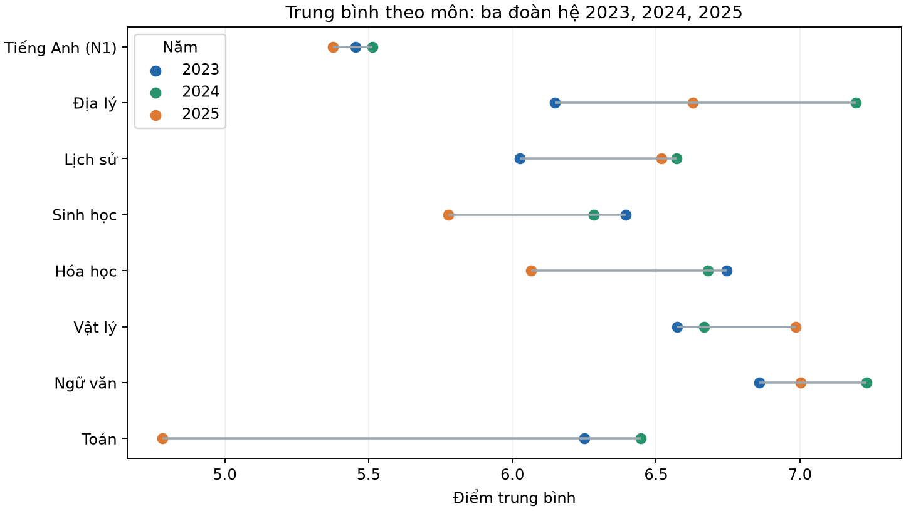

Báo cáo ghi nhận trung bình Toán là 6,251 năm 2023, 6,447 năm 2024 và 4,783 năm 2025. Một thay đổi lớn như vậy cho biết kết quả quan sát khác nhau giữa các kỳ thi; riêng biểu đồ này không cho biết nguyên nhân, cũng không đủ để kết luận năng lực học sinh giảm. Hãy đọc cùng thay đổi đề, chương trình, cơ cấu môn lựa chọn và độ bao phủ nguồn.

**Câu hỏi dẫn sang bước tiếp:** mức thay đổi chung có giống nhau ở các tỉnh không?

## Bước 2 — Xem chênh lệch giữa các tỉnh và môn

Các heatmap dưới đây cho thấy trung bình và tỷ lệ đạt từ 9 điểm trở lên theo tỉnh × môn, mỗi năm một cặp. Chúng giúp tìm nơi cần xem kỹ hơn; nên đọc cả hai chỉ số vì trung bình và đuôi điểm trả lời hai câu hỏi khác nhau.

### Năm 2023

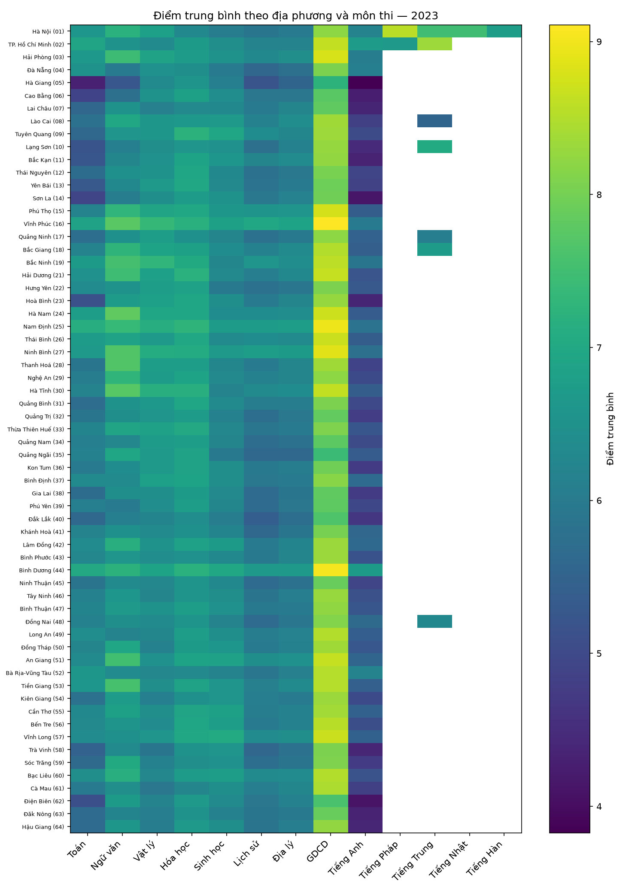

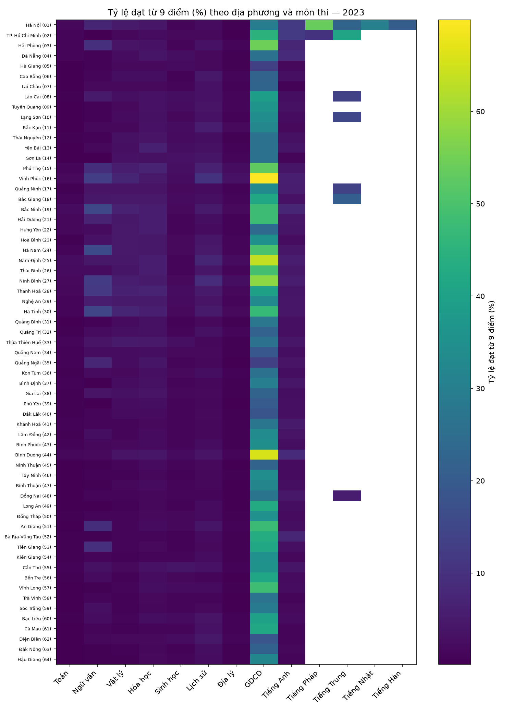

### Năm 2024

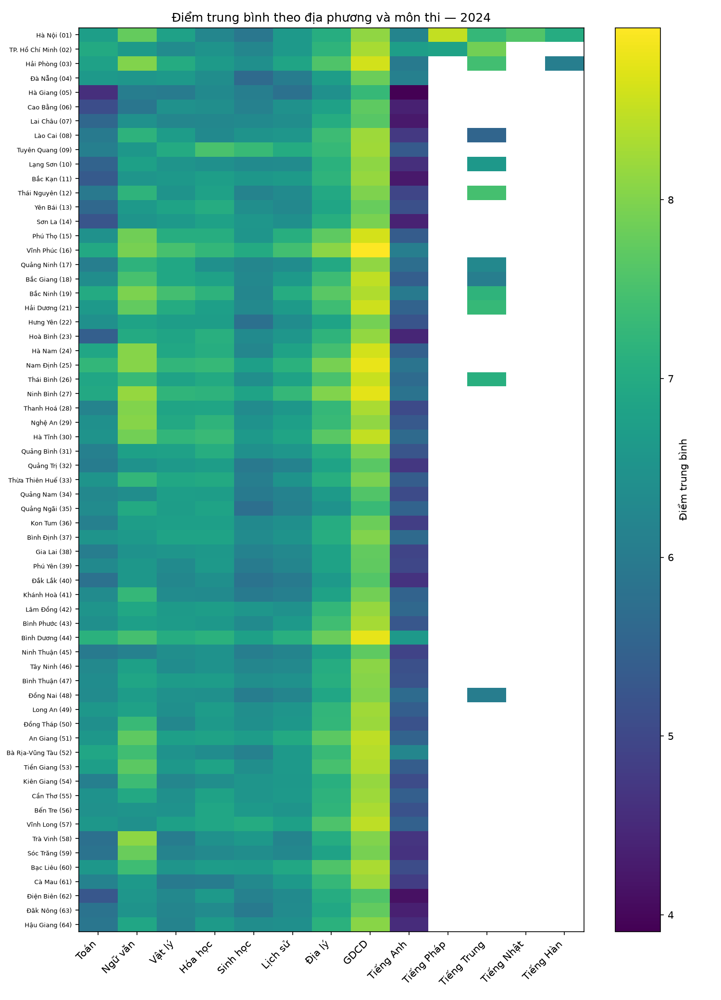

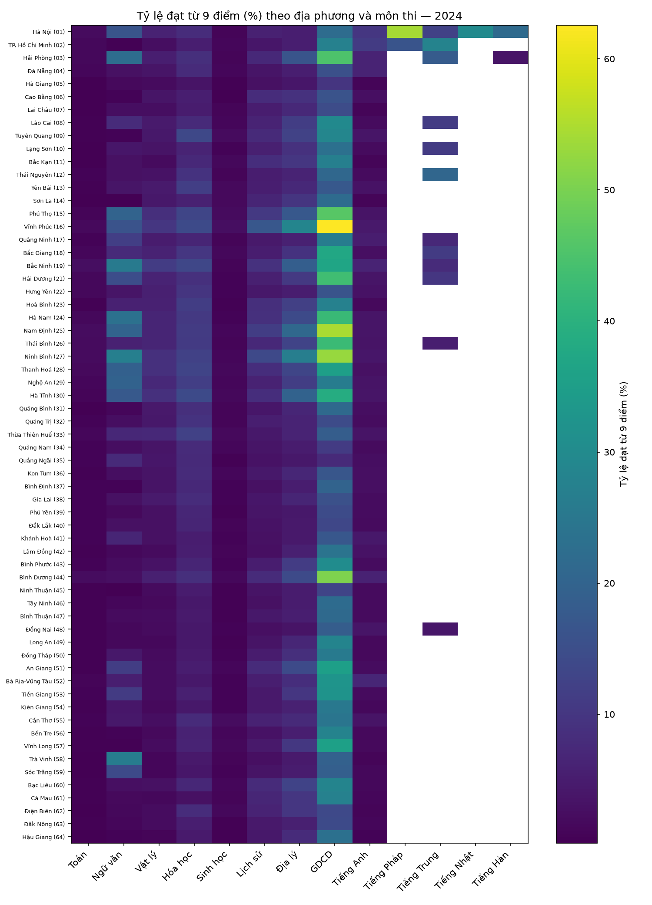

### Năm 2025

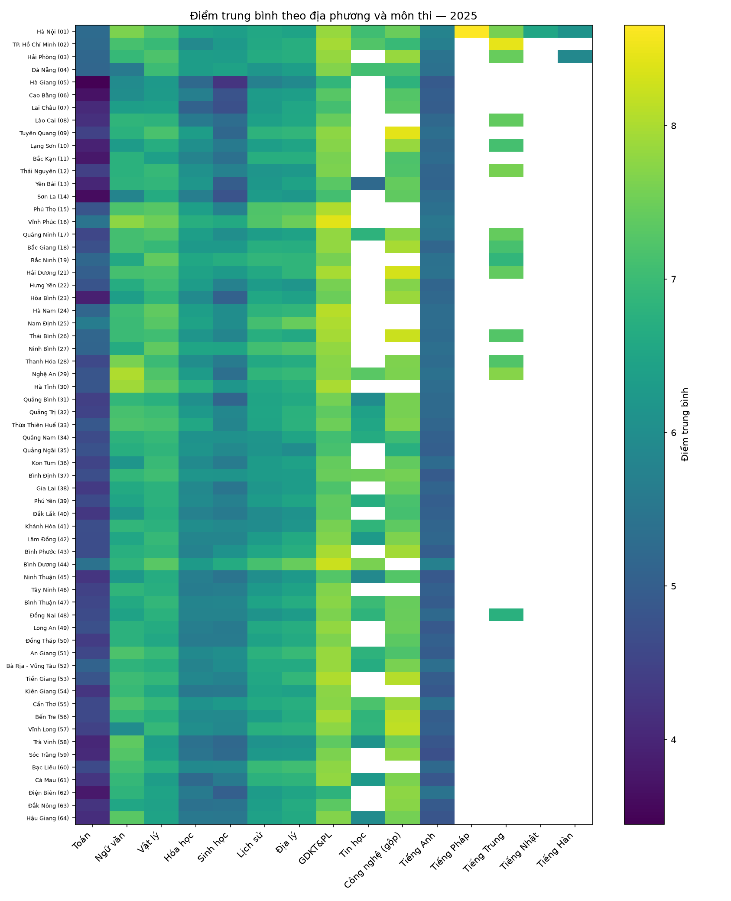

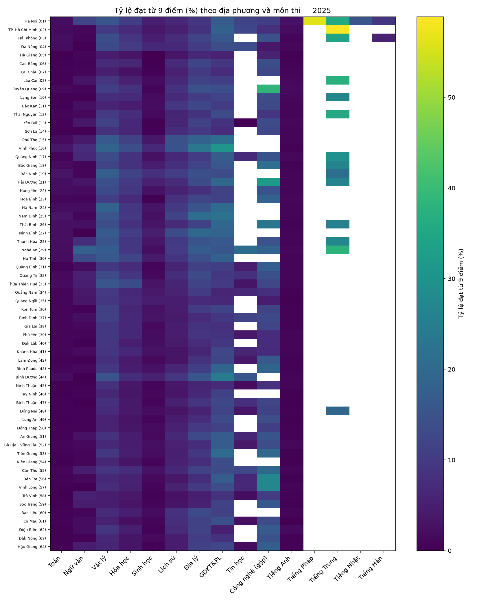

**Cách chuyển thành chỉ báo hỗ trợ:** không chỉ xếp theo điểm trung bình. Trong bảng chi tiết, xem P10/trung vị/P90, IQR, tỷ lệ dưới ngưỡng và cỡ mẫu. Tỉnh–môn nằm ở nhóm thấp qua nhiều năm là nơi hợp lý để đặt câu hỏi về hỗ trợ học tập; các thống kê này không chỉ ra nguyên nhân và không phải đánh giá chất lượng địa phương.

**Câu hỏi dẫn sang bước tiếp:** chênh lệch nằm ở toàn bộ phân phối hay chỉ ở một phần đuôi?

## Bước 3 — Đọc hình dạng phân phối trước khi gắn cờ bất thường

ECDF Ngữ văn đặt phân phối quan sát cạnh đường chuẩn tham chiếu. Đường chuẩn chỉ giúp hình dung độ lệch; điểm thi rời rạc, bị chặn từ 0 đến 10 và không bắt buộc phải có dạng chuông.

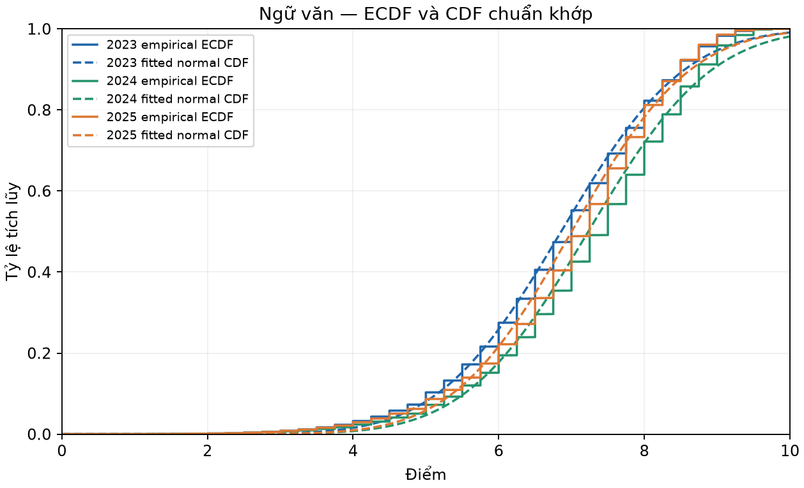

Tỷ lệ đuôi điểm cao và thấp giữa các môn/năm được tổng hợp ở biểu đồ sau:

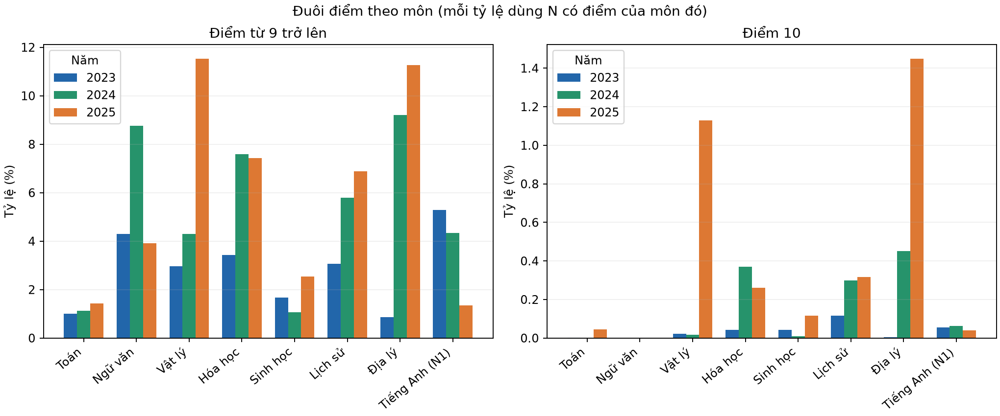

Báo cáo nền còn có các profile tỉnh theo Isolation Forest. Chúng là công cụ xếp hạng điểm khác biệt trên các đặc trưng phân phối, không phải xác suất gian lận.

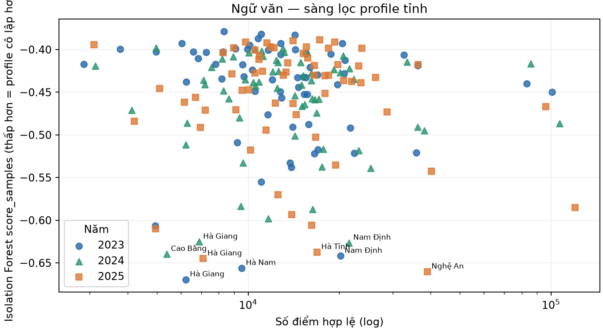

Trong thống kê nền, số người có ít nhất một điểm môn bị gắn cờ ngoại lệ là 43.642 (2023), 49.786 (2024) và 38.640 (2025). Cờ IQR/z-score được tính riêng cho từng tỉnh × môn. Cờ đuôi cao kết hợp cỡ mẫu, số điểm đạt ngưỡng, tỷ lệ so với phần còn lại, mức chênh tuyệt đối và hiệu chỉnh nhiều kiểm định.

Ví dụ Ngữ văn Nghệ An: tỷ lệ đạt từ 9 điểm là 5,62% năm 2023, 19,69% năm 2024 và 17,99% năm 2025. Sau đối chiếu mô tả theo dải điểm Toán, mức chênh so với kỳ vọng ghi trong báo cáo là +1,67, +11,38 và +14,62 điểm phần trăm. Đây là hiệu chỉnh một phần cơ cấu, không kiểm soát mọi khác biệt giữa thí sinh hay kỳ thi.

**Kết luận của bước:** biểu đồ có thể giúp chọn địa phương/môn cần rà soát; không thể dùng phổ điểm tổng hợp để quy kết gian lận. Muốn xác minh cần dữ liệu cấp câu hỏi/mã đề, phòng thi, chấm/phúc khảo và bằng chứng liên quan.

## Bước 4 — Đặt phân phối môn và tổ hợp cạnh nhau để hiểu lựa chọn

Báo cáo nền tính số dự thi/tỷ lệ tham gia, các môn thường đi cùng nhau và đủ 24 tổ hợp từ ba môn thành phần. Trong dữ liệu tổ hợp, B00 có ít nhất 100 thí sinh tại 63 tỉnh năm 2023, 63 tỉnh năm 2024 và 62 tỉnh năm 2025.

Hai biểu đồ Nghệ An minh họa cách chuyển từ phổ điểm môn sang phổ điểm tổ hợp:

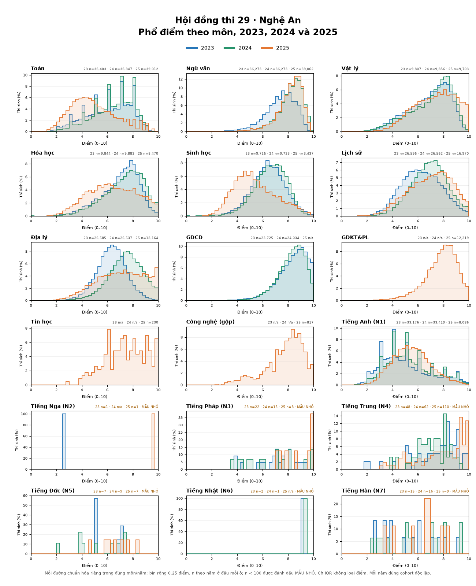

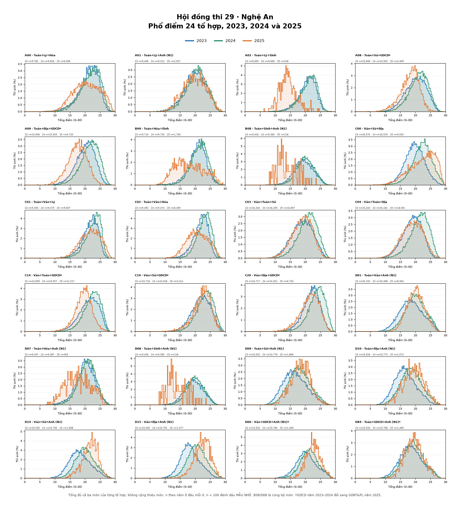

Các hình này so sánh phân phối điểm; chúng không tự thể hiện tỷ lệ thí sinh chọn từng môn. Để lập kế hoạch giáo viên/nguồn lực, hãy dùng bảng số dự thi và tỷ lệ chọn môn bên cạnh hình. Cũng cần đọc riêng GDCD ở 2023–2024 và GDKT&PL ở 2025 vì tên môn và nội dung đánh giá đã thay đổi.

## Bước 5 — Chuyển kết quả thành hành động phù hợp

| Kết quả đọc được | Hành động có thể cân nhắc | Không nên kết luận |
| --- | --- | --- |
| Một số tỉnh × môn có phân vị thấp hoặc tỷ lệ dưới ngưỡng cao kéo dài | Ưu tiên trao đổi về nguồn lực, dạy học và hỗ trợ môn đó; theo dõi lại bằng cùng chỉ số | Tỉnh đó có chất lượng kém vì điểm trung bình thấp |
| Tỷ lệ chọn môn/tổ hợp thay đổi giữa các năm | Cập nhật nhu cầu giáo viên, tài liệu và kế hoạch ôn tập; luôn xem cả số lượng và tỷ lệ | Điểm môn thay đổi chỉ do học sinh giỏi/yếu hơn |
| ECDF, đuôi điểm hoặc profile tỉnh khác biệt rõ | Đưa vào danh sách cần kiểm tra thêm, kết hợp hồ sơ độc lập | Có gian lận dựa trên biểu đồ điểm |
| Có nhu cầu dự báo học sinh cần hỗ trợ | Bổ sung dữ liệu có trước kỳ thi rồi đánh giá mô hình theo năm kế tiếp | Dùng điểm môn khác cùng kỳ như cảnh báo trước thi |

Với dữ liệu hiện tại, chưa nên huấn luyện mô hình dự báo cá nhân trước kỳ thi: các tệp điểm là kết quả cuối kỳ, thiếu biến đầu vào sẵn có trước kỳ thi. Nếu có thêm điểm đánh giá định kỳ/hồ sơ học tập, cần đặt ngưỡng và hành động hỗ trợ trước, dùng chia tập theo thời gian, so sánh với baseline và kiểm tra hiệu năng giữa các tỉnh trước khi áp dụng.

## Giới hạn nguồn và khả năng tái lập

Các số liệu và biểu đồ trên được dẫn từ báo cáo nền. Tại commit nền `codex/statistics-correlation-pca`, tệp `data/raw/diem_thi_thpt_2024.csv` không có trong cây tệp dù báo cáo ghi đường dẫn và SHA-256. Nguồn được nêu là bản công khai ngày 17/07/2024, chưa gồm phúc khảo; báo cáo ghi nhận 1.045.613 điểm Toán, ít hơn 30 so với phổ điểm công bố. Cần bổ sung đúng snapshot nguồn và mã sinh báo cáo để người khác chạy lại toàn bộ kết quả từ đầu.

Xem [báo cáo nền đầy đủ](bao_cao_thpt_2023_2024_2025.md) để tra bảng chi tiết theo tỉnh, môn và tổ hợp.
